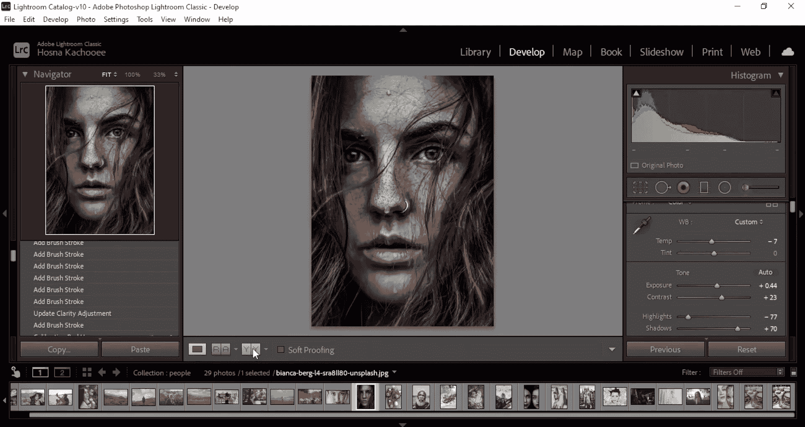

🎬 完整Adobe Lightroom mega课程：第60课：电影感示例

在本节课中，我们将学习如何使用Adobe Lightroom给人像照片营造电影感，并通过光影与色彩的调整来讲述一个完整的故事。电影感不仅仅是滤镜，更是通过色温、色调、明暗和细节的共同作用，让观众在看到照片的一瞬间就能感受到人物的情绪与所处环境。本节课我们将以一张特写人像为例，一步步完成从原片到电影感成片的全过程。

什么是电影感照片

电影感照片是指利用特定的着色和色调来传递故事情节的照片。通过不同的光照、色调和色相，我们可以把一个故事讲给观众听。在Lightroom中，这意味着我们不需要复杂的器材，只需后期调整就能赋予照片叙事性。

核心概念可以用如下公式表示：
`电影感 = 光照 + 色调 + 色相 + 情绪叙事`

本节课我们要处理的这张照片是一位女士的特写，她的脸上有水滴，头发贴在脸颊上，仿佛正处于下雨且有风的天气里。她的眼睛颜色较浅，脸部细节也非常丰富。根据这些视觉元素，我们可以构思出一个悲伤且震惊的情境：大风大雨天，雨刚刚开始落下来。

为了实现这种电影感，我们需要进一步增强图片中的细节，并为照片注入合适的氛围。之前的课程中我们已经学习过，冷色调通常传递悲伤的记忆，而暖色调则传递快乐和珍贵的记忆。既然我们的主体是悲伤的，那么就应该使用冷色调。如果把色温调冷，画面会让人联想到冬天和天色渐暗，观众不会从中感受到温暖，反而觉得女子很悲伤；反之，如果调暖，就会像金色的日落瞬间，让人觉得她可能在开心，或者在怀念某件珍贵的事情。仅仅改变图片的色温，就能产生巨大的视觉差异。色调（Tint）也可以进一步帮助我们达成目标，不同的色调会带来不同的色彩效果，只要把握好平衡，就不会过度。

色温的调整可以用简单的代码逻辑来理解：
`最终色温 = 基础色温 + 冷暖偏移量（小于0表示偏冷，大于0表示偏暖）`

现在我们已经明确了想要表达的氛围和编辑方向，可以开始正式调整图片了。

基础光调整

以下是基础光调整的操作步骤：

- 先使用去雾工具。这个工具是我们的最爱，已经能产生明显效果。它加深了阴影，并把更多注意力引向了脸部细节，比如雀斑和水滴。
- 调整高光。图片中有些高光过亮，我们需要把它们压下来。
- 提高阴影，降低白点，增加对比度和曝光度。因为原图整体偏暗，需要通过曝光滑块把它提亮，同时适当增加对比度。
- 完成基础色调调整后，保留当前设置，因为我们还有很多细节需要通过清晰度来提升。此时照片已经开始呈现出电影感了。

接下来，我们需要加入之前讨论过的冷色调，但不要过度。建议将色温设置为-7，并给品红色调+10，以便更接近我们想要的悲伤氛围。此时照片看起来已经比较冷了，离目标很近了。

后续课程我们会更多地讨论氛围，以及好莱坞电影中常见的调色风格。

色彩与饱和度调整

以下是色彩与饱和度的调整方法：

- 提升自然饱和度和饱和度。因为女士的头发是红色的，我们希望这个颜色能够清晰可见。
- 注意可能会出现剪切情况。可以按下J键查看暗部和亮部的剪切点。虽然无法完全消除，但可以适当增加填充光，再次按下J键检查，效果会更好。还有一些高光需要降低白点，同时降低阴影，这样画面会更均衡。

色调曲线调整

以下是色调曲线的设置思路：

- 制作S型曲线。在阴影、对比度和高光三个位置各添加一个点。
- 如果需要更多阴影细节，可以适当调整，同时降低高光部分。

色调曲线的作用可以用公式概括：
`输出亮度 = 曲线函数(输入亮度)`

在HSL/颜色混合器面板中，我们需要处理照片中已有的颜色，包括红色、橙色、一些蓝色和青色。以下是具体操作：

- 提高红色和橙色的饱和度，因为这些颜色构成了头发和面部的一部分。
- 青色没有出现，不需要处理。
- 提高蓝色的饱和度。
- 进入亮度面板，降低红色和橙色的亮度，此时画面会显得非常细致。
- 提高蓝色的亮度，目的是让眼球看起来更有神采，仿佛在发光。

色彩分级

以下是色彩分级的设置方案：

- 给阴影添加冷色调，因为我们想要营造的是悲伤的画面。悲伤的图片充满情感，是快乐图片无法传递的。
- 中间调部分撤销之前的调整，暂时保持现状即可。

细节与色差修正

以下是细节和色差的处理步骤：

- 放大图片查看细节，等待预览加载。目前的细节已经足够，不需要再额外锐化，否则会过度。
- 修正色差。我们在正确的位置，进入透镜校正面板，处理蓝色通道的色差，已成功去除。

裁剪与构图

以下是裁剪与构图的相关操作：

- 可以考虑把主体更靠近相机，或者反过来，让她离相机更远一些。经过尝试，后者效果更好。
- 启用限制裁剪选项。

关于变形面板，我们不需要进行调整，因为照片本身不对称，也没有参考线可用。由于女子是站在一个角度的，无法使用眉毛作为参考。如果强行旋转画面，会显得很奇怪，并扭曲摄影师原本想表达的氛围，因此我们撤销了变形操作。

渐晕与局部调整

以下是渐晕和局部调整的做法：

- 使用渐晕工具给画面加暗角，目的是把观众的注意力集中在眼睛和面部上。我们已经暗化了边缘，并稍微羽化一下，不需要找回高光，圆度设置即可。
- 不要添加噪点，因为我们不希望细节被噪点混杂。

校准与微调

以下是校准面板的操作内容：

- 进一步给阴影上色，添加了品红色调。
- 处理色相时，最初的色调不对，再试也不太对，于是降低了饱和度。除非她头发本身就是那种姜黄色，否则就减少饱和度。
- 处理蓝色部分，给蓝色不同的色调并提高饱和度，同时降低绿色。经过几次来回调整后，画面看起来更好了。

局部修饰嘴唇

为了进一步表现我们想要的氛围，可以想象女子可能困在岛上，下雨、刮风、天气寒冷。在这种情况下，人的面容会发生变化，嘴唇会因为寒冷、缺水和缺乏能量而变得苍白，甚至有昏厥的感觉。实现这个效果是可选的，取决于你想要表达的具体氛围。

以下是局部修饰嘴唇的步骤：

- 检查画笔范围，确定涂抹区域。
- 使用调整画笔涂抹嘴唇。放大以便看得更清楚。
- 如果第一次涂抹效果不好，可能是因为画笔羽化不足，需要撤销并重新设置一个点，添加足够的羽化，使修饰看起来更自然。
- 涂抹嘴唇的上半部分，可以使用鼠标滚轮缩小画笔尺寸，方便精细操作。
- 取消勾选蒙版以查看前后差异。降低嘴唇的饱和度，同时适当变暗或变亮，避免饱和度过高，适当找回一些颜色。
- 如果遗漏了一些地方，继续用画笔涂抹，完成后点击完成，然后缩小图片查看。

此时嘴唇不再像之前那么红了。还可以做一些进一步的微调，比如关闭这里的色调，因为感觉太重了。图片现在已经完成，不需要进行斑点修复，因为那样会去掉我们想要保留的纹理。

前后对比与最终微调

左右对比可以看出，画面现在冷了很多。虽然我们已经去除了部分蓝色，但仍然有一些蓝色残留，可以进入蓝色通道，稍微给一点黄色色调，并降低饱和度和亮度。如果发现某些区域还有蓝色，可以使用调整画笔在该区域创建一个点，进行局部处理。

我还对着色做了一些进一步调整，因为不喜欢画面偏绿的感觉。回到上面，处理色温标签，让画面比原来更冷。眉毛里有一些蓝色，原图本身就有，可能是化妆的一部分。不过在Photoshop中，我们可以去掉这些蓝色，按照自己的想法来调整。

现在照片呈现出更强烈的电影感，这正是我们追求的目标。

本节课中我们一起学习了如何通过分析照片中的视觉元素来构思电影感氛围，如何调整色温、色调、曝光、对比度、色调曲线、HSL、色彩分级、细节、色差、裁剪、渐晕、校准以及局部画笔等工具，最终打造出一张具有悲伤电影感的人像照片。希望这节课对你有所帮助，我们下节课再见。
