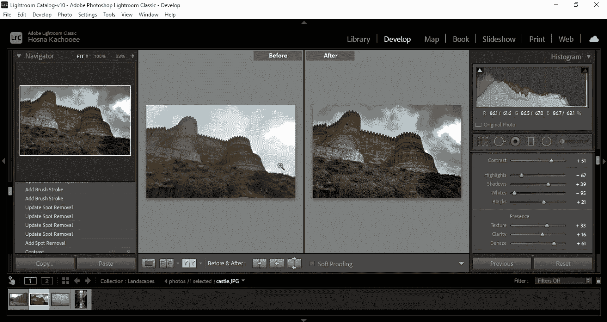

# 完整Adobe Lightroom大课程：第61课：电影风格示例第二部分 🎬

在本节课中我们将要学习如何为风景照片打造电影感3D风格。上一节课我们处理了一张特写人像，赋予了它立体的电影感。本节课我们将把同样的技巧应用到一张风景照片上，画面中有大片草地、广阔天空、云层以及一座古老的城堡。我们会一步步教你如何把一张普通的风景照片变得更有电影感和空间感。

首先我们要做的，就是观察原图并确定主要拍摄对象。打开这张图片后，你会发现城堡在画面中显得非常小，草地和天空占据了大部分面积，城堡只扮演着次要角色。但我们的目标是让城堡成为主角。为了达到这个效果，最直接的方法就是裁剪图片，重新平衡城堡、草地和天空这三个元素的比例，让画面服务于我们的创意构思。

以下是裁剪构图的具体操作步骤：

- 启动裁剪工具。
- 选择固定宽高比，确保各部分比例协调，这里采用 16:10。
- 调整裁剪框，保留更多天空，让城堡显得更近，同时减少草地占比。

裁剪比例 = 16 : 10

裁剪完成后，城堡在画面中的比重明显提升，画面也变得更加紧凑，观众的注意力会自然地被引向城堡本身。

构图整齐之后，我们需要检查画面中是否还有干扰视线的物体。仔细观察你会发现，画面左侧有一盏路灯，它与周围的草地格格不入，显得非常突兀，完全不符合整体氛围。这时候就需要用到点修复工具来把它去掉。操作时可以使用鼠标滚轮调整修复圆圈的大小，也可以在软件面板中直接设置。圆圈要大到刚好能覆盖住路灯，点击一次即可，Lightroom会自动寻找周围相似的区域来填充。处理完成后，那盏路灯就像从来不存在过一样。

此外，画面中还有一棵黄色的灌木，与周围绿色的植被颜色不一致，也不符合整体氛围。我们可以再次使用点修复工具，建立一个适当大小的修复点，注意不要做得太大，否则会让Lightroom产生混乱，导致修复效果不自然。完成后，这两处杂物都被清理掉了。

以下是点修复操作的关键注意事项：

- 修复圆圈大小要合适，过大会导致识别错误。
- 每次只处理一个明显的干扰物。
- 处理完后拉远视图，检查是否还有其他需要清理的地方。

现在画面只剩下城堡、草地和天空这三个核心元素，以及一些用来衬托主体的辅助细节，我们可以开始正式调色了。

进入编辑模式后，通常先从去雾开始，为图像打下良好基础。先对图像进行适当的去雾处理，这样可以让颜色更鲜艳，天空也更有层次感。因为这天本来就是阴天，看起来暴风雨将至，所以城堡和草地稍微暗一些也很符合氛围。我们要营造的是一种史诗感，仿佛城堡里即将发生一场战斗，整体基调要严肃而宏大，让观众一看就知道这不是一张普通的旅游照片。

按下键盘上的 J 键，Lightroom会提示你图像中存在纯白剪裁，也就是高光部分失去了细节。这些是画面中最亮的区域。我们需要稍微降低高光，让剪裁消失，但不必过度处理，因为天空中太阳被云层遮挡，这部分亮度本来就很正常，不在直方图的主要问题范围内，属于合理的亮部表现。

以下是基础面板中需要调整的项目：

- 去雾：提升色彩饱和度和天空定义。
- 对比度：让各个元素更分明，增强立体感。
- 阴影：稍微提亮，增加细节。
- 高光：适当压暗，避免白色剪裁。
- 白色与黑色：微调白色和黑色点，丰富色调范围。

对比度提升 + 阴影提亮 + 高光压暗 = 更强的三维感

然后是存在感面板，去雾已经处理过了，接下来添加清晰度，让图像看起来更锐利。再放大检查效果，确认细节足够。接着添加纹理，纹理作用于图像中原本就有的纹理细节，而清晰度则是把这些纹理更明显地突显出来，两者作用不同，不能混淆。再来看看自然饱和度，原本绿色过于浓重，可以稍微降低，但后续还会在HSL面板中单独处理每种颜色，所以这里先做小幅度调整即可。

基础光影调整完成后，图像的整体对比度和锐度已经有了明显提升，接下来我们可以进一步优化色调曲线。

色调曲线是控制画面明暗与色彩走向的重要工具。进入色调曲线面板，这里有三个通道，包括主颜色通道以及深蓝色、亮绿色、深绿色和带点棕红色的通道。移动这些通道时，主要影响天空和部分草地，尤其是天空。如果我们想让天空更蓝，以增强暴风雨天的史诗感，就可以适当增加蓝色通道的数值。绿色通道也要做小幅度调整，不要过度。红色通道同样要非常谨慎，如果调整过度，就像给图片加了滤镜，会破坏原本的色彩和谐，让画面显得不自然。

以下是色调曲线调整的原则：

- 主通道构建整体明暗对比。
- 各独立通道仅做微调，避免色彩失真。
- 观察天空和草地的变化，保持自然。

接下来在点曲线部分，我们不需要把图像压平，而是拉低白点并拉高黑点，构建经典的 S 曲线。之前阴影调整可能稍微过头了一点，现在把阴影点稍微提高一点。对比度不能调得太强，否则会显得不自然。完成后我们可以回到 HSL 面板，分别处理每种颜色，让色彩更符合电影风格的要求。

色调曲线帮我们建立了整体的明暗骨架，接下来要进入更细致的颜色分离调整。

HSL 面板允许我们分别调节色相、饱和度和亮度，是电影风格调色的核心步骤。首先处理蓝色，在色相选项卡中，我们可以决定蓝色偏向青色还是紫色。这两个方向都不够真实，但个人更喜欢偏青色一点的效果，所以这里选择负 30 的数值。这样得到的颜色更自然，不像科幻电影那么突兀，更符合现实中阴天天空的色调。

接下来处理绿色。画面中有大量绿色，我们需要决定是让它偏黄还是更浓郁。偏黄会显得冷调，尤其是画面中两种不同深浅的绿色，Lightroom会把它们识别为同一种颜色。我们决定让草地偏黄一些，稍后会用调整画笔单独处理这部分绿色的颜色。不过现在先处理这部分绿色，再处理后面的区域，这样逻辑更清晰。这两处绿色饱和度差异很大，因为一个是树叶，一个是草地，需要分别对待，不能一概而论。

然后处理城堡。城堡属于红色系，我们需要决定是偏粉色还是偏黄色。实际上城堡更接近橙色，可以选择面包色或橙黄色调，黄色调更理想，所以就选这个方向。这里没有青色需要处理。然后进入饱和度选项卡，之前提到绿色过于鲜艳，可以在这里尝试修正，不过实际效果并不算糟糕，暂时保持现状，等后续再看整体效果再做决定。

稍后我们会用点修复工具尝试把某个区域的颜色改成另一处的颜色，建立一个点并让Lightroom从这里寻找采样点，这个操作不是每次都会用到，但值得一试，有时候能产生意想不到的效果。先撤销刚才对城堡的调整，因为处理过度了，容易让画面失真。进入亮度选项卡，适当提高城堡的亮度，但幅度要小，barely visible，几乎察觉不到，这样才自然。天空可以调暗一些，但也要控制在最小范围，不要过度，否则会破坏天空的层次。绿色可以选择变暗或变亮，我们决定把绿色调暗，让画面更沉稳。

颜色调整完成后，接下来需要进行色彩分级，因为目前的颜色显得有些苍白，只有天空的颜色比较漂亮。在阴影部分添加暖色调，混合得更均匀，同时调整平衡，降低饱和度，效果会更好。中间调部分也要处理，应该给它一个偏黄而不是偏红的色调，并保持平衡，不要偏向某一种极端颜色。高光部分暂时可以保持不变，或者稍微给一点偏青的颜色，必要时再调整亮度，看整体感觉。

以下是色彩分级的常用搭配建议：

- 阴影：暖色调 + 适当降低饱和度。
- 中间调：偏黄色调，保持平衡。
- 高光：保持原样或微调偏青。
- 全局：可叠加一层冷绿色调，营造严肃氛围。

全局色彩分级 = 叠加滤镜层

你也可以添加全局色彩分级，就像在图像上覆盖一个滤镜。这里给它一个绿色调，正如我们之前讨论的，颜色越冷，图像显得越严肃和忧伤，这正是我们想要表达的氛围。用这张图片来看，我想表达城堡里正在进行一场战斗，有人即将牺牲，整体情绪要沉重。低角度拍摄通常表现出被拍摄对象的主导地位，如果我们是画面中的人物，从低角度拍摄，就会显得非常有压迫感。现在我们就是从低角度拍摄，这凸显了城堡的重要性，再加上背景中的暴风雨，整体氛围更加浓厚。当我们给图像添加冷绿色调时，相比暖色调，会营造出更严肃的视觉效果。如果加上暖色，就不符合暴风雨天的背景了，因为暴风雨通常不是友好的景象，人们在暴风雨中容易受伤，所以更适合冷色调。现在我们已经接近冷色调电影感3D风格的目标了。

色彩分级完成后，画面的情绪基调已经确立，接下来我们可以处理图像的细节与镜头校正。

在细节面板中，我们需要决定图像需要多少锐化以及是否需要降噪。适当增加锐化，保持默认设置即可。因为这是一座古老的城堡，我们要保留墙体上的裂缝和突出的细节，在电影里，古老往往意味着强大，所以就保持原样，不要过度修饰。进入降噪选项卡，这张图片几乎没有噪点。即使放大观察，也只能看到一些微小的颗粒，但如果强行去除，可能会破坏之前的所有调整，所以这部分不太重要，我们只是因为放大太多才看得到，正常观看距离下根本察觉不到。彩色噪点也没有，画面中可见的苔藓和白色小点其实是雨滴，城堡因为雨水显得颜色更深，那些白色的东西就是雨滴。不过放大这么多没人能真正看见雨滴，所以不需要花太多精力处理。

以下是细节面板的处理建议：

- 锐化：适度增加，保留古建筑纹理。
- 亮度噪点：若无明显噪点可跳过。
- 彩色噪点：本图无需处理。

在镜头校正部分，可以根据喜好扭曲图像。如果把数值拉得太远，效果不会很好，反而会让画面变形。为了营造电影感，一个好主意是让图像远离镜头，但拉太远了也不合适，所以要适度控制，找到平衡点。我们也可以尝试鱼眼效果，让画面更靠近镜头，或者调整透视，直到找到最合适的效果，这需要多试几次才能确定。我觉得目前的效果比较满意，就保持这样。接下来看色差，在画面中最鲜艳的地方，也就是这些云彩附近检查，没有发现色差。可以使用导航框在图像中移动查看，仔细检查后确认没有色差，这一步可以跳过，不必浪费时间。

细节和镜头校正处理完毕后，图像的技术质量已经达标，接下来我们可以添加一些创意性的光影效果。

接下来进入效果面板，这里可以添加晕影来集中观众的注意力。我们可以根据需要添加明暗，但如果直接调暗，会把某些区域弄得太黑，所以最好撤销，暂时保持原样。不过如果调整中点，效果会好一些，但会让整体图像变得太暗。所以我们在变换面板之后再使用裁剪后晕影功能，这样控制更精准。在变换方面，目前的角度我很满意，也许可以再微调一下水平线，试着转向另一侧，但效果不理想，于是撤销。也可以处理垂直方向，让角度更低，或者换个角度试试，但实际效果并不好，所以还是撤销变换操作，图像不需要旋转或缩放，这部分就跳过，保持原有构图。

现在进入效果面板，我们可以在这里添加之前想要的晕影效果，相比其他面板，这里控制力度更大，所以我通常更喜欢在这里操作，因为参数更直观。如果想要把某个区域变暗，可以调整中点，避免效果显得奇怪，不要让边缘过黑。同时处理圆度，把羽化度进一步调高，不要把外圆做得太模糊，保持在 50 左右，这样过渡自然。把之前丢失的高光再找回来，不要过度处理，我们选择负 11 这个数值，不再使用增益，保持克制。

晕影效果添加完成后，画面的主次关系更加清晰，接下来是最后的校准与色温调整。

校准面板是调整图像原色的最后一步，能决定电影风格的成败。首先让我困扰的是绿色，直接跳转到绿色原色色相选项卡。我们需要决定绿色偏黄还是偏蓝，是要更冷还是更暖，我们决定坚持冷色调，因为这更符合暴风雨天的氛围。接下来处理饱和度，效果看起来好多了，这也增加了我们之前讨论的冷色调氛围，让画面更有故事感。蓝色部分暂时不用动，保持现状即可。再看看红色，把它调得更红一点，我喜欢这个效果，和后面的天空搭配得很不错，能形成色彩对比。如果觉得红色太重，可以降低饱和度区域，我觉得现在确实太红了，所以降低到负 21，让红色更收敛一些。校准部分完成。

再稍微处理一下去雾，同时增加清晰度，进一步突出细节，让城堡的纹理更明显。在忘记之前，我们其实还没有添加色温，现在调整色温，给它一个暖色，用来平衡画面，不要让它偏青，否则画面会显得过于阴冷。然后再稍微降低图像的暗部，因为我们要营造一种黑暗、严肃、冷色调的氛围，这是一种悲伤和严肃事情发生时的电影风格，也许可以加一点背景故事，让观众产生联想。

以下是色温与最终微调的检查清单：

- 色温：稍微偏暖以平衡冷色调，避免偏青。
- 暗部：适当降低，增强严肃氛围。
- 剪裁检查：按 J 键查看高光和阴影剪裁。

按 J 键检查，发现仍有一些剪裁，降低白色高光。阴影部分可以稍微提亮，把黑点提上来，但要注意不要单独处理高光，再按一次 J 键确认。我还要再稍微降低高光，也许去掉一些对比度，让画面更柔和。看看效果，不需要再增加对比度了，目前的状态已经不错。对比前后效果，未编辑时有剪裁，编辑后看起来很不错，和原来平平无奇的画面完全不同，这是两张完全不同的图片，变化非常大。

整体调色基本完成后，我们还有一个局部区域需要修复。

在结束之前，我想起还有一块区域需要修复，那就是草地中亮度不一致的部分。切换到单视图，进入点修复工具，这里是之前处理过的点，如果需要更改，可以像使用调整画笔一样点击。但我们要新建一个点，画一个大圆，尝试从那个位置采样，让颜色融合进去，但采样位置不对，把圆圈移到别处试试，调整位置和大小，经过几次尝试后，找到了合适的采样点，让那部分草地与周围融为一体。因为那部分原本是亮绿色，看起来比周围更亮，我们可以用调整画笔新建一个点来修正，让颜色更统一。

以下是调整画笔局部修正的操作步骤：

- 使用滚轮调整画笔大小。
- 开启蒙板显示，方便看到涂抹区域。
- 先增加对比度，再降低高光。
- 降低饱和度和清晰度，使其与周围区域一致。

再放大到 33% 查看效果，处理得相当不错，调整到合适大小，关闭导航器，搞定。现在再次查看前后对比，画面完全不同，虽然可能还需要一些微调，比如稍微减少一点清晰度，保持低调，不要过于锐利，现在我很满意了，不再那么明亮和强烈。再看一次前后对比并排放置，我非常满意。这就是打造电影感风格的示例教程，第二部分到这里就结束了。接下来我们会学习不同的风格和更多课程，但今天就到这里，下节课见。

本节课中我们一起学习了如何为风景照片打造电影感3D风格。从裁剪构图、清除杂物，到基础光影调整、色调曲线、HSL颜色与颜色分级，再到细节锐化、镜头校正、晕影效果、校准与最终微调，最后还进行了局部画笔修复。我们把一张原本平淡的城堡风景照片，变成了具有史诗感和空间感的电影画面。希望这些步骤能帮助你掌握Lightroom中电影风格后期的核心思路，下节课见。

