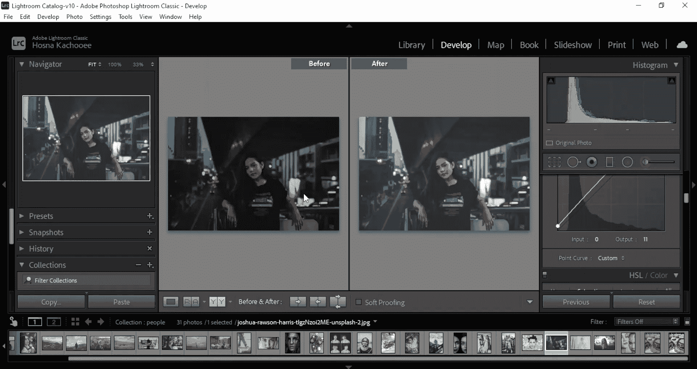

# 📸 完整Adobe Lightroom大课程：第62课：Brandon Woelfel梦幻风格照片编辑实战


在本节课中，我们将学习如何使用Adobe Lightroom来模仿摄影师Brandon Woelfel的标志性编辑风格。他的作品在社交媒体上非常流行，以梦幻、柔和和充满霓虹色彩的视觉效果著称。虽然他本人也出售预设并开设在线课程，但在这一节里，我们会一步步亲手尝试，只在Lightroom中完成基础调色和光影处理，为后续在Photoshop中添加更多细节打下坚实基础。你不需要任何高级技能，跟着步骤走就可以完成。


## 一、了解Brandon Woelfel编辑风格的核心特征


在开始具体操作之前，我们需要先弄清楚这种风格到底有什么特别之处。Brandon Woelfel的照片有一些共同的视觉元素，这些元素让他的作品一眼就能被认出，也正是很多社交媒体用户想要复刻的目标。如果你仔细观察他的作品集，会发现这些特征几乎在每一张图片里都出现过。


以下是这种风格的主要特点：

- 背景虚化（Bokeh），让主体更加突出
- 霓虹色彩，营造幻想感
- 画面反光，增加梦幻氛围
- 柔和的整体色调，呈现出一种梦幻的情绪

这些特点合在一起，创造出一种既梦幻又带有幻想色彩的情绪。当你自己想要表现这种氛围时，了解这些特征就非常有帮助。他的风格相当独特，很多人都在尝试复刻它，他自己也出售Lightroom预设和在线课程，方便想要直接向大师学习的用户。


## 二、在Lightroom中完成基础光影调整


了解了风格特征之后，我们可以打开Lightroom，开始对示例照片进行基础调整。这张示例照片本身已经具备了一些背景虚化的元素，非常适合用来练习这种风格。通常情况下，在Lightroom编辑完成之后，还需要在Photoshop中进行最后的收尾工作，比如添加更多的背景虚化。不过如果原图里已经有足够的背景虚化和反光，这一步就可以省略。在我们的例子中，背景虚化不多，稍后可以在Photoshop中补上，但今天的重点是只用Lightroom来完成大部分工作。


下面是具体的调整步骤，请按顺序操作：

**第一步：使用色调曲线压平画面**
首先，观察Brandon Woelfel的作品，你会发现阴影部分非常明亮，几乎没有深色区域，整张图片看起来比较扁平，没有强烈的对比度。为了达到这个效果，我们要先处理色调曲线。

```
色调曲线调整：
阴影滑块向上提升 → 画面变扁平 → 暗部变亮
```

把色调曲线的滑块往上拉一点，这样图片就被压平了，阴影也变亮了。接下来还要处理高光部分，适当提高高光，让明暗过渡更柔和。这一步做完，亮部和暗部都被提亮了，为后面的调色做好准备。


**第二步：调整白平衡与色调**
色调曲线调整完毕后，进入基础面板，先处理白平衡。Brandon Woelfel的照片通常偏冷色调，会带有一些冷粉色、青色或蓝色的感觉，而不是暖黄色。所以我们要让画面整体变冷一点。先暂时设定一个数值，后面还可以再微调。

另外，他的照片里通常含有较多的粉色或品红色调。我们也要加一点色调（Tint）向品红方向偏移。开始时不要加太多，先放慢速度，后面有机会再回来细调这些参数。


**第三步：在基础面板中处理光影参数**
白平衡和色调设置好之后，继续在基础面板里调整光影参数。首先把对比度稍微降低，比如设为负26左右，让画面更扁平。然后继续提亮阴影部分，建议先设在54左右，如果觉得调得太多了再调回来。最后稍微提高一下白色部分，这样基础的光影调整就完成了。


到这里为止，我们已经压平了画面，设置了合适的白平衡，也处理了阴影和高光。虽然现在的变化看起来不算很大，但这些基础步骤对后面的调色非常重要，绝对不能跳过。


我们可以对比一下调整前后的效果：

- 调整前：阴影较暗，对比度较强，色温偏暖
- 调整后：阴影变亮，画面更扁平，色调偏冷


## 三、颜色调整与HSL面板


光影部分暂时告一段落，接下来我们要处理照片的颜色，这也是Brandon Woelfel风格最核心的地方。他的照片以独特的色彩搭配闻名，所以色彩调整是重中之重。我们要先把所有颜色通道都显示出来，然后逐个调整，不要跳过任何一步。


以下是各个颜色通道的调整建议：

- 红色：稍微向右移动，让红色看起来更粉一点，但不要过度，避免影响人物肤色
- 橙色：向红色方向偏移，比如负10左右
- 绿色：尝试给它一点青绿（Teal）感觉，虽然原图里绿色不多
- 青色：暂时保持为0，因为原图里几乎没有青色
- 蓝色：朝青绿方向调整，比如负30，让蓝色建筑部分更有质感
- 紫色：向左移动，调整紫色色相
- 品红：原图里没有明显的品红，保持默认

调整完色相之后，可能会发现人物的脸部变得太粉或者颜色太鲜艳了。这时候我们要把部分红色调回来，让肤色看起来更自然。这时候颜色就有了一个不错的起点，可以继续往下走。

接下来处理饱和度，调节颜色的浓淡程度。蓝色饱和度之前调得太强了，会抢走主体的注意力，所以要适当降低。红色也同样太强，需要降低一点。就这样，颜色的强度就控制住了，不会喧宾夺主。

然后处理亮度（Luminance），也就是颜色的明暗程度。我们要提高红色和橙色的亮度，让整体更加平衡。蓝色部分也可以稍微提亮一点。如果之前去掉的饱和度觉得太少了，可以加回来一点，让画面更接近目标风格。


## 四、校准面板与最终光影微调


颜色调整得差不多了，接下来进入校准面板，进一步优化原色，然后再回去微调光影。校准面板能让我们从最底层的原色入手，对整体色调进行更精准的掌控。


在校准面板中，我们需要调整以下原色参数：

```
校准原色：
蓝色原色 → 调整为青绿（Teal）色调
红色原色 → 偏移到橙色方向，例如 +19
饱和度 → 稍微减小
```

因为照片里有很多蓝色和红色，使用原色调整能更容易实现我们想要的青绿色调。这时候画面看起来已经不错了。把红色原色更多地偏移到橙色一边，比如设为19左右。饱和度方面稍微减小一点即可，不要过度处理。

颜色部分完成后，我们要回到光调节部分，也就是色调曲线和基础面板，再次根据自己的喜好微调光影。可能需要再调整一下高光，减少一点对比度，继续压平画面。黑色部分也可以稍微降低一点。曝光方面，如果照片有点欠曝，就适当提高。不断调整对比度，直到你对外观满意为止，这个过程需要一点耐心。


## 五、Lightroom与Photoshop的配合使用


Lightroom里的主要调整已经完成，这时候我们来看看完整的效果，以及后续还可以做什么。通常情况下，编辑者会把照片从Lightroom导出到Photoshop，添加更多的背景虚化、光效叠加或特殊样式。在示例图片里，你会注意到某些部分的虚化效果比其他部分更强，那些其实是后期在Photoshop中添加的额外叠加文件。

你可以搜索“虚化叠加层”或者“光泄露叠加”来找到类似素材。我在这里展示这些，只是让你知道原理是怎样的，以及为什么未完成的图片看起来光效不够。因为最终效果的另一半其实是在Photoshop里完成的。但就Lightroom而言，我们已经能处理好色彩和光影，为Photoshop的二次创作打下坚实的基础，这已经足够应付大多数场景了。


## 六、关于预设的简要介绍


如果你不想手动完成上述所有步骤，还有一种更简单的方法，那就是使用预设。很多拥有独特风格的摄影师，就像Brandon Woelfel一样，都会出售他们自己的预设。我们会在后面的课程中详细讲解预设，这里先简单说明一下。

简单来说，当你从创作者那里购买预设并下载文件后，这个预设就会出现在Lightroom的预设面板里。这里是我的历史面板，我可以把它关掉，不过预设还是会出现在预设面板中。你只需要打开预设面板，找到下载的预设，点击一下就能直接套用，不需要手动调整每一个滑块。


使用预设的流程如下：

1. 从创作者处购买并下载预设文件
2. 在Lightroom中导入该预设文件
3. 在预设面板中找到并点击应用

相比于手动一步步调整，用预设会简单得多。但通过今天的课程，我们学到了很多关于颜色如何呈现特定风格、如何让图片变扁平、以及如何把一张深夜拍摄的照片变得更有趣。通常来说，经过这种风格化处理的照片，比原始照片更容易吸引观众和粉丝的注意力。所以你确实想跟上潮流，尝试让你的图片看起来适合某个平台，比如说Instagram。现在这个效果看起来非常适合在Instagram上分享，我们可以把它发布到网上，肯定会得到不错的反馈。


## 课程总结




本节课中，我们一起学习了如何用Adobe Lightroom模仿Brandon Woelfel的梦幻风格照片编辑。我们了解了该风格的核心特征，包括背景虚化、霓虹色彩、画面反光和柔和氛围。在实际操作中，我们使用色调曲线压平画面，调整冷色调的白平衡，处理HSL中的颜色色相与饱和度，利用校准面板优化原色，并反复微调光影参数。虽然Lightroom无法完全复制Photoshop中的所有虚化效果，但我们已经为后续的后期工作打好了基础。如果你不想手动调整，也可以直接购买摄影师的预设一键套用。希望这节课能帮助你制作出适合社交媒体分享的吸引眼球的照片。

