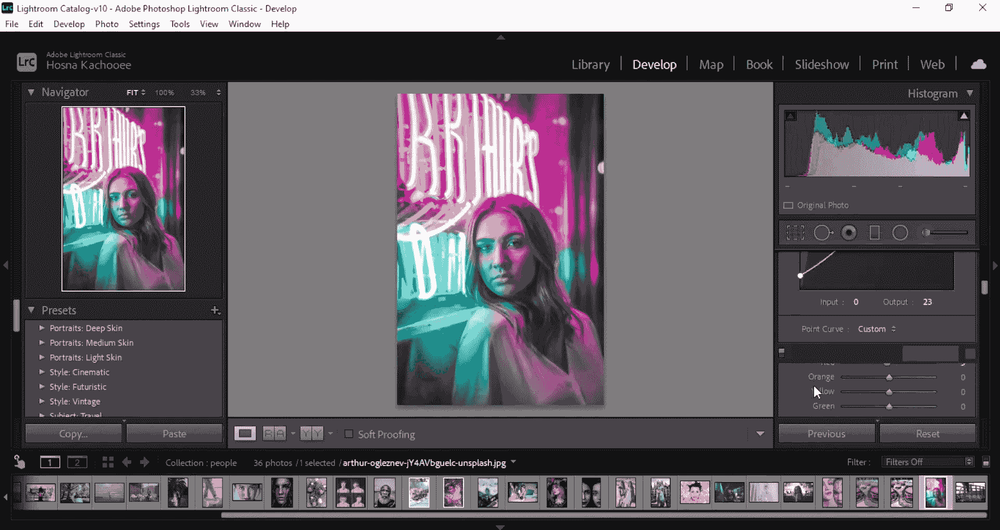

📸 完整Adobe Lightroom大课程：063：Brandon Woelfel霓虹风格照片编辑

在本节课中，我们将一起学习如何在Adobe Lightroom中打造Brandon Woelfel那种标志性的霓虹灯风格照片。这张示例图片背景有一块发光的霓虹招牌，画面中阴影很多，人物主体在光线中显得有些模糊。我们的目标是通过调整光影、颜色和色调，让这张照片呈现出那种典型的粉红色与青色交织的未来感视觉效果。下面我们就从分析原图开始，一步步把画面调出来。

首先我们来看另一个使用Brandon Woelfel风格的例子。这张图片里有一个霓虹灯招牌，颜色非常适合这种风格，招牌就在人物身后。画面中有大量阴影，同时也有清晰的人物主体。这正是一个理想的练习示例，而且此时直方图已经在发出疑问。直方图似乎在问：为什么图片这么暗？为什么又这么亮？但实际上，直方图并不明白，这种明暗对比正是我们要追求的效果。

`直方图疑问 = 画面过暗 + 局部过亮`

上一节我们分析了原图的明暗特点，知道了这张照片需要大幅度改造光影。本节中，我们先从最基础的光影滑块开始调整。

我们先从阴影开始调整，就像在之前的课程中做的那样。这里要走一条反直觉的路线，即把阴影调亮。原因非常简单：在之前的示例中，我们可以看到Brandon Woelfel风格的照片几乎没有明显的阴影，画面整体都被亮光覆盖。接下来我们降低对比度。对比度降低后，画面中的深影部分就消失了，对比前后效果可以明显看出阴影已经不见了。然后我们继续调整白点。实际上，我们要先从高光开始。把高光数值调低，同时也把白点数值调低。接着把黑点数值调高。此时，图片看起来几乎像一个电子游戏画面。接下来进入“存在感”板块来处理图像的质感。纹理数值设为-12似乎是一个不错的位置，不过我们还是保持在-5，因为-12实在太过了。至于自然饱和度，我们会保持鲜艳，但暂时不去动饱和度滑块。目前的颜色效果看起来不错，等我们把具体的颜色调整完之后，还会再回来修整这些数值。

```
Shadows: 提高（阴影变亮）
Contrast: 降低（去除深影）
Highlights: 降低（高光变暗）
Whites: 降低（白点变暗）
Blacks: 提高（黑点变亮，产生哑光质感）
Texture: -5（降低纹理，避免过度锐化）
Vibrance: 保持鲜艳
Saturation: 暂不调整
```

`哑光质感 = 阴影提高 + 黑点提高 + 纹理降低`

光影部分的初步调整已经完成，图片整体变得柔和且略带游戏画面感。接下来我们需要处理具体的颜色，因为Brandon Woelfel风格的核心在于粉色和霓虹色。

暂时跳过色调曲线，等每种颜色都调整完之后再回来处理。回顾之前的课程，这种风格追求的是粉色和非常霓虹的颜色。因此我们需要先看看画面里都有哪些颜色。这里有一些红色，也有一些蓝色。我们先从这两个颜色开始。对于红色，我们要把色相往粉色方向移动。饱和度和亮度稍后再处理。接着处理蓝色，我们希望把蓝色变得更偏青色。同时，我也要增加橙色，因为人物的脸部在光线中有点看不清楚了。实际上，背景中还有一些紫色。我们可以把紫色增加一些，并把它变成更亮的颜色。再看红色，我把红色色相调到-27。然后进入饱和度板块，红色饱和度设为-5，蓝色的饱和度暂时可以。回到亮度板块，刚才应该把某些颜色调暗，不过我们还是选择更亮的颜色。至于洋红，保持在+35。蓝色不需要做其他调整，蓝色的亮度已经足够，保持现状即可。

以下是HSL颜色调整的具体数值和操作逻辑。

- 红色色相：-27（向粉色偏移）
- 红色饱和度：-5
- 蓝色色相：向青色偏移
- 橙色：增加（提亮脸部）
- 紫色：增加并变亮（背景紫色）
- 洋红：+35
- 蓝色亮度：保持原样，已经足够亮

`粉色调色 = 红色色相降低 + 洋红增加`
`霓虹蓝 = 蓝色色相偏青`

颜色的大方向已经确定，红色变成了粉色，蓝色变成了青色。接下来我们要通过色调曲线进一步塑造画面的整体明暗层次。

现在进入色调曲线。可能之后还需要回来修改颜色，但我先想看看怎样才能达到这个颜色范围。我要把阴影点提高，给图片带来那种哑光效果。然后在暗部再增加一个点并稍微降低。接着看看高光部分，高光点越高，颜色就越亮。刚才调得太过了，我们把它调下来，大约到这里，这样就比较合适了。最后还有一个中间调的点，我们要把它稍微提高一些。好了，就这样。

```
Tone Curve:
  阴影点：提高（产生哑光效果）
  暗部点：略微降低
  高光点：适度提高（颜色变亮）
  中间调点：提高
```

`哑光曲线 = 阴影抬升 + 中间调抬升`

色调曲线已经塑造出了柔和的整体基调。接下来我们要微调色温、色调，并再次降低对比度，让画面更符合霓虹风格。

现在可以添加色温，我选择更冷的色温，先看看效果如何。我也可以添加色调，同样我们希望画面中粉色多于绿色，所以保持在粉色一侧。回到基础面板，再次降低对比度。把白点稍微提高，+5应该就可以了。然后看看整体效果，同时也稍微增加一下清晰度，我想保留画面中的细节。我再把清晰度调高一些，让图片更具哑光质感，感觉还需要再做一点微调。

```
Temperature: 偏冷
Tint: 偏粉色
Contrast: 降低
Whites: +5
Clarity: 提高（保留细节，增强哑光感）
```

`霓虹氛围 = 冷色温 + 粉色色调 + 低对比度`

基础面板的微调已经完成，画面整体更冷、更粉、更柔和。接下来我们再回到HSL面板，仔细检查一下红色和蓝色是否还需要调整。

回到HSL面板，我觉得目前的颜色还不是我们想要的效果，稍微有点过分了。看看能不能再往粉色方向靠，虽然可以做，但可能会过度。也许我们可以通过亮度滑块来稍微提亮一下。就是这样，人物的脸部现在看起来清晰了一些。对于蓝色，我也尝试同样的方法。实际上，蓝色设为-3，负3是比较合适的。现在人物的脸部看起来有点斑驳，我们可以用调整工具来修复。另外，头发里也有些颜色，可能是灯光效果，也可能是染发了，我们暂时无法确定。

面部和头发的颜色已经初步处理，接下来我们要进入色彩分级，给阴影、中间调和高光分别添加色调。

进入色彩分级面板。像往常一样，我们先从阴影开始。在这里我们要处理青色和粉色。如果选择青色，就能得到我们想要的颜色；如果使用粉色，效果会完全不同。目前我们更需要青色而不是粉色，所以就保持这里不动。接下来看看中间调，是否要给它一种青色的外观。是的，就这样。然后是高光部分，我们不去处理高光，因为那是人物脸部的发光文字。接着到全局选项，给整张图片加上一个全局色调，我觉得青色就很好。我再回到这里，刚才忘了调整一些细微的数值。需要稍微提高亮度，再把饱和度降低一点。回到中间调，稍微增加洋红并降低，实际上是降低亮度，再处理饱和度。至于高光部分，就保持原样即可。如果需要的话可以调整亮度，不过因为那是霓虹灯招牌，我们只需要把亮度提高就行了。

以下是色彩分级的分区调整思路。

- 阴影：青色（主要色调）
- 中间调：青色
- 高光：不调整（保留脸部发光文字）
- 全局：青色

`色彩分级 = 阴影青色 + 中间调青色 + 全局青色`

色彩分级已经完成，画面整体笼统了一层青色。接下来我们处理细节、噪点和色差，再进行裁剪后暗角和校准调整。

让我们尝试把所有做过的调整融合在一起，达到平衡。我觉得这样就可以了。关于细节部分，我们不需要额外增加细节，因为原图本身已经足够锐利。我们只需要去掉一些噪点。另外，我们还要把人物从镜头前稍微拉远一些。看看效果如何。接下来我要检查一下是否存在色差，或者只是因为她染了头发之类的原因，我看不到任何变化。所以我们只能假设她确实染发了，因为看起来就是这样。撤销刚才的操作，我们不需要做变形调整。

```
Detail: 不增加额外细节（原图已足够锐利）
Noise: 降低噪点
Chromatic Aberration: 检查后无明显色差（疑似染发）
Transform: 不需要
```

`图像清晰度 = 原图锐度 + 降噪处理`

细节和色差处理完毕，接下来我们要添加裁剪后暗角，并进入校准面板进行最终的颜色校正。

对于裁剪后暗角，我们选择颜色优先模式。把四个角变暗，同时把高光拉回来。好了，现在我们到了校准面板，这里可以进一步调整颜色。我们是否需要更粉一点？向左移动会更粉，向右移动会更橙。我们想要粉色，不过这样就太粉了，保持在大约-49的位置。接下来是蓝色，我们要让蓝色稍微偏青一点。因为颜色实在太鲜艳了，正在覆盖人物的脸部。不过当你站在如此明亮的霓虹灯招牌旁边时，这也是正常的。让我们撤销刚才的操作，回到HSL面板，把之前做的亮度调整去掉。我觉得这样处理得比较合适。

以下是校准面板的原色调整参数。

- 红色原色：-49（向粉色偏移，但不过度）
- 蓝色原色：偏青色
- 原因：靠近亮灯招牌时，颜色过于鲜艳是正常现象

`校准粉色 = 红色原色向左移动（约-49）`

校准面板的调整已经完成，颜色的整体方向更加明确。接下来我们要回到HSL面板，对蓝色的亮度和饱和度做最终修正，并使用局部遮罩工具进一步优化画面。



回到这里，蓝色我们还没有动过，实际上应该把蓝色调暗，紫色区域也一样。好了，那我们还能做什么呢？我打算去掉蓝色的饱和度，感觉我们之前处理得有点过了，调到负值。虽然之前并没有过度处理，但就是这样的效果。接下来用局部调整部分，我会用这把刷子来选定颜色范围，只针对蓝色和紫色区域。明白了，降低，再降低，让青色看起来不那么强烈。

以下是最终的蓝色与局部调整步骤。

- 蓝色亮度：调暗
- 蓝色饱和度：降至负值
- 紫色区域：同步调暗
- 局部遮罩：用画笔选定蓝色和紫色，降低其强度

`局部降低青色强度 = 画笔遮罩 + 蓝色/紫色饱和度降低`

局部遮罩调整完成，画面中的青色不再过于刺眼。接下来我们再次检查白点和黑点，然后查看最终的前后对比效果。

好了，让我们进一步检查一下图片。我们不需要任何纹理效果，我想我们差不多完成了。让我再仔细处理一下白点和黑点。好了，我们现在得到了一张霓虹风格的图片，主要颜色是粉色和青色。同样，如果你想让照片完全像他那样，就需要把Lightroom里完成的作品导入Photoshop，添加一些光泄漏效果或其他额外元素，才能营造出他那种编辑风格。但这是我们在Lightroom里能做到的极限了。让我们看看前后对比，颜色范围完全不同了。这看起来非常疯狂，但那正是这种风格的特点。如果我们想要，也可以适当降低这种疯狂感。并排看一下，一边看起来更具未来感，另一边则更自然。所以同样，我们无法完全在Lightroom里完成这张图片，你最终还需要在Photoshop里继续处理。但如果你能做出类似的图片，那你就已经做得很好了。本节课就到这里，下节课见。


在本节课中，我们一起学习了如何在Adobe Lightroom中模仿Brandon Woelfel的霓虹灯风格编辑。我们分析了原图的明暗特点，依次调整了阴影、对比度、高光、白点和黑点，通过色调曲线营造了哑光质感，并用HSL、色彩分级与校准面板确立了粉色与青色的主色调。最后，我们还使用了局部遮罩工具优化了画面中的蓝色和紫色区域。不过，要完全还原那种风格，仍然需要把作品带入Photoshop添加光泄漏等元素。如果你能做出类似的图像，就说明已经掌握了本节课的核心技巧。

