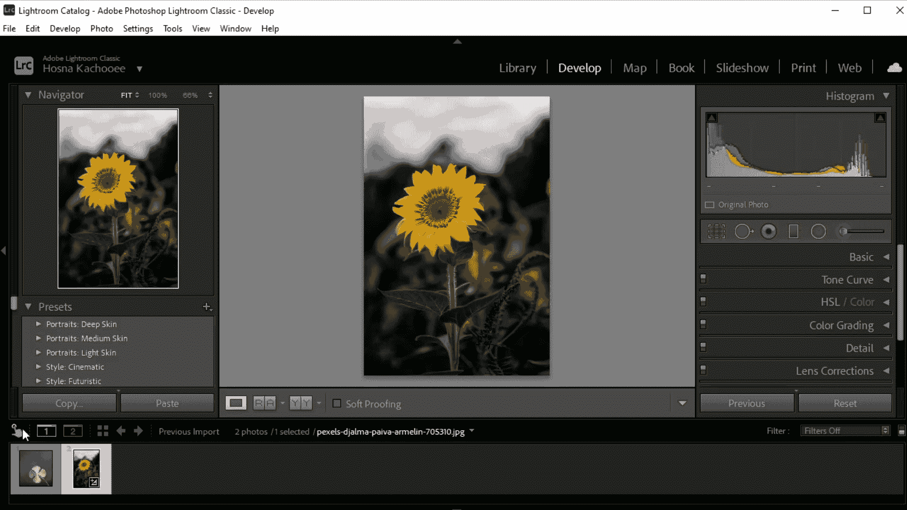

Adobe Lightroom 零基础到专家照片编辑全套课程：p66 第161课：微距摄影后期编辑 🌻


在本节课中我们将要学习微距摄影在 Lightroom 中的后期编辑方法。微距摄影听起来很专业，其实它的核心逻辑非常直白，就是把拍摄对象的细节放大展现，同时让周围杂乱的环境退居二线。我们将以一张向日葵照片为例，从最基础的曝光调整开始，逐步进入对比度、高光、阴影，再到色调曲线和 HSL 颜色面板，最后使用径向滤镜进一步把主体从背景中分离出来。无论你拍摄的是花朵、树叶上的水滴，还是其他微距主题，这节课讲的思路都可以直接套用，帮你把平淡的微距照片编辑得更有重点。


## 1. 认识微距摄影的核心目的 📸

在动手调整参数之前，我们先来搞清楚微距摄影到底要追求什么效果，这样后面的编辑方向才不会跑偏。

微距摄影的定义，用大白话来说，就是画面里只有一个主体处于清晰对焦状态，而其他部分都会模糊或者变暗。拍微距照片的整个目的，就是把主体身上的细节表现出来，让观众一眼就能看到花瓣上的纹理或者叶片上的水滴。在这个向日葵的例子里，我们要突出的是花朵本身，而不是周围的绿色背景。另一张示例照片则专注于树叶上的水滴，连叶柄和背景都不需要，只保留叶片和水滴即可。当你着手在 Lightroom 里编辑微距照片时，你的头号目标应该是尽可能多地保留主体细节，同时把周围不需要的细节去掉，把背景变暗，压进阴影区域，达到隔离主体的效果。

微距摄影 = 主体清晰细节 + 背景区域弱化


## 2. 基础面板：曝光与对比度初步调整 🎛️

搞定概念之后，我们进入 Lightroom 的基础面板，开始对这张向日葵照片进行第一轮调整。

首先打开基础面板，这里面包含温度、色调、曝光等基础参数。我们先看温度和色调，但先不急着动，先处理最明显的问题。在这张照片里，向日葵的花瓣部分出现了过曝情况，也就是说那些花瓣太亮了，导致原本漂亮的黄色看不清楚。我们知道向日葵应该有非常美丽的黄色，但现在因为过曝，颜色发白，不够鲜艳。解决办法很简单，把曝光滑块往左拉，降低整体曝光。调整之后你会发现，照片瞬间好看了很多，对比之前和之后，仅仅靠降低曝光就带来了巨大的变化。

以下是基础曝光调整的关键操作：
- 降低曝光滑块，修复花瓣过曝
- 观察前后对比，确认黄色重新显现

接下来我们要实现主体与背景的隔离，这就需要在花瓣和背景之间制造对比度。在基础面板里，把对比度滑块往右拖，增加对比度。你可以观察一下之前和之后的效果，增加对比度后照片看起来舒服多了。不过要注意，有时候把对比度调得太高，颜色会被过度饱和，显得太浓烈。如果你的图片出现这种情况，不用担心，往下滚动就能看到饱和度滑块，把绿色或其他过于强烈的颜色稍微降低一下就行。在这张图里绿色还好，不过你自己的照片可能需要处理。我们暂时先撤销刚才的操作，把对比度调回大概 65 左右，不要调到 100 那么高。


## 3. 高光、阴影与白黑点处理 ⚖️

完成曝光和对比度的初步调整后，我们继续深入基础面板的色调部分，处理照片里的亮部和暗部。

在处理完基础的色调之后，我们来看高光、阴影、白色和黑色这四个滑块，它们分别控制图像中最亮和最暗的部分。再次查看向日葵的花瓣，你会发现颜色依然没有完全显现出来，整体还是过度曝光。天空部分也有同样的问题。花瓣和天空的共同点在于，它们都属于图像中的高光区域。因此，把高光滑块向左拖拉，降低高光值。这样做之后，天空的亮度降低了，但这没关系，因为在这张微距照片里，我们不希望天空抢走向日葵的注意力。如果这是一张风景照，天空、花朵和人物都需要入镜，那天空的颜色就很重要，我们会想要保留它。但在这里，我们要去掉任何会分散注意力的东西，让向日葵成为绝对的主角。

天空处理完之后，照片里还有一些过亮的白色部分需要处理。把白色滑块往左拉，去除天空和花瓣上残留的过曝。调整完这些之后，你会发现向日葵连同它的茎和叶子，开始和周围环境融合在一起，因为周围全是绿色，而且还有些黄色杂色。为了让主体脱颖而出，我们需要处理图像中属于暗部的区域，也就是阴影和黑色。把阴影滑块向左拖拉，把黑色滑块也向左调低，直到你满意为止。阴影建议调到大概 46 左右，黑色可以设为负 28。调完之后，向日葵就开始在画面中脱颖而出了。

以下是色调调整的参考数值：
```
高光：向左降低
阴影：46
黑色：-28
白色：向左降低
```


## 4. 存在感面板：纹理、清晰度与去雾 🔍

色调部分调整得差不多了，接下来我们处理存在感面板，让主体的细节更加扎实。

存在感面板包含纹理、清晰度和去雾等选项，这些工具的作用是增强主体在画面中的存在感。我通常会先增加去雾数值，这样能在花瓣和周围区域之间制造更多的对比度，这正是我们想要的效果。同时我也会加一点清晰度，给叶片带来更多细节，不过纹理这一项我们暂时先不动，以后可以在其他面板里再优化。

接下来处理颜色。我会先提高自然饱和度，把向日葵本该有的鲜艳黄色找回来。因为我们刚才把画面整体变暗了，难免会损失一些颜色，稍后会用自然饱和度、饱和度以及 HSL 颜色面板来补回来。饱和度我只稍微降低一点点，不想在这里花太多时间调颜色，因为我们的目标是分离颜色，那部分工作会留到 HSL 面板里去做，在那里我们可以分别处理每种颜色的色相、饱和度和亮度。


## 5. 色温与基础面板收尾 🌡️

在离开基础面板之前，还有一个容易被遗忘的参数需要处理，就是色温。

在结束基础面板的编辑之前，我们先把色温调一下。向日葵本身带有暖色调，我们希望在整个编辑过程中保持这种温暖的感觉，所以我会把图像调得偏暖一些。色调这个选项我不打算用，直接关闭基础面板，进入下一步的色调曲线。


## 6. 色调曲线：点曲线与 RGB 分通道 📈

基础面板的大致调整完成后，我们进入色调曲线，对光影和颜色进行更精细的控制。

在色调曲线里，我更习惯使用点曲线，你可以根据自己的喜好选择。现在我们继续变暗阴影部分，操作时要非常轻柔，不要把点拖得太用力，否则图像会产生畸变。沿着曲线慢慢移动，逐个创建控制点。如果需要，就像我刚才做的那样，也可以稍微降低高光，或者把阴影再提上来一些。现在图像看起来已经不错了，我还会在高光部分再加一个点。

在关闭色调曲线之前，我要提醒大家一件事。如果你发现图像偏红、偏绿，或者其他 RGB 数值不正常，可以分别进入各个颜色通道进行调整。比如如果图像偏绿，就去绿色通道。在颜色理论里，品红色是绿色的对立色，青色是红色的对立色，黄色是蓝色的对立色。在这张照片里，图像有一点偏绿，所以我会进入绿色通道。你会注意到阴影部分有绿色，高光部分有品红色，因为品红色正好可以抵消绿色。

具体做法是在绿色通道里创建一个点，稍微把阴影部分往下拖一点，这样绿色就会变得更平衡。你也可以处理高光，向某个角落拖动会去掉绿色，同时加入一些品红色，最终平衡图像的颜色。我现在主要处理阴影部分，高光部分已经不错了。调完之后，你会发现绿色比之前更平衡了。如果你的图片偏红，可能是红花的原因，或者偏蓝，方法一样，进入对应的单独通道，平衡那个特定的颜色就行。

这里顺便解释一下，为什么品红色是绿色的对立色，青色是红色的对立色。数字成像的原色是红、绿、蓝，也就是 RGB。另外还有一组你可能听说过的颜色模式，叫作 CMYK，代表青色、品红色、黄色和黑色，其中 K 代表黑色。当我们把这两组颜色对应起来时，红色对应青色，绿色对应品红色，蓝色对应黄色。简单来说，就是 RGB 和 CMYK 这两组颜色互相对立，四种颜色相互对抗。在这个例子里，我们就是用这四种颜色来平衡照片中的色彩。K 和 W 在这里可以理解为天空里的白色和黑色，虽然白色不是这套体系的核心，但因为白色是黑色的对立色，我们可以暂时把一个虚拟的 W 放进颜色里。总的来说，就是白色和黑色，红色和青色，绿色和品红色，蓝色和黄色，这些配对在你需要处理大量颜色并希望它们平衡时会非常有用。

RGB 原色：红、绿、蓝
CMYK 原色：青、品红、黄、黑
对立色配对：红-青，绿-品红，蓝-黄


## 7. 直方图警告与颜色平衡检查 ⚠️

在调整色调曲线的过程中，我们需要时刻关注直方图，确保颜色没有过度集中。

我稍微再对阴影部分做一点调整，觉得现在的效果更好了。如果你注意到了，当我把滑块拉到这里的时候，画面上会出现一个错误提示。如果按下键盘上的 J 键，虽然在这里显示不出来，但这意味着绿色的浓度太高了，直方图是正确的，图像实在太绿了。这时候我得听从直方图的提示，把数值拉回到不再报错的位置。之所以会在这里出现提示，是因为我们现在处理的是阴影部分，而高光部分在上面。如果高光部分绿色过多，错误提示就会出现在那里。


## 8. 关闭色调曲线，进入 HSL 颜色面板 🎨

色调曲线调整完毕，我们关闭它，转而处理 HSL 颜色面板，进一步细化黄色和绿色的表现。

关闭色调曲线后，进入 HSL 面板。我不会改变色相，对目前的绿色和黄色感到满意。不过我会处理黄色的饱和度，那里有非常漂亮的黄色。我也会稍微增加绿色的饱和度，因为画面里绿色并不多，最重要的是黄色和绿色。然后在亮度部分，我会稍微降低一点，为了平衡黄色。至于绿色，我会稍微提高亮度，但这完全取决于拍摄对象。如果你只想让花瓣成为唯一的主角，就不需要这么做。但我希望有一些绿色可见，所以我会稍微提高亮度。如果你不想要这样，只想让花瓣成为绝对的焦点，那就把这些数值调低，我个人现在更喜欢这个效果，我会把亮度拉回大约负 65。在设定好颜色并处理完曲线之后，我发现图像有点太暗了，可以随时回到基础面板，稍微增加曝光。用 Ctrl+Z 撤销一下，我可能会把一些高光找回来，同时保留阴影，把黑色稍微提高一点，也加一点白色。在对比度下面，我其实要增加它，只是在尝试，看看对我这张特定的向日葵照片来说，什么效果最好，什么是我个人的偏好。我再稍微降低一下，其实是增加了，回到边缘滑块，降低黄色的亮度，我觉得它太亮了。好了，现在我可以去色彩分级面板了，如果我想改变阴影、高光或中间调的颜色，就会在这里做，但我对现在的图像比较满意，所以直接关闭。


## 9. 细节面板与校准面板 🔧

颜色和色调都处理好了，接下来进入细节面板，处理锐化和降噪问题。

进入细节面板，我们要加一点锐化，因为照片已经相当清晰了，但焦点区域细节非常丰富，可能会伴随一些噪点，稍后需要去除。点击适应画面，然后适当增加锐化，降低噪点。我误操作把它降低了，其实是增加了方向反了。好了，最后进入效果面板，其实我不想加那个，你可以在照片周围加一些晕影效果，如果你想要的话。校准面板的逻辑和我们之前讲过的一样，处理红色和绿色，青色等等。我会处理绿色滑块，因为我发现图像里的绿色有点偏红。我就在那个绿色原色上加一点饱和度，其他颜色保持为 0。


## 10. 径向滤镜：进一步隔离主体 🎯

全局调整结束后，我们使用径向滤镜，对向日葵的花瓣进行局部增强，让主体更加突出。

为了进一步把花瓣从背景中隔离出来，我会使用径向滤镜，因为它是一个圆形的遮罩工具。点击并拖动，把遮罩放在花瓣上方，根据需要调整大小。在做任何调整之前，我先反转遮罩图层，这样我们只影响花朵，而不是周围区域。首先降低曝光，我们不是为了曝光而来，先处理阴影，也许再加一点曝光。我会给花瓣一种神奇的花朵效果，你们可以尝试自己喜欢的任何风格。我会加一点对比度，稍微提高黑色，有点过了，再加一点白色。好了，我还会加一点清晰度，现在太亮了，我把白色完全去掉，双击白色滑块重置。然后我就处理黑色和阴影，降低对比度，很难得到一点点曝光，我觉得这就差不多了。好了，全部调整完成，这是我的图像，我把所有面板都关闭，让界面整洁一些。校准面板也关掉，这样就完成了。


## 11. 最终效果对比与课程总结 📊

所有的编辑步骤都完成了，让我们来看看编辑前后的对比效果。

在这节课里，我们所做的就是隔离我们对焦的主体。如果我的相机对焦在这些花朵上，首先我需要把向日葵构图出来，然后通过降低阴影、给花朵增加更多颜色，来隔离这些花朵，这样人们看到你的照片时，第一眼就会注意到你选择的主体，在我这个例子里就是这朵花。顺便说一句，这张照片是某人拍摄的，我之前忘了提。当你路过这张照片时，你的眼睛首先看到的就是这朵花，因为我们已经把它隔离出来了。我们在告诉每个人的眼睛去看花朵，之后他们才会去探索叶子，也许背景里还有天空、山脉等等。

让我们看看之前和之后的效果。之前的照片严重过曝，画面内容太多，眼睛不知道该落在哪里。然后我们隔离了颜色，隔离了主体，平衡了颜色，处理了阴影和高光，最终得到这样一张图片。这是一个背景中还有其他元素的例子，通常如果这是你的微距照片，编辑会花更长时间，但如果是像第二个例子那样只有简单背景，就会容易处理得多。

希望大家喜欢这一课。如果你拍摄微距照片，这会非常有帮助，显然你需要让相机对焦在细节上，可能是一个人，也可能是一支笔，或者像这里这样的花朵。你想要得到这样一个被隔离的主体照片吗？就在 Lightroom 里花时间，把你选定主体的细节表现得更加突出。我们下一课见，届时我们会讲解一个更简单的微距照片。




本节课中我们一起学习了微距摄影后期编辑的完整流程，包括理解微距摄影的核心目的、使用基础面板调整曝光和对比度、处理高光和阴影、利用存在感面板增强细节、通过色调曲线和 HSL 面板平衡颜色、使用径向滤镜隔离主体，以及最终的效果对比。希望这些内容能帮助你更好地编辑微距照片，让主体细节更加突出。
