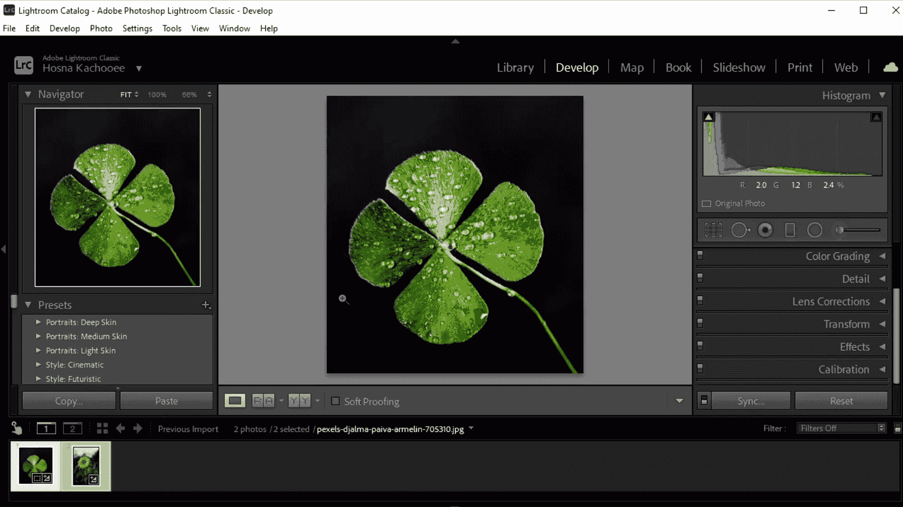

# Complete Adobe Lightroom Megacourse：Beginner to Expert Photo Editing：p67：Macro Photography Pt. 2 📸

在本节课中，我们将继续学习微距摄影的后期处理流程。本节课的练习图片是一朵三叶草，背景是简单的灰色。与上一节课中我们处理的第一张图片不同，这张图片的背景非常干净，不需要花太多精力去处理杂乱的环境。我们将学习如何通过基础面板、色调曲线、HSL 面板以及细节面板，让三叶草和水滴更加突出，最终得到一张适合海报或墙面装饰的精美照片。


## 第一步：理解微距摄影中的背景设置 📷

在微距摄影中，拍摄对象通常非常小，比如一朵玫瑰或者一株三叶草。商业拍摄时，摄影师通常会将拍摄对象放置在纯色背景上，这样可以最大程度地突出主体。

以下是使用纯色背景的核心原因：

- 纯色背景可以减少干扰，让观众的视线直接聚焦在拍摄对象上。
- 后期处理时，可以通过调暗背景，使主体与背景形成更强的对比。
- 产品摄影中也常使用同样的手法，通过单色背景衬托产品细节。

当然，如果你是在室外偶然拍到这朵花，可能没有条件准备纯色背景，这种情况下只能就地取材拍摄。不过只要掌握后期技巧，依然可以通过调整光线和颜色，让主体脱颖而出。


## 第二步：基础面板调整光影 ☀️

上一节我们介绍了如何处理背景复杂的微距图片，本节中我们来看看背景简单的图片该如何调整。首先打开 Lightroom 的基础面板，观察原始图片。

你会发现三叶草上的光线分布不均匀。阴影部分比较暗，而受光部分比较亮，这种亮暗失衡需要在基础面板中修正。

以下是具体调整参数：

```
基础面板设置：
对比度：约 18
高光：适当降低
亮部：适当下调
暗部：适当下调
```

对比度数值不能过高，100 会过度破坏图像，18 点刚好能增加层次感而不丢失细节。降低高光可以让绿色部分更加均衡，避免局部过亮。调整完成后，你会发现灰色背景变得更暗，三叶草显得更加突出。这正是我们想要的效果，因为深色背景能让主体更容易从图像中分离出来。


## 第三步：背景纯黑与抠图技巧 🖼️

当背景被调暗到接近纯黑时，图像的主体就变得非常容易提取。如果你需要将三叶草用于海报设计，比如制作一张关于自然的海报，纯黑背景会大大简化后续工作。

以下是纯黑背景的优势：

- 在 Photoshop 中可以通过改变混合模式，轻松去除黑色背景。
- 抠图后只保留清晰的三叶草，方便合成到其他设计中。
- 商业海报和宣传材料中常使用这种方式，因为处理起来更高效。

如果你熟悉 Photoshop 或 Illustrator，就会明白混合模式的作用。即使你暂时不使用这些软件，也没关系，先跟随本节课学习 Lightroom 的调色流程，未来接触这些软件时会更容易理解。


## 第四步：存在感面板提升清晰度 ✨

接下来进入存在感面板，这里的调整能让照片看起来更有质感。我们的目标是在花瓣、水滴和背景之间建立清晰的对比。

以下是存在感面板的调整建议：

```
存在感面板设置：
去雾：适当增加
清晰度：适当增加
纹理：不调整
自然饱和度：保持默认
饱和度：保持默认
```

去雾可以增强画面层次，清晰度可以让边缘更加锐利。纹理在本例中不需要调整，保持默认即可。绿色的自然饱和度和饱和度已经比较满意，暂不修改。如果需要改变颜色，建议在 HSL 面板中操作，而不是在这里直接调整。


## 第五步：色调曲线微调亮暗 📈

色调曲线是控制画面明暗的重要工具。在本例中，我们使用点状曲线，不需要触及各个颜色通道，因为绿色本身已经表现良好。

以下是色调曲线的操作思路：

```
色调曲线调整：
通道：不触及 RGB 各通道
亮部点：稍微下调
暗部点：根据喜好创建控制点并微调
控制点数量：没有固定限制
```

亮部点稍微下调，可以避免背景过亮。暗部点可以创建一个控制点，根据喜好稍微调暗或调亮，增加画面深度。控制点的数量没有固定限制，取决于你希望对图像做多大程度的改变。曲线调整完成后，暂时不再修改，进入下一步。


## 第六步：HSL 面板优化绿色 🌿

HSL 面板允许我们分别调整色相、饱和度和亮度。对于这张三叶草照片，绿色是最重要的颜色。

以下是 HSL 面板的调整重点：

```
HSL 面板设置：
绿色饱和度：增加
绿色亮度：提高，大约 7 点
```

不要在基础面板中随意改变饱和度，HSL 面板能提供更精准的控制，避免影响其他颜色。增加绿色饱和度可以让颜色更鲜艳，适当提高绿色亮度会让三叶草看起来更生动。


## 第七步：细节面板保持锐度 🔍

细节面板决定了照片的最终清晰程度。放大图片，你可以看到三叶草上的细小绒毛和每一颗水滴都非常清晰，我们希望在整个编辑过程中保留这些细节。

以下是细节面板的设置：

```
细节面板设置：
锐化：适当增加
噪点降低：只降低颜色噪点
```

这样可以在不引入过多噪点的前提下，保持图像的清晰和自然。我们不希望丢失相机已经捕捉到的任何细节。


## 第八步：晕暗效果与校准 🎨

晕暗效果用于画面四角变暗，但在本例中，图像四角本身没有需要突出的内容，因此不需要添加晕暗。

接下来进入校准面板，这里可以微调基本颜色的色相。

以下是校准面板的调整：

```
校准面板设置：
绿色色相：向右移动，偏向蓝绿色
绿色饱和度：适当增加
```

绿色色相向右移动可以去掉不想要的黄色调，使绿色偏向蓝绿色。适当增加绿色饱和度，保持绿色的鲜艳程度。


## 第九步：裁剪构图 ✂️

调整完成后，图像周围可能还有一些多余的空白区域。为了突出三叶草，我们可以进行裁剪。

以下是裁剪建议：

```
裁剪设置：
长宽比：锁定，选择正方形
构图位置：三叶草居中
```

锁定长宽比并选择正方形构图，将三叶草居中放置。去掉多余空间后，观众的注意力完全集中在三叶草上。


## 第十步：前后对比与总结 📊

现在我们可以查看编辑前后的对比。原始图片中，三叶草的绿色不够明显，水滴也不够清晰，整体曝光过度，部分区域太亮，部分区域太暗。

编辑后的图片展现了更多细节，水滴和花瓣上的细纹清晰可见，绿色鲜艳自然，主体被很好地隔离。

本节课我们处理无背景干扰的微距图片，主要经历了以下四个步骤：

```
编辑步骤总结：
第一步：通过调暗灰色背景，去除背景中的干扰细节。
第二步：突出水滴和三叶草上的细小纹理，增加画面细节。
第三步：调整颜色，展现相机捕捉到的鲜艳绿色。
第四步：优化光影，通过基础面板和色调曲线平衡过曝和欠曝区域。
```

因为不需要处理复杂的背景，本节课的编辑过程比第一个例子更快，也更简单。




在本节课中，我们一起学习了如何在 Lightroom 中编辑一张纯色背景的微距三叶草照片。从基础面板的光影平衡，到色调曲线的亮暗控制，再到 HSL 的绿色优化和细节面板的锐化保留，每一个步骤都围绕着让主体更加突出这一目标。希望你喜欢这节课，我们下节课见。

