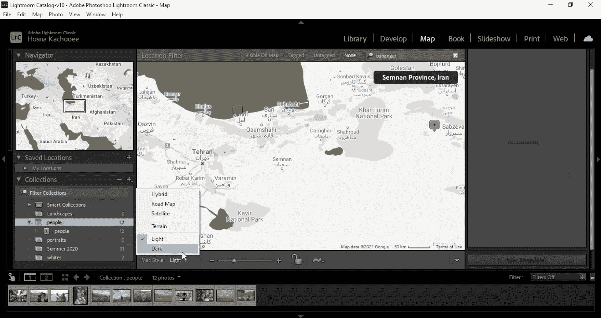

Complete Adobe Lightroom Megacourse： Beginner to Expert Photo Editing：第68节：地图模块 🗺️


在本节课中我们将要学习 Adobe Lightroom Classic 中的地图模块。地图模块是一个非常实用的图片管理功能，它可以根据照片拍摄的地理位置来对图片进行分类和整理。无论你的相机有没有开启 GPS 功能，你都可以通过这个模块给照片添加位置信息，以后想要找到某张在特定地方拍摄的照片，都会变得非常简单。这就像是给你的照片装了一个地理位置标签，方便你以后快速检索。

上一节我们简单介绍了地图模块的基本用途，本节中我们来看看这个模块到底在 Lightroom 的哪个位置，以及它具体能帮我们做什么。

在地图模块在 Lightroom 界面的右上角，它紧挨着“开发”模块和“图书”模块。你可以直接点击这个标签页进入地图视图。进入后，你会看到一个世界地图界面，这就是用来显示照片拍摄位置的地方。

还记得我们之前说过，Lightroom Classic 是一款非常强大的图片管理工具吗？地图模块就是它管理能力的体现之一。

当你拍摄照片时，如果相机的 GPS 功能已经开启，那么位置信息就会自动写入照片的元数据当中。Lightroom 读取这些元数据后，就能自动在地图上标注出照片的拍摄地点。

```
照片位置信息 = GPS 坐标（经度，纬度）
```

Lightroom 会把这些信息在地图上显示为一个小图标。比如说，如果你在巴哈村的一个偏远地方拍了一张照片，地图上就会在对应位置出现一个标记，告诉你这张照片是在那里拍摄的。

本节前面我们讲了 GPS 自动定位的情况，不过现实中并不是所有照片都带有位置信息。本节中我们来看看，如果你的照片里没有 GPS 数据，应该怎么手动添加位置。

如果你拍照时没有打开 GPS，地图模块一开始可能是空的，上面没有任何标记。这时候我们可以手动把图片拖到地图上的正确位置。

以下是手动添加位置的步骤：
1. 在地图上放大，找到你拍摄照片的大概区域，比如伊朗境内。
2. 使用 Google 地图进行定位，因为它能显示道路和具体地点，帮你精准找到拍摄地点。
3. 从胶片条中选中一张照片，把它拖拽到地图上的对应位置。
4. 松开鼠标，照片就会固定在这个地理位置上。

以后你缩小地图，这张照片的标记依然会留在那里。如果你原来的相机开了 GPS，地图上可能会布满很多这样的标记，覆盖你所有拍摄过的地方。

前面一节我们介绍了如何手动把照片拖到地图上，本节中我们来看看，地图模块里还能看到哪些位置相关的信息，以及怎么通过地图来搜索照片。

在地图模块里，选中一张已经标记位置的照片，右侧面板会显示详细的地理信息。这些信息包括城市、州、国家，以及 GPS 坐标。不过，自己手动输入精确的 GPS 坐标比较麻烦，所以大多数情况下，直接拖拽到地图上是更简单的方法。

如果你不确定确切的 GPS 坐标，也可以先在地图上找到大概位置，把照片拖过去，这样 Google 地图就能识别这个地方了。你还可以给照片添加说明文字、创建日期等元数据，虽然这些不是必须的，但有助于以后整理。

```
照片元数据示例：
{
  "城市": "德黑兰",
  "州": "东阿塞拜疆",
  "国家": "伊朗",
  "GPS 坐标": "35.6892, 51.3890"
}
```

以下是可以在地图模块里补充的元数据项：
- 文件名
- 所在文件夹
- 位置状态
- 标题或说明文字
- 创建日期

在管理照片时，你还可以使用过滤功能。地图下方有“未标记”和“已标记”两种筛选选项，点击后地图上只会显示对应状态的照片标记。比如选择“已标记”，地图上就只显示那些已经添加了位置信息的照片。

你也可以在地图上直接搜索某个地点，比如搜索冰岛，地图会自动把视角移动到冰岛，并且只显示你在那里拍摄的照片。找到这些照片后，你可以右键导出它们，或者把它们添加到某个合集，也可以在文件夹里查看它们所在的位置。



上一节我们学习了如何在地图上搜索和筛选照片，本节中我们来看看地图的显示样式可以怎么调整，还有一个比较有趣的轨迹记录功能。

Lightroom 提供了多种地图样式供你选择，包括混合模式、地形模式、道路模式、卫星模式，还有浅色和深色主题。个人比较推荐使用混合模式，因为它既有卫星图像，又有道路和地名标注，看起来最清晰。

以下是常见的地图样式选项：
- 混合 (Hybrid)
- 地形 (Terrain)
- 道路 (Roadmap)
- 卫星 (Satellite)
- 浅色或深色主题

除了地图样式，还有“轨迹记录”功能。如果你拍照时开了 GPS，并且导入了轨迹日志文件，Lightroom 就会在地图上画出一条线，显示你拍摄多张照片时的移动路线。你可以清晰地看到自己先在某个地方拍了一张，后来又去了另一个地方拍了一张，整个行程就像一条轨迹线一样展现在地图上。即使没有 GPS 数据，这个功能也无法使用，但如果你有相关记录，它能帮你把拍摄地点串联起来，回忆起当时的旅行经历。

本节课中我们一起学习了 Lightroom 的地图模块。我们了解了地图模块位于右上角，它能根据照片的 GPS 位置信息自动对图片进行分类和管理。如果照片没有自动位置信息，我们也可以手动把照片拖到地图上的正确位置。此外，我们还学习了如何在地图上搜索地点、筛选已标记和未标记的照片、切换不同的地图样式，以及使用轨迹记录来回顾拍摄路线。希望这节课能帮你更好地整理和管理照片，我们下节课见。
