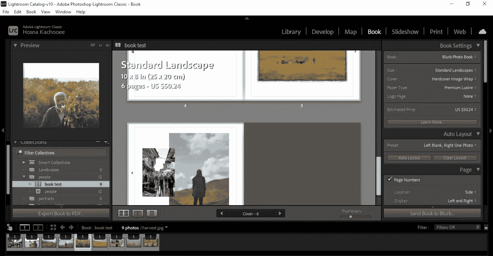
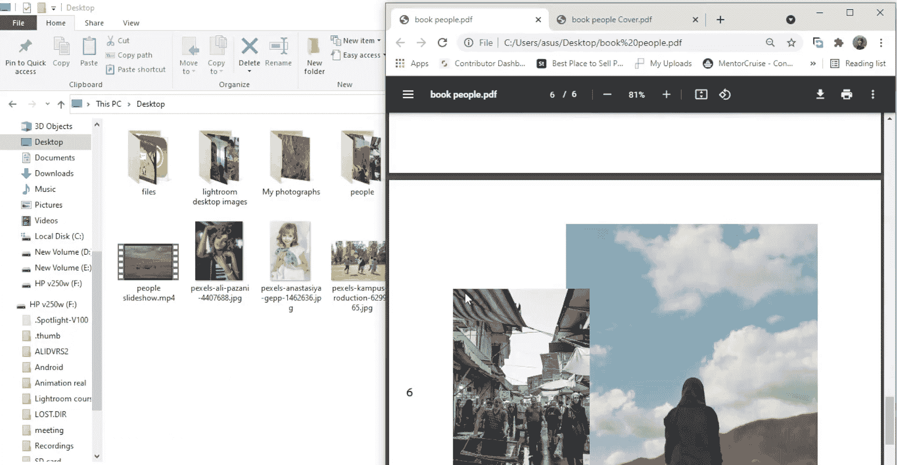
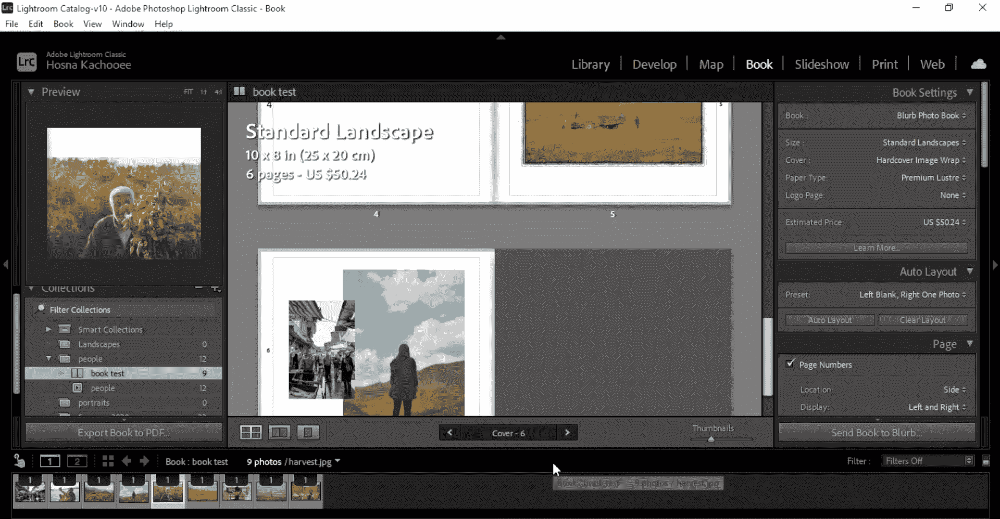

Adobe Lightroom Megacourse：p69：使用Book模块制作照片书 📚

在本节课中我们将学习如何在Adobe Lightroom中使用Book模块制作一本照片书。很多新手可能不知道，Lightroom不仅能修图，还能直接把你的照片排版成一本实体书或者电子书。你不需要离开这个软件，就能完成从选图到排版，再到导出的全部过程。这一节课会把整个流程拆解开来，让你即使是第一次接触，也能快速上手。我们会从准备图片开始，一步步讲解如何设置封面、内页布局、文字和背景，最后导出成品。无论你是想做一本个人画册，还是想把旅行照片做成纪念册，这节课都能帮你打好基础。

### 一、准备图片并加入集合 🖼️

在正式打开Book模块之前，我们需要先把想要用来制作书籍的照片准备好。

制作照片书的第一步，是决定哪些照片要放进去。建议你在导入照片到资料库的时候，就把目标图片放入一个专门的集合里。这样在Book模块中，你只需要调用这个集合，就能看到所有候选图片，不用在成千上万张照片里一个个找。如果你打算在书里加入自己的肖像，或者放一个带有Logo的页面，也要把这些素材一起放进同一个集合。因为Book模块只能读取当前集合里的照片，集合外的图片是无法使用的。

以下是准备图片时需要注意的几点：

- 把所有用于书籍的照片放入同一个集合
- 如果需要个人照片或Logo，也一并放入该集合
- 导入资料库后及时整理，避免后期找图浪费时间

集合准备完成后，我们就可以进入Lightroom的Book模块，开始设置书籍的基本样式了。

### 二、进入Book模块并选择书籍样式 📖

在Lightroom中切换到Book模块后，你会看到几种不同的书籍输出选项。目前主要有Blurb杂志、Blurb贸易书、Blurb摄影书，以及PDF和JPEG三种导出格式。Blurb是一家在美国的自助出版平台，已经和Lightroom合作，这意味着你在软件里设计好书籍之后，可以直接把订单发送给Blurb进行印刷和出版，不需要自己另外找印刷厂。选择Blurb选项时，软件会提供模板，并显示预估价格，方便你提前了解成本。如果你只是想先做一个电子版本，保存成PDF或者把每一页保存成单独的JPEG文件也是可以的。

以下是Book模块提供的主要输出选项：

- Blurb杂志：适合制作类似杂志的排版效果
- Blurb贸易书：适合普通的商业图书格式
- Blurb摄影书：专门针对摄影作品集优化
- PDF：导出为电子书，方便分享和查看
- JPEG：将每一页保存为独立的图片文件

输出选项可以用下面的简单公式表示：

```
输出选项 = {Blurb杂志, Blurb贸易书, Blurb摄影书, PDF, JPEG}
```

选定了输出格式之后，接下来需要确定书籍的尺寸和封面类型。

### 三、设置书籍尺寸与封面 📐

书籍尺寸取决于你照片的拍摄方向。如果你的照片大多是横向风景照，就选择横向尺寸；如果多是竖向人像照，就选择竖向尺寸。Lightroom不会强制你改变照片方向，而是根据你现有图片的比例来推荐合适的尺寸。关于封面，如果你选择的是Blurb实体书，可以设置硬壳封面、图片包裹封面、书衣封面或者软壳封面。这些选项只影响实体印刷版，如果你最后只导出PDF，就不会显示这些封面设置。

以下是常见的封面类型说明：

- 硬壳：硬壳精装，适合保存收藏
- 图片包裹：封面图直接包裹在书壳上
- 书衣：外加一层可拆卸的书衣
- 软壳：柔软封面，成本较低

尺寸和封面确定后，我们可以开始调整书籍内页的细节设置了。

### 四、调整内页纸张与布局 📄

进入内页设置部分，你可以选择纸张类型，决定书页的手感和显示效果。另外有一个Logo页面的选项，可以选择是否在书中添加专门的Logo页，如果不需要就直接关闭。此时软件会提示你目前一共有多少页，不包括封面。布局部分有几种预设方案，比如每页一张照片、左边空白右边一张照片，或者照片配文字混合排列。你也可以清除当前布局从头开始，或者让Lightroom自动生成布局，这对新手来说非常方便。

以下是可选的页面布局预设：

- 每页一张照片
- 左空白右一张照片
- 照片加文字混合排版
- 自动布局由Lightroom生成

布局设置好以后，还可以给书页添加页码，并决定页码显示在哪个位置。

### 五、设置页码与添加页面 🔢

Lightroom允许你给书籍添加页码，方便读者翻阅。页码可以放在页面的左上角、右上角、左下角、右下角，或者页面的侧边，你可以根据喜好自由选择。另外，如果你觉得两页不够，还可以随时添加更多页面。软件提供多种页面模板，比如单页一张照片、双页跨页设计，甚至可以直接制作文字页。所有这些选项都在模块面板里，点击即可应用。

以下是页码可以显示的位置：

- 页面顶部角落
- 页面底部角落
- 页面侧边
- 单页或双页同时显示

页码和页面数量都确定之后，我们就可以开始给书页添加边框、文字和背景了。

### 六、编辑边框、网格对齐与文字 ✍️

为了让页面看起来更整洁，你可以给图片添加边框，或者选择不加边框。Lightroom还有一个网格对齐功能，建议保持默认开启，这样在移动图片和文字时会自动吸附到网格线上，排版会更整齐。关于文字部分，你可以修改文字的大小、不透明度、颜色、字体样式以及对齐方式。比如把文字放在页面的左侧、右侧，或者居中，全部都可以通过面板调节。

以下是文字可以调节的属性：

- 文字大小
- 文字不透明度
- 文字颜色
- 字体样式
- 文字对齐方式

文字属性可以用下面的代码结构理解：

```python
text_properties = {
    "size": 24,
    "opacity": 100,
    "color": "#000000",
    "font": "Arial",
    "alignment": "left"
}
```

文字样式调整完后，还可以给整个页面添加背景颜色或背景图片。

### 七、设置页面背景 🎨

页面背景可以设置为纯色，也可以添加一张背景图片。如果你想用图片做背景，记得把那张背景图也放入当前的集合里，否则无法选取。为了不让背景盖过主体照片，建议将背景图片的不透明度调低，或者使用简单的抽象图形作为底纹。你也可以直接去掉背景图片，只保留一种纯色背景。这些设置会应用到所有页面，除非你单独为某一页修改。

以下是背景设置的常见方式：

- 纯色背景
- 背景图片配合低不透明度
- 抽象图形底纹
- 无背景，使用默认白页

背景设置完成后，最关键的一步是把你的照片拖放到书页里。

### 八、添加图片与区分页面文本 🖼️✨

在Book模块中添加照片非常简单，只需要把集合里的图片拖放到页面上的空位即可。Lightroom支持缩放图片，你可以放大或缩小照片，调整它在页面中的位置。另外需要注意页面文本和图片文本的区别。图片文本是跟随照片的，照片移动，文字也会跟着移动；而页面文本是固定在页面上的，与具体图片无关。如果你想在某一页写一些说明文字，不想让它随图片移动，就应该使用页面文本。

以下是向书页添加内容的两种主要方式：

- 直接拖放图片到页面占位符
- 添加页面文本或图片文本，再调整位置

图片和文字都排版好以后，你还可以创建专门的纯文字页面，或者把整本书保存下来。

### 九、创建文字页与保存虚拟书 💾

如果你希望书中有一页只放文字，不放照片，可以创建一个文字页面。Lightroom提供多种页面模板，包括单页、双页跨页、纯文字页等，你可以根据需要自由切换，甚至可以制作年鉴风格的页面。完成排版后，不必立刻导出，可以先将这本书保存为虚拟书，存放在你的集合里。以后想继续修改，直接打开该集合就能看到之前保存的布局，不需要从头重新排版。

以下是保存虚拟书的步骤：

- 点击创建保存的书籍
- 为书籍命名，例如Book test
- 选择保存位置，建议放在和幻灯片相同的集合里
- 确认只包含已使用的照片，避免冗余

书籍保存后，最后一步就是导出成文件，查看最终效果了。

### 十、导出书籍并查看成品 🖨️

当你对排版结果满意后，可以选择导出书籍为PDF，或者直接发送给Blurb进行印刷。如果你只想先看看效果，导出PDF就足够了。导出后，你会得到两个PDF文件，一个是封面，一个是内页页面。打开它们，就能看到你设计的封面和内页的样子，里面包含你添加的图片、文字和背景。这样你就可以把电子版发给亲友查看，或者拿着文件去实际印刷一本实体书。

以下是导出时可选的操作：



- 导出书籍为PDF，方便电子分享
- 发送书籍到Blurb，进行实体印刷
- 查看桌面上的导出文件，确认封面与内页

导出结果可以用下面的代码结构表示：



```python
export_options = ["PDF", "Send to Blurb"]
final_output = {
    "cover": "cover.pdf",
    "pages": "book_pages.pdf"
}
```



本节课中我们一起学习了如何在Adobe Lightroom中使用Book模块制作照片书。我们从准备图片和建立集合开始，进入Book模块后选择了书籍样式与输出格式，接着设置了尺寸、封面、纸张和布局，并添加了页码、背景、图片与文字。最后我们学习了如何保存虚拟书，以及导出PDF或发送到Blurb印刷。掌握这些功能后，你就能把修好的照片整理成一本漂亮的画册，分享给家人朋友，或者作为个人作品集使用。

