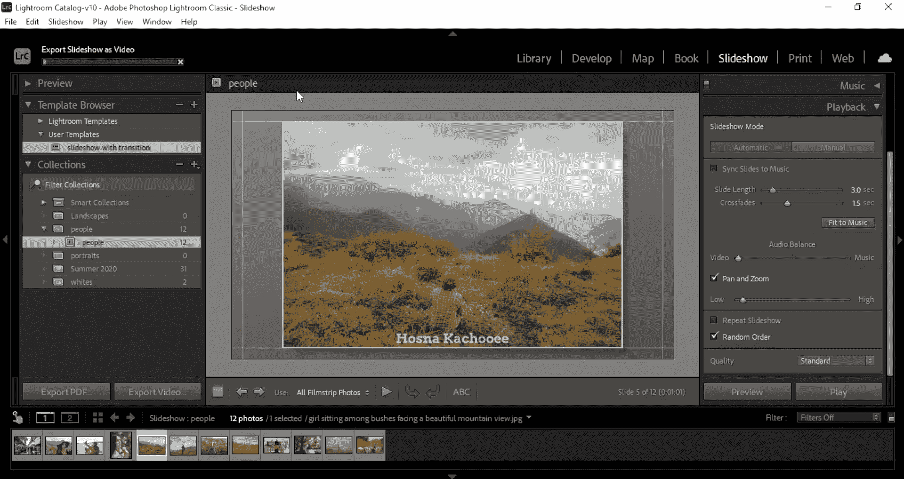
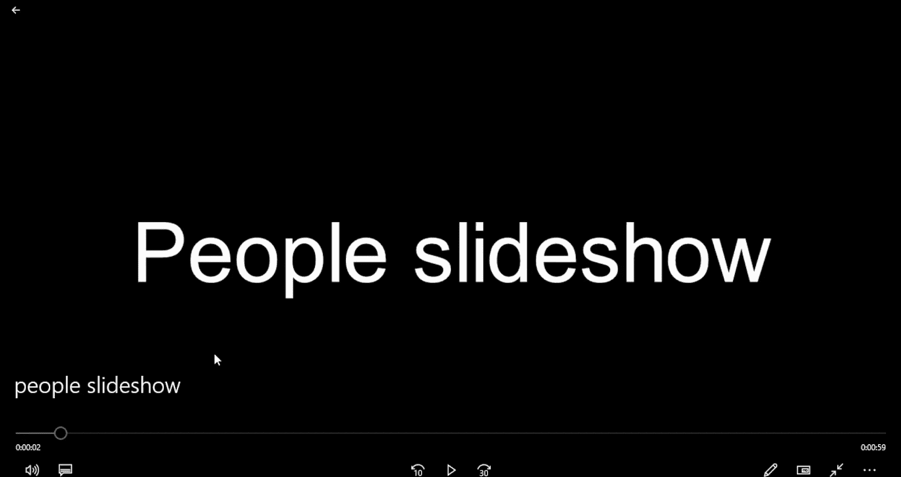
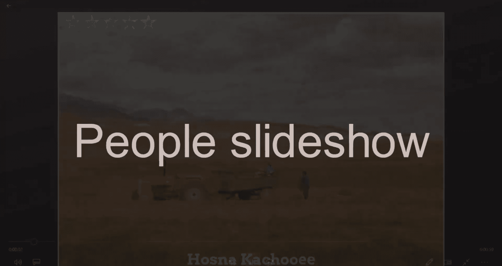
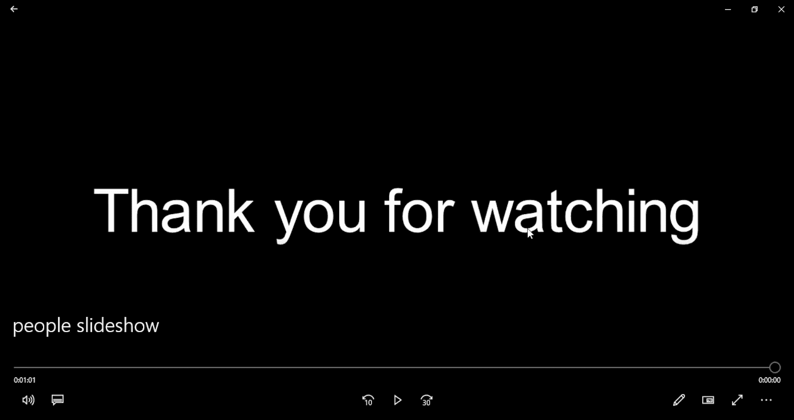

Adobe Lightroom 从入门到专家照片编辑：第70节：幻灯片模块 🖼️


在本节课中，我们将学习 Adobe Lightroom 中的幻灯片模块。你将了解如何把导入 Lightroom 的照片制作成幻灯片，以及如何给幻灯片添加边框、阴影、水印、星级评分、背景音乐和标题画面。最后我们会把幻灯片保存为模板，并导出成视频文件，方便你在电脑上播放或分享给他人。


## 第一步：创建图片集合

在使用幻灯片模块之前，你需要先准备好一组照片。最简单的方法就是创建一个图片集合，把想要展示的照片放在一起，这样管理起来更方便，也更高效。

以下是创建图片集合的具体操作：

- 在 Lightroom 中找到你想要用于幻灯片的照片文件夹。
- 选中所有需要的图片，然后点击创建新的集合。
- 给集合起一个名字，例如“人物”，然后确认导入。
- 如果需要，可以为图片添加标题、关键词等元数据，不过暂时可以跳过，先完成导入即可。

创建好集合后，Lightroom 就会把这些图片聚集在一起，方便我们在幻灯片模块中统一处理。


## 第二步：进入幻灯片模块

上一节我们介绍了如何创建图片集合，本节中我们来看看如何进入幻灯片模块并开始制作。

点击 Lightroom 右上角的模块切换区域，选择名为“幻灯片”的模块。进入后，你会看到当前集合里的所有图片都出现在预览区域。这些图片就是你刚才导入并命名过的照片，同时也保留了你之前设置的星级评分。

此时，幻灯片模块的主界面已经展示在你面前，接下来我们将逐一讲解左侧和右侧的各项设置选项。


## 第三步：调整布局与边框

幻灯片模块提供了多种布局选项，用来决定图片在屏幕上的显示方式。我们先从最基础的边框和填充设置开始。

以下是常用的布局选项说明：

- **缩放填充画面**：如果勾选这个选项，Lightroom 会裁剪图片以填满整个画面。除非你的图片本身就是 16 比 9 比例，否则不建议开启，因为会切掉图片的重要部分。
- **描边顺序**：给每张图片添加一个边框。你可以调整边框的粗细和颜色，这个设置会同时作用于所有图片。
- **投影阴影**：在图片下方添加阴影效果，让图片看起来有立体感。你可以调整阴影的偏移量、不透明度和圆角半径，还可以改变光照方向，模拟光线从左上角或右下角照射过来。

布局部分还包括参考线。这些线决定了图片不能超出的范围。默认情况下，所有图片的参考线是联动的，如果你想单独移动某张图片，需要取消“全部链接”选项。

此外还有纵横比预览，常见的有 4 比 3 和 16 比 9。16 比 9 适合电脑屏幕或电视播放，4 比 3 则更适合 Instagram 等平台。根据你的展示场景选择合适的比例即可。

布局与边框的设置可以用这个简单逻辑表示：

```text
最终画面 = 图片内容 + 边框样式 + 阴影效果 + 参考线限制
```


## 第四步：添加叠加层与水印

上一节我们介绍了布局与边框设置，本节中我们来看看如何给幻灯片图片添加叠加层和水印。

叠加层的作用是在图片上方显示身份标识，不同于传统水印，它更多用于展示作者姓名或品牌标识。

以下是设置叠加层的步骤：

- 点击叠加层选项，创建一个新的身份标识板。
- 输入你的名字，选择白色字体，这样在深色图片上也能清晰可见。
- 调整字体大小和不透明度，避免过于刺眼，保持低调但可辨认。
- 如果你已经有现成的水印预设，也可以直接选择使用，不过建议为幻灯片单独制作一个更合适的版本。

除了身份标识板，你还可以开启星级评分显示。这样图片在幻灯片中会带上你在资料库模块中设置的星标，方便观众一眼看出哪些是精选作品。星标的位置、颜色和大小都可以调整，建议放在图片角落，避免遮挡人物脸部等主要内容。


## 第五步：设置背景与标题画面

叠加层设置完成后，我们需要关注图片背后的背景，以及幻灯片的开头和结尾画面。

以下是背景与标题画面的设置项：

- **颜色渐变背景**：为背景添加从一种颜色过渡到另一种颜色的渐变效果。你可以选择深色或浅色，调整渐变角度和不透明度，让整体看起来更柔和。
- **背景图片**：也可以从胶片条中拖入一张图片作为背景，但要小心使用，以免抢走主图片的注意力。
- **标题画面**：在幻灯片开始前显示的介绍画面，可以加上标题文字，比如“人物幻灯片”，并设置字体颜色和大小。
- **结尾画面**：在幻灯片结束后显示的画面，可以写“谢谢观看”之类的文字，作为礼貌的收尾。

标题画面和结尾画面可以使用身份标识板来制作，颜色建议设为白色，并适当放大，确保观众能看清。


## 第六步：添加音乐与播放设置

上一节我们介绍了背景与标题画面，本节中我们来看看如何为幻灯片添加背景音乐，并设置播放方式。

音乐可以让幻灯片更有感染力。你可以从本地导入一段背景音乐，Lightroom 会根据图片数量自动匹配播放时长。

以下是播放设置的关键选项：

- **自动与手动**：自动模式下，Lightroom 会根据你设定的每张图片停留时间自动播放；手动模式适合你需要临时暂停并讲解的场景，一般建议选择自动。
- **同步幻灯片与音乐**：开启后，Lightroom 会让每张图片的显示时长自动适配音乐长度，确保音乐结束时幻灯片也正好播放完毕。
- **每张幻灯片时长**：你也可以手动指定每张图片停留几秒钟，例如 3 秒或 4 秒。
- **交叉淡出**：图片之间的过渡效果，控制一张图片淡出、下一张图片淡入所需的时间，通常设为 1.5 秒左右即可。

如果你的幻灯片中包含视频，还可以调整音频平衡，决定背景音乐在视频播放时是否静音。

此外还有平移缩放选项，开启后图片会在播放时缓慢放大或移动，让静态图片变得更生动，避免画面过于平铺直叙。


## 第七步：保存模板与导出幻灯片

所有设置完成后，你可以把当前配置保存为模板，以后制作新幻灯片时直接套用，无需重新调整。

以下是保存模板和导出的步骤：

- 点击模板面板中的加号按钮，给当前设置命名，例如“带过渡效果的幻灯片”，然后保存到用户模板库。
- 保存幻灯片项目，选择存放的文件夹，比如刚才创建的“人物”集合文件夹。
- 最后点击导出视频，选择保存位置，文件名可以沿用集合名称，格式选择 MP4，画质可以选择 720P 或更高。
- 等待导出完成，你就会得到一段包含边框、阴影、水印、星级评分和背景音乐的完整幻灯片视频。

需要注意的是，如果你选择导出为 PDF，星级评分、水印和图片阴影会保留，但背景音乐和动画效果不会显示。因此如果你制作的是视频幻灯片，建议始终选择导出视频格式。


## 第八步：预览最终效果

导出完成后，建议立即播放视频检查效果。你可以看到每张图片带有平移缩放动画，星级评分出现在角落，水印清晰可见，背景音乐贯穿始终，开头有标题画面，结尾有“谢谢观看”画面。



这就是使用 Lightroom 制作幻灯片的完整流程。在接下来的课程中，我们将介绍其他模块的功能，敬请期待。






## 总结



本节课中我们一起学习了如何在 Lightroom 中使用幻灯片模块。我们先创建了图片集合，然后进入幻灯片模块调整布局、边框和阴影，接着添加了叠加层、水印和星级评分，设置了背景渐变和标题画面，导入了背景音乐并配置了自动播放参数，最后保存了模板并导出为 MP4 视频。希望这篇教程能帮助你快速上手 Lightroom 的幻灯片制作功能，制作出专业且生动的图片展示作品。

