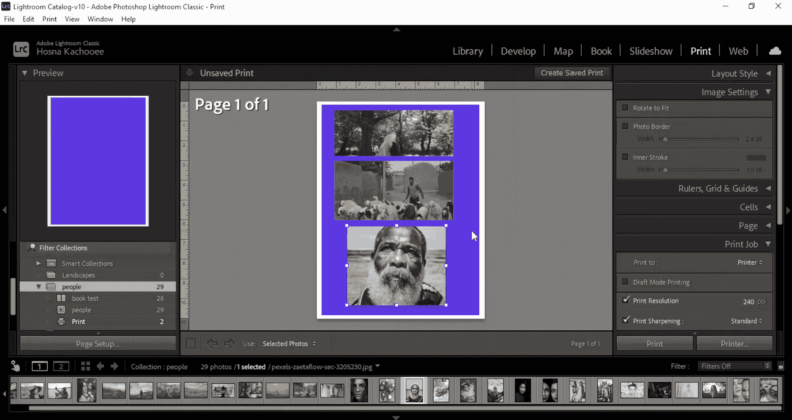

# 🖨️ Complete Adobe Lightroom Megacourse：071：打印模块

在本节课中我们将要学习 Lightroom Classic 软件中的打印模块。打印模块的作用是让你把处理好的照片输出成实体纸张，或者保存为可打印的电子文件。无论你是想制作明信片、信件、联系表，还是把照片交给打印店制作，本节课都会教你如何一步步完成设置。我们会从准备图片集合开始，接着讲解打印机与纸张的设置，然后介绍布局模板、边距、辅助线、单元格、身份标识、水印，最后介绍打印任务与预设保存。内容比较多，但每一步都很简单，初学者也能轻松跟上。

进入打印模块与准备图集

上一节我们介绍了 Lightroom 的其他输出模块，本节中我们来看看打印模块是如何工作的。

打印模块和图书模块有一些相似之处，但两者的目的完全不同。图书模块是用来制作整本相册的，而打印模块是用来制作单张纸张的，每张纸上可以放一张或多张照片。这些纸张适合制作明信片、信件、联系表，以及你通常会交给打印店处理的各种打印任务。如果你自己有打印机，就可以直接在 Lightroom 里完成打印，不需要额外的软件。当然，前提是你必须有一台打印机，如果没有打印机，后续的操作就会受到一定限制。现在我们开始看具体怎么操作。

和 Lightroom 的其他模块一样，在进入打印模块之前，你需要先准备好一个图片集合，把所有想打印的照片都放进去。建议你先到资料库模块，导入想要打印的照片，然后把它们添加到一个集合中，集合的名字可以自己定义，比如叫做“婚礼打印”或者“个人照片打印”。这样所有需要打印的照片都集中在一个集合里，你就不需要在不同的集合之间来回寻找。在打印模块的左侧面板，你会看到刚才在资料库里创建的集合列表，可以随时切换到包含不同照片的其他集合。这个面板也很有用，万一你漏掉了一张在另一个集合里的照片，可以随时回去把它找回来，放到当前打印用的集合中。下面我们先关闭集合面板，专注于当前要用于示例的这个集合。

以下是打印模块左侧集合面板的主要作用：
- 集中管理所有待打印照片
- 快速切换不同照片集合
- 避免在多个集合之间重复查找

页面设置：打印机、纸张与方向

刚才我们介绍了如何准备图片集合，本节中我们来看看页面设置的具体内容。

在开始打印之前，第一件事就是设置打印环境，也就是告诉 Lightroom 你要用哪台打印机，使用什么纸张，以及纸张的方向。点击页面设置后，会弹出一个小面板，里面会询问打印机、纸张和方向的相关信息。首先是打印机选择，这里会列出你电脑上连接的所有可用打印机，你可以从中挑选想要使用的一台。示例中使用的是 Microsoft XPS 文档写入器或者 Microsoft 打印机，实际使用时会显示你自己电脑上安装的打印机。选择打印机后，状态通常会显示为“就绪”，面板还会告诉你打印机的位置和类型。如果你需要进一步调整，可以点击属性按钮，在那里可以设置是黑白打印还是彩色打印，纸张从哪个托盘进纸，等等。比如你有一个托盘放普通 A4 纸，另一个托盘放相册纸或光面纸，就可以在这里指定 Lightroom 告诉打印机从哪个托盘取纸。

媒体类型也是页面设置的一部分，它决定了你的照片打印出来后的外观。你可以选择哑光效果，也可以选择光面效果。光面照片看起来会比较亮亮的，哑光照片则比较平面，有时候还会有一点颗粒感。这里实际上是在选择纸张表面的纹理类型，所以要根据你实际使用的纸张来选择正确的选项，确保打印机支持这种纸张。

接着是布局方向，这里有两个选项，一个是竖向，适合人像照片，另一个是横向，适合风景照片。示例中暂时保持竖向。你还可以选择每张纸打印多少页，以及高级选项，高级选项与打印机型号和功能直接相关，因为每个人的打印机都不同，这里就不详细展开了。设置完成后点击确定。

下面是页面设置中需要关注的几个核心设置：
- 打印机：选择你实际连接的打印设备
- 纸张尺寸：常见的有 `A4`、`A5`、`Letter`、`Legal` 等标准预设
- 纸张来源：指定打印机使用哪个纸盒
- 方向：竖向或横向，点击后可以看到预览会发生翻转
- 媒体类型：哑光或光面，决定照片表面纹理

页面设置完成后，你还可以在底部选择纸张尺寸，这里也有常见的 `A4`、`A5`、`Letter`、`Legal` 等预设，可以直接选用。纸张来源也可以在这里重新选择，方向的选项同样适用，点击不同方向会看到布局发生翻转。如果有任何疑问，可以点击帮助，如果是网络打印机，还可以使用网络选项。设置好后点击确定，第一步就完成了。

边距与布局模板

刚才我们完成了页面设置，本节中我们来看看边距和布局模板的设置。

很多打印机无法实现边缘到边缘的无边距打印，所以纸张的四周通常会留下一些灰色边缘，这些边缘叫做边距。示例中选定的打印机就有固定边距，你不能把边距调得太低，否则完整的图片可能无法打印出来。不过你可以增大边距，比如增大右侧边距，图片就会向左移动，反之亦然。这是边距的工作原理。现在不需要改动边距，把刚才的调整撤销即可。

接下来你需要告诉 Lightroom 你想要什么样的布局。你可以选择单张图片，也可以选择图片包，或者自己创建自定义包。Lightroom 自带的一些模板非常适合初学者入门，你可以在右侧面板看到预览，点击任意一个模板就会立即应用到当前布局中。

以下是 Lightroom 提供的几种常见布局模板：
- 单图：每张纸只打印一张照片，适合大尺寸照片输出
- 图片包：在一张纸上排列多张相同或不同的照片
- 联系表：将多张照片缩小后排列在同一张纸上，适合家庭护照照片等场景
- 自定义包：可以自由放置照片位置，灵活度最高

以单图模板为例，选择一张横向的四乘六照片，你会看到照片周围有一些白色边框，这些边框在裁切照片时很有帮助。你也可以进一步调整边框，让它们重叠，不过这些都是针对单张图片的设置。如果选择两张图片的布局，可以把它当成一张信纸，从中间对折，然后在背面写字。还有一种布局是一张大图配合描边线，适合人像照片，看起来效果更好。在单图模式下，如果你希望每张纸都打印同一张照片，可以选择“每页重复一张照片”选项。

联系表模板适合打印大量小照片，比如家庭合影的护照照片。先选择尺寸，决定是横向还是竖向，然后选择每页重复照片，这样所有照片就会排列出来。你可以调整缩放填充，让照片填满单元格，同时调整每张照片的位置。自定义包则更加灵活，你可以把一张照片放在这里，另一张照片放在那里，根据需要创建自己的排版。自定义包也有最大尺寸限制，如果图片比例和纸张不匹配，仍然会保留边距。如果你想填满整个页面，可以使用缩放填充，但这样会剪掉照片两侧的一些像素。为了保留照片的完整部分，可以通过增大左右边距来调整，让布局看起来更合理。同时调整上下边距，虽然可能无法做到完全居中，但可以看到黑色边框完整环绕照片，这就是最终打印出来的效果，你只需要裁切掉多余的部分即可。或者也可以直接在页面设置中选择与图片尺寸匹配的纸张尺寸。

除了 Lightroom 自带的模板，你还可以创建用户模板。如果你经常使用打印模块，建议像我们在幻灯片模块中做的那样，创建一个包含自己常用设置的用户模板。这样下次赶时间时，直接点击自己的模板，所有调整都会自动应用，不需要从头开始重复设置，节省大量时间。

以下是创建用户模板的主要好处：
- 保存自己常用的打印设置
- 下次直接调用，无需重新配置
- 适合固定打印机和纸张尺寸的场景

辅助线、网格与单元格

刚才我们介绍了布局模板，本节中我们来看看辅助线、网格和单元格的使用。

在布局面板中，你会看到尺子、网格和引导线。尺子显示纸张的边界，绿色的线是引导线，这些工具非常有助于让布局保持平衡和对称。我强烈建议开启所有这些选项。如果关闭引导线，你就不知道照片是否居中，是否位置正确，各个元素是否平衡或重叠。开启引导线后，你可以查看顶部的尺子，它会告诉你当前位置是否在中心，或者不在中心。纸张尺寸的变化也会反映在尺子上，比如从八乘十英寸改为八点五乘十一英寸，尺子上的刻度也会相应变化。

以下是尺子、网格与引导线的作用：
- 尺子：显示纸张和图片的边界位置
- 网格：在页面上提供统一的排版参照
- 引导线：帮助判断照片是否居中、平衡

网格捕捉是一个很有用的功能。开启网格捕捉后，移动照片时会感觉稍微有一点滞后，这是因为它在按照网格对齐引导你，这样就不容易放错位置。你可以把网格捕捉设置为按照页面网格或者按照单元格移动。单元格就是你在页面上看到的那些格子，开启单元格捕捉后，照片只能按照格子的大小进行移动。如果你想获得精确的尺寸，建议开启这个功能。现在先关闭它，看看尺子、网格和引导线的效果。

单元格功能允许你自定义照片放置的区域大小。在自定义包模式下，你可以删除现有单元格，然后根据需要创建新的单元格。比如创建一个四乘五英寸的单元格，或者一个三乘七英寸的单元格，甚至是一个五乘七英寸的单元格。如果创建的单元格没有放满当前页面，Lightroom 会自动生成第二页。你可以关闭不需要的页面，只保留自己要用的页面。创建好单元格后，就可以把想要打印的照片拖进去，照片可以在页面上自由移动，也可以随时查看它们的尺寸。如果想让照片更大，就创建更大的单元格，或者添加新页面。现在先关闭这个面板，看看如何调整选中的单元格。

调整选中单元格时，你可以修改它的高度或宽度。如果你不确定具体要什么尺寸，可以先尝试调整，看看效果。调整单元格尺寸时会裁切掉照片的某些部分，这和我们之前提到的边距是一样的道理，需要根据你希望照片呈现的效果来操作。你也可以旋转单元格，不过如果单元格是正方形，旋转效果不明显。锁定图片宽高比选项开启后，当你修改宽度时，高度会按照设定的比例同步变化，不会随意拉伸。关闭这个选项后，你可以自由调整图片的宽度和高度，让图片变厚或变薄。

如果想重新开始，可以清除布局，删除之前做的所有设置。关闭单元格面板后，我们进入页面设置部分。

页面背景与身份标识

刚才我们介绍了单元格调整，本节中我们来看看页面背景和身份标识。

在页面面板中，你可以为背景页面选择颜色，这里有多种颜色选项可供更换。如果你不喜欢当前的单元格显示，可以去网格线和图片单元格选项中进行调整，或者使用页面网格来关闭它们。然后选择背景颜色。这一点和我们在幻灯片模块和图书模块中学过的内容类似。

接下来是身份标识，这基本上就是你的名字或者品牌名称。你不希望它显示成默认的 Lightroom 字样。如果你在之前的模块中已经创建过身份标识，可以在这里直接使用。你可以输入自己的名字，还可以覆盖颜色，也就是在身份标识上覆盖一层颜色，比如不想要黑色，可以改成红色或其他颜色。如果不开启覆盖颜色，它会保持为黑色，因为创建预设时我们选择了黑色。如果想要不同的颜色，就需要使用覆盖颜色功能，在身份标识上方添加一层颜色。

你还可以调整透明度，让身份标识非常鲜明，或者像水印一样淡淡的。需要注意的是，身份标识不是水印。比如如果你在制作明信片，可以在上面写“圣诞快乐”，然后在底部放上自己的名字作为水印。现在只是显示自己的名字，你可以随意缩放大小，或者使用控制点来调整，完全由你掌控。还有一个选项是“渲染在图片后面”，意思是身份标识会显示在照片的下方。如果你添加了一个单元格，放进一张照片，然后开启这个选项，身份标识就会出现在照片后面；如果关闭，身份标识就会显示在照片前面。如果选择“应用于每张图片”，那么所有放入的照片都会带有这个身份标识。这对于想要统一标记照片的场景很有用，不过如果只是自己打印使用，通常不需要这么做。

水印功能也是类似的道理。开启水印后，系统会让你选择之前创建的预设。在之前的课程中，我们已经创建了一个用于演示的水印和一个带有自己名字的水印。选择其中一个后，放入一张照片，比如随便选一个四乘五英寸的单元格，水印就会出现在照片上。水印只会添加到照片本身，不会添加到空白区域。如果你添加多个单元格，水印会出现在每一张照片上。

切割指南用于在打印后裁切照片。你可以放大查看照片，根据需要制作切割线，对每个照片都做同样的操作。如果你想裁切这张纸，现在就有了切割指南。你还可以选择是否添加裁切标记，裁切标记可以是边缘的小星星，也可以是直线，效果会根据你的图片尺寸和位置发生变化。比如选择另一个尺寸，放入随机照片，然后移动它们，就会生成相应的裁切标记。这些标记在你想要精确切割照片时非常有帮助，不过操作起来可能会有点卡顿，演示完后可以关闭它们。页面面板到此结束，直接关闭即可。

打印任务与预设保存

刚才我们介绍了页面背景和身份标识，本节中我们来看看打印任务的最后设置以及预设保存。

在打印任务面板中，你需要决定是要直接发送到打印机打印，还是导出为 JPG 文件。如果你自己没有打印机，或者想把文件发送给别人处理，选择导出为文件就非常方便。你可以指定保存位置，还可以使用草稿模式打印。草稿模式不是最终成品，只是用来测试效果的，测试时不需要提供所有信息，等到最终确定再输出完整信息。

分辨率设置决定了每英寸多少像素，目前设置为 240，建议保持默认值，除非你的图片包含大量图形和细节，需要保留所有像素。打印锐化选项可以选择低、标准或高，建议保持标准。媒体样式和之前讨论过的一样，可以选择光面或哑光，这里暂时选择哑光。

色彩管理涉及到图片中的颜色模式和打印时的颜色模式。我们之前讨论过，打印使用的颜色模式是 `CMYK`，但这里没有直接提到。配置文件建议保持为“由打印机管理”，也就是不进行额外的色彩管理，交给打印机自己决定通常是最佳选择。如果你是高级用户，也可以选择其他配置文件，但需要自己添加。这里先取消设置，建议直接按照打印机的默认设置进行。

你还可以对亮度和对比度进行进一步调整，这些设置只会在打印时生效。不过因为我之前已经对图片进行了编辑，不觉得需要再做额外调整，所以把刚才的改动撤销。这里有一条提示信息，不是错误提示，只是告诉你在选择“由打印机管理”时，需要在打印机驱动程序对话框中启用色彩管理，这又和你的打印机有关，需要在打印机端完成设置。

全部设置完成后，你可以创建保存的打印任务，这就像是一个模板。可以把它放入你下方的“人物”集合中，选项包括仅使用选中的照片。创建完成后，你现在有两张用于打印的图片。如果点击幻灯片，就会切换到幻灯片模块，现在我们回到原来的“人物”集合，再返回打印模块，继续刚才的操作。

如果你想把所有照片都添加进去，可以快速把照片导入。现在我们要保留单元格而不是受损的部分，这些空单元格可以先留着。假设这是你经常用来打印照片的设置，那么就把所有照片都选中。我们之前提到过模板，你可以创建自己的用户模板，这样就不需要每次都调整所有设置了。

针对你的打印机，点击创建新预设。我建议为你自己的特定打印机创建预设，如果你使用的是别人的打印机，就不能使用这个模板，因为这个模板是专门为你的打印机类型和你之前选择的纸张尺寸而创建的。比如我们可以创建一个名为“八乘十英寸 HB 打印机”的预设，这样当你想要打印八乘十英寸的照片，并且使用自己的打印机时，就知道要选这个预设，并选择相应的文件夹。你可以创建新文件夹，或者直接使用用户模板文件夹。创建完成后，你就有了自己的预设，非常方便。

我们再创建另一个预设。让单元格重叠，设置为四乘五英寸，假设这就是你想要的效果。创建新预设，命名为“八乘十英寸重叠 HP 打印机”，同样放入用户模板文件夹。现在你有两个预设了，进入其中一个，你会看到你之前选择的单元格；进入另一个，会看到另一个单元格。只需点击这里，所有设置都已经为你准备好了，你只需要把照片拖进方框里就可以了，并不难，真的很简单。

我们关闭尺寸显示，不使用页面出血和尺子，但保留尺子，移除图片单元格。顺便说一下，图片单元格不会被打印出来，它们只是用来做参考线的。如果你想在照片周围加上边框，可以创建照片边框，并根据喜好进行调整。还可以添加任意颜色的内部描边，这一点我们之前也讲过。现在关闭这些选项，最小化所有面板。

好了，我的图片设置完成了，这是我想要制作的明信片。让我把它整理得整齐一点，现在看起来不太好看，有点抽象。把它移到这里，你现在看到的是一个抽象的布局，并不理想。创建保存的打印任务，这些图片只会放入你刚才选择的集合中，也就是我们之前创建的那个集合。现在我可以点击打印，进入打印机设置，进一步进行打印机调整，包括份数。你想打印一份还是两份？打印到文件、属性、打印范围等等都可以设置。假设我已经设置完毕，然后点击打印，这会打开你笔记本电脑上的打印机程序。

但这不是我们这次要做的打印操作。如果你选择打印，打印操作会在这里显示，实际打印过程会在 Lightroom 之外完成，不过 Lightroom 会告诉打印机具体的尺寸、纸张类型等信息。确保你的打印机托盘里放有你选择的那种特定纸张，并且你的打印机支持你在 Lightroom 中选择的所有设置。

本节课到此结束，这就是如何使用打印模块的方法，真的很简单。Lightroom 把一切都做得非常简单，现在你可以使用打印模块来打印你的照片，也许可以用于感恩节、圣诞节，或者任何你想要的场合，就像拥有自己的打印店一样。真的非常简单。

本节课中我们一起学习了 Lightroom Classic 打印模块的完整流程，包括准备图片集合、页面设置、布局模板、边距、辅助线与网格、单元格调整、页面背景与身份标识、水印与切割指南，以及打印任务设置和预设保存。希望你觉得这节课有帮助，我们下一节课见。
