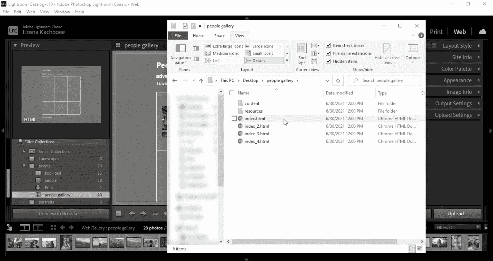
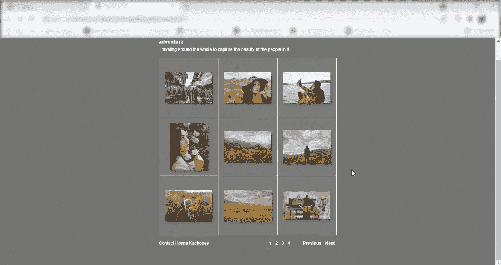
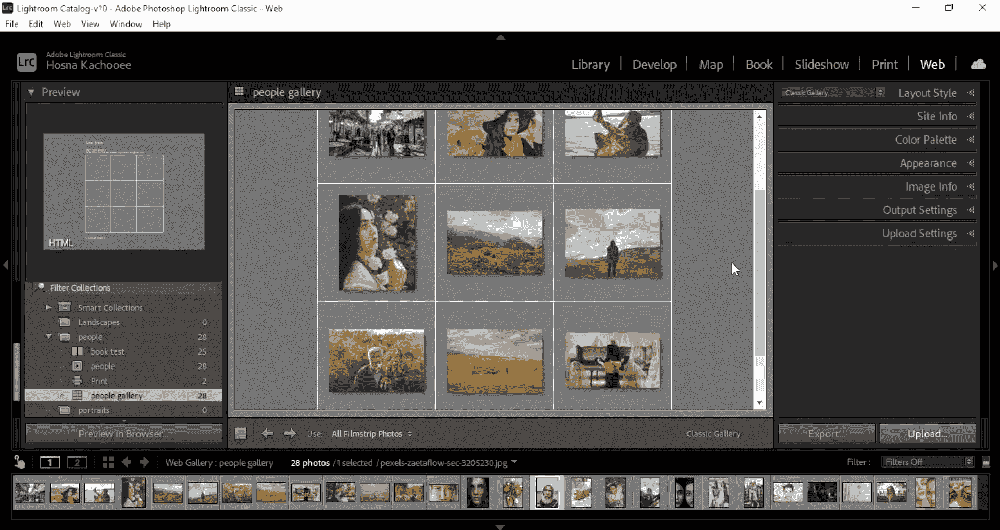

# Complete Adobe Lightroom Megacourse： Beginner to Expert Photo Editing part2: p72: Web模块：创建在线作品集 🌐

在本节课中，我们将学习Lightroom Classic中的最后一个模块，也就是Web模块。这个模块的主要作用是帮助你建立一个在线作品集，让你的照片不再只存在于电脑里，而是可以通过网页形式展示给其他人。我们会从画面布局开始，逐步讲解如何设置网站信息、调整颜色、添加水印，最后导出成一个可以直接分享的HTML相册。

Web模块是什么，以及它能解决什么问题

Web模块听起来可能不够直观，但它的功能非常具体。它的作用是为你创建一个在线图片集，替代传统的打印画册或实体照片。你不需要把图片打印出来做成实体书，而是可以直接生成一个网页版的作品集。这种方式非常方便，尤其是当你想把作品展示给客户、老板或者任何其他人时，只需要分享一个网页链接，比发送实体拷贝或单独的JPG文件要简单得多。

当你完成本节内容后，你将掌握完整的Lightroom工作流程。这个流程可以用下面这个公式来描述：

原始图片 → 后期处理 → 加入图片集 → 添加元数据 → 发布作品 → 在线分享

这意味着从导入照片开始，到最终把作品发布到网络上的每一个环节，你都已经知道该如何操作。

画面布局与可选的相册类型

Web模块的界面布局与打印模块、幻灯片模块以及图书模块非常相似。它们拥有类似的设置面板，但并不完全相同，每个模块都有一些独特的功能。如果你已经掌握了前三个模块的操作方法，那么第四个Web模块对你来说不会太难。

布局风格与打印模块相似，但有一个关键区别：这里是相册展示，而不是实体打印。

以下是目前内置的四种相册样式：

- 经典相册：默认选择，适合大多数初学者使用。
- 网格相册：图片以网格形式排列。
- 方形相册：与网格相册类似，但不带边框。
- 条状相册：类似电影胶片条，图片彼此相连。

如果你想要更多样式，也可以在网上寻找其他相册模板，但内置的这几种已经足够让你起步。

在开始制作之前，你需要先准备一个包含想要分享图片的图片集。你可以在图片集面板中进行管理。例如，如果你不希望某张图片出现在相册里，可以右键点击该图片，选择从图片集中移除，图片就会立即消失。

网站信息的填写方法

在正式设置外观之前，你需要先填写网站的基本信息。这些信息会直接显示在生成的网页上，让访问者了解你的作品集是关于什么的。

以下是需要填写的主要字段：

- 画廊标题：你的画廊叫什么名字，例如People 2020。
- 集合标题：这一组图片的集合名称，例如Adventure。
- 集合描述：一段简短的文字，用来讲述这些图片拍摄的背景故事，比如旅行拍摄、记录人物美丽瞬间等等。
- 网页或邮件链接：访问者点击后可以跳转到你的个人网站或发送邮件。
- 联系信息：填入你的姓名或联系方式，方便对方与你取得联系。

填写这些信息后，访问者打开你的画廊时，就能看到标题和描述，从而更好地理解每张照片拍摄的初衷。

身份标识牌的设置

身份标识牌类似于你的个人签名或品牌标志。如果开启这个功能，你的名字会以醒目的方式显示在页面上。你可以选择之前制作好的预设，把名字放在页面上，让访问者一眼知道是谁的作品。

不过在Web画廊中，过多的文字可能会让页面显得拥挤，抢走图片的风头。如果你希望图片本身成为视觉焦点，可以选择关闭身份标识牌。当然，如果你喜欢，也可以专门为网页画廊制作一个专属的身份标识牌，并设置点击后跳转到你的网站或邮箱地址。

此外，你还需要为Web画廊本身命名。这个名称最终会成为HTML文件的名字，建议和画廊标题保持一致，避免出现无关的命名。

颜色调板的调整

颜色调板决定了你HTML画廊的整体视觉风格，包括文字颜色、背景颜色和单元格颜色等。

在调整面板时，有一个实用的小技巧叫做单独模式。你可以右键点击任意一个面板，选择开启单独模式。开启后，当你打开一个面板时，其他所有面板会自动关闭，这样界面会更加整洁，不需要手动一个个关闭。

以下是颜色调板中可以调整的项目：

- 文字颜色：页面上普通文字的颜色，可以选择白色。
- 详细文字颜色：如果没有详细说明文字，可以直接关闭。
- 背景颜色：页面整体的背景，可以选择黑色。
- 单元格颜色：图片所在格子的颜色，也可以选择黑色。
- 悬停颜色：鼠标移到图片上方时显示的颜色。
- 指南线颜色：用于辅助对齐的线条颜色。
- 数字颜色：图片编号的颜色。

通过这些设置，你可以让画廊变得五彩斑斓，或者保持黑白简约风格，完全取决于你的个人喜好。

外观设置的细节调整

外观面板用于控制画廊的网格规模、阴影效果以及边框样式。

以下是可以调整的外观选项：

- 网格尺寸：决定每页显示多少张图片，默认是3乘3，也可以改为4乘3等其他比例。
- 投影阴影：在每张图片下方添加阴影，让页面看起来更有层次感。如果关闭，图片会显得比较平面。
- 分区边框：用于区分不同图片区域的边框，通常可以关闭。
- 显示单元格编号：给每张图片加上数字编号，如果不喜欢大号数字，可以关闭。
- 照片边框：在图片周围添加边框，颜色也可以自定义，或者直接关闭。

关于图片尺寸，需要注意的是，在这里做的调整不会立即在预览中显示，只有当你最终发布作品后，这些变化才会生效。

图片信息与输出设置

图片信息面板控制访问者在浏览画廊时能看到什么内容。如果你在导入照片时已经添加了标题和说明文字，那么访问者点击图片后就能看到这些信息。如果没有添加，页面上只会显示图片本身。

输出设置决定了最终发布画廊的技术参数。

以下是输出设置中的关键选项：

- 图片质量：可以选择低画质或高画质。画质越低，网页加载速度越快，但图片细节会变差；画质越高，图片更清晰，但加载时间会变长。建议选择一个让访问者能清楚看到图片的平衡点。
- 元数据：可以将之前制作好的元数据模板添加到图片中，例如版权信息。如果有人右键点击图片查看属性，就能看到你的版权标记和姓名，证明这些照片是你拍摄的。
- 水印：可以在图片上添加半透明的文字或图标水印。如果你不希望水印影响观看体验，可以直接关闭。
- 锐化：锐化是在导出时应用的，预览页面看不出来效果。建议保持标准设置，等到真正发布后再查看效果。

上传设置与预设保存

上传设置决定了生成的画廊文件存放在哪里，以及如何组织文件夹。

你可以选择将文件放入子文件夹，或者在你的Lightroom图集目录中创建专门的文件夹。例如，可以创建一个名为gallery people的文件夹，路径可以是slash gallery people。如果你希望以后能快速使用相同的样式和文字，可以点击加号创建新预设，并将其保存在用户模板中。下次制作画廊时，直接选中这个预设即可，不需要重新设置每一项。

你还可以为画廊添加筛选条件，只导出标记的图片、选中的图片，或者整条胶片带中的所有图片。如果你没有给图片添加评分或标记，可以把这些筛选条件都关闭。

保存Web画廊并导出

当所有设置完成后，你可以保存这个Web画廊。保存后的画廊既会出现在你的硬盘上，也会出现在Lightroom的图集目录中。你可以把它放入当前的图片集，方便以后管理。如果你需要，也可以创建虚拟副本，这样副本中可以包含原图没有的内容，比如水印或边框。

接下来就是导出步骤。选择一个保存位置，给文件夹命名，比如People Gallery，然后开始导出。导出完成后，打开文件资源管理器，进入你保存的位置，你会看到一个名为People Gallery的文件夹，里面包含index.html文件以及若干个单独的页面文件。

双击打开index.html，它会在你的浏览器中显示整个画廊。你可以点击下一页查看不同的图片，也可以点击联系方式跳转到你的网站或邮箱。如果你给图片添加了标题，标题也会显示出来。现在你已经拥有一个可以在线分享的画廊，只需要把这个HTML文件发送给任何人即可。

FTP上传选项

除了直接导出HTML文件，Lightroom还提供了通过FTP服务器上传画廊的选项。

FTP的全称是文件传输协议服务器。简单来说，它允许你通过服务器和计算机网络，将画廊文件传输到另一台电脑或另一个人那里。如果你使用FTP，通常需要填写服务器名称、用户名和密码，这些信息一般会由接收文件的人提供。

不过为了保持操作简单，本教程建议优先使用导出面板来完成画廊的生成和分享。

总结

在本节课中，我们一起学习了Lightroom Classic的Web模块。你了解了如何从零开始创建一个在线图片集，如何填写网站信息、设置身份标识牌、调整颜色调板、修改外观细节、配置输出设置，最后导出成一个可以直接在浏览器中打开的HTML画廊。

完成这一节后，你已经学习完了Lightroom的所有模块，掌握了从导入原始图片到最终分享作品的完整流程。如果你使用Adobe账号，还可以同步图集目录，以防程序或电脑出现问题时丢失设置。

接下来的课程中，我们将探讨更具体的编辑风格，以及在学完图像开发后可以尝试的其他方向，比如参加摄影比赛、在知名平台上建立在线作品集等等。今天的内容就到这里，我们下节课再见。
