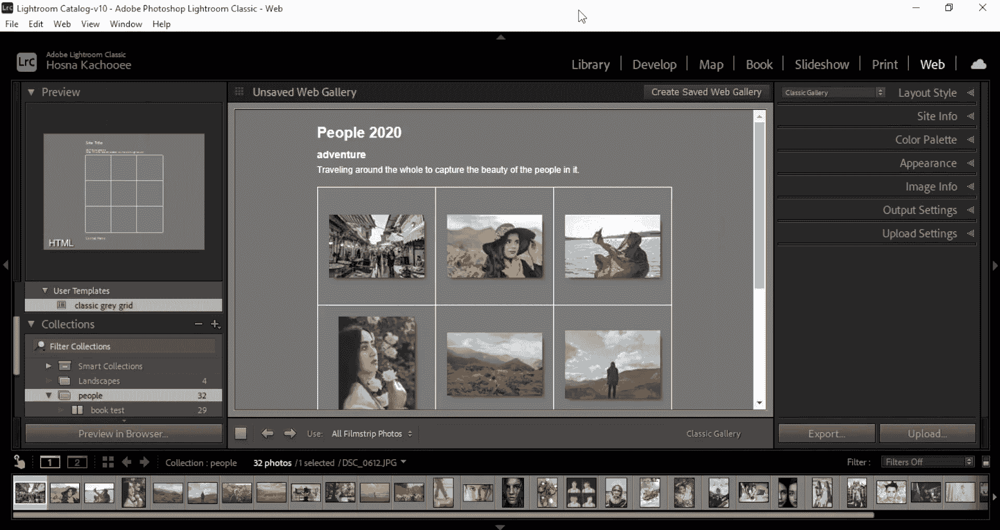

# 完整Adobe Lightroom 大师课：零基础到专家级照片编辑：73：各模块顶部选项详解 🖼️


在本节课中，我们将继续学习 Adobe Lightroom 各个模块最上方菜单栏的功能。上一节课我们已经介绍了库模块面板里各个工具的作用，本节课我们把注意力转移到屏幕最顶部的选项条上。这些选项在库模块、开发模块、地图模块以及图书、幻灯片、打印、网页等模块中基本都会出现，虽然很多功能和下方面板里的按钮是重复的，但了解顶部菜单能让你更快地找到所需操作。我们会用大白话把每个菜单项讲清楚，即使是第一次接触 Lightroom 的新手也能看懂。

## 📁 库模块顶部选项：File 菜单

上一节我们介绍了库模块面板的基础操作，本节我们先来看看库模块最上方 File 菜单里都有哪些选项。

File 菜单是 Lightroom 左上角的第一个菜单，里面的选项和你在其他电脑软件里看到的文件菜单差不多，不过都是针对照片目录和导入导出设计的。你可以把它当成 Lightroom 的文件操作总开关，下面我们逐项来看，方便你以后对照使用。

核心概念描述如下：

```
目录（Catalog）= 所有导入照片的集中管理容器
New Catalog = 创建一个全新的图片管理容器
```

以下是库模块 File 菜单下的主要选项及其含义：

- `New Catalog`（新建目录）：创建一个全新的图片目录，用来存放你导入的所有照片。你可以理解为给 Lightroom 新建一个相册管理本。
- `Open Catalog`（打开目录）：打开电脑中已保存的目录文件，里面的照片会立刻出现在库模块中。
- `Open Recent`（打开最近使用的目录）：显示你最近打开过的目录列表，方便快速切换。
- `Optimize Catalog`（优化目录）：对目录进行整理优化，让 Lightroom 运行更流畅。
- `Import Photos and Videos`（导入照片和视频）：把电脑、存储卡或外接硬盘里的图片和视频导入 Lightroom。
- `Import from Another Catalog`（从另一个目录导入）：把其他 Lightroom 目录里的照片导入当前目录。
- `Import a Photoshop Elements Catalog`（导入 Photoshop 元素目录）：如果你有 Photoshop Elements 生成的目录，可以用此选项导入。
- `Tethered Capture`（拍摄捕获）：在摄影棚工作时连接相机，拍下的照片会直接显示在 Lightroom 中。
- `Auto Import`（自动导入）：启用后，Lightroom 会自动导入 SD 卡或外接闪存盘里的新照片。
- `Import Develop Profiles and Presets`（导入开发配置文件和预设）：把你从网上下载或保存在外接硬盘里的预设导入 Lightroom。
- `Exporting`（导出）：把选中的照片导出为常见格式。
- `Export with Previous`（使用上一次设置导出）：使用和上一张导出照片相同的设置进行导出。
- `Export with Preset`（使用预设导出）：在导出的同时直接应用某个预设，可以选择导出为邮件附件、DNG、JPEG 等格式。
- `Export as Catalog`（导出为目录）：把大量照片导出为一个目录文件，保存到本地硬盘或外接硬盘，方便以后使用。
- `Email Photos`（通过邮件发送照片）：直接把照片通过电子邮件发送出去。
- `Plug-in Manager`（插件管理器）：安装和管理用于处理照片的第三方插件，新手可以先用 Lightroom 自带的管理功能。
- `Plug-in Extras`（插件扩展）：如果你有额外的插件想添加到 Lightroom，在这里进行操作。
- `Show Quick Collection`（显示快速集合）：把一些照片临时放在一起，不需要花时间去创建正式的相册。
- `Clear Quick Collection`（清空快速集合）：把快速集合里的所有照片移除。
- `Library Filters`（库筛选器）：按照旗标、星级、颜色标签等条件筛选照片，只显示符合条件的图片。
- `Set up Printer`（设置打印机）：如果你想直接从 Lightroom 打印照片，可以在这里配置打印机。
- `Page Setup`（页面设置）：设置打印时页面的样式和布局。
- `Exit Lightroom`（退出 Lightroom）：关闭程序。

File 菜单的内容我们就讲到这里，接下来继续看看库模块里的 Edit 菜单和其他菜单。

## 🛠️ 库模块顶部选项：Edit、Library 与 Image 菜单

介绍完 File 菜单之后，我们接着看看库模块里剩下的几个常用菜单，包括 Edit、Library 和 Image 等。

这些菜单主要用于对已导入照片的筛选、选择和元数据管理。对初学者来说，你不需要一下子全部记住，先知道有这些选项，用到的时候再回来查即可。

以下是库模块中 Edit、Library、Image 等菜单的常见选项：

- `Undo`（撤销）：撤销上一步操作。
- `Change Source`（更改来源）：更改照片的导入来源路径。
- `Select All`（全选）：选中当前所有照片。
- `Select None`（全不选）：取消所有选择。
- `Invert Selection`（反选）：把已选和未选的状态互换，比如只选中了第一张，反选后就是除了第一张之外的所有照片。
- `Deselect Active Photo`（取消选中当前照片）：只取消当前选中照片的选择状态。
- `Select Flagged Photos`（选中已标记照片）：只选中你加了旗标标记的照片。
- `Deselect Unflagged Photos`（取消选中未标记照片）：取消没有旗标照片的选择。
- `Select by Flag`（按旗标选择）：选择特定类型的旗标照片，如选中、未选中、拒绝等。
- `Preferences`（偏好设置）：清理缓存文件、临时文件，修改 Lightroom 存储数据的位置等技术设置。
- `Catalog Settings`（目录设置）：设置目录相关参数，包括识别板设置、编辑水印等。
- `New Collection`（新建相册）：在库模块中创建新的照片集合。
- `New Smart Collection`（新建智能相册）：根据条件自动收集照片的相册。
- `Collection Set`（相册集）：用来组织多个相册的文件夹。
- `New Folder`（新建文件夹）：在目录中创建新文件夹。
- `Find a Photo or Folder`（查找照片或文件夹）：在库中查找特定照片或文件夹。
- `Enable Filters`（启用筛选器）：按照指定条件筛选照片。
- `Show Photos in Subfolders`（显示子文件夹中的照片）：把子文件夹里的照片也显示出来。
- `Refine Photos`（优化照片）：对照片进行进一步筛选。
- `Find All Missing Photos`（查找所有丢失照片）：找出显示为丢失状态的照片，通常带有问号图标。
- `Validate DNG Files`（验证 DNG 文件）：检查 Adobe 的原始格式 DNG 文件是否完整。
- `Find Faces`（查找人脸）：让 Lightroom 重新扫描照片中的人脸。
- `Remove Photo`（移除照片）：从库中移除选中的照片。
- `Photo Merge`（照片合并）：创建全景照片，或者自动增强图片。
- `Create Virtual Copy`（创建虚拟副本）：生成一份不占用硬盘额外空间的照片副本，只在 Lightroom 中作为虚拟存在。
- `Rotate / Flip`（旋转/翻转）：旋转或翻转照片方向。
- `Set Flag / Rating / Label`（设置旗标/评分/标签）：给照片打标记、打星级或添加颜色标签。
- `Auto Enhance`（自动增强）：让 Lightroom 自动优化照片。
- `Develop Settings`（开发设置）：自动应用一些开发模块的设置，比如转黑白、调整白平衡等。
- `Metadata`（元数据）：编辑关键词、拍摄时间、版权等照片信息，可以复制、粘贴或同步元数据。
- `View`（视图）：隐藏或显示工具栏、筛选条，切换放大视图，调整网格大小，按不同方式排序照片。
- `Loupe / Compare / People`（放大镜/对比/人物）：放大查看单张照片，对比多张照片，或查看 Lightroom 识别出的人脸。
- `Go to Develop`（前往开发模块）：切换到开发模块进行后期编辑。
- `Window`（窗口）：管理屏幕布局、模块切换、前进后退等界面选项。
- `Help`（帮助）：在卡住时查找帮助文档。

库模块的顶部选项我们基本看完了，接下来我们切换到开发模块，看看这里的顶部菜单有什么变化。

## 🎨 开发模块顶部选项

库模块的顶部选项我们已经看完了，现在我们切换到开发模块，看看这里的顶部菜单有什么不同。

开发模块是 Lightroom 里进行照片后期编辑的核心区域。它的顶部菜单和库模块很像，但有一些专门针对编辑操作的选项。File 菜单在每个模块里几乎是一样的，所以这里我们主要关注和开发相关的菜单项。

以下是开发模块中常用的顶部选项及其作用：

- `New Snapshot`（新建快照）：保存当前编辑状态的一个副本，方便以后对比或恢复。
- `New Preset`（新建预设）：把当前的编辑参数保存为预设，下次可以一键应用到其他照片。
- `Clear History`（清除历史）：清除编辑历史记录。
- `Reset All Settings`（重置所有设置）：把基本面板和下方所有面板的设置恢复默认。
- `Update to Current Process Version`（更新到当前处理版本）：让照片使用最新的处理引擎，默认即可，当前为版本 5。
- `Copy Settings`（复制设置）：复制当前照片的所有编辑参数。
- `Paste Settings from Previous`（粘贴之前的设置）：把刚才复制的设置应用到另一张照片，实现批量统一编辑。
- `Auto White Balance`（自动白平衡）：让 Lightroom 自动调整照片的白平衡。
- `Auto Settings`（自动设置）：让 Lightroom 自动完成整张照片的编辑。
- `Convert to Black and White`（转为黑白）：把彩色照片转换为黑白照片。
- `Reset Crop`（重置裁剪）：恢复裁剪工具的默认设置。
- `Crop as Shot`（按原始比例裁剪）：保持拍摄时的原始宽高比。
- `Constrained Aspect Ratio`（固定宽高比）：裁剪时锁定特定的宽高比。
- `Copy After Settings to Before`（复制后设置到前设置）：把后状态的编辑参数复制到前状态。
- `Swap Before and After Settings`（交换前后设置）：交换前和后两个状态的编辑参数，这里的前后是指软件界面里的前后对比预览。
- `Crop / Spot Removal / Red Eye`（裁剪/去斑/红眼）：开发模块常用的修图工具。
- `Graduated Filter / Radial Filter / Adjustment Brush`（渐变滤镜/径向滤镜/调整画笔）：局部调整照片光线和颜色的工具。
- `Guided Upright`（引导矫正）：自动矫正照片的透明和歪斜。
- `White Balance Selector`（白平衡选择器）：在照片中点击中性灰点来设定白平衡。
- `Fringe Color Selector`（色纹选择器）：去除照片边缘的色纹。
- `Target Adjustments`（目标调整）：直接在照片上拖动来调整特定区域。
- `View`（视图）：隐藏工具栏、查看前后对比、开启放大镜、显示剪切警示等。
- `Window / Help`（窗口/帮助）：界面布局和帮助支持。

开发模块的顶部选项我们已经梳理清楚，接下来我们来看看地图模块的顶部菜单。

## 🗺️ 地图模块顶部选项

开发模块的顶部选项我们已经梳理清楚，接下来我们来看看地图模块的顶部菜单。

地图模块主要用于查看和管理照片的地理位置信息。它的顶部菜单大部分和之前的模块相同，但多了一些与地图定位和路径记录相关的功能。

以下是地图模块中特有的顶部选项：

- `Filter by Location`（按位置筛选）：在地图上筛选拍摄地点的照片。
- `Track Log`（轨迹记录）：查看和管理 GPS 轨迹记录，了解拍摄时的移动路线。
- `Search Track Images`（搜索轨迹图片）：在轨迹记录中查找对应的照片。
- `Delete GPS Coordinates`（删除 GPS 坐标）：删除照片的地理位置坐标信息。
- `Delete All Location Metadata`（删除所有位置元数据）：一次性清除照片里所有的地理位置数据。
- `View`（视图）：选择地图样式，显示或隐藏工具栏、地图图例和信息面板。
- `Go to Library / Develop / Crop`（前往库/开发/裁剪）：从地图模块快速跳转到其他模块处理照片。
- `Window / Help`（窗口/帮助）：界面布局和帮助支持。

地图模块的顶部选项主要是围绕位置信息展开的，接下来我们看看图书模块有哪些顶部功能。

## 📖 图书模块顶部选项

地图模块的顶部选项主要是围绕位置信息展开的，接下来我们看看图书模块有哪些顶部功能。

图书模块用来制作照片书或画册。它的顶部菜单里有一个专门的图书选项，用于创建新书、翻页、更新说明文字等操作。

以下是图书模块中常用的顶部选项：

- `Create Saved Book`（创建已保存的图书）：新建一个可以保存的图书项目。
- `Go to Beginning / Previous / Next / End`（跳转到首页/上一页/下一页/末页）：在图书页面间快速导航。
- `Update Metadata Based Captions`（根据元数据更新说明文字）：自动根据照片的元数据生成图片说明。
- `View`（视图）：选择不同的页面预览方式，显示信息叠加层或参考线。
- `Zoomed Page`（缩放页面）：放大查看单个页面的细节。
- `Window / Help`（窗口/帮助）：界面布局和帮助支持。

图书模块的功能比较集中在图书制作上，接下来我们来看看幻灯片模块的顶部菜单。

## 🖥️ 幻灯片模块顶部选项

图书模块的功能比较集中在图书制作上，接下来我们来看看幻灯片模块的顶部菜单。

幻灯片模块用来制作照片播放演示文稿。它的顶部菜单除了常规的 File 和 Edit 之外，还有一个专门的幻灯片菜单，可以用来创建模板、导出 PDF、视频或 JPG 格式的幻灯片。

以下是幻灯片模块中常用的顶部选项：

- `Create Saved Slideshow`（创建已保存的幻灯片）：新建并保存一个幻灯片项目。
- `New Template`（新建模板）：创建新的幻灯片布局模板。
- `New Template Folder`（新建模板文件夹）：用来整理幻灯片模板。
- `Export PDF Slideshow`（导出 PDF 幻灯片）：把幻灯片导出为 PDF 文件。
- `Export JPG Slideshow`（导出 JPG 幻灯片）：把幻灯片导出为 JPG 图片序列。
- `Export Video Slideshow`（导出视频幻灯片）：把幻灯片导出为视频文件。
- `Text Overlay`（文字叠加）：在幻灯片中添加标题或说明文字。
- `Run Slideshow`（运行幻灯片）：开始播放幻灯片。
- `Pause`（暂停）：暂停当前播放的幻灯片。
- `Next Slide / Previous Slide`（下一张/上一张）：在幻灯片页面间切换。
- `Use Selected Photos`（使用选中的照片）：只使用当前选中的照片制作幻灯片。
- `Use All Filmstrip Photos`（使用所有胶片条照片）：使用底部胶片条里的所有照片。
- `Use Flagged Photos`（使用已标记照片）：只使用加了旗标的照片。
- `View`（视图）：隐藏工具栏、隐藏参考线、显示标题栏等。
- `Screen Mode`（屏幕模式）：切换全屏、灯光关闭等显示模式。
- `Window / Help`（窗口/帮助）：界面布局和帮助支持。

幻灯片模块的顶部选项我们已经看完，接下来我们进入打印模块。

## 🖨️ 打印模块顶部选项

幻灯片模块的顶部选项我们已经看完，接下来我们进入打印模块。

打印模块用来把照片输出到纸张上。它的顶部菜单可以帮你创建打印模板、选择打印照片、旋转图片以及设置打印布局。

以下是打印模块中常用的顶部选项：

- `Create Saved Prints`（创建已保存的打印项）：保存当前的打印设置。
- `New Template`（新建模板）：创建新的打印布局模板。
- `New Template Folder`（新建模板文件夹）：整理打印模板。
- `Use Selected Photos`（使用选中的照片）：只打印当前选中的照片。
- `Use All Filmstrip Photos`（使用所有胶片条照片）：打印底部胶片条里的所有照片。
- `Use Flagged Photos`（使用已标记照片）：只打印加了旗标的照片。
- `Rotate`（旋转）：旋转打印时的图片方向。
- `View`（视图）：显示或隐藏叠加层和参考线，建议保持默认设置。
- `Screen Mode`（屏幕模式）：切换屏幕显示模式和灯光模式。
- `Window / Help`（窗口/帮助）：界面布局和帮助支持。

打印模块的顶部选项主要围绕纸质输出展开，最后我们来看看网页模块。

## 🌐 网页模块顶部选项

打印模块的顶部选项主要围绕纸质输出展开，最后我们来看看网页模块。

网页模块用来制作可以发布到网上的照片画廊。它的顶部菜单可以创建网页画廊模板、选择照片内容、导出网页相册并在浏览器中预览。

以下是网页模块中常用的顶部选项：

- `Create Saved Web Gallery`（创建已保存的网页画廊）：新建并保存一个网页相册项目。
- `New Template`（新建模板）：创建新的网页画廊布局模板。
- `New Template Folder`（新建模板文件夹）：整理网页模板。
- `Reload`（重新加载）：刷新当前的网页画廊预览。
- `Export Web Photo Gallery`（导出网页照片画廊）：把画廊导出为可上传到网站的文件。
- `Preview in Browser`（在浏览器中预览）：用浏览器打开并查看画廊效果。
- `About Class Gallery`（关于画廊类）：查看当前使用的画廊模板说明。
- `View / Window / Help`（视图/窗口/帮助）：界面布局和帮助支持。



本节课中我们一起学习了 Adobe Lightroom 各个模块最上方菜单栏的功能。我们详细介绍了库模块的 File、Edit、Library 等菜单，了解了新建目录、导入导出、筛选照片等操作；接着看了开发模块的预设、快照、复制粘贴设置等编辑相关选项；又概览了地图、图书、幻灯片、打印和网页模块的顶部菜单，知道了它们分别用于位置管理、画册制作、幻灯片播放、照片打印和网页画廊发布。虽然很多选项在下方面板里也能找到，但熟悉顶部菜单能让你更快速地完成工作。希望这篇教程能帮助你更好地掌握 Lightroom 的界面操作。
