# 🚀 低级设计速成：1：并发简介


在本节课中，我们将学习低级设计中最容易出错的部分——并发。课程会把并发问题分成三个主要类别：正确性、协调和稀缺性。对于每一类问题，我们会看具体场景，说明常见的陷阱，并介绍可以用来解决的工具和原语。所有内容都会用大白话讲解，即使你是初学者也能看懂。文章后面还会给出一个快速检查清单，帮助你在面试中快速判断该用哪种方案。


接下来我们先看一个具体的并发场景，帮助你建立直观感受。


## 背景：订票系统与共享状态


假设你正在开发一个类似 TicketMaster 的订票服务。这里需要注意，这不是分布式系统设计，也不是架构设计，而是低级设计，也就是说我们只在一个进程内部工作。在这个订票系统里，用户可以浏览座位并预订座位。你会先写一个 `bookSeat` 函数，这个函数属于预订服务类。函数接收一个座位编号，先检查该座位是否可用，如果可用就完成预订。


下面是 Java 和 Python 的示例代码，你可以任选一种参考。

```java
// Java 示例
public void bookSeat(String seatId) {
    if (seats.containsKey(seatId) && seats.get(seatId).equals("available")) {
        seats.put(seatId, "booked");
    }
}
```

```python
# Python 示例
def book_seat(self, seat_id):
    if seat_id in self.seats and self.seats[seat_id] == "available":
        self.seats[seat_id] = "booked"
```

这段代码看起来好像没有问题。事实上，如果你使用的是单线程语言，比如 TypeScript，那么这段代码确实没问题。但如果程序运行在多线程环境下，就会出现麻烦。当两个用户尝试在同一时刻预订同一个座位时，会有两个线程几乎同时访问同一个共享状态，也就是座位映射表。我们来具体推演一下会发生什么。


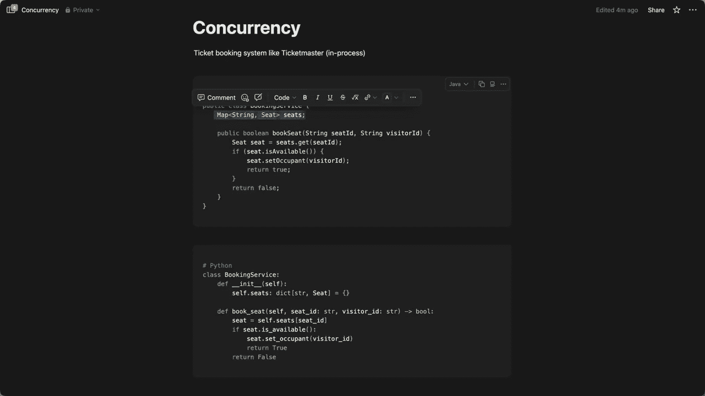

### 并发冲突的具体过程


我们可以把两个线程分别命名为 Alice 和 Bob。Alice 先检查 7A 座位是否可用，结果是可用。紧接着，Bob 也检查 7A 座位是否可用，结果也是可用，因为 Alice 还没有完成她的预订。之后，Bob 完成了预订，与此同时 Alice 也完成了预订。由于两个操作几乎同时发生，Bob 的预订会覆盖掉 Alice 的预订。最后 Bob 拿到了这个座位，而 Alice 误以为自己拥有座位，结果去现场看演出时发现 Bob 在那里，这就出了大麻烦。

这个例子说明了面试中最常见的一种并发错误。它比较容易被忽略，除非你专门留意。当然，多线程系统中还有其他并发挑战，但它们都可以整齐地划分为三个主要类别：第一是正确性，就像我们刚才看到的；第二是协调；第三是稀缺性。当你明白这三类分别是什么、它们如何出现，以及如何解决之后，你就能应对低级设计或机器编码面试中几乎所有的并发问题了。


接下来我们逐一介绍这三类，先从正确性开始。


## 第一类：正确性问题


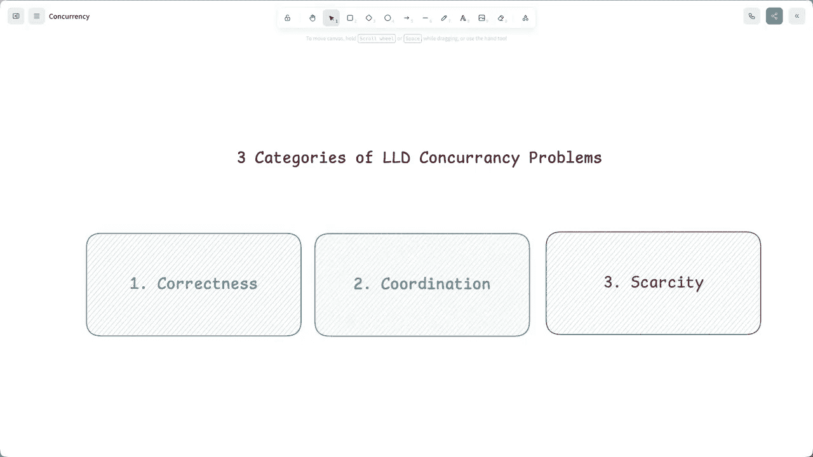

刚才我们看到，正确性问题发生在共享状态被损坏时，原因是两个线程试图在同一时刻访问它。在面试中，你需要留意的一个典型模式叫做“先检查再操作”。

以下是“先检查再操作”模式的典型场景：

- 停车场系统：先检查车位是否为空，再把车分配给该车位。
- 限速器：先检查用户是否未超过速率限制，再允许请求通过。
- 库存系统：先检查商品库存是否充足，再处理订单。

这些场景的形状完全一样，关键在于你要能一眼认出这个模式。

这个模式的问题在于，检查和操作之间存在一个时间差。在这个时间差里，另一个线程可能会悄悄修改状态，从而导致错误。这就是 bug 的根源所在。

要修复这个问题，核心思路是把检查和操作合并成一个原子操作。原子操作意味着这两个动作必须作为一个整体完成，不允许其他线程在中间插手。实现这一点的标准工具就是锁。每种编程语言都有自己的锁原语，例如 Rust 和 Go 中的互斥锁，Java 中的 `synchronized` 块，Python 中的 `Lock`，以及 C++ 中的互斥锁和信号量。这些工具都保证同一时间只有一个线程能执行一段代码，其他线程必须等待锁被释放。

使用锁的一般流程是：先获取锁，然后执行检查，再执行操作，最后释放锁。

下面是 Java 中使用 `synchronized` 块的示例：

```java
public void bookSeat(String seatId) {
    synchronized (this) {
        if (seats.containsKey(seatId) && seats.get(seatId).equals("available")) {
            seats.put(seatId, "booked");
        }
    }
}
```

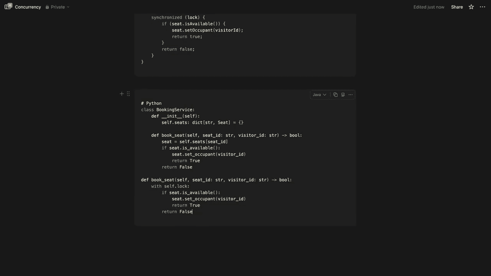

在 Java 里，`synchronized` 块内部的所有代码都在持有锁期间执行。进入块时获取锁，执行操作，在块结束时释放锁。

在 Python 中，思路类似，通常使用一个实例变量作为锁：

```python
import threading

class BookingService:
    def __init__(self):
        self.lock = threading.Lock()
        self.seats = {}

    def book_seat(self, seat_id):
        with self.lock:
            if seat_id in self.seats and self.seats[seat_id] == "available":
                self.seats[seat_id] = "booked"
```

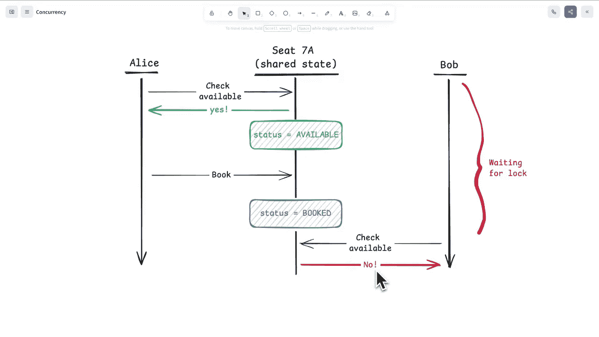

当锁被持有时，没有两个线程可以互相干扰。

如果回到刚才的图示，现在的流程是这样的：线程 Alice 检查座位是否可用，结果是可用，然后为 Alice 完成预订，座位状态变为已预订。在这整个过程中，Bob 无法插入，因为 Alice 已经先获取了锁并且一直持有着它。Alice 可以完成检查和操作这两个步骤，而 Bob 只能在一旁等待。只有当锁被释放，并且座位状态被设置为已预订之后，Bob 才能再次检查，这时他会正确地得知座位已经不可用。


正确性问题中第二个常见模式叫做“读取-修改-写回”。

这个模式是指：先读取一个数值，基于它计算出一个新值，然后把新值写回去。最经典的例子就是给计数器加一。你看到的代码可能只有一行 `count++`，但实际上它包含三个步骤：先读取当前值，再加一，最后把新值写回。如果两个线程同时执行这个操作，它们可能都读到 5，都算出 6，然后都写回 6。最终结果是 6，而正确结果应该是 7，这就丢失了一次递增。

这个模式会出现在点击计数器、银行账户余额、库存数量、指标聚合等场景中。简单来说，只要你要基于当前状态来更新一个数值，就会遇到“读取-修改-写回”模式。

修复思路和之前一样：把整个读取-修改-写回过程变成原子操作。对于简单的计数器，可以使用原子变量，它在硬件层面处理这个问题。现代 CPU 有特殊指令，比如比较并交换（Compare And Swap），可以在一个 CPU 周期内完成读取-修改-写回。硬件保证没有其他线程能在值被更新过程中看到中间状态。

以下是 Java 中的原子整数示例：

```java
import java.util.concurrent.atomic.AtomicInteger;

AtomicInteger count = new AtomicInteger(0);
int newValue = count.incrementAndGet(); // 原子地加一并返回新值
```

你不再使用 `count++`，而是调用 `incrementAndGet()`，这会在硬件层面使用比较并交换操作，最终返回 11（假设初始值为 10）。

不幸的是，Python 不支持内置的原子变量。在 Python 里，你只能像上面那样使用锁来解决这个问题。

那么，什么时候用原子变量，什么时候用锁呢？如果你只更新单个变量或计数器，比如标志位或简单统计量，可以使用原子变量。但如果你需要同时更新两个变量，并且要求它们保持一致，比如在账户之间转账，那么原子变量就不够用了，这时候必须依赖锁。

总结一下，正确性问题主要有两种模式：先检查再操作，以及读取-修改-写回。它们的根本原因相同，都是操作之间存在空隙，允许其他线程干扰。解决办法也相同，让操作变成原子的，通常使用锁，有时也可以使用原子变量，具体取决于语言以及你是否只更新单个变量。


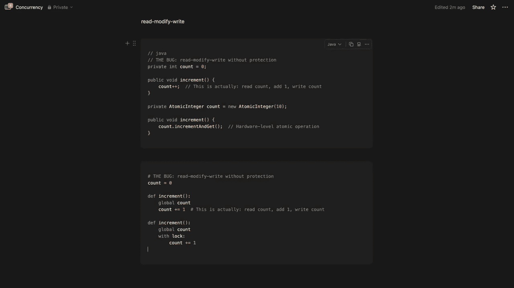

接下来我们进入第二类并发问题：协调。


## 第二类：协调问题


假设你正在开发一个网站，用户注册后需要发送一封欢迎邮件。发送邮件大约需要 500 毫秒，也就是半秒钟，你不希望注册请求被阻塞整整半秒。因此，你想要把这个耗时的工作交给后台线程，然后立即把注册结果返回给用户。

在这种情况下，你有 API 线程需要把任务传递给邮件发送线程或工作线程。最自然的解决方案是在两者之间放一个队列。生产者把任务推入队列，消费者也就是邮件发送者就可以从队列中取出任务并发送邮件。

看起来很简单，但这样做实际上引入了两个问题。以下是这两个问题：

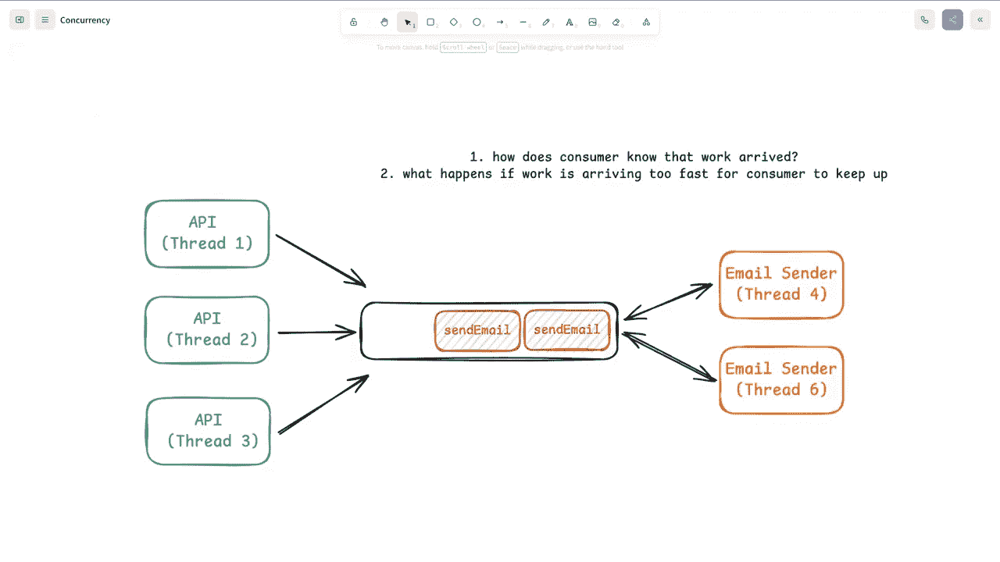

- 工作线程如何得知新工作已经到达，并且如何高效地得知？
- 如果工作到达的速度快于消费者处理的速度，会发生什么？

你可以想象一下，有大量发送邮件的任务，只有少数几个工作线程，队列会越来越长。下面我们先解决第一个问题。


### 工作线程如何等待任务


工作线程需要能够等待任务到来。最天真的方法是让线程在循环中不断检查是否有工作。下面是这种做法的伪代码：

```python
while True:
    if not queue.is_empty():
        task = queue.pull()
        process(task)
```

这个循环会一直运行，基本上是不间断地处理。问题很明显，线程在白白消耗 CPU。它一直在循环，不断检查队列：“准备好了吗？准备好了吗？准备好了吗？” 这浪费了本可用于其他地方的宝贵 CPU 资源。

你可能会想到的第一个改进方案是引入睡眠和轮询。也就是说，在尝试获取任务失败后，线程先睡一会儿，比如 100 毫秒，然后再试一次。下面是示例：

```python
while True:
    task = queue.try_pull()
    if task is None:
        sleep(100)  # 毫秒
    else:
        process(task)
```

这样做确实减少了一些 CPU 浪费，但仍然在浪费周期，并且引入了延迟。如果一个新任务需要 500 毫秒来发送邮件，可能实际上要花 600 毫秒，因为任务到达后，线程可能要等 100 毫秒才能从队列中取出它。

你真正想要的是：当没有任务时工作线程休眠，而一旦任务到达就立即唤醒。解决方案是使用阻塞队列。就像锁和原子变量一样，大多数主流编程语言都内置了阻塞队列。

阻塞队列的工作方式如下。工作线程调用 `take` 函数。如果队列是空的，该线程就会进入休眠状态。当生产者调用 `put` 向队列中放入元素时，会自动唤醒一个休眠中的工作线程，告诉它有任务可以处理了。

下面是 Java 实现示例：

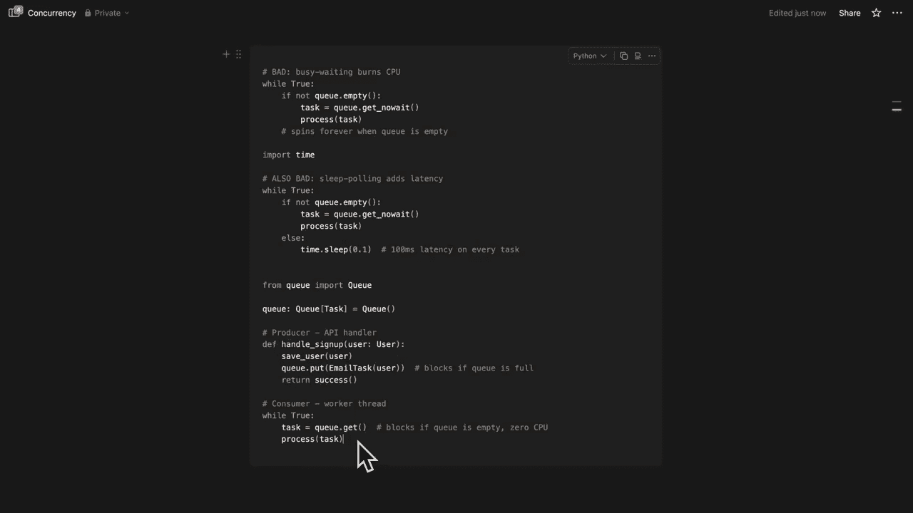

```java
BlockingQueue<Task> queue = new LinkedBlockingQueue<>();

// 生产者
queue.put(task);
return "success";

// 消费者
while (true) {
    Task task = queue.take(); // 如果队列为空，线程会在此处休眠
    process(task);
}
```

当新用户进来时，生产者把任务放入队列并立即返回成功，该线程就完成了。在消费者端，线程依然在循环中，但如果它调用 `queue.take()` 而队列为空，线程就会休眠，告诉其他线程可以先使用 CPU。直到下一次 `put` 发生，线程才会自动唤醒，处理任务，然后重复这个过程。

在 Python 中，队列默认就是阻塞队列。API 略有不同，使用 `put` 和 `get`，而不是 `take`，但总体概念是一样的。


接下来我们回到协调中的第二个问题：如果工作到达的速度太快，消费者来不及处理会发生什么？


比如一封营销邮件发出去后，50,000 个用户同时点击链接，产生了大量后台任务和邮件发送请求。队列会越来越长，最终变成无界的，导致内存耗尽，整个进程崩溃。这就是我们想要避免的情况。

解决方案是使用有界阻塞队列。你设置一个最大容量，当队列满了之后，生产者会阻塞，直到有空位为止。这种机制叫做背压。系统在处理不过来时会自然减速。有界阻塞队列就能解决这个问题。

实现方式很简单，在创建阻塞队列时指定最大元素个数即可。当达到这个数量时就开始施加背压。Python 中可以通过 `maxsize=1000` 这样的参数来实现。

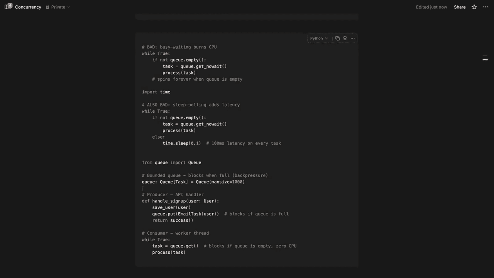

在面试中，几乎总是希望对队列加上界限，没什么理由不加。这个模式会出现在任何需要异步处理的场景，比如任务调度器、后台任务处理器或消息队列。如果工作需要从一个线程流向另一个线程，那就是协调问题，阻塞队列几乎总是你的首选答案。当然还有更多细节，比如如何合理设置缓冲区大小，关闭时会发生什么，如果请求路径不能接受阻塞该怎么办。但面试中最重要的一点是：如果需要协调，就使用有界阻塞队列。


接下来我们介绍最后一类并发问题：稀缺性。


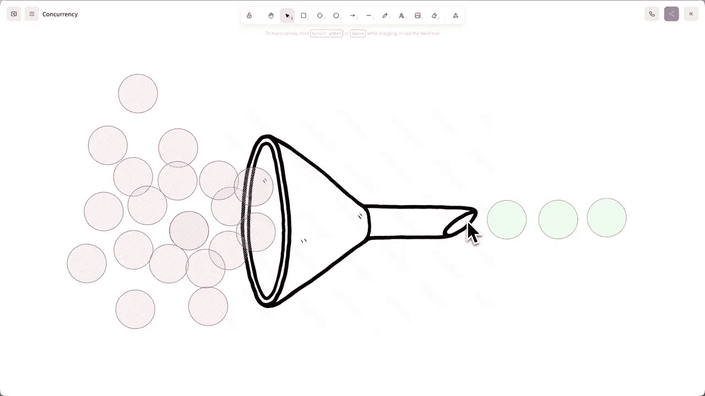

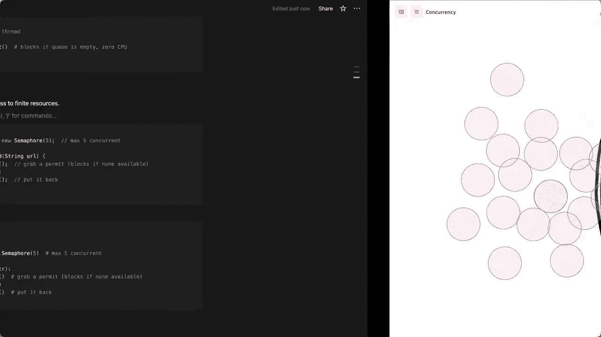

## 第三类：稀缺性问题


稀缺性问题是指需要限制对有限资源的并发访问。比如，你正在调用一个外部 API，该 API 只允许 10 个并发请求，也就是它的速率限制。而你有 50 个线程可能同时尝试调用它。

你需要一种方法，一次只允许 10 个线程在这里执行。

解决这个问题的工具叫做信号量。你可以把信号量概念上看作是一个许可桶。在执行某个操作之前，先从桶里拿一个许可；操作完成后，把许可放回桶里。如果你到达时桶里没有许可，就需要等待，直到有人把许可放回去。

下面是 Java 和 Python 的实现。Java 内置了信号量。假设你要下载一些昂贵的文件，并且希望同时下载的文件不超过 5 个，可能是为了避免内存耗尽或 IO 过载。你先获取一个许可，也就是从桶里拿一个许可，然后执行昂贵的下载操作，最后释放许可。这样就能保证同一时间只有 5 个线程在进行下载。

Java 示例：

```java
Semaphore semaphore = new Semaphore(5);

public void downloadFile() {
    semaphore.acquire();
    try {
        // 执行昂贵的下载
    } finally {
        semaphore.release();
    }
}
```

Python 示例：

```python
import threading

semaphore = threading.Semaphore(5)

def download_file():
    semaphore.acquire()
    try:
        # 执行昂贵的下载
    finally:
        semaphore.release()
```

这里有个值得注意的细节：如果下载操作抛出异常会怎样？如果抛出异常，程序就会跳出下载函数，异常会向上冒泡，而你从未释放信号量，也就没有把许可放回去。如果这种情况发生了 5 次，按照刚才的比喻，你的许可桶就会完全空掉，所有的信号量都被永久占用，整个系统会陷入停滞，不再有任何下载能够进行。这是面试中非常常见的一个 bug。当你处理稀缺性问题时，要问自己：我能保证信号量一定会被放回吗？许可一定会被归还吗？

幸运的是，解决办法很简单：用 `try-catch` 配合 `finally` 块。在 `try` 里执行下载，无论是否失败或出错，都在 `finally` 中释放许可。Python 中也是同样的做法，为了完整性，下面是示例：

```python
semaphore.acquire()
try:
    download()
finally:
    semaphore.release()
```

有时候，你不是在计数请求数量，而是在管理带有状态的实际对象。这一点很重要，请继续往下看。典型的例子是数据库连接。每个连接都持有一个打开的 TCP 套接字，占用内存，并跟踪事务状态。你不能为每个请求或每个查询都创建一个新连接。相反，你应该创建一个连接池，比如打开 10 个连接，然后让所有线程复用这 10 个连接，这样就不用频繁打开和关闭连接了。

这是稀缺性问题的另一种变体。之前的例子是简单计数，而现在你面对的是一个固定的资源集合。解决方案和我们在协调部分看到的一样：可以使用阻塞队列。把队列填满你的对象，线程取出一个，使用它，然后把它放回去。底层原语仍然是阻塞队列，但使用方式略有不同，你基本上是在把它当作一个对象包或可复用的对象池。

下面是具体实现。我们继续使用阻塞队列，实例化时务必指定上限。然后加载连接，假设有 10 个连接，把它们都放入池中，也就是放入队列。每次你想要执行查询时，首先要做的就是从池中取出一个连接。如果没有可用连接，就会阻塞等待，就像协调部分说的那样。执行查询，最后在 `finally` 块中把连接放回池中。这里和释放锁或放回信号量略有不同，你只是把连接重新放回池中，也就是再次调用 `put`。此时下一个正在等待的线程就可以拿到它了。

Python 中的实现思路完全一样。

无论哪种情况，稀缺性问题的模式都是一样的：你获取一个稀缺资源，使用它，然后释放它，并且使用 `finally` 块确保即使出错也能释放。


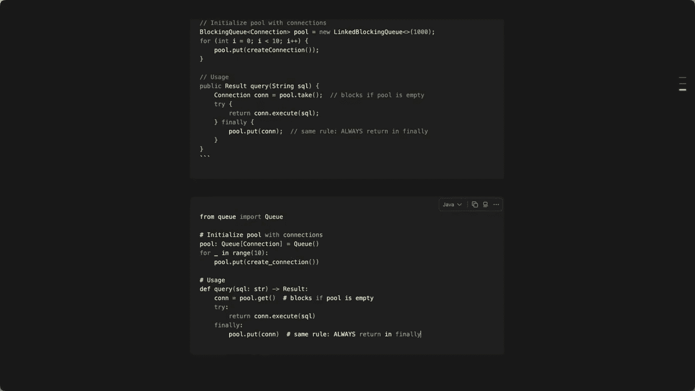

## 总结与面试检查清单


好了，现在我们把视角拉回来，总结一下。如果你在低级设计面试中遇到并发问题，可以参考这个心理检查清单。

第一，问自己：是否存在多个线程可以访问的共享状态？如果答案是肯定的，那就是正确性问题。对于正确性问题，我们讨论了“读取-修改-写回”和“先检查再操作”两种模式。无论哪种情况，你都可以使用锁或原子变量。

第二，考虑工作是否需要从一个线程流向另一个线程。如果是，那就是协调问题。你需要思考两种情况：没有工作时该怎么办，以及工作太多时该怎么办。这两种情况通常都要使用阻塞队列或有界阻塞队列。

第三，如果存在某个东西的固定数量限制，那就是稀缺性问题。要确保资源总是在 `finally` 块中被释放，并且通常应该使用信号量或把阻塞队列当作对象池来使用。

大多数面试问题都能清晰地映射到这三个类别之一。当你能识别出这三类，并在面试中看出来的时候，你就知道该应用哪些解决方案，事情也就变得很简单。

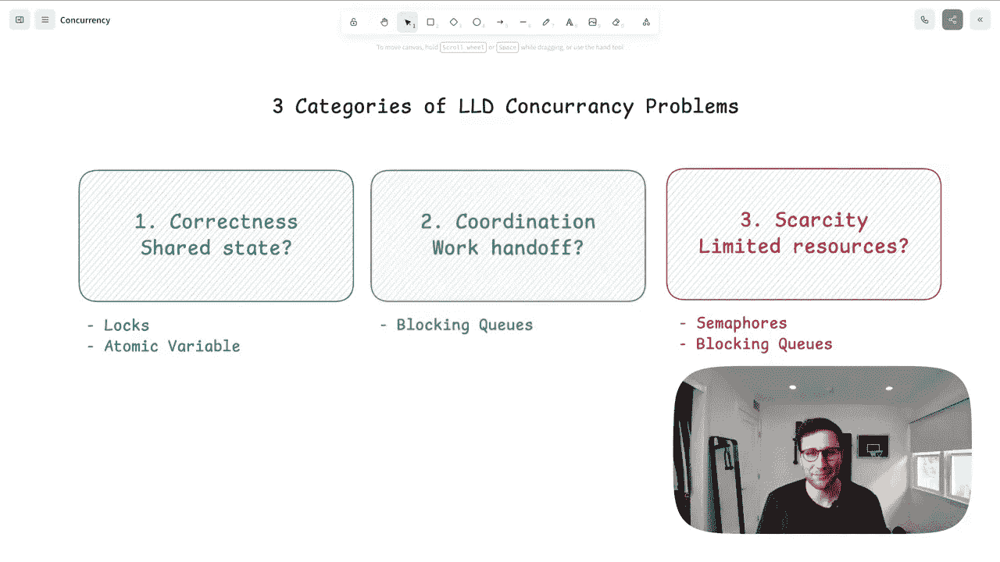

希望这篇内容对你有帮助。正如前面提到的，我们在网站上有关于正确性、协调和稀缺性的完整文字拆解，包含更多例子和各种核心编程语言的详细内容，还有面试中需要注意的事项和更多边界情况，细节远超本文。这些内容会在描述中提供链接，遗憾的是，这些内容仅限高级用户访问。最后，如果你喜欢这篇内容，请点赞并订阅，我们很快会带来更多内容。再见。
