# 低层设计速成：p02：Connect Four 低层设计 🎯

在本节课中我们将要学习如何完成一个经典的低层设计面试题目：设计一个连四（Connect Four）游戏。本节课由前 Meta 高级工程师 Evan 主持，他也是 Hello Interview 平台的联合创始人，该平台提供系统设计、低层设计、代码和行为面试等内容的准备资源，大部分内容免费。课程内容会从低层设计面试的基本概念讲起，接着依次进行需求分析、实体识别、类设计、代码实现，最后讨论可扩展性方案。整篇教程会使用大白话解释每一个步骤，适合刚开始准备低层设计面试的初学者阅读。

接下来，我们先来看看低层设计面试到底考察什么。

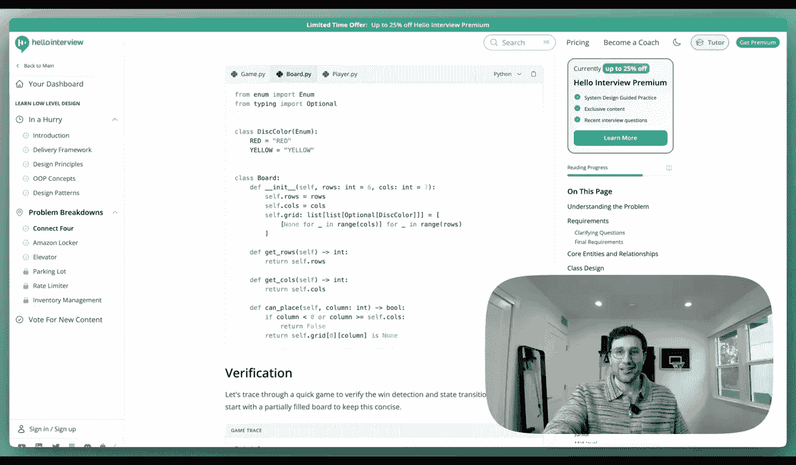

## 1. 低层设计面试是什么 📐

低层设计是一种面试形式，重点考察面向对象设计能力。简单来说，面试官希望看到你能确定需要哪些类，这些类之间如何协作，以及具体方法该如何实现才能让系统正常运行。这类题目在亚马逊、微软、Netflix 等公司非常常见，尤其出现在初级岗位面试中，不过高级岗位偶尔也会遇到。在印度和亚洲地区，很多当地公司或海外大厂的分公司也很喜欢考查低层设计，有时无论应聘者的职级如何都会问到。

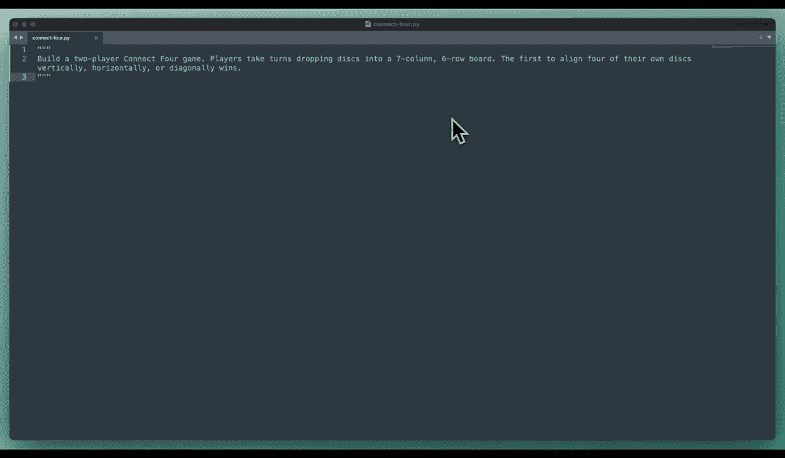

本节课将以连四游戏为例，带你完成一次完整的低层设计演示。我会展示在面试中如何回答这个问题，也会告诉你作为面试官，我在每个步骤中会关注哪些要点。如果你更偏好文字资料，也可以参考配套的文字拆解，里面会包含所有的权衡、完整代码、各种语言的实现以及每个决策的详细说明，而视频中为了简洁会使用伪代码。

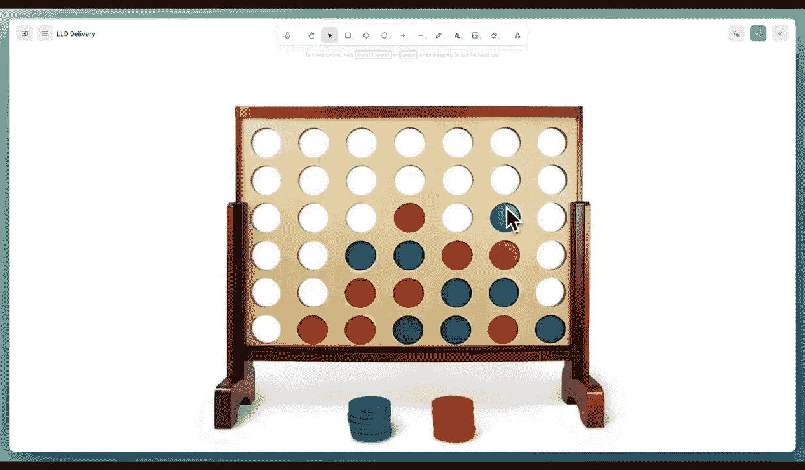

## 2. 需求分析 📋

拿到面试题目后，最常见的错误是立刻开始写代码或思考实现细节。这样做有两个问题。首先，你还没有和面试官明确要构建什么，双方很容易理解不一致。其次，面试官明确在评估你的问题分析能力，也就是你能否把模糊的题目描述转化为具体可执行的需求。

面试官可能会给出这样的题面：构建一个两人连四游戏，玩家轮流将棋子投放到七列六行的棋盘中，谁先在垂直、水平或对角线方向连成四颗自己的棋子，谁就获胜。

如果你从未玩过连四，也不用担心。游戏规则很简单：两名玩家轮流落子，棋子会落到所选列的最低可用位置，目标是让自己的四颗棋子在某一方向连成一线。

为了避免直接跳进实现，你应该先花几分钟时间确定需求。建议从三个主要类别入手提问。

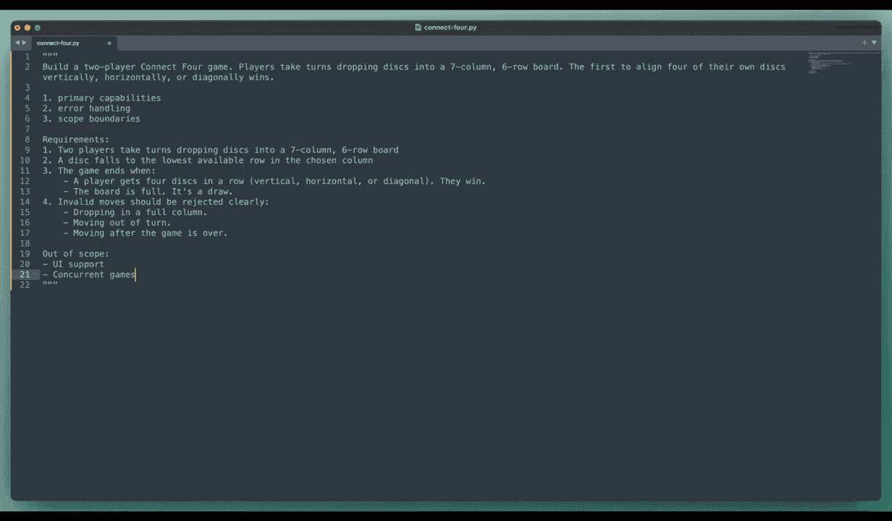


以下是需要向面试官确认的问题类别。

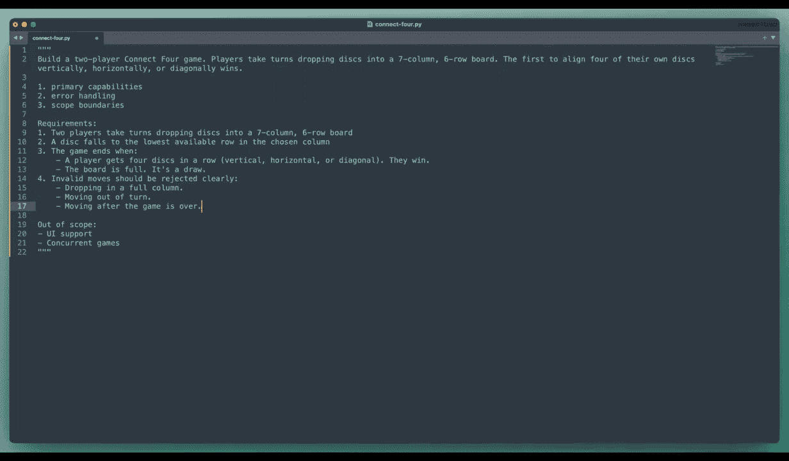

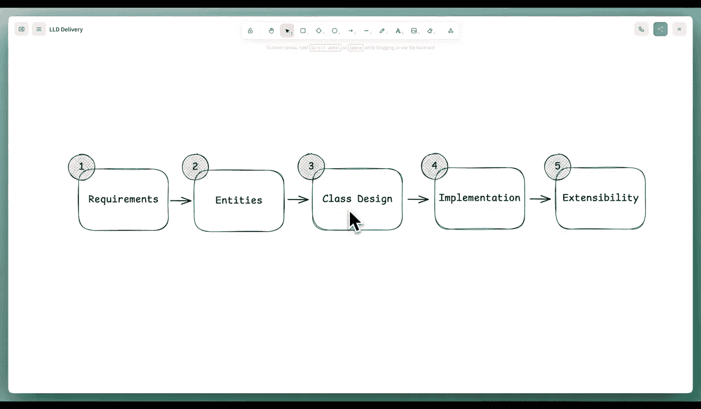

- 主要功能。例如，玩家如何与游戏交互？是指定列号后棋子自动落下吗？游戏结束的方式有哪些？仅仅是四连子，还是也包含平局？
- 错误处理。例如，如果有人试图在已满的列中落子，应该怎么处理？是返回错误、抛出异常，还是直接忽略？如果有人越界行动，又该如何拒绝？
- 范围边界。例如，我们是一次只支持一局游戏，还是需要支持多局并发？用户界面是否在设计范围内，还是由其他人员负责？

经过这些确认后，你会得到一组清晰的最终需求，建议在共享屏幕或白板上记录下来。

以下是整理后的最终需求示例。

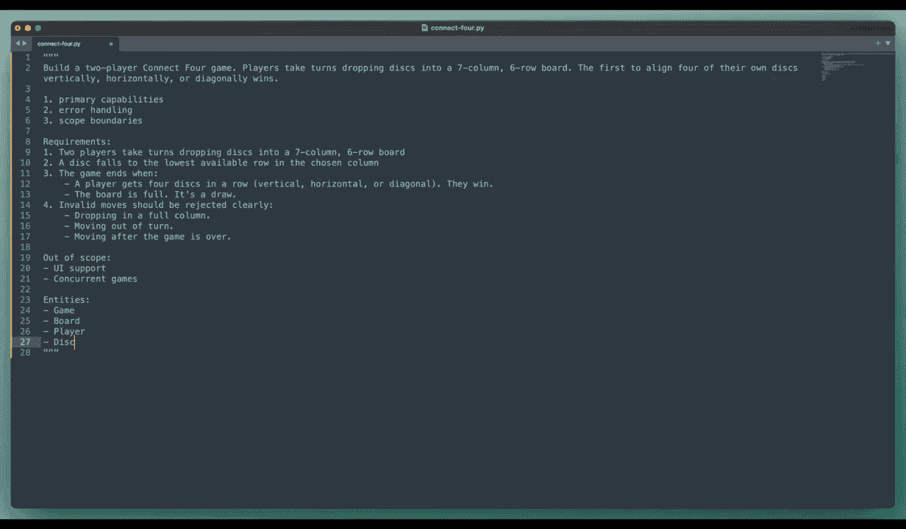

- 有两名玩家轮流在七列六行的棋盘上投放棋子。
- 棋子会落到所选列的最低可用行。
- 游戏在满足以下任一条件时结束：垂直、水平或对角线方向出现四连子，或者棋盘填满导致平局。
- 无效移动包括：在已满的列中落子、轮到其他玩家时行动、游戏结束后再行动。
- 用户界面和并发多局游戏不在本次设计范围内。

明确需求之后，我们就可以进入下一步，即确定系统需要哪些实体。

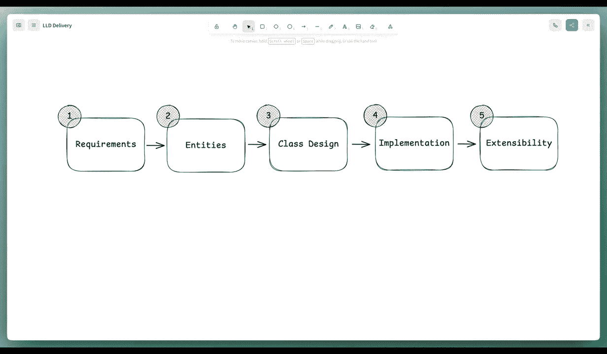

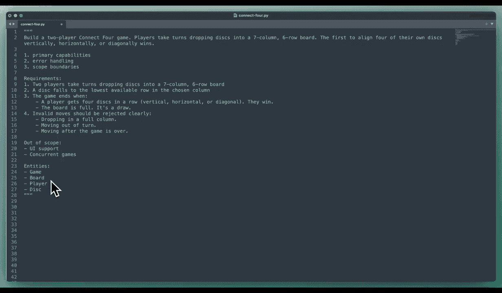

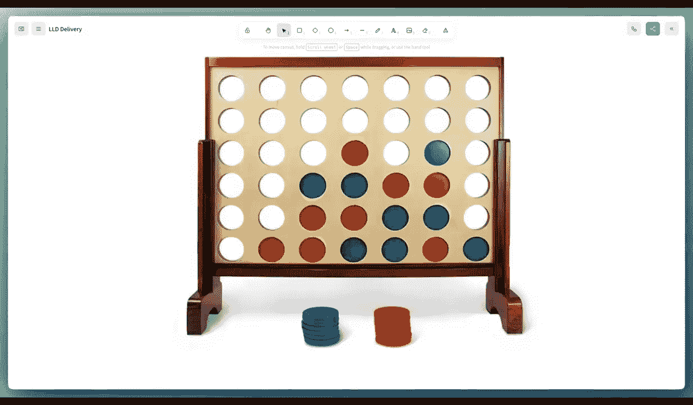

## 3. 实体识别 🧱

实体识别阶段的目标是弄清楚系统需要哪些对象，以及这些对象如何相互交互。这些实体最终会成为类设计中的类。

一个简单且实用的方法是通读需求，提取其中的名词和关键事物。以连四游戏为例，我们可以找到以下几个实体。

以下是需求中提取的核心实体。

- 游戏。负责维护游戏状态和游戏逻辑，持有棋盘和玩家对象。
- 棋盘。管理网格状态和棋子位置，知道某列是否已满、棋子应落在哪里、是否出现四连子，但不关心谁下棋或谁获胜。
- 玩家。代表单个游戏参与者，通常只是一个简单的数据容器，包含姓名和棋子颜色。
- 棋子。游戏中的落子物体，在初步设计中可以用枚举表示，例如红色或蓝色。

这个阶段不需要把每个细节都想得完美，面试中你写下的内容也不是一成不变的。你可以随时回来修改，目的是让思路按顺序从基础逐步构建，而不是直接冷启动跳进细节，那样很容易走弯路。

确定实体之后，我们可以利用这些实体开始类设计，这时事情会变得更有意思。

## 4. 类设计 🏗️

类设计阶段需要决定每个类持有什么数据，对外暴露什么方法，也就是定义它的接口。很多候选人容易纠结哪个类负责什么，比如游戏类的职责是什么，棋盘类的职责是什么。最重要的原则是：每个类应该有一个清晰的工作。当需求变化时，你应该能精确指出需要修改哪个类，而无需触碰其他类。

这里要介绍一个核心设计原则，叫做单一职责原则。可以用公式表示：

职责(类) = 明确且单一的业务关注点

换句话说，棋盘就像放在桌上的实体棋盘，它只懂网格物理规则和落子规则，不知道玩家是谁，也不知道轮到谁。如果棋盘大小从六乘七变成八乘八，或者获胜条件从四连子变成五连子，只需要修改棋盘类。

而游戏类就像裁判，负责游戏流程和编排，知道轮到谁、游戏是否结束、谁获胜。它把棋盘当作工具使用。如果增加悔棋功能或改为三人游戏，只需要修改游戏类。两者职责清晰分离，互不渗透。

接下来我们回到连四问题，自顶向下设计类。先从游戏类开始，因为它是编排者和主要入口，其他类会与它交互。确定游戏类的接口后，再依次向下设计棋盘和玩家，这样可以保持关注公共 API，避免过早陷入实现细节。

对于每个类，可以逐行阅读需求，推导出状态和行为。先看游戏类需要跟踪什么状态。游戏需要追踪两名玩家、当前是谁的回合，以及棋盘本身。游戏结束时可能有人获胜或平局，因此需要记录某种游戏状态。

在跟踪状态时，有个值得注意的设计决策。有些候选人习惯使用多个布尔标志，比如游戏是否结束、是否有获胜者、是否平局。但这样会出现问题：三个布尔值有八种组合，而只有三种是有效的。比如游戏结束为真、有获胜者为假、平局为真，这种组合就不合法。你不得不依赖自己或未来的开发者绝不会设置冲突的值，这显然不好。

更好的做法是使用枚举。对于这种多状态游戏，可以用枚举包含三个值：进行中、已结束、平局。这样只能处于三种有效状态之一。如果你还想随时知道谁赢了，可以在游戏类中额外保存一个可为空的获胜者字段，不过要注意保持它和状态字段同步。在面试中，使用伪代码时，简单的枚举加上获胜者状态已经足够，面试官更希望看到你能权衡利弊并做出合理决定。

以下是游戏类建议持有的状态。

- 玩家一，类型为玩家类。
- 玩家二，类型为玩家类。
- 当前玩家，表示轮到谁落子。
- 棋盘，类型为棋盘类。
- 游戏状态，枚举类型，取值为进行中、已结束、平局。
- 获胜者，可为空的玩家引用，记录最终赢家。

有了状态之后，再确定外部需要调用的行为，每个方法都应对应需求中的具体需求。

以下是游戏类建议暴露的公共方法。

- 构造函数，接收玩家一和玩家二，初始化游戏。
- 落子操作，接收玩家和列号，返回布尔值表示是否成功落子。
- 获取当前玩家，用于知道谁该下棋。
- 获取游戏状态，用于判断游戏是否结束。
- 获取获胜者，用于返回谁赢了。
- 获取棋盘，可选，用于渲染完整棋盘视图，但本题中用户界面不在范围内，所以此方法可选。

游戏类会调用一些私有辅助方法来完成落子、判胜和判平等工作，这些私有方法在类设计中不如公共方法重要，重点在于对外接口设计得当。

接下来设计棋盘类。棋盘是游戏状态的一部分，游戏类会与它交互。根据需求，棋盘需要知道行数和列数，本题中是六行七列，但最好设计成可扩展的，未来可以改变。棋盘还需要知道棋子会落到最低可用位置，棋盘是否已满，以及是否有四连子。这说明我们需要跟踪网格状态，即每个位置当前有什么棋子。

网格自然是一个二维数组。很多候选人会在二维数组中直接存储玩家对象，表示某个位置属于哪个玩家，空位置为空。这种做法可以接受，但有一个问题：网格其实只需要知道该位置是什么颜色的棋子，而不需要知道完整的玩家对象。这样更符合单一职责原则，也更容易测试。

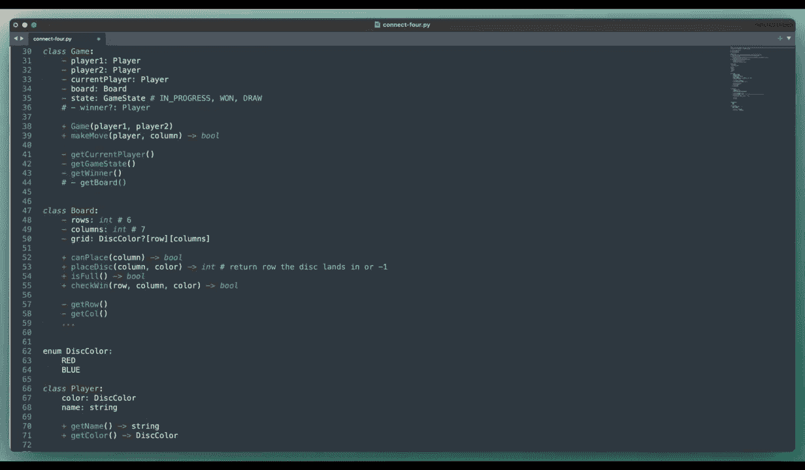

因此更推荐的做法是定义一个棋子颜色枚举，包含红色和蓝色两种值。棋盘只需要知道每个位置的棋子颜色，游戏类再根据颜色推断对应的玩家和获胜者。

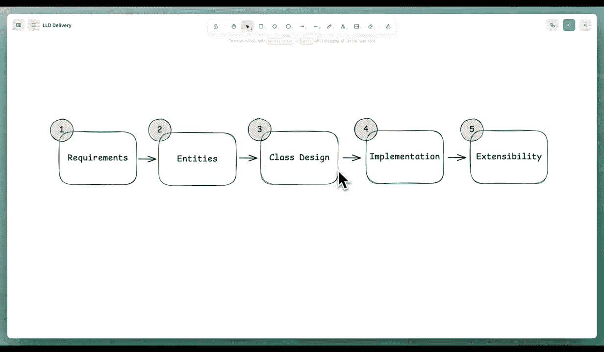

以下是棋盘类建议持有的状态。

- 行数，整数类型。
- 列数，整数类型。
- 网格，二维数组，每个元素为棋子颜色枚举，空位表示没有棋子。

棋盘类需要暴露的公共方法如下。

- 是否可以落子，接收列号，返回布尔值。
- 放置棋子，接收列号和棋子颜色，返回棋子落入的行号，若失败则返回负一。
- 棋盘是否已满，返回布尔值，用于判断平局。
- 检查获胜，接收行号、列号和棋子颜色，返回布尔值，表示该位置落子后是否有人获胜。

玩家类非常简单，只需要知道玩家的名字和棋子颜色，并提供公共获取方法，本题不需要花太多时间在这里。

关于 UML 的说明：有些面试官可能会要求画 UML 图。不过 UML 已经非常过时，主要科技公司基本不再使用，微软在 2006 年就从 Visual Studio 中移除了 UML 工具。如果面试官坚持要求 UML，可以礼貌询问是否接受简化的类表示法，绝大多数情况下面试官会同意。如果面试官强制要求且你不熟悉 UML，可以坦诚说明这不是你工作中使用过的建模方式。

到此，类设计部分就完成了，接下来可以进入代码实现阶段。

## 5. 代码实现 💻

类设计完成后，就可以开始写代码了。不同公司对代码详细程度的要求不同，有的希望写伪代码，有的希望写真实代码，有的只需要口头讲解。在展示完类设计后，建议先询问面试官希望看到哪种程度的实现。

进入实现时，建议采用两步走的方法。第一步是先定义核心逻辑，也就是列出函数应该做什么的主流程。第二步是考虑边界情况，面试官非常看重候选人是否会主动想到各种可能出错的地方。通常面试官只会要求你实现几个核心函数，本题中最常见的有游戏类的落子操作、棋盘类的放置棋子和检查获胜三个函数。

以下是游戏类落子操作的核心逻辑步骤。

1. 尝试放置棋子。
2. 检查放置该棋子后是否有人获胜。
3. 如果没有获胜，检查是否平局。
4. 切换回合。
5. 返回落子结果。

在这个流程之外，还需要处理几个边界情况。

- 游戏已经结束，不允许再落子。
- 试图落子的玩家不是当前回合的玩家。
- 列号超出棋盘范围。
- 目标列已经满了。

根据单一职责原则和封装思想，列超出范围和列已满这两类检查可以交给棋盘类完成，游戏类只需关心游戏是否已结束以及是否轮到当前玩家。下面给出落子操作的伪代码实现示例。

```
函数 游戏.落子(玩家, 列号):
    如果 游戏状态 != 进行中:
        返回 假
    如果 玩家 != 当前玩家:
        返回 假
    
    核心逻辑:
    行号 = 棋盘.放置棋子(列号, 当前玩家.颜色)
    
    如果 行号 == 负一:
        返回 假
    
    如果 棋盘.检查获胜(行号, 列号, 当前玩家.颜色):
        游戏状态 = 已结束
        获胜者 = 当前玩家
        返回 真
    
    如果 棋盘.棋盘已满():
        游戏状态 = 平局
        返回 真
    
    当前玩家 = (当前玩家 == 玩家一) ? 玩家二 : 玩家一
    返回 真
```

关于返回布尔值还是抛出异常，面试中可以和面试官讨论。如果返回布尔值，调用方可能不知道具体错误原因，体验不佳。如果时间允许，可以建议返回包含成功与否和错误信息的对象，或者返回错误枚举，让调用方知道该怎么处理。

接下来是棋盘类的放置棋子函数。它接收列号和棋子颜色，返回棋子落入的行号，若无法放置则返回负一。

核心逻辑是找到该列最低的空行，让棋子落下，更新网格状态，并返回落入的行号。为了直观理解，可以把棋盘想象成一个二维数组，第一行是最上面一行，最后一行是最下面一行。如果要在第两列放置棋子，需要从最底行开始向上检查，直到找到第一个空位。

以下是放置棋子的伪代码实现示例。

```
函数 棋盘.放置棋子(列号, 颜色):
    如果 列号 < 0 或 列号 >= 列数:
        返回 负一
    
    核心逻辑:
    从 行号 = 行数 - 1 向下遍历到 0:
        如果 网格[行号][列号] == 空:
            网格[行号][列号] = 颜色
            返回 行号
    
    返回 负一
```

边界情况包括列号越界和列已满。列已满的检查可以交给私有辅助方法完成，避免在主函数中重复实现细节。

最后一个核心函数是棋盘类的检查获胜函数。它接收刚刚放置棋子的行号、列号和颜色。核心逻辑是从该位置向四个方向扩散，统计相同颜色棋子的数量，如果任一方向总数达到四个，则判定获胜。

这里要注意方向数量。虽然直觉上有水平、垂直和对角线三种方向，但对角线分为两个方向：右上到左下，以及左上到右下。加上水平和垂直，总共需要检查四个方向。

以下是四个方向的行增量和列增量。

```
水平方向: 行增量 = 0, 列增量 = 1
垂直方向: 行增量 = 1, 列增量 = 0
对角线方向一: 行增量 = 1, 列增量 = 1
对角线方向二: 行增量 = 1, 列增量 = -1
```

检查获胜的伪代码实现示例如下。

```
函数 棋盘.检查获胜(行号, 列号, 颜色):
    如果 行号 < 0 或 行号 >= 行数 或 列号 < 0 或 列号 >= 列数:
        返回 假
    如果 网格[行号][列号] != 颜色:
        返回 假
    
    核心逻辑:
    对于每个方向 (行增量, 列增量) 在 四个方向中:
        计数 = 1
        计数 += 沿方向计数相同颜色棋子(行号, 列号, 行增量, 列增量, 颜色)
        计数 += 沿反向计数相同颜色棋子(行号, 列号, 行增量, 列增量, 颜色)
        如果 计数 >= 4:
            返回 真
    
    返回 假
```

沿单一方向计数的私有辅助函数可以这样写：

```
函数 沿方向计数(行号, 列号, 行增量, 列增量, 颜色):
    计数 = 0
    当前行 = 行号 + 行增量
    当前列 = 列号 + 列增量
    
    当 当前行在棋盘范围内 且 当前列在棋盘范围内 且 网格[当前行][当前列] == 颜色:
        计数 = 计数 + 1
        当前行 = 当前行 + 行增量
        当前列 = 当前列 + 列增量
    
    返回 计数
```

这里不需要使用策略模式。有些候选人喜欢为水平、垂直、两个对角线分别定义检查器类，然后在检查获胜时遍历所有检查器。这属于过度设计。网格上只有这四个可移动方向，不存在其他可扩展的检查策略，而且这段逻辑只有十几行代码，没有必要为了套用模式而增加复杂度。如果你想向面试官展示对设计模式的了解，可以说：我可以引入策略模式，为每个方向写一个检查器，但考虑到逻辑简单且不会变化，我暂时不这么做，以免过度设计。这样的回答通常会让面试官印象深刻。

代码实现阶段到此结束，接下来我们讨论如果面试官追问可扩展性问题该如何回答。

## 6. 可扩展性讨论 🔄

如果时间允许，且根据你的面试官和职级，可能会接着问几个扩展性问题，用来考察你的代码设计是否具有良好的扩展能力。初级和中级候选人可能不会走到这里，但高级候选人可以准备以下三个常见问题。

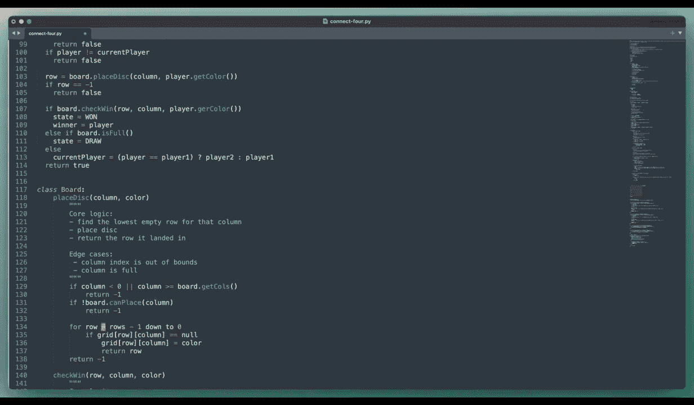

第一个问题是如何支持不同的棋盘尺寸。这其实很简单。在当前设计中，除了类定义外，没有任何地方硬编码了六和七。只需给棋盘类增加一个构造函数，接收行数和列数即可。其他代码在检查边界时都会动态使用行数和列数，因此棋盘会自然增长，其他逻辑无需修改。

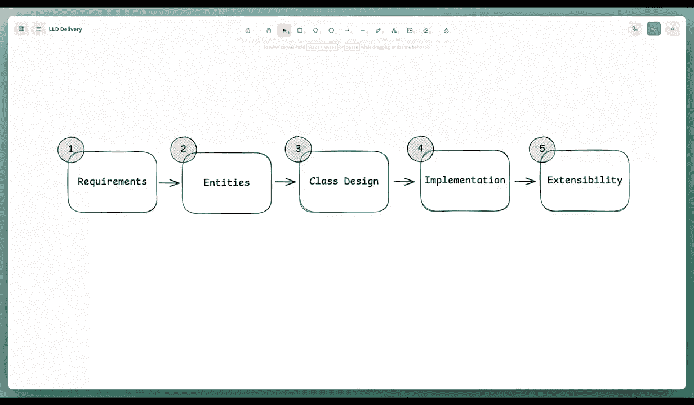

以下是可扩展棋盘尺寸的构造函数示例。

```
类 棋盘:
    构造函数(行数, 列数):
        此.行数 = 行数
        此.列数 = 列数
        初始化 网格[行数][列数]
```

第二个问题是如何增加悔棋或移动历史功能。这个问题比较有意义，因为它考察你在编排者（游戏类）和状态（棋盘类）之间是否保持了清晰的分离。所有落子都通过游戏类的落子操作流程，因此这里是记录所有移动的唯一切入点。

可以引入一个移动记录栈。每次落子成功后，将包含玩家、行号和列号的移动记录压入栈中。悔棋时，弹出最后一条记录，清空棋盘上的对应位置，并将当前玩家切换回上一位。

以下是悔棋功能的伪代码示例。

```
类 游戏:
    移动历史 = 栈<移动记录>
    
    函数 悔棋():
        如果 移动历史为空:
            返回 假
        
        最后移动 = 移动历史.弹出()
        棋盘.清空单元格(最后移动.行号, 最后移动.列号)
        当前玩家 = 最后移动.玩家
        游戏状态 = 进行中
        返回 真
```

第三个问题是如何增加电脑对手。这个问题主要考察你是否能识别出该功能超出当前类设计范围，而无需大幅修改现有的游戏类和棋盘类。

可以保持游戏规则不变，引入一个电脑对手类。电脑对手查看当前棋盘，然后返回它想要选择的列号。游戏驱动逻辑中，如果当前玩家是人类，就从界面获取输入；如果是电脑，就调用电脑对手的选择列方法。游戏类和棋盘类本身不需要做任何改动。

以下是电脑对手集成的伪代码示例。

```
函数 游戏.开始():
    当 游戏状态 == 进行中:
        当前玩家 = 获取当前玩家()
        如果 当前玩家 是 电脑:
            列号 = 电脑对手.选择列(棋盘)
        否则:
            列号 = 从界面获取输入()
        
        游戏.落子(当前玩家, 列号)
```

以上就是可扩展性讨论的三个常见方向，接下来我们总结本节课的内容。

## 总结 📚

本节课中我们一起学习了低层设计面试的基本概念，并以连四游戏为例，完整演示了从需求分析、实体识别、类设计、代码实现到可扩展性讨论的全过程。我们重点强调了不要直接跳进实现，要先和面试官明确需求；要遵循单一职责原则，让棋盘只负责网格物理规则，让游戏类只负责游戏流程；在状态建模中优先使用枚举而不是多个冲突的布尔标志；在编写代码时先梳理核心逻辑，再补充边界情况；最后在面试中不要为了套用设计模式而过度设计。

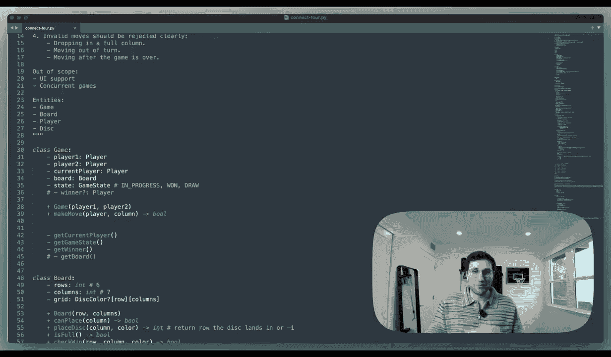

希望这篇教程能帮助你更好地理解低层设计面试的框架，并在未来的面试中表现出色。祝你面试顺利。
