🚀 低级设计速成：03：Amazon Locker 低级设计

在本节课中，我们将学习如何设计一个类似 Amazon Locker 的快递柜系统。这个系统允许快递员将包裹投放到柜子里，也允许客户使用取件码来领取包裹。课程内容将完整覆盖低级设计面试的所有关键环节，包括需求分析、实体建模、类接口设计、伪代码实现以及可扩展性讨论。无论你是准备亚马逊面试，还是想系统性地提升低级设计能力，本节内容都适合作为入门参考。我们会使用大白话来解释每一个概念，确保初学者也能听懂，并且在每个知识点之后都会留出足够的说明空间，让阅读过程更自然。

---

## 低级设计面试的通用框架

上一节我们介绍了低级设计面试的整体目标，本节中我们来看看面试中通常遵循的五步框架。这个框架的目的是让你在面试过程中保持专注，不会遗漏重要环节，同时避免在时间有限的面试中临时超时。掌握这个框架后，你在面对任何低级设计题目时都会有清晰的行进路线，而不是盲目开始写代码。


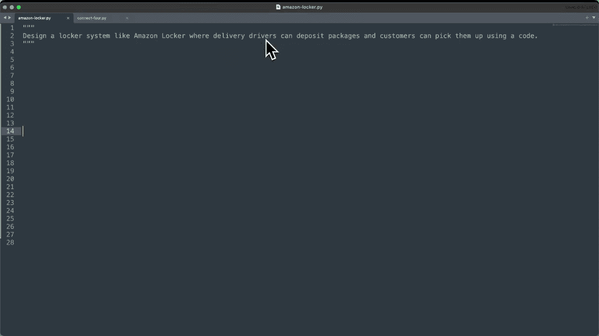

以下是低级设计面试的五个标准步骤。

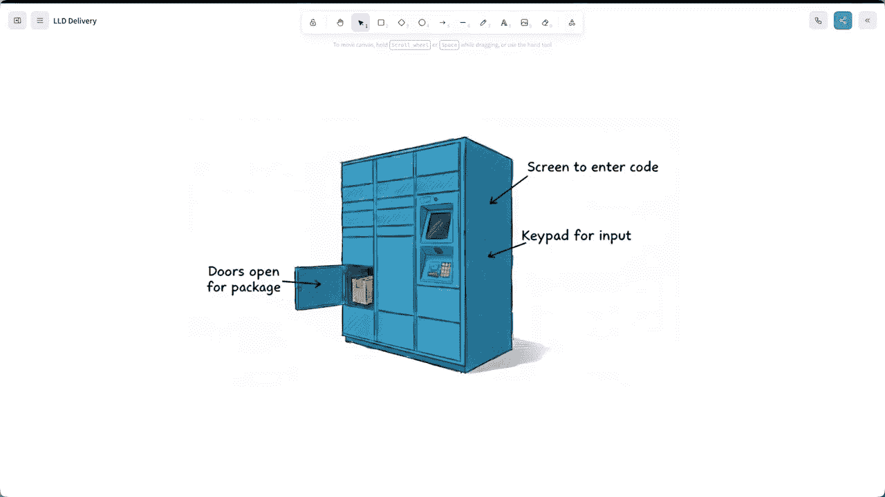

1. 需求分析。你需要和面试官进行来回沟通，明确要构建的系统究竟是什么，并达成一致的需求集合，以此作为后续设计的基础。
2. 实体建模。这一步是梳理系统中的名词，确定哪些对象需要建模为类或枚举。
3. 类设计。根据前面确定的实体和需求，逐个推导每个类需要持有的状态和提供的行为。状态是指类需要记住的信息，行为是指类需要能够执行的操作，也就是代码接口。
4. 代码实现。在拿到类设计之后，需要将其转化为代码。大部分公司更倾向于伪代码，更关注设计选择而非语法细节，完整的语言实现可以参考书面资料。
5. 可扩展性讨论。如果时间允许，面试官会询问设计如何演进，这类后续问题用于考察你的系统是否具备良好的扩展能力。

---

## 需求分析与问题澄清

有了面试框架之后，接下来的第一步是进行需求分析，也就是面试中常说的问题分析。面试官会给出一个模糊的白板题目，考察你是否具备提出澄清问题并最终确定需求的能力。很多候选人拿到题目后就想立即写代码，但这是错误的做法，因为题目描述的模糊性是有意设计的。

以下是本节要设计的具体题目。

设计一个类似 Amazon Locker 的快递柜系统，其中快递员可以存放包裹，客户可以使用取件码来取件。

如果你不熟悉 Amazon Locker，可以把它理解为一种自助服务终端，用于安排包裹取件。客户不需要在家等待送货，可以选择将包裹送到城市各处设置的快递柜。快递员打开柜门放入包裹，关闭门后系统会生成一个取件码发送给客户。客户稍后使用该取件码打开柜门取走包裹。如果居住地不适合直接送货上门，这种方式就非常有用，因此这类系统在实际生活中非常普遍。

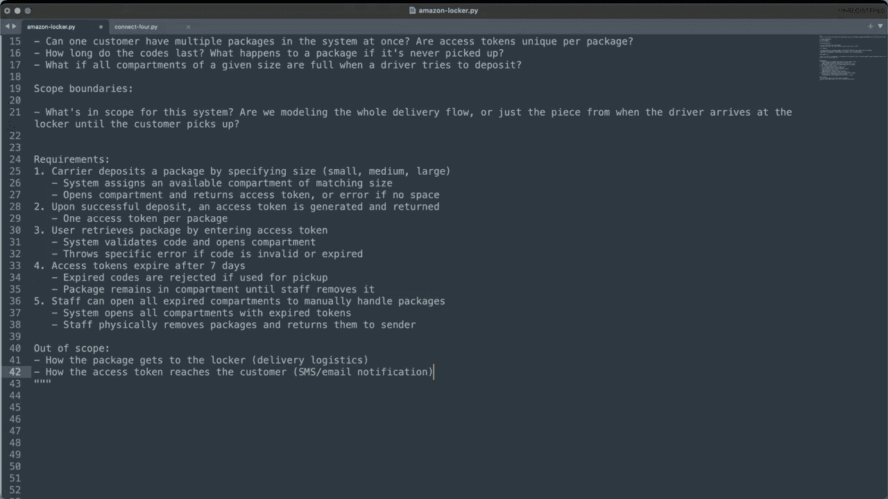

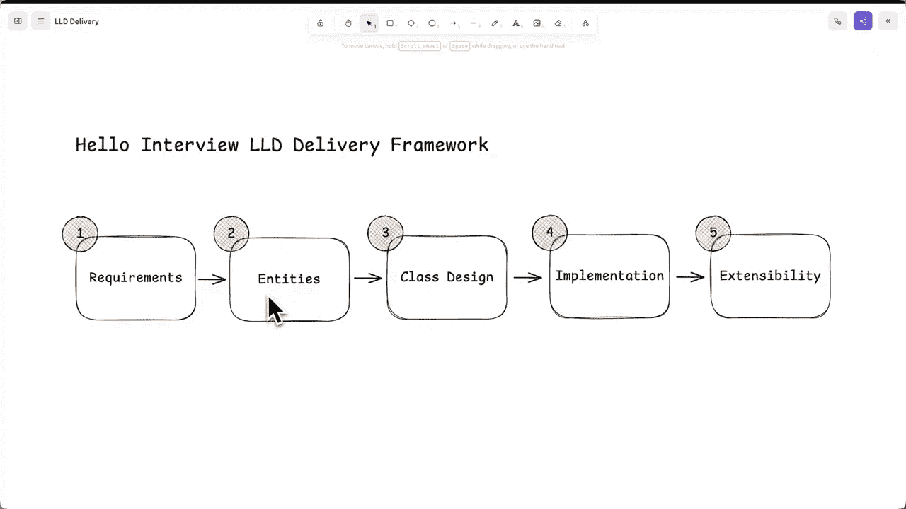

拿到题目后，千万不要立即开始写代码。面试官想看你是否能主动提问，缩小需求范围。候选人常会问自己到底该问什么，我的建议是关注三个关键类别，分别是系统的主要功能、系统的错误处理、系统的范围边界。

以下是需要覆盖的三个提问类别。

第一，系统的主要功能。例如，快递柜是否有不同尺寸的格口？客户如何获取取件码？
第二，系统的错误处理。例如，一个客户是否可以同时在系统中存放多个包裹？取件码是否会过期？如果所有相同尺寸的格口都已满，该如何处理？
第三，系统的范围边界。哪些内容在设计范围内，哪些内容在范围之外。

作为面试官，我可能会这样回答这些问题。关于格口尺寸，是的，系统有小、中、大三种尺寸，包裹需要放入对应尺寸的格口。关于取件码的发送方式，短信或邮件不在本次设计范围内，系统只负责生成并返回取件码，由上层服务负责发送给客户。关于多个包裹，一个客户可以同时有多个包裹，但每个包裹都有独立的访问令牌和独立的格口。关于过期时间，我们假设取件码在七天后过期，之后工作人员可以来清理过期格口，将包裹带回仓库。关于格口已满的情况，如果快递员尝试存放包裹时请求尺寸的格口没有空位，就抛出错误。关于范围，本次设计只涵盖从快递员到达快递柜到客户取件的过程，其余物流环节由更高级别的服务管理。

在记录完所有问题和回答之后，你应该能够整理出一组清晰的需求。我们最终确定的需求共有五条。

以下是最终确认的需求列表。

第一，快递员通过指定包裹尺寸来存放包裹，系统会打开对应尺寸的空闲格口，并生成访问令牌返回，以便上层服务通过短信或邮件将其发送给客户。
第二，存放成功后会生成访问令牌。
第三，客户输入访问令牌来取件，系统验证后打开柜门，客户即可取走包裹。
第四，访问令牌在七天后过期，工作人员会定期清理过期格口。
第五，不在设计范围内的内容包括包裹最初是如何送达快递柜的物流过程，以及短信或邮件通知机制。

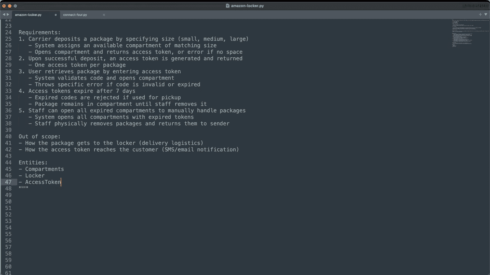

在面试中，你可以一边写需求一边与面试官口头沟通，这两个过程可以交替进行。重要的是，最终要和面试官达成一致的需求集合，之后的所有设计都围绕这个集合展开，未提及的内容都默认不在范围内。

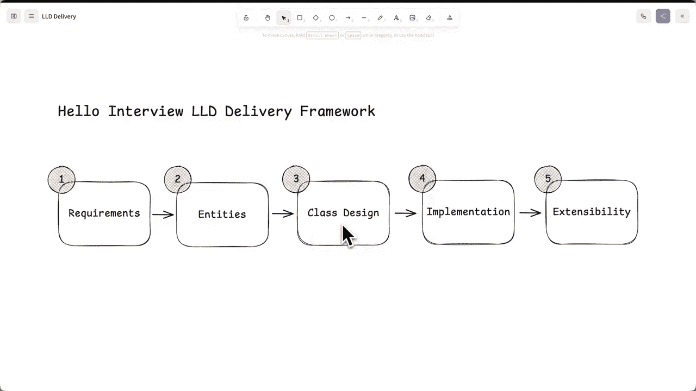

---

## 实体建模

需求确定之后，下一步是建立系统的实体模型，确定需要哪些对象以及它们如何交互。这些实体后续会成为类设计的基础。我的建议是直接在需求描述中寻找名词，逐个判断它们是否在系统中有立足之地，不要试图一次性想到所有东西。

以下是我们在需求中识别出的核心名词。

包裹。我们需要存放包裹，初看之下似乎需要一个包裹类。但实际上，包裹 ID、运输信息、客户详情以及包裹内物品都由其他系统管理。本系统只关心包裹的一个属性，即尺寸，因为尺寸决定了应该分配哪个格口。因此，包裹本身不需要建模为独立类，它只是存放或取件函数的输入参数。
快递员和客户。这两者是系统外部的角色。尽管客户可能有 Amazon 账户，但本系统不需要维护用户状态或行为，只需通过取件码进行交互。快递员同理，不需要建模。
格口。这是系统的核心实体，是存放包裹的物理槽位。每个格口有尺寸，可以打开，并且需要知道当前是否被占用。格口需要建模为类。
快递柜。这是整个系统的编排者和入口，负责寻找合适格口、生成取件码、维护关系等，是快递员和客户交互的接口。
访问令牌。这看起来只是一个字符串，但它实际上包含过期时间，并代表访问特定格口的权限，值得建模为独立实体。

在实际面试中，你不需要一开始就想得面面俱到。可以先把所有名词都写下来，随着类设计和实现的深入，再回来调整实体列表。这种动态调整是非常自然且被鼓励的做法，不必为此感到焦虑。

---

## 类设计

实体确定之后，我们需要为每个实体定义接口，也就是类设计，包括每个类持有的状态和暴露的方法。我推荐自顶向下进行设计，先从编排者类入手，再处理它所依赖的底层类。这样可以先确定高层操作，自然推导出底层类需要提供的能力。在本例中，编排者就是快递柜类。

以下是快递柜类的状态设计。

```text
Locker 状态：
- compartments: List<Compartment>
- accessTokens: Map<String, AccessToken>
```

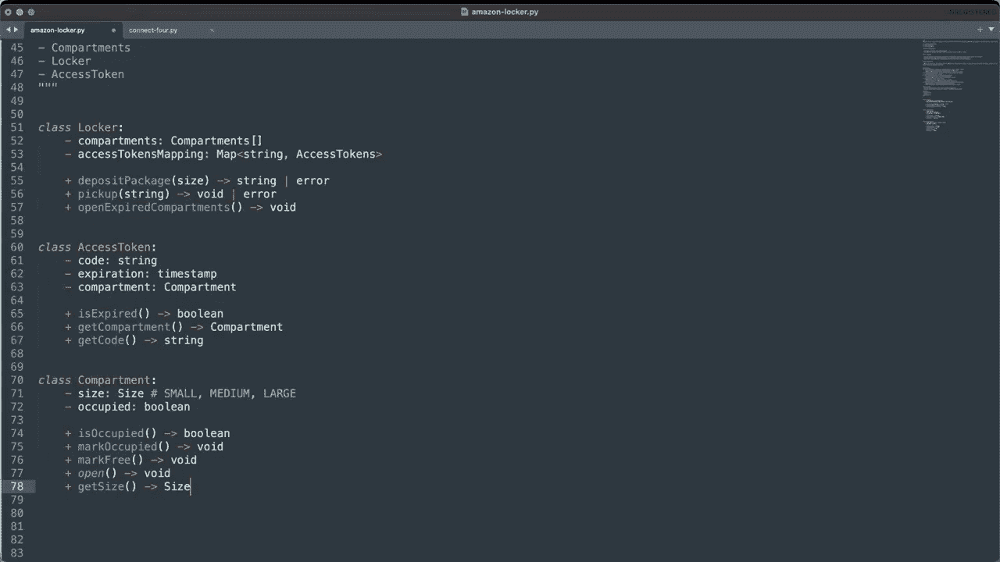

首先是格口列表。快递柜需要知道系统中有哪些格口，以及哪些格口当前可用。这可以用一个格口对象列表表示，通常包含五十到一百个格口。其次是访问令牌映射。快递柜需要记录已经发放的所有访问令牌，以便取件时能够查找。最初可以使用列表，但为了意图清晰，建议使用字符串到访问令牌对象的映射。当客户输入取件码时，可以通过映射直接完成 O(1) 查找，找到对应的令牌对象，进而定位到对应格口。在这里使用映射主要是为了代码意图清晰，而不是因为格口数量很小时的性能差异有多大。面试时应优先考虑可读性，尤其在数据量只有几百甚至更少的情况下。

以下是快递柜类需要暴露的行为。

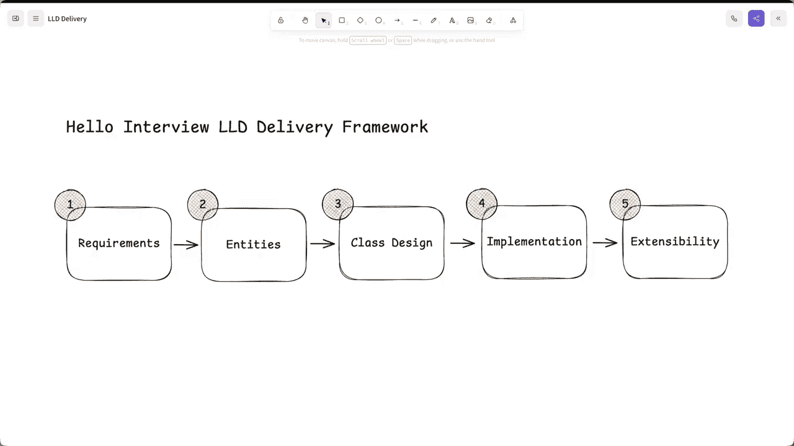

第一，存放包裹方法。接收包裹尺寸作为输入，返回表示访问令牌的字符串，由上层服务负责将其发送给客户。
第二，取件方法。接收表示取件码的字符串，如果成功打开柜门则返回空，如果失败则返回错误。
第三，打开过期格口方法。供工作人员调用，用于清理未被取走的过期包裹，返回空。

接下来是访问令牌类的设计。

```text
AccessToken 状态：
- code: String
- expiration: Timestamp
- compartment: Compartment

AccessToken 行为：
- isExpired(): Boolean
- getCompartment(): Compartment
- getCode(): String
```

状态包括取件码字符串、过期时间戳，以及该令牌所对应的格口对象。行为包括判断是否过期，返回布尔值；获取对应格口，这是一个简单的获取器方法；获取取件码字符串，用于存放包裹后将其发送给客户。

最后是格口类的设计。

```text
Compartment 状态：
- size: SizeEnum {SMALL, MEDIUM, LARGE}
- isOccupied: Boolean

Compartment 行为：
- isOccupied(): Boolean
- markOccupied(): void
- markFree(): void
- open(): void
- getSize(): SizeEnum
```

状态包括尺寸枚举，可选值为小、中、大，以及布尔值 isOccupied，表示格口当前是否被占用。行为包括判断是否被占用，将其标记为已占用，将其标记为空闲，触发柜门打开的 open 方法，以及获取尺寸的获取器方法。

值得注意的是，格口类通过标记已占用和标记空闲来管理自身的物理状态，并通过 open 方法控制柜门打开，这是良好的封装示例。虽然也可以由快递柜类维护一个占用映射，但由于格口的占用状态属于物理状态而非对象之间的关系，将其建模在格口类中更为合适。

---

## 伪代码实现

类设计完成后，就可以进入实际的伪代码实现阶段了。在低级设计面试中，通常只需要实现最有意思的几个方法，使用伪代码即可，无需关注特定编程语言的语法。访问令牌类和格口类主要是获取器和设置器，实现比较直接，因此不需要在此重点展开。

我们将实现快递柜类中的三个核心方法：存放包裹、取件、打开过期格口。实现每个方法时，建议按照两个步骤进行。第一步是定义核心逻辑，第二步是考虑边界情况。下面我们逐个拆解。

以下是存放包裹方法的核心逻辑。

```text
depositPackage(size):
  compartment = getAvailableCompartment(size)
  if compartment == null:
    throw Error("没有该尺寸的可用格口")
  
  compartment.open()
  compartment.markOccupied()
  
  token = generateAccessToken(compartment)
  accessTokens[token.code] = token
  
  return token.code
```

1. 找到请求尺寸的空闲格口。
2. 打开该格口，让快递员放入包裹。
3. 将该格口标记为已占用，防止未来重复打开。
4. 为客户生成访问令牌。
5. 将生成的访问令牌存入访问令牌映射。
6. 返回取件码字符串，供上层服务通过短信或邮件发送给客户。

以下是该方法需要处理的边界情况。

主要边界情况是，如果没有请求尺寸的空闲格口，则抛出错误，提示没有该尺寸的可用格口。其他步骤如打开柜门、生成令牌、存入映射等，在本设计规模下可以假设不会出问题。

以下是查找可用格口的辅助方法逻辑。

```text
getAvailableCompartment(size):
  for c in compartments:
    if c.getSize() == size and not c.isOccupied():
      return c
  return null
```

遍历所有格口，对每个格口判断其尺寸是否等于请求尺寸，并且是否未被占用。如果找到第一个匹配的格口，直接返回。如果遍历结束仍未找到，则返回 null。该辅助方法本身没有额外的错误情况，只有未找到格口这一种情形。

以下是取件方法的核心逻辑。

```text
pickup(code):
  if code == "":
    throw Error("无效取件码")
  
  token = accessTokens[code]
  if token == null:
    throw Error("无效取件码")
  
  if token.isExpired():
    throw Error("取件码已过期")
  
  compartment = token.getCompartment()
  compartment.open()
  compartment.markFree()
  
  accessTokens.remove(code)
```

1. 在访问令牌映射中查找输入的取件码，得到对应的访问令牌对象。
2. 从访问令牌中获取关联的格口对象。
3. 打开该格口。
4. 假设客户已经取走包裹，柜门会在三十秒后自动关闭。
5. 将该格口标记为空闲。
6. 从访问令牌映射中移除该取件码。

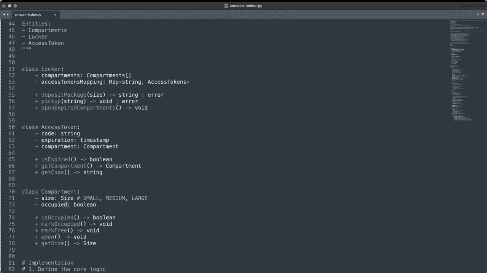

以下是取件方法需要处理的边界情况。

第一，如果输入的取件码为空字符串，抛出无效取件码错误。
第二，如果取件码在映射中不存在，抛出无效取件码错误。具体异常类型取决于编程语言，在伪代码中可以假设查找返回 null。
第三，如果访问令牌已经过期，抛出取件码已过期错误。

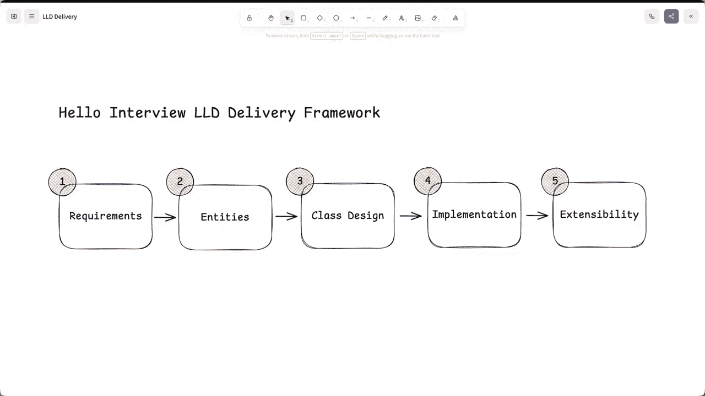

以下是打开过期格口方法的核心逻辑。

```text
openExpiredCompartments():
  for code, token in accessTokens:
    if token.isExpired():
      compartment = token.getCompartment()
      compartment.open()
      compartment.markFree()
```

1. 遍历访问令牌映射中的所有令牌。
2. 找出所有已过期的令牌。
3. 对每个过期令牌，获取其关联的格口并打开柜门。
4. 假设工作人员已经取走了包裹，柜门自动关闭后，将格口标记为空闲。

这里有一个值得讨论的设计决策。是否应该从映射中移除已经过期的访问令牌？如果移除，客户在十天后拿着同一个取件码回来，会收到无效取件码错误，而不是取件码已过期错误。从产品体验角度，更希望客户看到已过期提示。考虑到格口数量只有五十到一百个，即使每天更换包裹，映射增长也不会很快，因此可以先不立即移除过期令牌，之后可以通过额外的清理逻辑处理长期积累的数据。这个决策可以在面试中与面试官确认。

---

## 可扩展性讨论

实现完成后，如果时间允许，面试官可能会询问可扩展性问题，以测试你的设计是否能够应对未来的变化。实习生、初级和中级候选人可能在这一阶段时间已尽，无需过度担心；高级候选人通常会遇到这类问题。接下来我们来看看 Amazon Locker 设计中最常见的三个扩展问题。

以下是三个典型的扩展问题。

第一，当所有相同尺寸的格口都已满时，是否允许小包裹使用更大的格口作为备选？例如，小包裹在没有小格口时可以放入中格口或大格口。解决思路是修改查找可用格口的方法，增加一个外层循环，按小、中、大的顺序依次检查尺寸，从请求尺寸的索引开始，直到找到第一个空闲格口为止。
第二，如何处理损坏或正在维护的格口？当前格口类使用布尔值表示是否被占用，现在需要增加第三种状态，表示格口不可用。建议将布尔值替换为枚举，包含可用、已占用、维护中等取值。原来的 isOccupied 检查改为 isAvailable 检查，即判断状态是否为可用。标记已占用时设置状态为已占用，标记空闲时设置状态为可用，将格口设为维护中时设置状态为维护中。
第三，如何确保包裹真的被放入格口后才生成访问令牌？当前设计假设快递员一定会把包裹放进去，但现实中快递员可能分心，导致格口被标记为已占用，但实际上没有包裹，同时生成了一个对应空柜子的取件码。解决思路是引入两阶段提交模式。将存放包裹拆分为两个步骤：先调用预留格口方法，打开柜门并生成预留 ID，但不立即将访问令牌放入正式映射；快递员放入包裹后，调用确认存放方法，此时才将格口标记为已占用，生成访问令牌，放入映射，并通知客户。这种先预留、再确认的机制能够避免在未实际存入包裹时就完成下游流程。

---

## 总结

本节课中，我们一起学习了如何设计 Amazon Locker 这种快递柜系统。我们从模糊的面试题目出发，经过需求分析，确定了五条核心需求；识别了快递柜、格口和访问令牌三个核心实体，并为每个类设计了清晰的状态和行为；接着用伪代码实现了存放包裹、取件和打开过期格口三个关键流程，并处理了常见的边界情况；最后探讨了格口降级、维护状态以及两阶段提交等可扩展性模式。

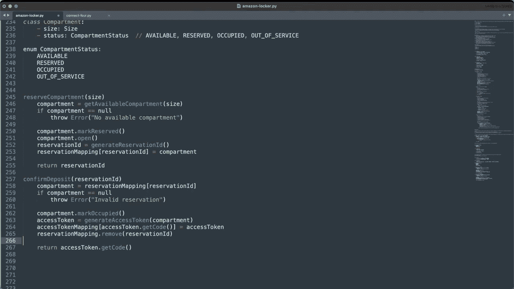


整个设计遵循面向对象原则，其中信息专家原则体现在格口类自行管理物理状态，关注点分离体现在快递柜负责编排、访问令牌负责权限控制、格口负责物理状态跟踪。由于快递柜的规模较小，通常只有五十到一百个格口，我们采用了简单的线性扫描，没有在不必要的地方过度优化。

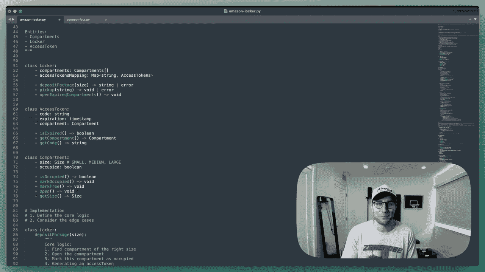

如果你觉得本节内容有帮助，可以查看文中提到的书面资料，其中包含各主流编程语言的完整实现，以及更多低级设计内容。祝你面试顺利，下次见。
