# 低层级设计速成：04：电梯低层级设计🏗️


在本节课中，我们将学习如何设计一个电梯控制系统。这是低层级设计面试中非常经典的一道题目，尤其在微软等大公司的面试中经常出现。相比于此前我们拆解过的连四棋等初级问题，电梯系统涉及更复杂的移动逻辑，具有一定的深度。我将引导你从面试官的视角出发，讲解每一步面试官会关注什么，以及如何一步步构建出符合预期的设计。


在任何低层级设计面试中，保持专注并覆盖所有重要点非常重要。面试时间通常较短，如果没有框架，很容易跑题或时间不够。下面是本视频中遵循的框架，也是我建议你用于所有低层级设计面试的通用框架。


第一步：明确需求。你需要和面试官反复沟通，确定要构建什么，达成一致的需求集合。


第二步：建模实体及其关系。也就是找出系统中的名词，确定哪些应该建模为类或枚举。


第三步：类设计。根据需求，为每个实体推导状态和行为。状态是类需要记住的内容，行为是类需要提供的函数。


第四步：实现。根据公司要求，可能使用伪代码或实际代码。本节课我们使用与语言无关的伪代码。


第五步：可扩展性。如果时间允许，讨论设计如何演进。


了解完框架之后，我们可以正式进入电梯系统的设计。假设你已经坐在面试的共享编辑器前，面试官给出如下题目：为一栋大楼设计电梯控制系统。系统需要处理多部电梯、全楼请求，并高效地移动电梯来服务这些请求。


你可能会想，我乘过电梯，我知道电梯怎么工作，这很简单，直接开始写代码就行。不过面试官希望你先提出澄清问题。题目描述故意模糊，问题分析是面试官明确评估的能力。你需要花时间理解问题，敲定核心需求。


澄清问题可以分为三类：


- 主要能力。系统的核心功能是什么，需要考虑什么错误处理。
- 范围边界。哪些内容在系统范围内，哪些不在。
- 其他细节。比如硬件是否模拟，时间步进如何处理。


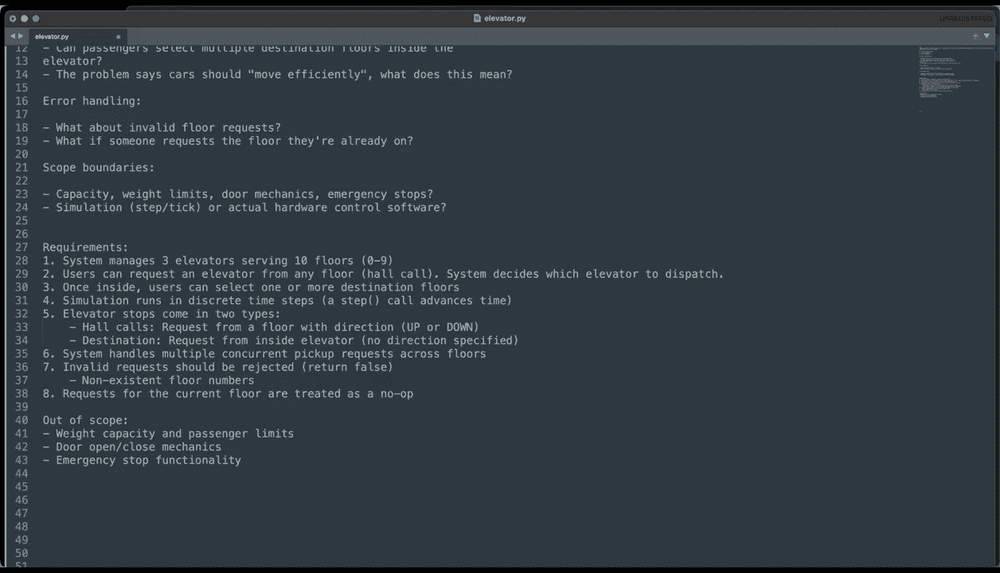

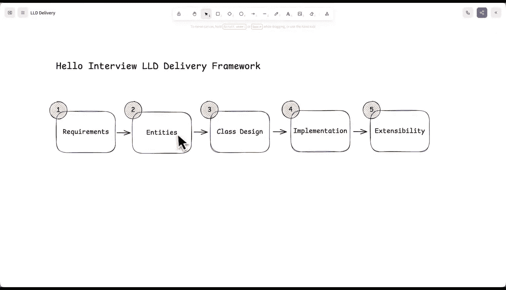

下面是你可能会问面试官的问题示例：


- 电梯数量和楼层数量是固定的还是可配置的？
- 厅召叫只有上行和下行，还是可以选择楼层？
- 乘客可以在电梯内选择多个目标楼层吗？
- 高效移动具体指什么？
- 无效楼层请求如何处理？
- 容量和重量限制、门的机制、紧急停止是否在范围内？
- 系统是基于步进和时钟的模拟，还是实际的硬件控制软件？


经过问答后，我们需要与面试官达成最终需求一致。以下是确定后的需求列表：


- 系统管理三部电梯，服务10层楼，编号0到9。
- 用户可以从任何楼层请求电梯，称为厅召叫，系统决定派遣哪部电梯。
- 进入电梯后，用户可以选择一个或多个目标楼层。
- 仿真运行在离散时间步进中，每次步进推进时间。
- 电梯停靠分为两类：来自楼层的厅召叫，带方向；以及来自电梯内部的目标请求，不带方向。
- 系统可以同时处理多个楼层的接请求。
- 无效请求应返回false或抛出错误。


需求确定后，接下来是实体建模。实体就是系统中的名词，这些名词可能成为类，为后续的类设计打下基础。这一过程直接基于刚才确定的需求，按顺序进行。


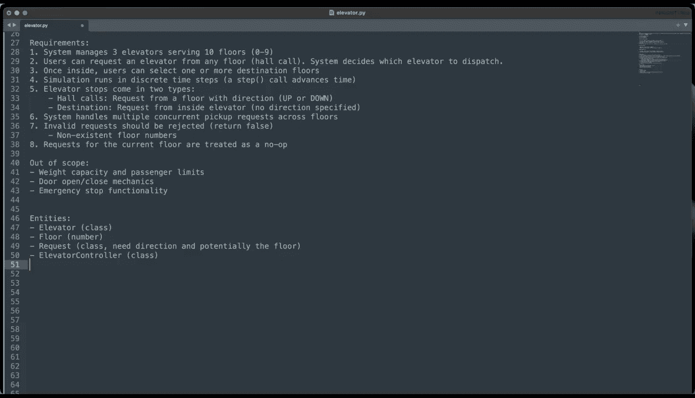

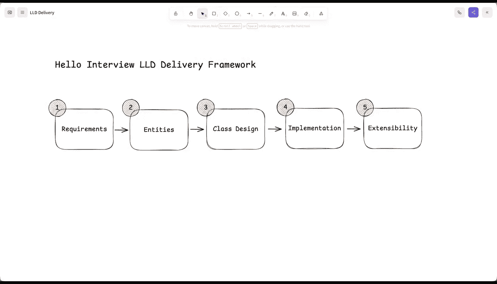

你需要扫描需求文本，寻找名词，判断每个名词是否适合作为类，或者只是字符串、数字或值对象。


以下是从需求中识别出的实体：


- 电梯。几乎肯定是一个类。电梯需要维护当前楼层、运行方向、需要停靠的楼层、待服务的请求等状态，并执行移动和停靠等规则。
- 楼层。乍看很重要，但实际上只是一个数字。楼层类不需要维护状态，也不执行规则，只需作为属性出现在请求和电梯中。因此不建模为类，而是一个数值字段。
- 请求。请求有两种类型，一类是楼层外的厅召叫，需要知道楼层和方向；另一类是电梯内部的目标请求，只需要知道楼层。请求可以建模为值对象或类，为简化起见我们将其设为类。
- 电梯控制器。虽然需求中没有直接出现这个名词，但考虑到调度厅召叫、维护电梯列表、推进仿真时间，系统需要一个统一的调度者。这就是电梯控制器，它是系统的主入口和协调者，必须建模为类。


实体确定后，进入类设计阶段。类设计的核心是明确每个类持有什么状态，支持哪些操作。我们按自顶向下的顺序设计，先设计控制器，再深入电梯类，这样可以专注于公共契约，不被实现细节干扰。


电梯控制器类的设计如下：


- 状态：电梯列表，即系统管理的所有电梯。
- 方法：请求电梯，接收当前楼层和方向，用于厅召叫；步进函数，遍历所有电梯并推进时间；构造函数，初始化电梯列表。


下面是电梯控制器的伪代码结构：


```text
class ElevatorController {
    List<Elevator> elevators

    constructor() {
        elevators = 初始化三部电梯
    }

    requestElevator(floor, direction) {
        验证楼层范围
        创建请求对象
        选择最佳电梯
        将请求添加到该电梯的请求集合
    }

    step() {
        对每部电梯调用 step()
    }

    private selectBestElevator(request) {
        选择最合适的电梯
    }
}
```


电梯类的设计如下：


- 状态：当前楼层、当前方向（上行、下行、空闲）、请求集合。使用集合而非列表，可以自动去重，避免多次前往同一楼层。
- 方法：构造函数、添加请求、步进函数、获取当前楼层、获取当前方向。


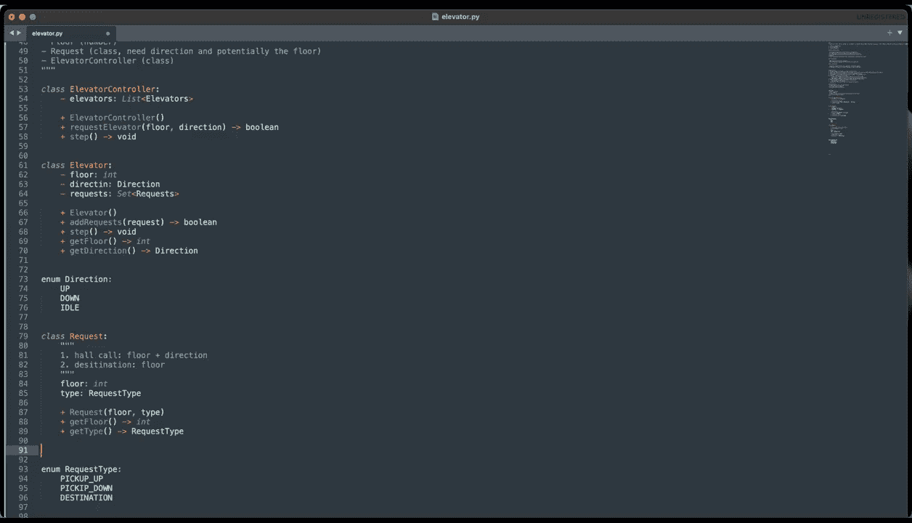

下面是电梯类的伪代码结构：


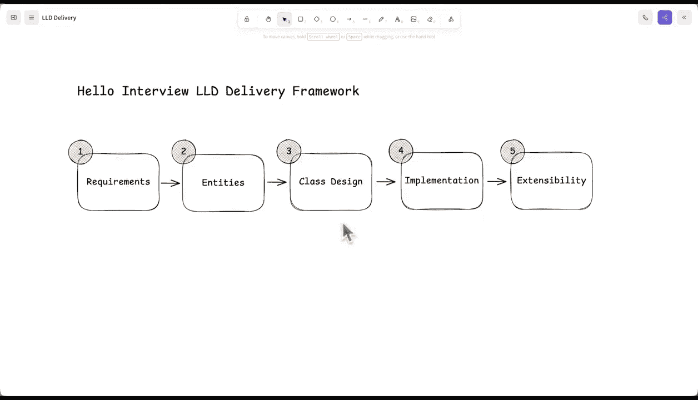

```text
enum Direction {
    UP, DOWN, IDLE
}

class Elevator {
    int currentFloor
    Direction direction
    Set<Request> requests

    constructor() {
        初始化状态
    }

    addRequest(request) {
        将请求加入请求集合
    }

    step() {
        执行移动、停靠、反向等逻辑
    }

    getFloor() {
        返回 currentFloor
    }

    getDirection() {
        返回 direction
    }
}
```


请求类的设计如下：


请求有两种主要类型：厅召叫包含楼层和方向；目标请求只包含楼层。如果直接复用方向枚举，会引入空闲状态，而请求不存在空闲状态，会导致歧义。更清晰的做法是显式编码请求类型。


定义请求类型枚举，包含三种状态：上行厅召叫、下行厅召叫、目标请求。这样避免了可空字段，代码可读性更高。


下面是请求类的伪代码结构：


```text
enum RequestType {
    PICKUP_UP, PICKUP_DOWN, DESTINATION
}

class Request {
    int floor
    RequestType type

    constructor(floor, type) {
        this.floor = floor
        this.type = type
    }

    getFloor() {
        return floor
    }

    getType() {
        return type
    }

    // 相等性基于楼层和类型
    equals(other) {
        return floor == other.floor && type == other.type
    }
}
```


类设计完成后，进入实际实现阶段。在低层级设计面试中，通常使用伪代码，面试官会指出核心方法让你实现，而不需要编写全部代码。我们将实现电梯控制器的请求电梯函数、选择最佳电梯函数、步进函数，以及电梯类的步进函数。


实现每个方法时，先用英语概述核心逻辑，再列出边界情况。


先看电梯控制器的请求电梯函数。核心逻辑是找到最适合的电梯，将请求添加到该电梯的请求集合。边界情况是楼层超出范围，应抛出错误。


下面是伪代码：


```text
requestElevator(floor, direction) {
    if floor < 0 or floor > 9 {
        抛出无效楼层错误
    }

    request = 创建请求对象(floor, 方向)
    bestElevator = selectBestElevator(request)
    bestElevator.addRequest(request)
}
```


选择最佳电梯函数有多种策略，比如最近电梯、轮询、方向感知等。这里我们实现一个简单的方向感知策略：优先找正在朝请求方向行驶且尚未经过请求楼层的电梯；如果没有，找最近的空闲电梯；最后退回到最近电梯。


下面是伪代码：


```text
selectBestElevator(request) {
    movingToward = 寻找朝请求方向行驶的电梯
    if movingToward 不为空 {
        return movingToward
    }

    nearestIdle = 寻找最近的空闲电梯
    if nearestIdle 不为空 {
        return nearestIdle
    }

    return 寻找最近的电梯
}
```


寻找朝请求方向行驶的电梯需要判断请求类型。上行厅召叫需要电梯向上行驶，下行厅召叫需要电梯向下行驶。同时要确保电梯尚未超过请求楼层，否则方向虽然对，但已经错过。


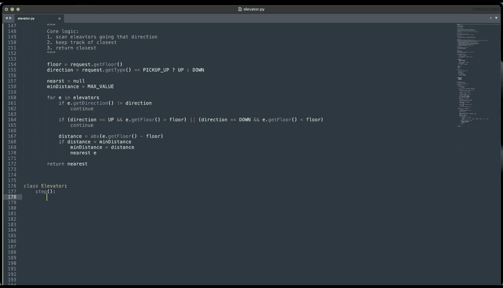

下面是该辅助方法的伪代码：


```text
findMovingToward(request) {
    请求楼层 = request.floor
    请求方向 = 根据请求类型转换为电梯方向

    currentNearest = null
    currentMinDistance = 最大值

    for 每部电梯 in 电梯列表 {
        if 电梯.direction != 请求方向 {
            continue
        }

        if 请求方向是上行 and 电梯.currentFloor > 请求楼层 {
            continue
        }

        if 请求方向是下行 and 电梯.currentFloor < 请求楼层 {
            continue
        }

        distance = 绝对值(电梯.currentFloor - 请求楼层)
        if distance < currentMinDistance {
            currentMinDistance = distance
            currentNearest = 电梯
        }
    }

    return currentNearest
}
```


电梯控制器的步进函数非常简单，只是遍历所有电梯并调用它们的步进函数。这体现了面向对象编程中的封装原则，控制器不需要知道电梯内部如何移动。


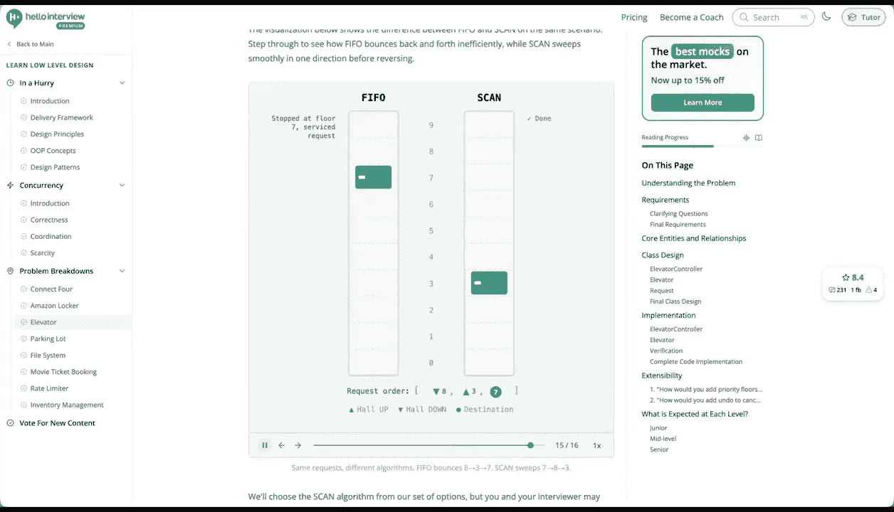

下面是伪代码：


```text
step() {
    for 每部电梯 in elevators {
        电梯.step()
    }
}
```


接下来是电梯类的步进函数，这是整个设计中最关键的部分，决定了电梯如何移动、服务哪个请求、服务顺序如何。我们采用扫描算法，也就是电梯实际常用的算法。扫描算法的核心是保持当前方向，沿同一方向扫描并服务所有请求，直到没有请求或到达顶层或底层，然后反向扫描。


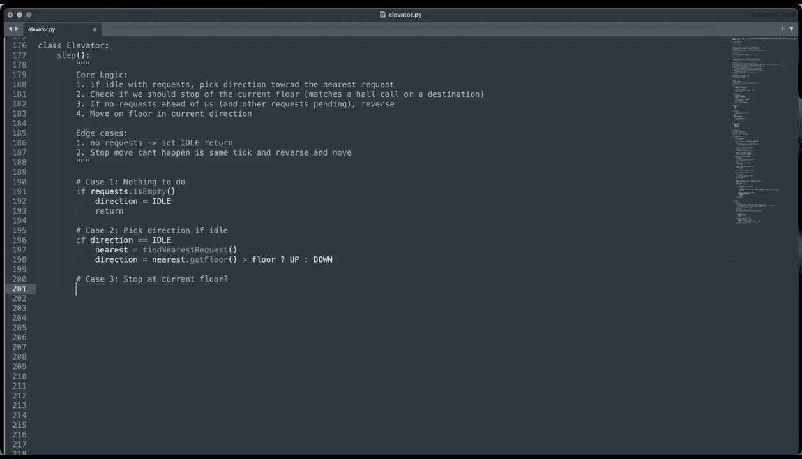

与先进先出算法相比，扫描算法更高效。例如请求顺序为：8楼下行厅召叫、3楼上行厅召叫、7楼内部目标请求。先进先出会先去8楼，而扫描算法会先在上行途中停靠7楼，再去8楼，最后下行到3楼，避免频繁反向。


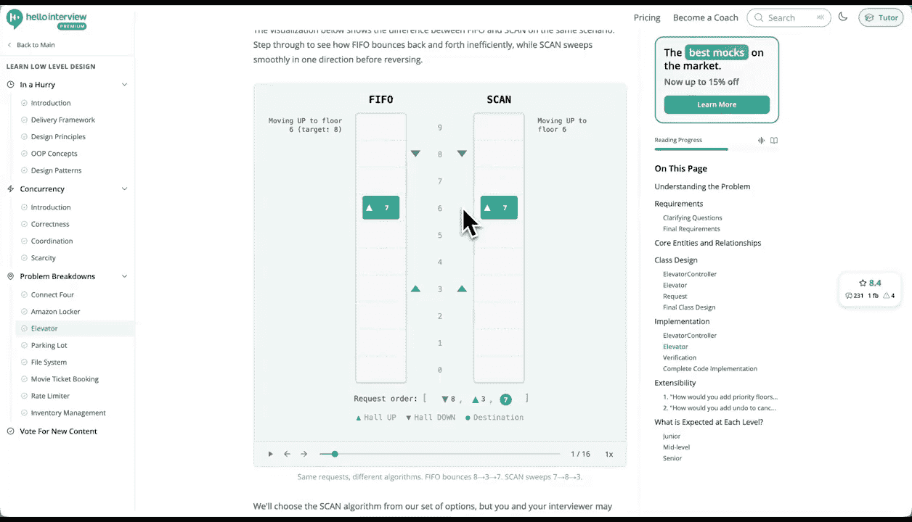

实现步进函数时，需要处理以下几种情况：


- 如果没有请求，设置方向为空闲并返回。
- 如果当前空闲且有请求，选择最近请求所在的方向，并开始移动。
- 如果当前楼层有匹配的厅召叫或目标请求，且方向正确，则停靠并移除请求。
- 如果当前方向前方没有请求，且还有其他请求，则反向。
- 否则，沿当前方向移动一层。


下面是电梯步进函数的伪代码：


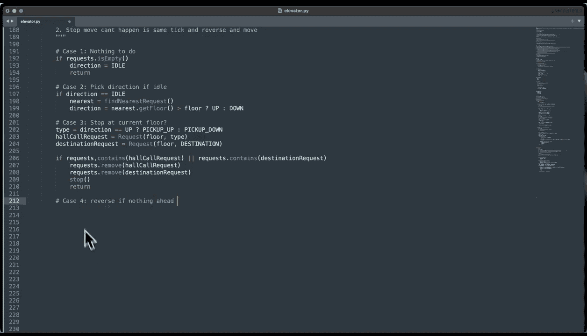

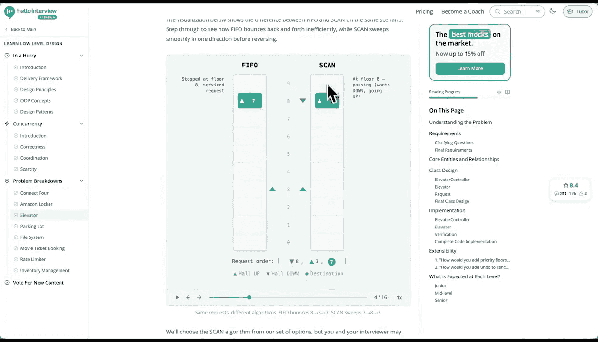

```text
step() {
    if 请求集合为空 {
        direction = IDLE
        return
    }

    if direction == IDLE {
        nearest = 查找最近请求
        if nearest.floor > currentFloor {
            direction = UP
        } else {
            direction = DOWN
        }
    }

    // 判断是否在当前楼层停靠
    hallCall = 创建请求(currentFloor, 当前方向对应的厅召叫类型)
    destinationCall = 创建请求(currentFloor, DESTINATION)

    if 请求集合包含 hallCall 或 请求集合包含 destinationCall {
        从请求集合移除对应请求
        return
    }

    if 前方没有请求 and 还有其他请求 {
        反转方向
    }

    if direction == UP {
        currentFloor++
    } else if direction == DOWN {
        currentFloor--
    }
}
```


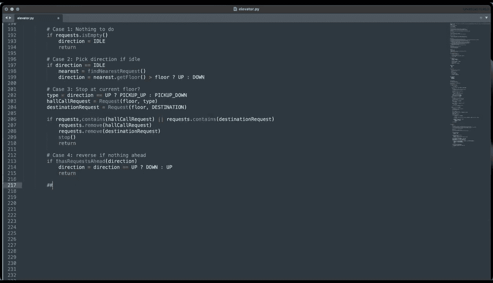

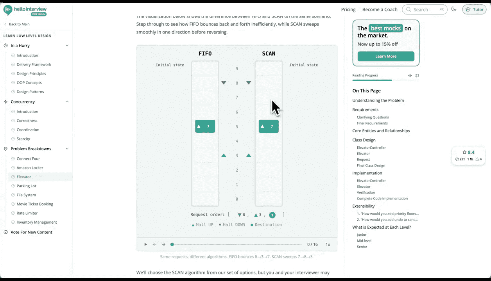

需要注意，停靠和移动不能在同一个时间步进完成，移动到楼层和在楼层停靠是两个不同的步进。


若时间允许，面试官可能会询问可扩展性问题。初级和中级候选人能走到这里已经很好，高级和专家级候选人则需要深入讨论。常见的可扩展性问题包括并发处理、优先楼层或快速电梯、取消楼层请求。


第一个问题是并发。如果两个用户同时从不同楼层按下电梯呼叫按钮，可能两个请求都选择同一部空闲电梯，导致效率低下；或者在同一部电梯的请求集合上进行并发修改，引发数据覆盖。步进函数中从请求集合移除请求时，也可能与添加请求同时发生，导致并发修改。


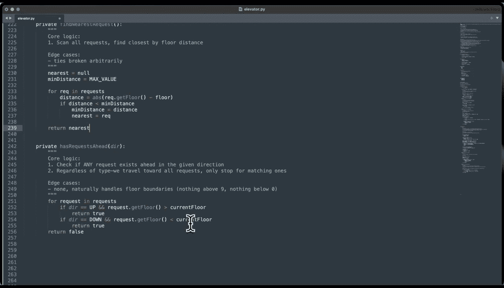

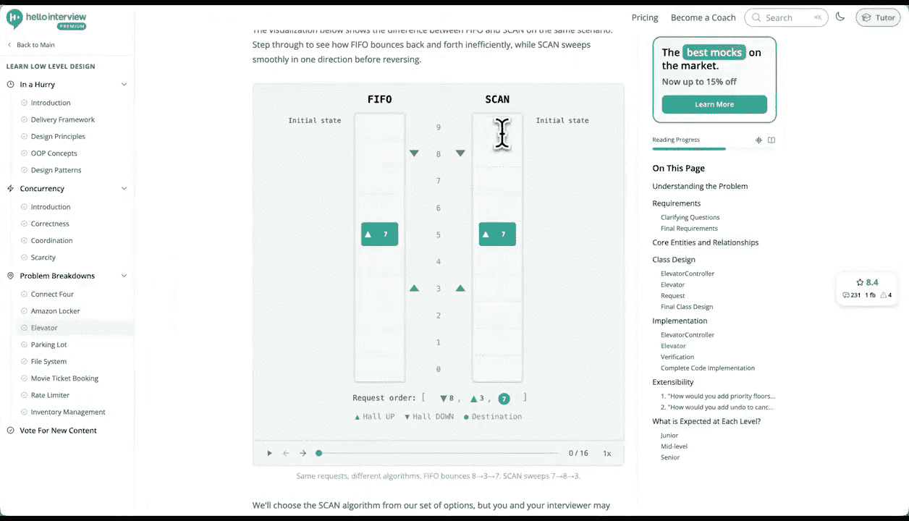

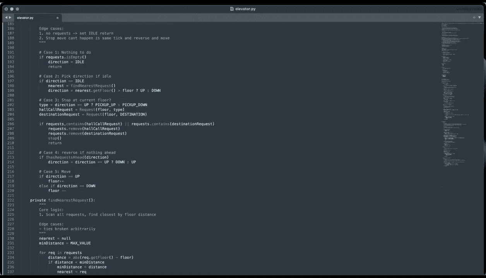

解决并发问题有两种方案。方案一是给请求电梯函数和步进函数加锁，确保同一时间只有一个线程访问请求集合。做法简单正确，但会导致阻塞，降低系统吞吐量。方案二是将添加请求写入线程安全队列，步进函数开始时将队列内容排入工作集。这样写入只操作队列，步进只操作集合，两者数据结构分离，不需要加锁，更为优雅。


下面是并发安全方案的伪代码片段：


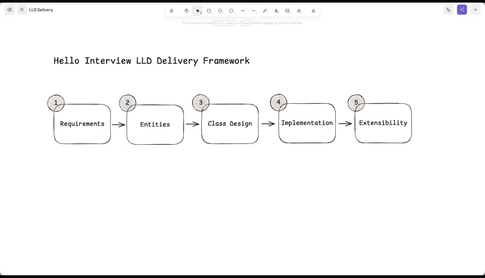

```text
class ElevatorController {
    ConcurrentQueue<Request> pendingRequests
    List<Elevator> elevators

    requestElevator(floor, direction) {
        pendingRequests.enqueue(创建请求)
    }

    step() {
        while pendingRequests 不为空 {
            request = pendingRequests.dequeue()
            selectBestElevator(request).addRequest(request)
        }

        for 每部电梯 in elevators {
            电梯.step()
        }
    }
}
```


第二个问题是优先楼层或快速电梯。一种做法是在请求对象中加入优先级字段并使用优先队列，但这会破坏扫描算法单向扫描的行为，导致电梯频繁反向，影响其他乘客。更好的做法是将其中一部电梯标记为快速电梯，专门服务优先楼层，其他电梯继续使用扫描算法。


下面是快速电梯标记的伪代码片段：


```text
class Elevator {
    boolean isExpress
    List<Integer> priorityFloors

    // 正常移动逻辑不变
    // 快速电梯只在 priorityFloors 中停靠
}
```


第三个问题是取消请求。鉴于当前设计已经比较清晰，取消请求非常简单，只需在请求集合中移除对应请求即可。下一步进时，该请求将不再被考虑。如果集合变为空，电梯将进入空闲状态。


下面是取消请求的伪代码片段：


```text
cancelRequest(request) {
    requests.remove(request)
}
```


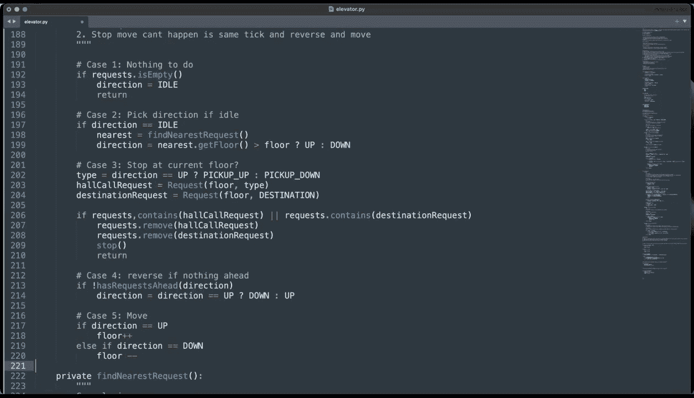

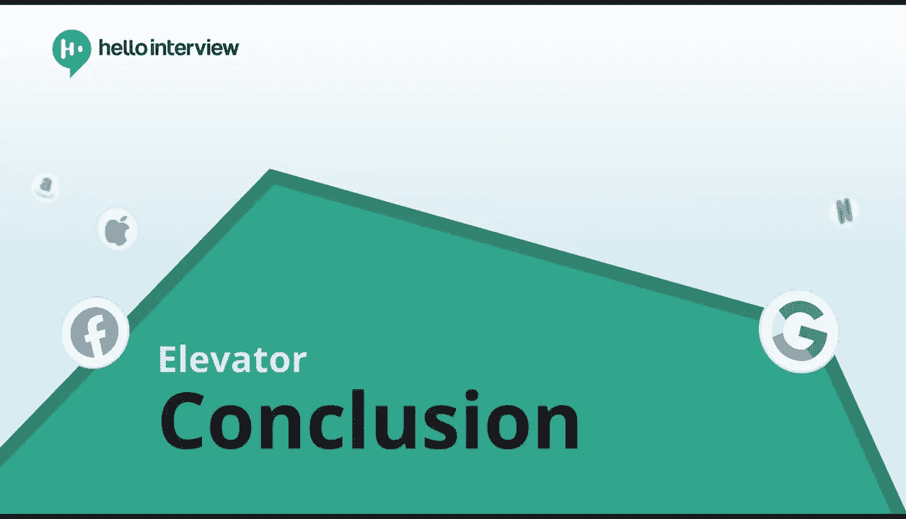

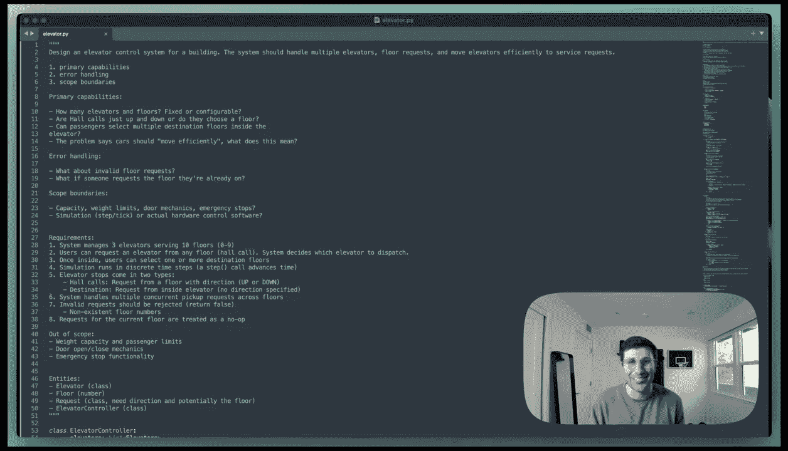

本节课中，我们一起学习了电梯低层级设计的完整流程。首先通过澄清问题明确需求，包括三部电梯、十层楼、厅召叫与目标请求、离散时间步进等。接着识别了电梯、楼层、请求、电梯控制器四个核心实体，并设计了它们的状态与行为。随后使用伪代码实现了请求调度、最佳电梯选择、扫描算法移动等核心逻辑，并讨论了并发控制、快速电梯、请求取消等可扩展性问题。希望这篇教程对你准备低层级设计面试有所帮助，祝你面试顺利。
