# 低级设计速成课：01：并发简介 🚀


在本节课中我们将要学习低级设计面试中最容易出错的部分，也就是并发。我们会先通过一个订票服务的例子，看看在单进程多线程环境下，两个用户同时抢同一个座位会发生什么。接着我们会把并发问题分成三大类，分别是正确性、协调和稀缺，并分别讲解每一类常见的模式、出现场景以及对应的解决工具。为了让初学者也能看懂，所有概念都会用大白话解释，并配合 Java 和 Python 的代码示例。如果你正在准备软件工程面试，可以关注 Hello Interview，那里有各类面试类型的备考资源，包括详细的文字拆解和常见面试题分析。


## 引入：订票系统与并发问题


设想你正在构建一个类似 TicketMaster 的订票服务，但这是一个进程内系统，不是分布式系统，也不是系统设计，而是低级设计，这意味着我们在单个进程中工作。在这个订票系统里，你可以浏览座位并预订座位。你会先写一个 bookSeat 函数，它是订票服务类的一部分，传入一个座位，先检查该座位是否可用，如果可用就进行预订。我给出了 Java 和 Python 两种实现供你参考。

这段代码乍看之下好像没什么问题，老实说，在 TypeScript 这类单线程语言里确实没问题。但如果你在多线程环境下运行，会发生什么呢？如果两个用户在完全相同的时间点尝试预订同一个座位，就会有两个不同的线程同时访问同一个共享状态，也就是座位映射。我们来具体看看这会导致什么后果。


## 并发问题的三大类别

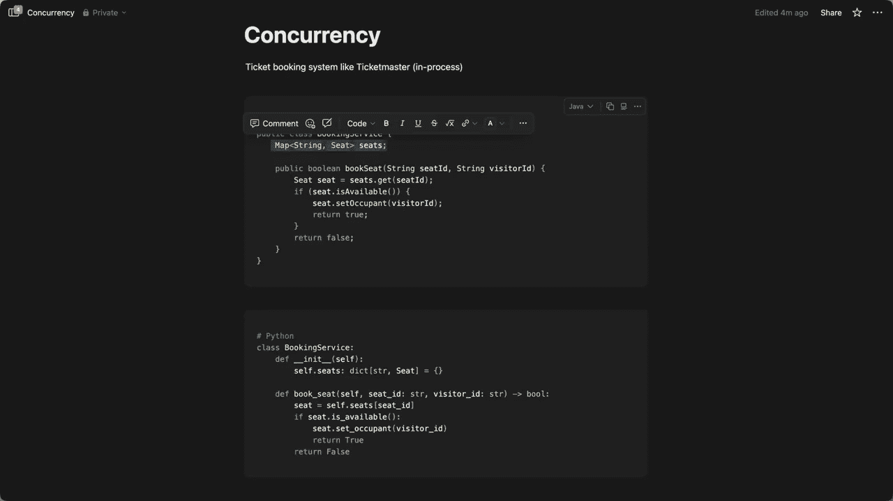

并发问题整齐地归纳为三大类别。第一类是正确性，就像刚才订票例子中看到的那样；第二类是协调；第三类是稀缺。一旦你了解这三类，知道它们是什么、怎么出现、怎么解决，你就能应对低级设计或机器编码面试中几乎所有的并发挑战。下面我们一个一个来拆解，先从正确性开始。


### 正确性：检查后执行模式

正确性问题发生在共享状态被两个线程在同一时间访问而导致数据损坏的情况下。你在面试中要识别的模式通常叫“检查后执行”（check then act）。基本上，你先检查一个条件，再根据这个条件采取行动。但在检查和行动之间，另一个线程可能会进来改变事情。

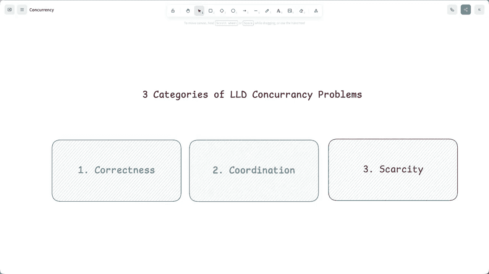

在订票例子中，我们先检查座位是否可用，然后再预订，这是两个独立的步骤。在检查和行动之间的这个间隙，另一个线程可以溜进来把座位抢走，bug 就藏在这个间隙里。这个检查后执行模式是低级设计面试中最常见的并发问题。比如多入口停车场系统，检查车位是否空闲，然后给车分配车位；限流器，检查用户是否在限额内，然后允许请求；库存系统，检查商品是否有货，然后处理订单，都是同一种结构，目标是能识别出来。

最重要的是，至少在高层面上，修复方法是让检查和行动合并在一起，作为一个原子操作发生。这样就不会有任何线程能在中间插入并打断。标准工具叫锁（lock），每种编程语言都有自己的锁原语。Rust 和 Go 里有互斥锁，Java 里有 synchronized 块，Python 里有 lock、mutex 或 semaphore，C++ 里也有。这些工具都保证一次只有一个线程执行一段代码，其他线程等待锁释放。你先获取锁，做检查，做行动，然后释放锁。

以下是 Java 中使用 synchronized 块的示例代码：

```java
synchronized (this) {
    if (seats.containsKey(seat) && seats.get(seat) == AVAILABLE) {
        seats.put(seat, BOOKED);
    }
}
```

以下是 Python 中使用 with lock 的示例代码：

```python
with self.lock:
    if seat in self.seats and self.seats[seat] == AVAILABLE:
        self.seats[seat] = BOOKED
```

回到刚才的图示，加锁后的情况会变成这样。线程 1（Alice）检查座位可用，是的，然后给 Alice 预订，状态变为已预订。整个过程中 Bob 进不来，因为 Alice 先获取了锁，Alice 持有锁，她能完成检查和行动两个步骤。Bob 只能等待。只有当锁释放、座位状态设为已预订后，Bob 才能检查座位是否可用，这时他会正确地得知答案是否。


### 正确性：读取-修改-写回模式

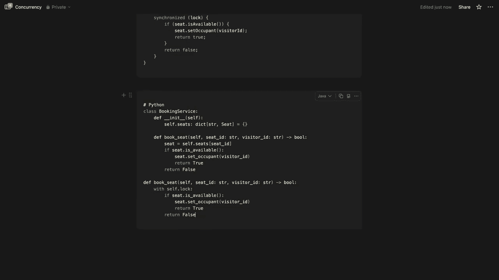

第二种常见的正确性模式叫“读取-修改-写回”（read modify write）。也就是读取一个值，基于它计算，然后写回。经典例子就是给计数器加一。假设计数器当前是 1，执行 count++，看起来像一个操作，一行代码，但实际上是三个步骤：先读取当前值，再加一，最后把新值写回。

如果两个线程同时做，它们可能都读到 5，都算出 6，都写回 6，最终结果是 6，但应该是 7，丢失了一次递增。这出现在点击计数器、银行账户余额、库存数量、指标聚合等场景，基本上只要你要基于当前状态更新一个值，就会遇到读取-修改-写回模式。

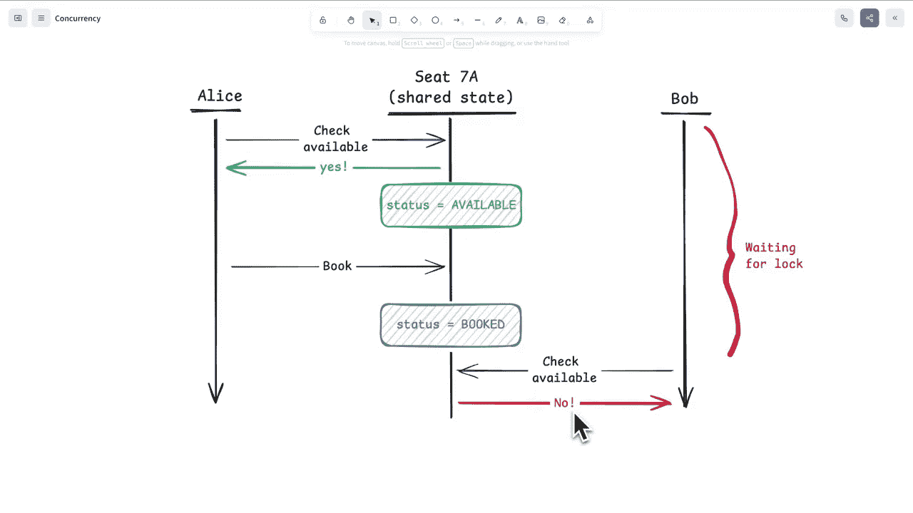

修复思路完全一样，要让整个读取-修改-写回操作原子化。对于简单计数器，可以使用所谓的原子变量，在硬件层面处理，这很酷。现代 CPU 有比较并交换（compare and swap）等特殊指令，在一个 CPU 周期内完成读取-修改-写回，硬件保证没有其他线程能在更新过程中看到该值。让我们看看解决方案的实现。

就像锁一样，每种主流语言都有自己的原子整数原语。在 Java 中，它就叫 AtomicInteger。你可以把原子整数实例化为任意值，比如 0 或者 10。每次想加 1 时，不要用 count++，而要用 count.incrementAndGet()，这是硬件层面的原子操作，会使用 CPU 上的比较并交换。在我们的例子中会返回 11。

以下是 Java 的示例代码：

```java
AtomicInteger count = new AtomicInteger(10);
int newValue = count.incrementAndGet(); // 返回 11
```

不幸的是，Python 不支持内置原子变量。在 Python 里没法直接用原子变量，只能像上面那样用锁。根据实现语言不同，你可能有原子原语，也可能没有。怎么知道用哪个？如果只是更新单个变量或计数器，比如标志位或简单统计量，就用原子变量。但如果要同时更新两个变量并且保持一致性，比如账户转账，原子变量就没用了，这时候得用锁。

总结一下，正确性中有两种主要模式：检查后执行和读取-修改-写回。根本原因一样：操作之间有间隙，其他线程可以干扰。修复方法也一样，让操作原子化，通常用锁，但有时也可以用原子变量，取决于语言和是否只更新单个变量。


### 协调：阻塞队列

第二类并发问题叫协调。假设你在做一个网站，用户注册后要发送欢迎邮件，发送邮件大约要 500 毫秒，半秒，你不希望注册请求被阻塞整整半秒。所以你想把这个耗时工作交给后台线程，把发送邮件的任务交给后台线程，然后立即返回注册请求给用户。

这时 API 线程需要把任务传给发送邮件的工作线程。自然的做法是两者之间放一个队列。生产者把任务推入队列，消费者（邮件发送者）从队列拉取任务并发送邮件。

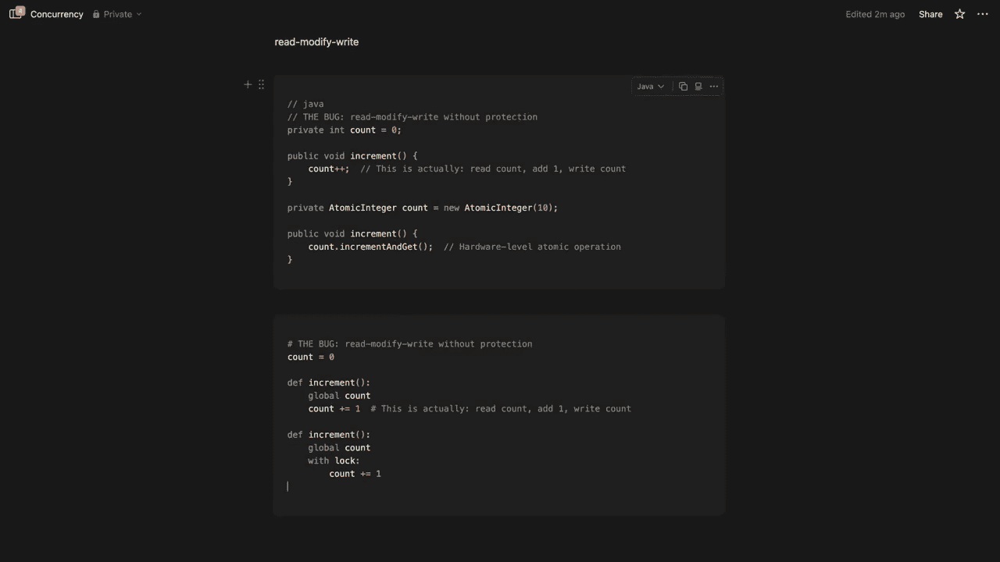

看似简单，但这样做引入了两个问题。第一，工作线程怎么知道新工作到了？消费者怎么知道工作到达，而且怎么高效知道？我们稍后讲。第二，如果工作到达的速度快过消费者处理速度怎么办？你可以想象有大量发送邮件的任务，只有几个工作线程，队列会越来越长。这就是我们要解决的两个问题，先从第一个开始。

基本上，工作线程需要能够等待任务。天真做法是线程在循环中不断检查是否有工作，比如 while true，如果队列为空就尝试拉取并处理，这样就一直在循环。这里有个明显问题，就是在白白浪费 CPU。线程被不断的循环完全占用，一直在检查队列：你准备好了吗，准备好了吗，准备好了吗？这浪费了本可用在其他地方的宝贵 CPU 资源。

你可能想到的第一个解决方案是睡眠再拉取，引入一个 sleep，不让线程一直转。比如尝试拉取，如果没拿到就睡眠 100 毫秒，然后再试。这样可以减少 CPU 浪费。Python 里也一样。不过这样可能好一点，浪费的周期少了，但还是在浪费。而且引入了延迟。如果新邮件任务本来要花 500 毫秒，现在可能要 600 毫秒，因为任务到了后要等 100 毫秒才能从队列拉取。你真正想要的是：没事干时工作者睡眠，工作一到就立刻唤醒。

解决方案是使用所谓的阻塞队列。就像锁和原子变量一样，大多数主流语言都内置了阻塞队列。阻塞队列的工作方式是，工作线程调用 take 函数。如果对空队列调用 take，线程就会睡眠。当生产者调用 put 放入东西时，会自动唤醒一个睡眠中的工作者，告诉它有任务要处理。

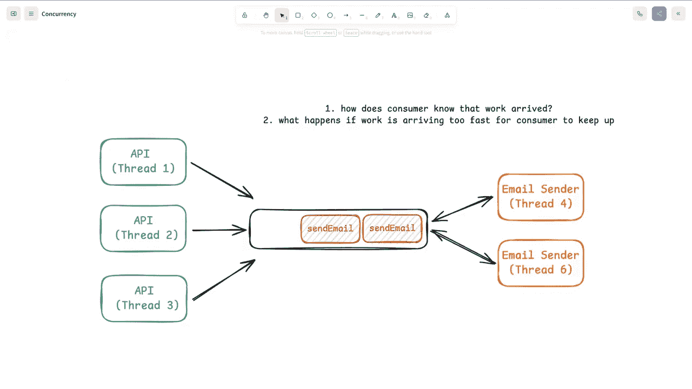

以下是 Java 的示例代码：

```java
BlockingQueue<Task> queue = new ArrayBlockingQueue<>(1000);

// 生产者
queue.put(task);

// 消费者
while (true) {
    Task task = queue.take(); // 队列为空时阻塞等待
    process(task);
}
```

以下是 Python 的示例代码：

```python
import queue

q = queue.Queue()  # 默认就是阻塞队列

# 生产者
q.put(task)

# 消费者
while True:
    task = q.get()  # 队列为空时阻塞等待
    process(task)
```

在 Java 中，我们要实例化一个阻塞队列。新用户进来时，把任务 put 进队列并返回成功，那条线程就完成了。在消费者那边，仍然在循环中，如果调用 queue.take() 而队列为空，线程就会睡眠，说其他线程可以用 CPU，我不需要了。直到下一次 put 进来，它才会自动唤醒、处理任务，然后重复：如果为空就睡眠。Python 的 Queue 默认就是阻塞队列，有 put，但对应的是 get 而不是 take，API 略有不同，但总体概念一样。


### 协调：有界阻塞队列与背压

回到协调中的第二个问题：如果工作到达速度快过消费者处理速度怎么办？比如营销邮件刚发出，5 万用户同时点击链接，产生了大量后台任务和邮件，队列越来越长，最终无界增长，导致内存耗尽，整个进程崩溃。这是我们要避免的。

解决方案是使用有界阻塞队列。设置最大容量，队列满时生产者阻塞，直到有空间。这叫背压（back pressure），非常重要，系统处理不过来时会自然减速。阻塞队列能解决这个问题。实现很简单，实例化时指定最大项数，超过这个数就开始施加背压，自然就成了有界阻塞队列。

以下是 Java 的示例代码：

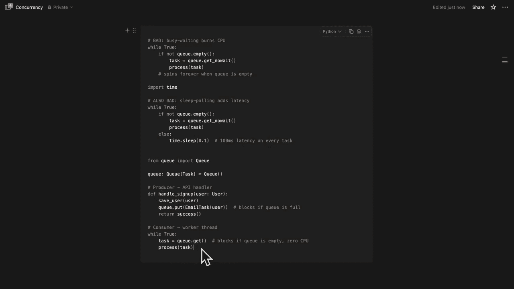

```java
BlockingQueue<Task> queue = new ArrayBlockingQueue<>(1000);
```

以下是 Python 的示例代码：

```python
import queue

q = queue.Queue(maxsize=1000)
```

使用阻塞队列，特别是有界阻塞队列时，几乎总是要确保有界，我觉得没理由不加上界。这个知识点会在面试中出现，只要需要异步处理，比如任务调度器、后台作业处理器、消息队列，工作从一个组件流向另一个组件，从一个线程流向另一个线程，那就是协调，阻塞队列几乎总是答案。当然还有更多细节，比如缓冲区怎么合理设置，关闭时会怎样，如果请求路径不能阻塞怎么办。但面试中主要记住：需要协调时，就用有界阻塞队列。


### 稀缺：信号量

最后一类并发问题叫稀缺，即需要限制对有限资源的并发访问。比如说，你在调用一个外部 API，它只允许 10 个并发请求，这就是它的速率限制。你有 50 个线程可能同时都想调用它。你需要一种方式，说任意时刻只有 10 个线程能在这里。

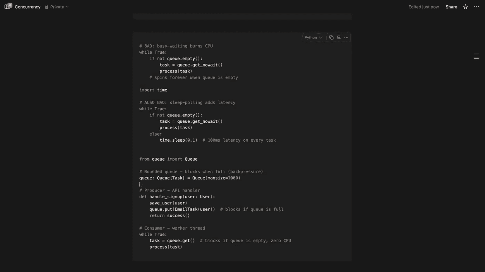

这个工具叫信号量（semaphore），你可能在学校学过。从概念上看，信号量就像一桶许可。在做某个操作之前，你从桶里拿一个许可，操作完后把许可放回去。如果你到了桶里没许可，就得等待，直到有人放回许可。

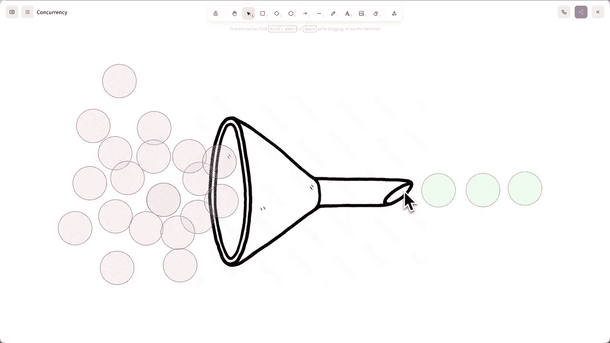

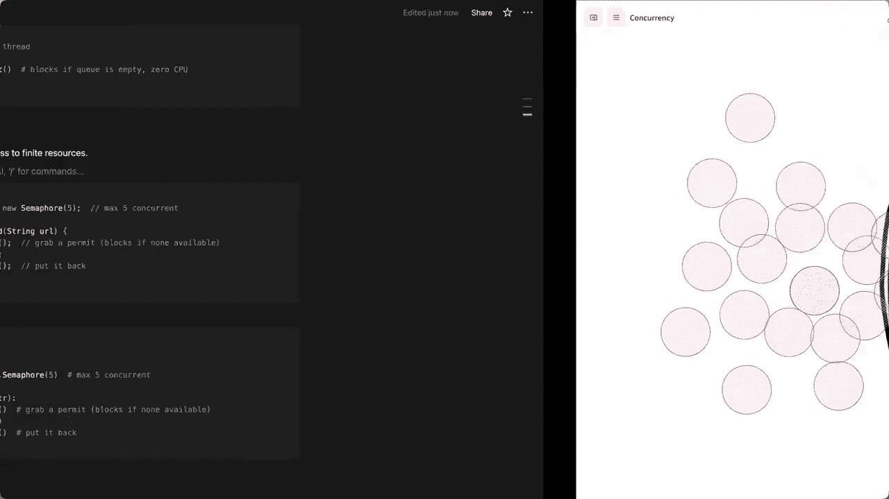

看看实现，Java 和 Python 都有。Java 内置信号量，大多数语言都有。比如说，你在下载一些大文件，想确保同时只下载 5 个文件，可能不想内存不足或 IO 不足。所以先获取一个许可，基本上从桶里拿一个许可，做昂贵的下载，然后释放许可。这能保证同时只有 5 个线程在下载。Python 里也一样，有信号量，分别是 acquire 和 release。

以下是 Java 的示例代码：

```java
Semaphore semaphore = new Semaphore(5);

// 获取许可
semaphore.acquire();
try {
    downloadFile();
} finally {
    // 释放许可
    semaphore.release();
}
```

以下是 Python 的示例代码：

```python
import threading

semaphore = threading.Semaphore(5)

# 获取许可
semaphore.acquire()
try:
    download_file()
finally:
    # 释放许可
    semaphore.release()
```

这里有个有趣的点，如果下载过程中抛出异常怎么办？如果抛出异常，我们会跳出下载函数，异常冒泡上来，我们永远不会释放或归还信号量，也不会把许可放回去。如果发生了五次，按照这个类比，你的许可桶就完全空了，没有任何信号量被释放，因为它们都抛出了异常，然后一直持有那个信号量。这会让一切停下来，乱套了，再也下载不了文件。这是处理稀缺问题时在面试中常见的 bug，你要确保信号量一定能放回去，许可一定能归还，供其他人使用。幸运的是，解决方法很简单，用 try-catch-finally 包起来，尝试下载，如果失败或出什么问题，finally 里都会释放许可。Python 里也一样。


### 稀缺：连接池与对象池

有时候情况不仅仅是计数，不是只在数请求数量，而是在管理带有状态的实际对象，这一点很重要。比如数据库连接，是经典例子。每个连接持有一个打开的 TCP 套接字，占用内存，追踪事务状态。你不能为每个请求或每个查询都创建一个新连接。相反，你创建一个连接池，可能有 10 个打开的连接，所有线程都能复用这 10 个连接，不用一直打开和关闭连接。这是稀缺问题的另一种形式。刚才的例子只是在计数，而我现在描述的是你有一组固定资源。

解决方法和协调中看到的一样，可以用阻塞队列，用你的对象填充它。线程取出一个，使用，然后放回去。底层原语还是阻塞队列，但用法不太一样，我们基本上把它当成一个对象包或可复用的对象池。

再看一次这个实现。我们有阻塞队列，实例化时应该加上限制，然后加载连接，比如有 10 个连接，把 10 个连接放进池里，现在它们在队列里。每次想运行查询时，第一件事就是从池里 take 一个连接。如果没有可用的，就阻塞等待，就像协调中记得的那样。然后运行查询，最后把连接放回池里。与释放锁或归还信号量不同，我们只是把连接放回池里，基本上再次调用 put。这时下一个等待的线程就可以拿走了。Python 里也一样，想法完全一致。

以下是 Java 的示例代码：

```java
BlockingQueue<Connection> pool = new ArrayBlockingQueue<>(10);

// 预先填充连接池
for (int i = 0; i < 10; i++) {
    pool.put(createConnection());
}

// 使用连接
Connection conn = pool.take(); // 无可用连接时阻塞等待
try {
    runQuery(conn);
} finally {
    pool.put(conn); // 归还连接到池中
}
```

这两种稀缺问题的模式是一样的：获取稀缺资源，使用它，然后释放它，并确保即使出错也能通过 finally 块完成释放。


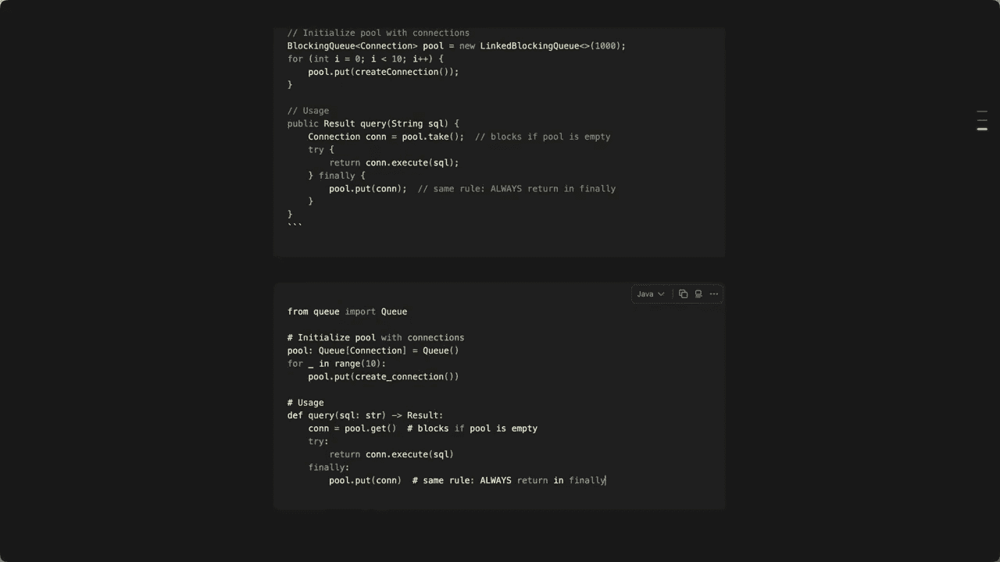

## 总结与面试检查清单

好了，总结一下。如果你在低级设计面试中遇到并发问题，这里有你的心智检查清单。第一件事要问自己：是否有多个线程可以访问的共享状态？如果答案是肯定的，那就是正确性问题。对于正确性问题，我们讲了读取-修改-写回，以及检查后执行。无论哪种情况，你都想用锁或原子变量。

第二件事要考虑：工作是否从一个线程流向另一个线程？如果是，那就是协调问题。你要想没工作时会发生什么，工作太多时会发生什么，这两种情况下你可能都想用阻塞队列或有界阻塞队列。

第三，我们讲过如果有某种东西的固定限制，那就是稀缺问题。所以要确保资源总是被释放，当然要在 final 块里。然后你可能想用信号量或阻塞队列作为池，就像我们讨论的。

大多数面试问题都能干净利落地映射到这三类中的一种。一旦你能识别出这三类，在面试中就能看出来，并且知道应用哪些解决方案，事情就变得很简单了。希望这对你有价值。正如我提到的，我们有正确性、协调和稀缺各类的完整文字拆解，包含各种核心编程语言的更多示例、面试中要注意的事项、边界情况，比视频里讲到的细节多得多，会放在描述链接里，但很遗憾只对高级用户开放。然后像往常一样，如果喜欢内容，请点赞订阅，我们很快会有更多内容。再见。


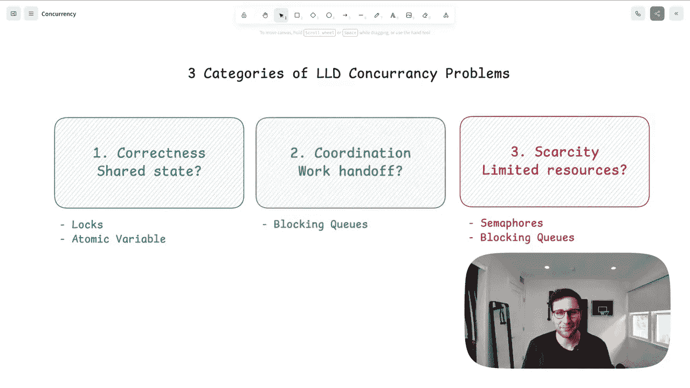

本节课中我们一起学习了低级设计中并发问题的三大类别：正确性、协调和稀缺。我们通过订票系统的例子，掌握了检查后执行和读取-修改-写回两种正确性模式，并学会了使用锁或原子变量来保证原子性；了解了如何使用阻塞队列和有界阻塞队列来解决线程间的任务协调与背压问题；最后学习了如何用信号量和连接池来管理稀缺资源，并确保在 finally 块中释放资源。希望这些内容能帮助你在面试中更好地应对并发相关的问题。

