# 低级设计速成：p02：2. 连四棋低级设计 🎮


在本节课中我们将学习如何设计一个两人连四棋游戏的低级设计方案。我们会从需求分析开始，逐步进入实体识别、类设计、代码实现，最后讨论可扩展性问题。本节内容适合初学者，不需要复杂的背景知识，跟着步骤一步步来即可。


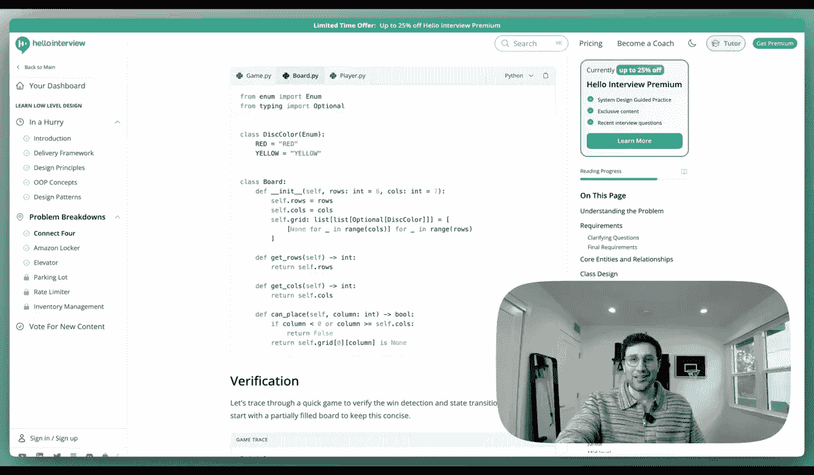

## 什么是低级设计

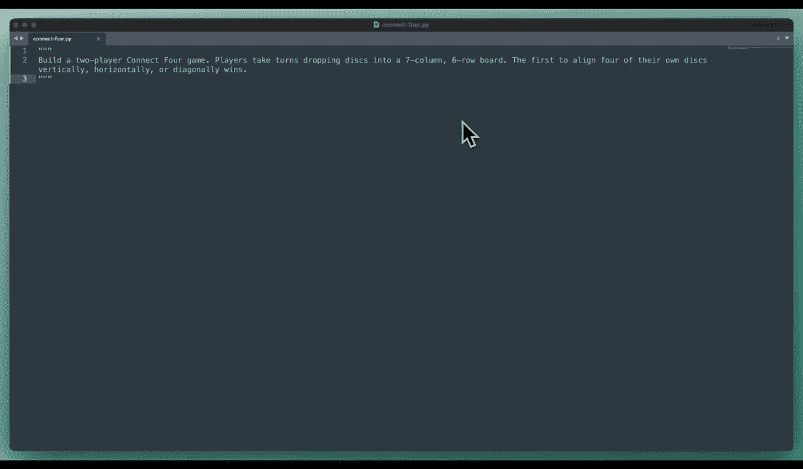

低级设计是面试中的一种类型，它侧重于面向对象设计。简单来说，就是决定需要哪些类，这些类如何交互，以及具体方法如何实现。

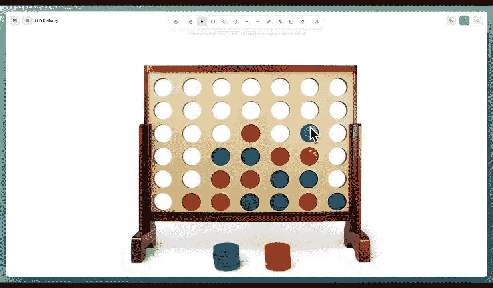

在大型公司面试中，低级设计非常常见。例如亚马逊、微软、Netflix 都经常考察，尤其是初级和中级职位，高级职位有时也会出现。在印度和亚洲地区，很多公司或海外公司的当地办公室也非常喜欢问这类问题，不论候选人的级别如何。

下面是一个常见的低级设计问题示例：

```text
设计一个连四棋游戏
棋盘为 7 列 6 行
两名玩家轮流投掷棋子
首先在垂直、水平或对角线方向连成四子者获胜
棋盘填满且无人获胜则为平局
```

这道题是初学者最常遇到的低级设计问题之一，适合用来介绍这类面试的流程。


## 需求分析

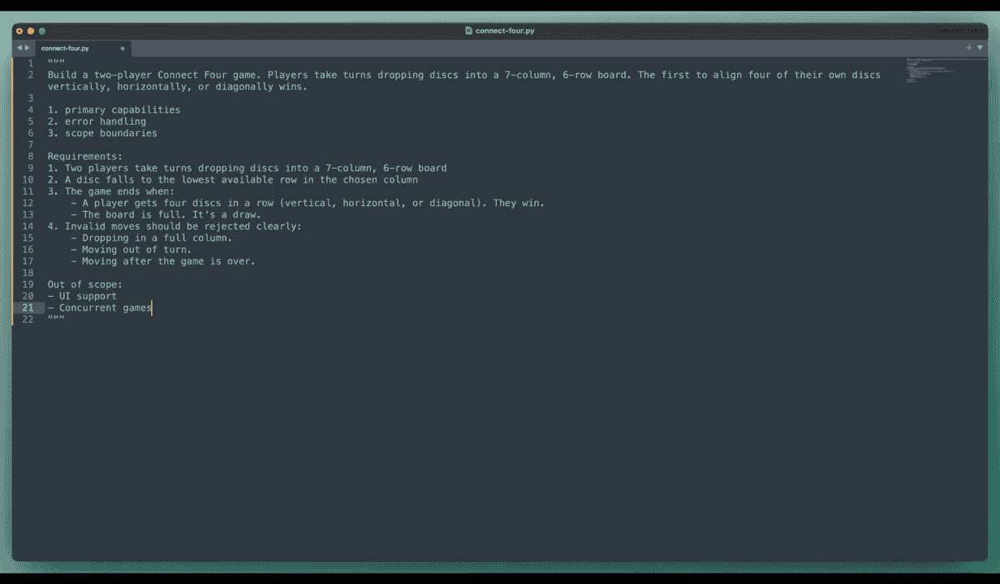


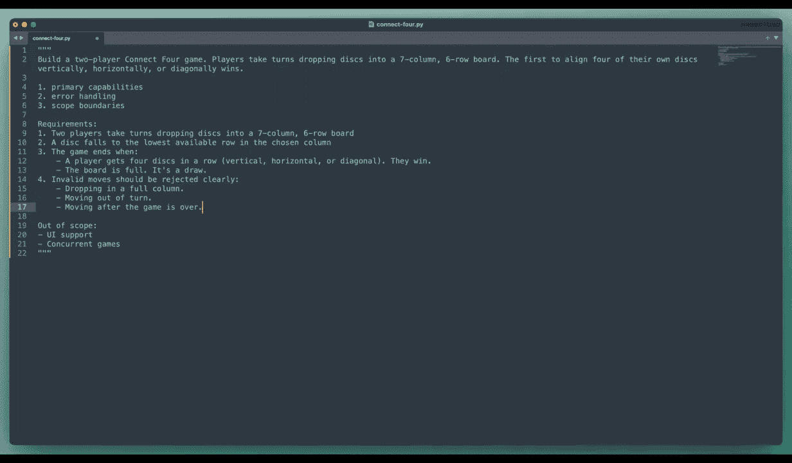

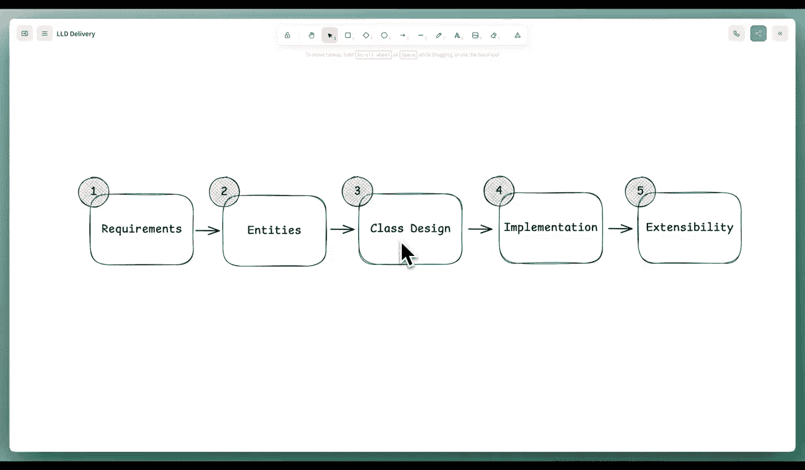

上一节我们介绍了什么是低级设计，本节中我们来看看如何分析需求。

拿到题目后，很多初学者容易立刻开始思考实现细节，这是一个常见错误。原因有两个：第一，你没有和面试官就要构建什么达成一致；第二，面试官正在评估你的问题分析能力，想看你能否把模糊的描述转化为具体的需求。

因此，在开始设计之前，应该花几分钟时间和面试官沟通，提出澄清性问题。以下是可以参考的问题类别：

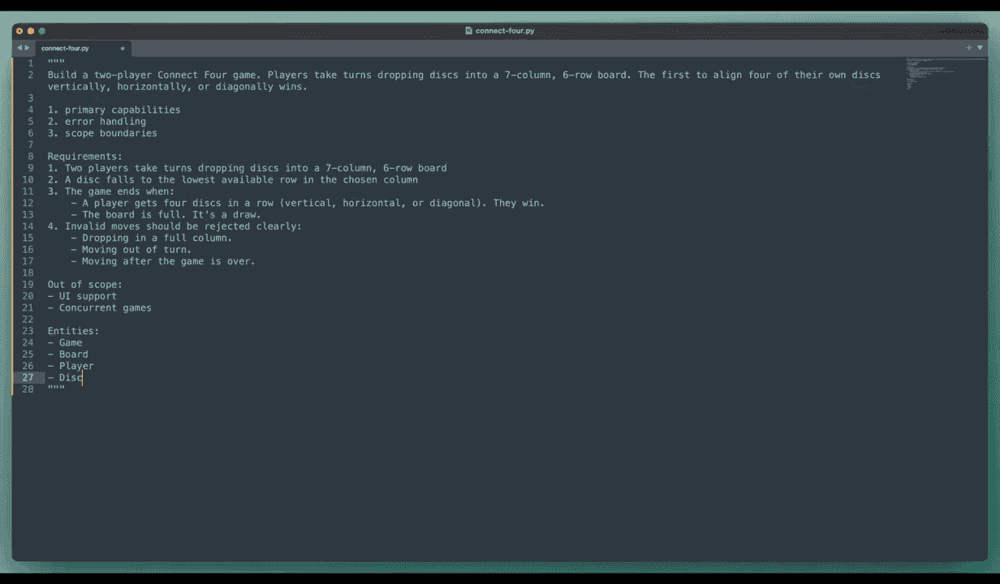

- 主要功能：玩家如何与游戏交互？是只指定列号，棋子自动落到最低可用位置吗？游戏结束的所有方式有哪些？只有连成四子，还是也包含平局？
- 错误处理：当某人尝试在已满的列中投掷棋子时，应该怎么做？返回错误、抛出异常还是忽略？如果玩家试图轮到对方时下棋，又该如何处理？
- 范围边界：是一次只支持一局游戏，还是支持多局并行？用户界面是否在范围内，还是仅关注后端类设计？

经过这些沟通，你会得到一组明确的最终需求，建议在共享屏幕或白板上记录下来。以下是一个可能的需求示例：

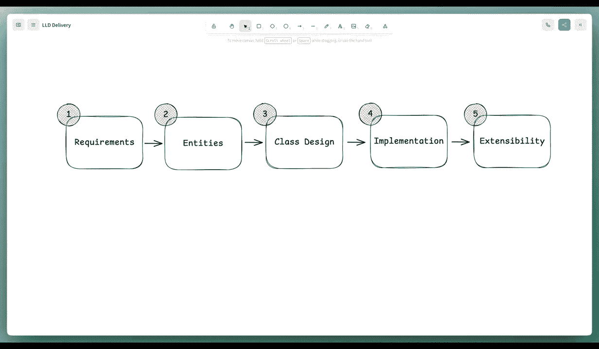

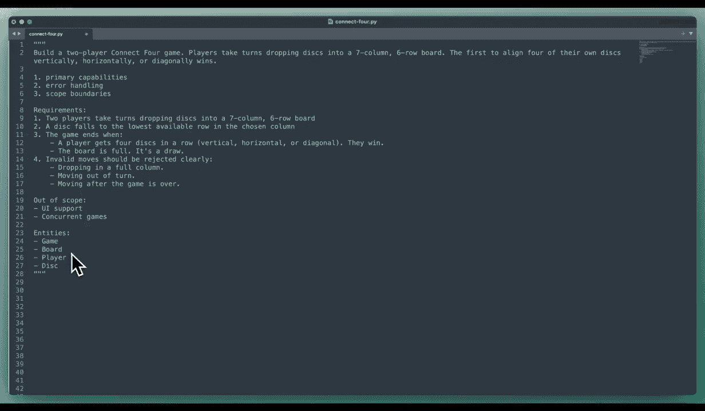

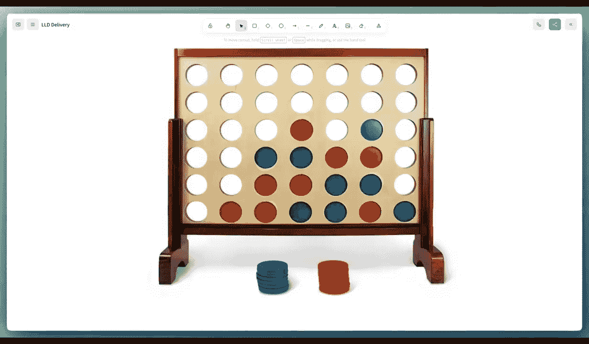

- 两名玩家轮流在 7 列 6 行的棋盘上投掷棋子
- 棋子落到所选列的最低可用行
- 游戏在任一方向连成四子时结束，或者棋盘填满时为平局
- 无效走法包括：在满列中投掷、轮到对方时下棋、游戏结束后下棋
- 范围外内容：用户界面、多局并行游戏

现在我们有了具体的需求集合，可以进入下一步。


## 实体识别

上一节我们完成了需求分析，本节中我们来看看如何识别实体。

实体识别就是找出系统中需要哪些对象，它们将如何相互作用，这些对象最终会变成类设计中的类。

一种简单的方法是通读需求，寻找名词和突出的事物。在连四棋中，我们可以找到以下名词：

- 玩家：需要建模，负责投掷棋子
- 棋盘：需要建模，管理网格状态
- 游戏：需要建模，作为协调者，持有棋盘和玩家
- 棋子：游戏中的一个东西，可以用枚举表示颜色

下面是这些实体的职责划分：

- 游戏类：负责游戏状态和游戏逻辑，持有棋盘和玩家对象
- 棋盘类：管理网格状态和棋子放置，知道列是否已满、棋子是否会下落、是否有四子相连，不关心谁下棋或谁获胜
- 玩家类：代表单个玩家，通常是简单的数据持有者，包含名字和棋子颜色
- 棋子：可以表示为枚举，比如红色或蓝色

这里有一个重要的设计原则，叫作单一职责原则，可以用公式表示：

```
每个类 = 一个明确的职责
```

意思是每个类应该只做好一件事。当需求变化时，你能精确指出需要更新哪个类，而不需要动其他类。例如，如果棋盘尺寸从 6x7 变成 8x8，或者连子条件从四子变成五子，只需要修改棋盘类；如果增加悔棋功能或改为三人游戏，只需要修改游戏类。


## 类设计

上一节我们识别了实体，本节中我们来看看如何进行类设计。

类设计的核心是决定每个类持有什么数据，对外暴露什么方法。建议采用自顶向下的方法，先设计游戏类，再设计棋盘类，最后设计玩家类。

先来看游戏类的状态。游戏类需要跟踪以下内容：

- 两个玩家对象：玩家一和玩家二
- 当前是谁的回合
- 棋盘对象
- 游戏状态：进行中、已有人获胜、平局

关于游戏状态的表示，有几种选择。一些候选人习惯使用多个布尔标志：

```python
is_over = bool
has_winner = bool
is_draw = bool
```

但这样会产生 8 种组合，而只有 3 种是合法的，容易出现状态冲突。更好的方式是使用枚举：

```python
enum GameState {
    IN_PROGRESS,
    WON,
    DRAW
}
```

如果还需要知道谁赢了，可以在游戏类中额外保存一个可空的玩家引用，或者直接从棋盘上读取最后落子的颜色来推断。面试场景下，伪代码中使用枚举加上获胜者状态已经足够。

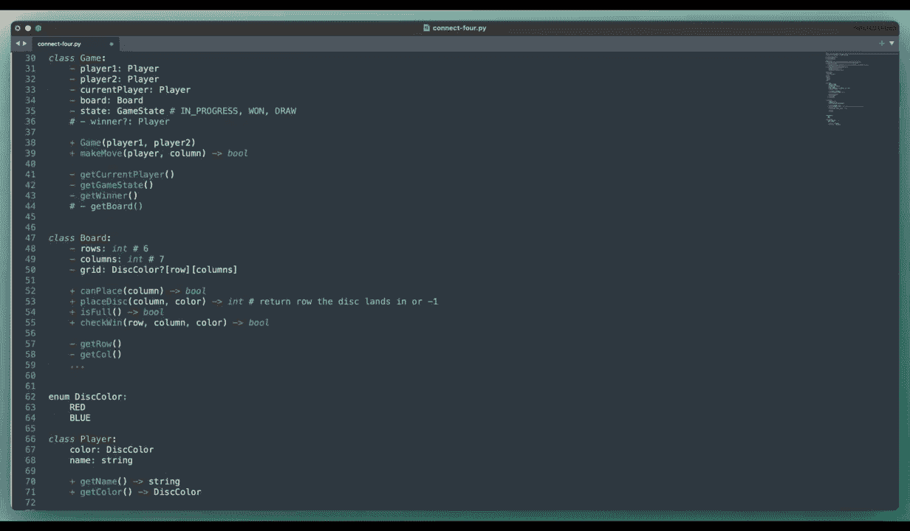

接下来看游戏类的行为，也就是需要暴露的方法：

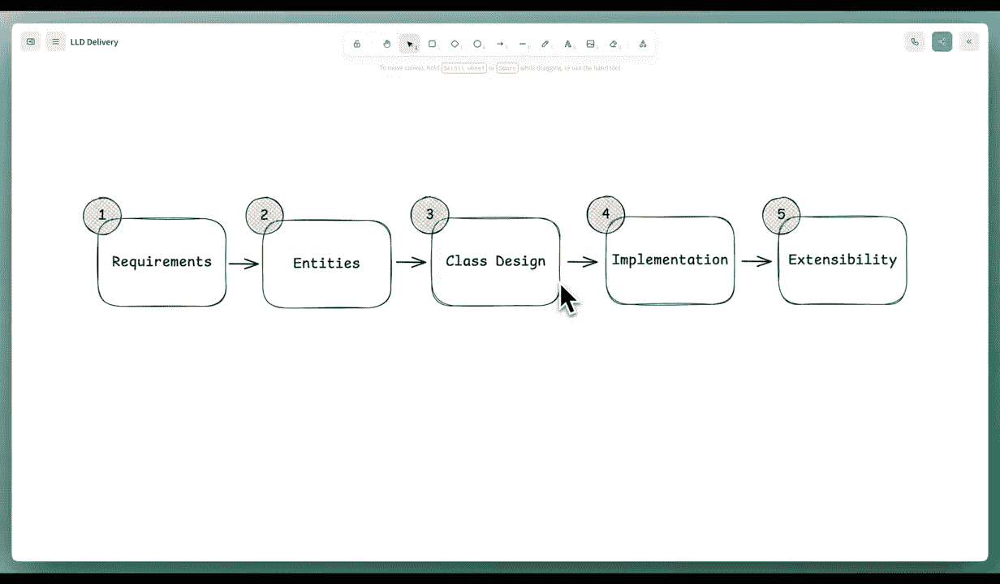

- 构造函数：传入玩家一和玩家二
- make_move(玩家, 列)：玩家下棋，返回布尔值或抛出异常
- get_current_player()：获取当前玩家
- get_game_state()：获取游戏状态
- get_winner()：获取获胜者
- get_board()：获取棋盘，用于渲染界面（如果在范围内）

再看棋盘类的状态：

- 行数和列数：整数，例如 6 行 7 列
- 网格状态：二维数组，记录每个位置的棋子颜色

网格中的每个位置只需要记录棋子颜色，不需要知道是哪个玩家，这样更符合单一职责原则，也更易于测试。

棋盘类需要暴露的方法：

- can_place(列)：是否可以在该列放置棋子
- place_disc(列, 颜色)：放置棋子，返回落在的行号，失败返回负数
- is_full()：棋盘是否已满
- check_win(行, 列, 颜色)：刚放置的棋子是否导致获胜

玩家类非常简单，只需要知道颜色，可能还有名字，对外暴露 getter 方法即可。

关于类图，这里有一个常见误解。很多候选人会问是否需要画 UML 图。事实上，UML 在大型科技公司中已经非常过时，微软在 2006 年就从 Visual Studio 中移除了 UML 工具。面试中如果面试官要求 UML，可以询问是否可以使用简化的类表示法，绝大多数情况下面试官会同意。


## 实现

上一节我们完成了类设计，本节中我们来看看如何编写伪代码实现。

实现时，建议先写出核心逻辑，再考虑边界情况。面试官很喜欢看到候选人主动讨论边界条件。

首先看游戏类的 make_move 方法。它的输入是玩家和列，输出是布尔值。

核心逻辑如下：

1. 放置棋子
2. 检查是否获胜
3. 检查是否平局
4. 切换回合
5. 返回结果

对应的伪代码如下：

```python
function make_move(player, column):
    # 边界情况：游戏已结束
    if game_state != IN_PROGRESS:
        return false
    
    # 边界情况：不是当前玩家回合
    if player != current_player:
        return false
    
    # 核心逻辑：尝试放置棋子
    row = board.place_disc(column, player.color)
    
    # 边界情况：列已满或列越界
    if row == -1:
        return false
    
    # 核心逻辑：检查获胜
    if board.check_win(row, column, player.color):
        game_state = WON
        winner = player
        return true
    
    # 核心逻辑：检查平局
    if board.is_full():
        game_state = DRAW
        return true
    
    # 核心逻辑：切换回合
    current_player = (current_player == player_one) ? player_two : player_one
    
    return true
```

关于返回布尔值还是抛出异常，面试中可以和面试官讨论。如果界面需要知道具体错误原因，返回一个包含成功与否及消息的对象会更好；但如果范围内不需要，返回布尔值也是可以接受的。

接下来看棋盘类的 place_disc 方法。输入是列和颜色，输出是落在的行号，失败返回 -1。

核心逻辑是从该列的最底行开始向上查找，找到第一个空位，放置棋子并返回行号。

伪代码如下：

```python
function place_disc(column, color):
    # 边界情况：列索引越界
    if column < 0 or column >= columns:
        return -1
    
    # 边界情况：列已满
    if not board.can_place(column):
        return -1
    
    # 核心逻辑：从底向上找空位
    for row from rows - 1 down to 0:
        if grid[row][column] is empty:
            grid[row][column] = color
            return row
    
    return -1
```

最后看棋盘类的 check_win 方法。输入是刚放置棋子的行、列和颜色，输出是布尔值。

核心逻辑是只需要从刚放置的棋子向四个方向扩展检查，不需要扫描整个棋盘。四个方向分别是水平、垂直、两个对角线。

方向可以用偏移量表示：

```python
directions = [(0, 1), (1, 0), (1, 1), (1, -1)]
```

每个元组表示行偏移和列偏移。对于每个方向，向正向和反向各数连续相同颜色的棋子数量，加上当前棋子本身，如果总数大于等于 4，则获胜。

伪代码如下：

```python
function check_win(row, column, color):
    # 边界情况：行或列越界
    if row < 0 or row >= rows or column < 0 or column >= columns:
        return false
    
    # 边界情况：该位置颜色不匹配
    if grid[row][column] != color:
        return false
    
    directions = [(0, 1), (1, 0), (1, 1), (1, -1)]
    
    for (dr, dc) in directions:
        count = 1
        
        # 正向计数
        count += count_direction(row, column, dr, dc, color)
        
        # 反向计数
        count += count_direction(row, column, -dr, -dc, color)
        
        if count >= 4:
            return true
    
    return false

function count_direction(row, column, dr, dc, color):
    count = 0
    r = row + dr
    c = column + dc
    
    while r >= 0 and r < rows and c >= 0 and c < columns:
        if grid[r][c] != color:
            break
        count += 1
        r += dr
        c += dc
    
    return count
```

这里有一个容易被过度设计的陷阱：有些候选人会为四个方向分别创建策略类，实现一个检查器接口。这在连四棋中是不必要的，因为方向只有固定的四种，逻辑也非常相似。如果想向面试官展示对设计模式的理解，可以口头说明：“我可以引入策略模式，但在这里没有必要，因为逻辑简单且不会扩展。”这样既展示了知识，又避免了过度设计。


## 可扩展性

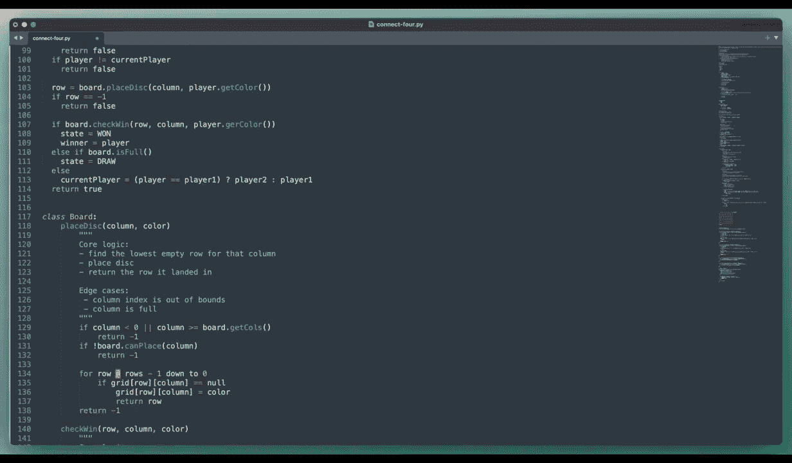

上一节我们完成了核心实现，本节中我们来看看面试中可能的延伸问题。

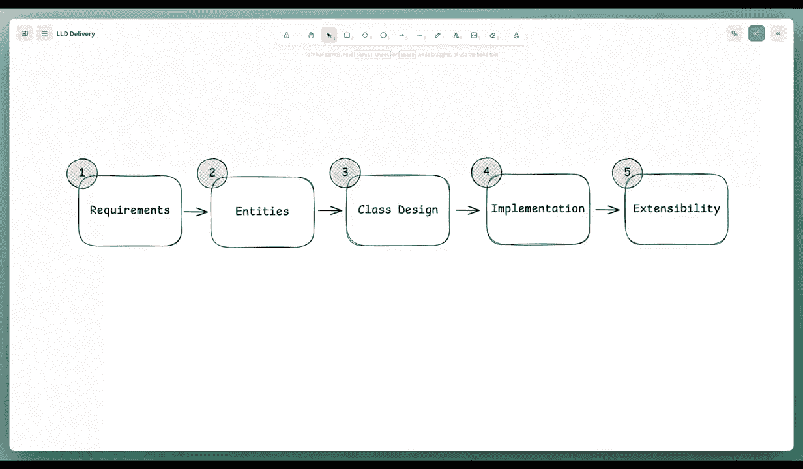

如果时间允许，面试官可能会问以下三个扩展性问题：

1. 如何支持不同的棋盘尺寸？
2. 如何增加悔棋或走法历史？
3. 如何增加电脑对手？

下面是针对每个问题的简要思路。

支持不同棋盘尺寸：

在类定义中不要硬编码 6 和 7，而是让棋盘构造函数接受行数和列数参数。所有边界检查都基于动态的行数和列数，因此棋盘会自然适应任意尺寸。

增加悔棋或走法历史：

悔棋逻辑应放在游戏类中，因为游戏类控制回合和状态变更。可以引入一个走法历史记录栈，每次成功下棋后，将包含玩家、行、列的走法记录压入栈中。悔棋时弹出最后一步，清空棋盘对应格子，切换回当前玩家，并恢复游戏状态。

增加电脑对手：

电脑对手属于行为扩展，不需要修改游戏类和棋盘类的核心规则。可以引入一个机器人组件，它观察当前棋盘并返回想要下棋的列。游戏驱动逻辑中，如果当前玩家是人类则从界面获取输入，否则调用机器人选择列。棋盘和游戏类无需改动。


## 总结

本节课中我们一起学习了如何设计一个连四棋游戏的低级设计方案。我们从需求分析开始，通过澄清问题确定功能、错误处理和范围边界；接着识别了游戏、棋盘、玩家和棋子等实体，并明确了各自的职责；随后进行了类设计，确定了每个类的状态和方法；最后用伪代码实现了下棋、放置棋子和检查获胜三个核心方法，并讨论了可扩展性问题。

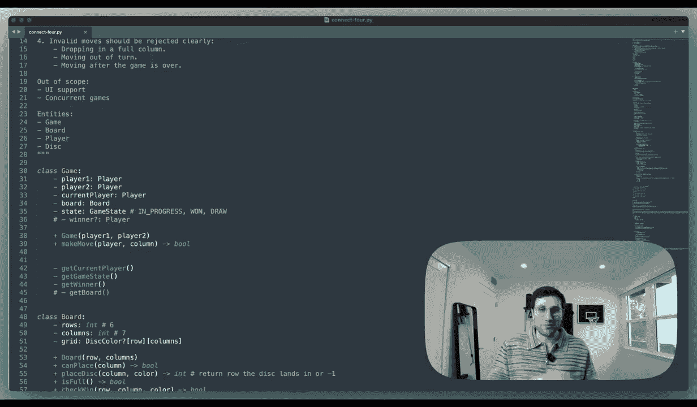

主要收获是：低级设计面试不必令人畏惧。只要按照框架逐步构建，保持简单，不在不必要的地方强行套用设计模式，就能在面试中表现出色。希望这篇教程对你有帮助，祝你即将到来的面试顺利。

