# 低级设计速成课：p03：Amazon Locker低级设计 📦

## 本节课概述 📚

在本节课中我们将要学习如何设计一个类似Amazon Locker的储物柜系统。这是一个在亚马逊面试中非常常见的低级设计问题，难度偏简单，但非常经典，面试官经常会拿这道题来考察候选人的基础设计能力。我们会一起走完从需求分析、实体建模、类设计、代码实现到扩展性讨论的完整流程，最后还会看看如何应对面试官的后续追问。

先简单介绍一下讲师和平台。我是Evan，曾是Meta的工程师，目前是Hello Interview的联合创始人。Hello Interview是一个帮助软件工程师准备即将到来的面试的平台，涵盖系统设计、低级设计、代码面试、行为面试、薪资谈判等方向，网站上有大量视频内容，绝大多数都是免费的。如果你不喜欢看视频，也可以阅读我们的文字拆解，里面不仅讲解了今天讨论的所有内容，还提供了各种核心语言的完整实现，包括Java、Python、TypeScript等，欢迎访问网站查看。

好了，废话不多说，我们正式进入正文。

## 低级设计面试框架 🗺️


在面对Amazon Locker这个具体问题之前，我们先来聊聊低级设计面试的通用框架。这个框架既是本视频会遵循的节奏，也是我建议你在接下来的所有低级设计面试中使用的方法。框架的目标很明确，就是让你在短时间的面试里保持专注，涵盖所有重要内容，避免因为时间紧张而漏掉关键步骤，最终交出一份完整的设计方案。

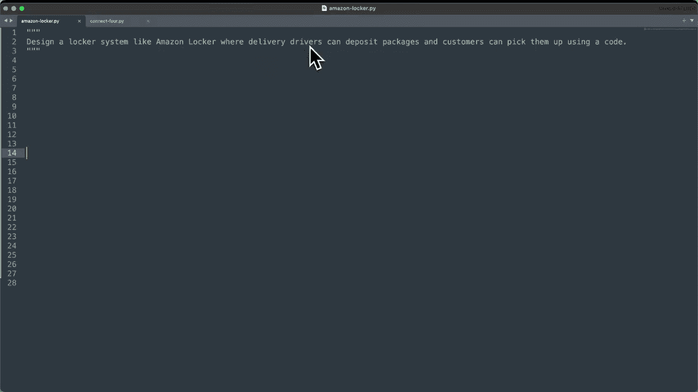

第一步，我们要明确需求。你需要和面试官进行来回沟通，弄清楚到底要构建什么，达成一套双方都同意的需求集，这将成为后续设计的基础。

第二步，建模实体及其关系。也就是找出系统里的核心名词，判断哪些需要建模为类或枚举，它们之间如何交互。

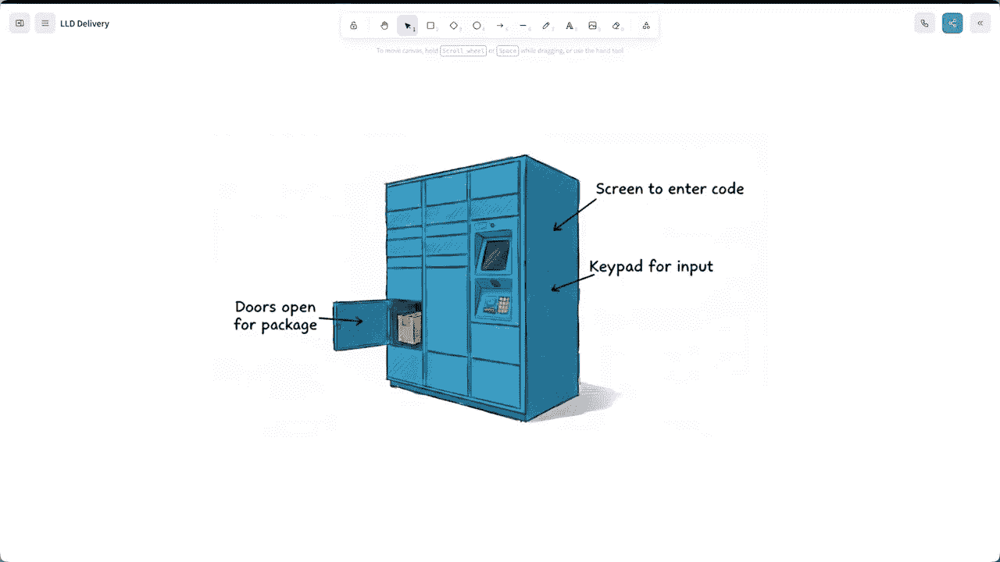

第三步，基于实体进行类设计。为每个类确定状态和行为，状态是指类需要记住哪些数据来满足需求，行为是指类需要能够做什么，也就是你要为代码提供的接口。

第四步，实际实现。不同公司和地区的偏好不同，有的公司更喜欢伪代码，更关注你的设计选择而不是语法细节。本节课我们会使用伪代码，保持与编程语言无关，完整的Java、Python、TypeScript等语言实现可以在文末链接的文字拆解中找到。

第五步，如果时间允许，讨论扩展性。面试官可能会问设计如何演进，比如如何支持新需求，这部分通常出现在面试的最后阶段。

假设你刚走进低级设计面试，面试官在白板上写下了这样的题目：设计一个类似Amazon Locker的储物柜系统，允许配送员存放包裹，顾客使用取件码提取包裹。

## 需求分析与澄清 ❓

接下来进入需求分析阶段。很多候选人看到题目就想立刻动手写代码，但请千万不要这样做。题目描述故意模糊，面试官就是想看你能否通过提问来厘清需求，这是面试中明确考察的问题分析能力。面试结束后，面试官会按照一组标准来评价你，其中一条就是你能否从模糊描述中提炼出清晰的需求，所以你绝对不能跳过这一环节。

你应该围绕三个关键类别来提问，以下是候选人通常会问的问题类别。

第一类，系统的主要功能有哪些。

第二类，系统如何处理错误情况。

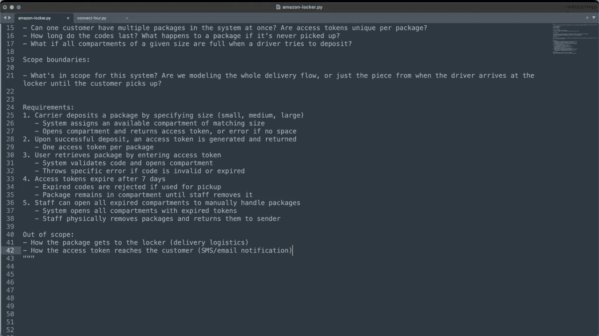

第三类，系统的范围边界在哪里，什么在范围内，什么不在范围内。

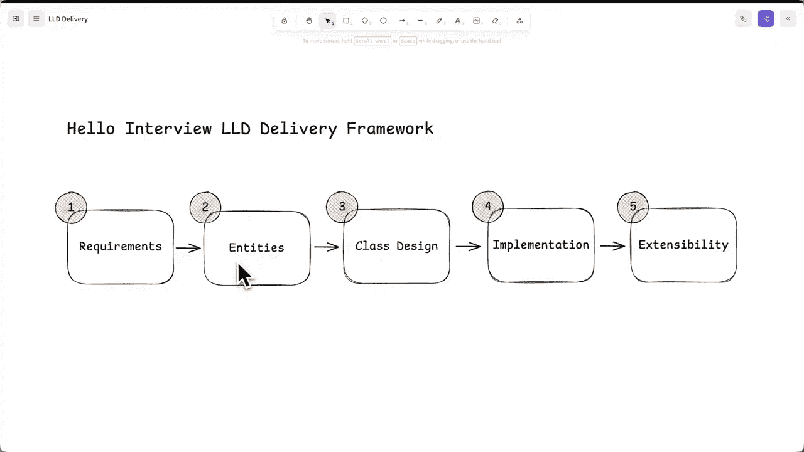

针对这个Amazon Locker问题，如果我是你的面试官，我可能会这样回答你的问题。

关于不同尺寸的格子，系统里有吗？是的，有小、中、大三种尺寸，你应该把包裹放进合适尺寸的格子里。

顾客如何拿到取件码，我们需要发短信还是发邮件吗？这个不在本系统范围内，我们直接返回取件码，调用方负责把码发送给用户。

一个顾客能否同时在系统里存放多个包裹？可以，每个包裹都有各自独立的访问令牌和独立的格子。

取件码多久过期，如果没人取件会怎样？假设七天后过期，过期后工作人员可以回来清理，把包裹带回仓库或其他处理方式。

如果司机要存放包裹时，指定尺寸的所有格子都满了怎么办？这种情况下我们就抛出一个错误。

系统范围是什么，我们是要建模整个送货流程，还是只建模司机到达储物柜到顾客取件的部分？我的回答是只建模最后这一部分，从司机到达储物柜到顾客取件，其他的送货物流都不在我们范围内，由更高层级的服务管理。

当你把这些问题都问完，并且一直在做笔记，你最终就能得到一组清晰的需求。以下是我们最终确定的需求，共五条。

第一，配送员指定尺寸来存放包裹，系统打开对应格子，并返回访问码供父级服务通过短信或邮件发送给用户。

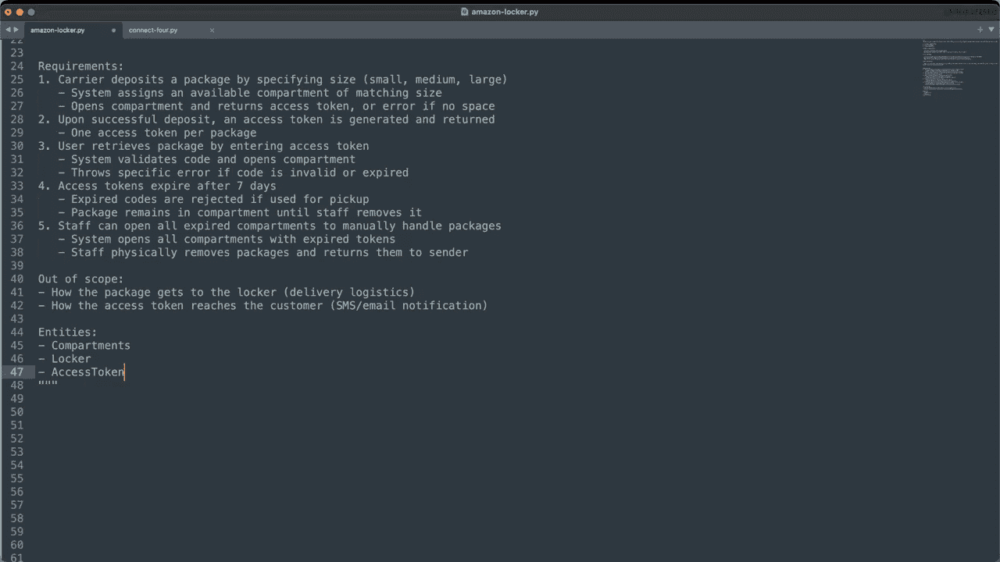

第二，顾客输入访问码取件，系统打开格子，顾客取走包裹。

第三，访问码在七天后过期，工作人员会定期清理过期格子里的包裹。

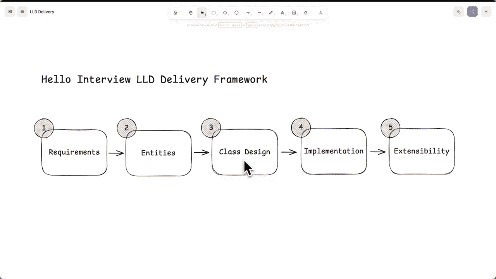

第四，包裹是如何通过配送和物流送到储物柜的，不在我们的范围内。

第五，短信或邮件通知也不在我们的范围内。

当你写下这些需求时，要大声思考，和面试官反复确认，达成共识。这里没有提到的所有内容，都默认不在范围内，面试剩下的时间都围绕这些需求来设计，不要超出这个边界。

## 实体识别 🔍

需求明确之后，下一步是识别实体。也就是找出系统到底需要哪些对象，它们之间如何交互，这些对象最终会成为类设计里的具体类。

我喜欢的方法是看需求里的名词，逐个判断是否值得在系统中建模。以下是根据需求提取的候选实体列表。

第一，我们要存放包裹，所以可以先写下Package。

第二，有需要打开的格子，所以写下Compartment。

第三，所有格子都属于一个总的储物柜，也就是Amazon Locker，这个不能忘，写下Locker。

第四，还有访问码，涉及生成、过期、返回给用户等，所以有AccessToken这个概念。

第五，有配送员和来取件的用户。

现在我们逐个分析这些实体，决定保留哪些，去掉哪些。先从最简单的两个说起，配送员和用户。他们都属于系统外部，我们不需要在系统里建模。虽然用户可能有亚马逊账号，但在这里无关紧要，我们只负责发邮件或短信，用户拿着码来取件就行。系统里不需要维护用户的状态或行为，所以我们可以把用户划掉，不建模。配送员也是同样的道理，不需要建模，直接从列表里删除。

再看包裹。乍一看，我们要存包裹，好像需要一个Package类？但大多数候选人加入Package类后会发现，后续设计时包裹其实属于系统外部。其他系统在追踪包裹ID、运输信息、顾客详情、包裹里有什么，这些都不关心。我们的系统只关心包裹的尺寸，因为需要知道分配什么尺寸的格子。除此之外，包裹本身不需要作为一个类，也不需要作为独立实体，它只是存放或取件函数的一个输入参数。稍后会更清楚，我决定把它去掉，因为它并不重要。

相比之下，格子才是系统的核心。每个格子有尺寸，能打开，还要记录当前是否被占用。所以Compartment肯定是类，要保留。

Locker显然也是，它负责编排整个流程。当司机说我有个中包裹时，系统需要遍历所有格子，找到最合适的，还要处理生成码、关联关系等编排工作。这就是Locker，是我们的入口，司机和用户都会和它交互，外部用户与系统的交互都通过Locker完成。

然后是访问码。你可能觉得这不就是一个字符串吗？确实，它需要存储，在存放时生成，在取件时查找。但它不只是字符串，它是一种带过期时间的屏障令牌，代表打开特定格子的权利。这个概念值得单独建模为实体，所以我保留AccessToken作为实体。

关于包裹、配送员这些，你可能会想，我怎么就该知道不建模呢？答案是你不需要知道，先把所有名词都写下来也没关系。在建模和类设计过程中，你会逐渐了解系统，随时可以回来更新实体列表，这在面试中是很自然、完全可以接受、甚至被鼓励的做法。别太纠结，现在先大致了解情况，为接下来的类设计打下基础。

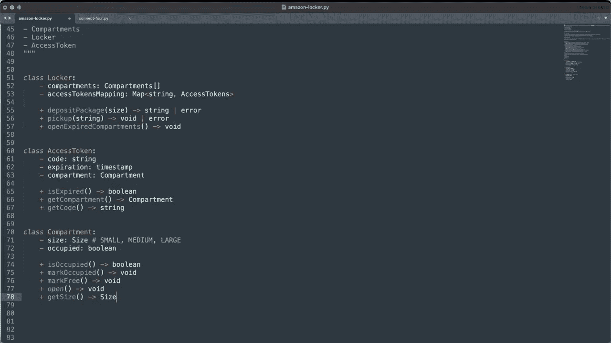

## 类设计 🏗️

实体确定之后，我们需要定义它们的接口，这就是类设计。每个类持有什么状态，暴露什么方法，需要清晰地梳理出来。

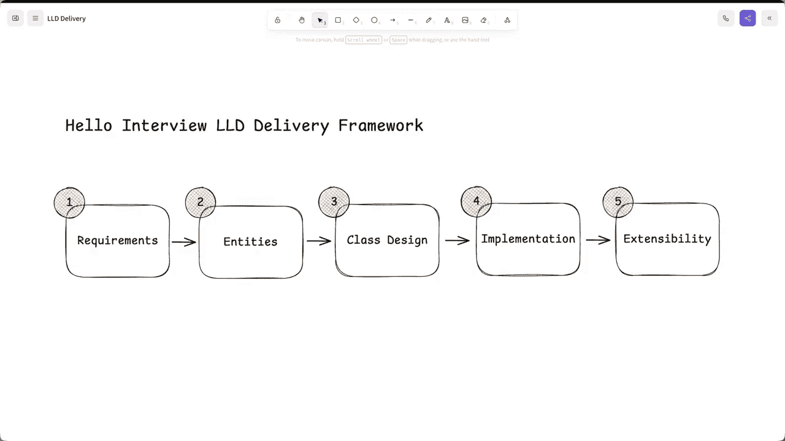

我建议自顶向下进行，先从编排者开始，也就是Locker，再往下看它依赖的实体。这样能先定义高层操作，自然会暴露底层类需要提供什么。

先来设计Locker类。回顾需求，配送员按尺寸存放包裹，系统分配匹配尺寸的空闲格子。系统这里就是Locker，它需要知道哪些格子可用，哪些格子存在。所以Locker首先要记住格子列表。

Compartments，可以是一个Compartment对象列表，包含这个储物柜系统里所有50或100个格子。

接着看需求，顾客输入取件码，系统验证并打开格子。所以Locker还需要记录所有发出的访问码，也就是accessTokens。这可以是一个列表，记录所有已经发出的访问码。如果想验证取件，需要遍历所有访问码，找到和用户输入字符串匹配的那个，然后返回。

对于50或100个格子，这样做完全没问题，即使是O(n)，速度也会很快。不过为了让意图更清晰，我会把它改成映射。字符串映射到访问码对象，这样用户给出码字符串时，就是一次O(1)查找，直接找到对应的访问码对象，进而找到格子。

这里有个点可以和面试官讨论。很多候选人过分迷恋O(1)优化，却不考虑实际规模和代码清晰度。在这里，引入映射不仅提升效率，还让代码意图更清晰。但后来在面试中也会看到反面例子，优化反而让代码更晦涩。所以记住，做O(1)优化时，先考虑可读性，特别是当n很小，比如不到几十万时。

状态定义完了，接下来同样处理行为。回顾需求，配送员按尺寸存放包裹，所以需要一个depositPackage函数，接收尺寸，返回访问码字符串，由调用方发送给用户。

接下来，顾客输入取件码取件，所以需要一个pickup函数，接收字符串，如果成功就打开格子并返回空，如果失败就返回错误。

最后一个公共函数是，工作人员打开所有过期格子，手动处理那些没被取走的包裹。可以叫openExpiredCompartments，返回空，因为它只是打开那些过期的格子，方便工作人员处理。

这就是Locker类的类设计。接下来看AccessToken类。

AccessToken的状态方面，需求说存放成功后生成访问码，顾客输入码取件，码在七天后过期，并且映射到格子。所以AccessToken包含：code，即用户收到并输入的字符串；expiration，码的过期时间戳；compartment，该访问码能访问的格子。

行为方面很简单。需要一个isExpired方法，返回布尔值，Locker在取件时用它来判断是否允许用户取件。还有一个getCompartment方法，简单的getter，Locker调用它来获取格子。另外要暴露getCode，因为存放包裹时需要把这个字符串码发给用户。这就是AccessToken的完整类设计。

最后是Compartment类，可能是最简单的。

Compartment需要知道尺寸，小、中、大，以及是否可用，也就是是否被占用。所以状态包括：size，是一个枚举，取值为小、中、大；isOccupied，布尔值，true或false。

行为方面，存放包裹时需要检查isOccupied，返回布尔值，本质上是个getter。然后需要markOccupied，标记为已占用，返回空。如果取件或工作人员清理，还需要markFree，标记为空闲，返回空。还有open函数，触发格子物理打开，返回空，这部分是机械部件，我们不实现。另外可能需要getSize，返回尺寸，因为存放包裹时要检查尺寸。

这里有个重要点，Compartment通过markOccupied和markFree自己管理物理状态，并通过open方法自己打开，这是很好的封装。当然也可以由Locker维护一个占用映射，但考虑到这是格子的物理状态而非关系，直接建模在Compartment类里更合理。

## 代码实现 💻

类设计完成后，进入实际实现。低级设计面试通常用伪代码实现最有趣的函数。大约30%到35%的面试可能要求用你选择的语言写代码，文末的文字分解里有各主流语言的完整实现，可以去看看。

接下来我们来看Locker类的实现。先写class locker，从depositPackage开始实现。

先来定义核心逻辑。存放包裹的步骤是什么？第一步，找到一个可用的匹配尺寸格子。第二步，打开格子，方便司机放入。第三步，标记格子为已占用，以后不再打开。第四步，生成访问码，让用户知道这是他们的格子。第五步，存储访问码，用访问码映射来实现。第六步，返回访问码字符串，供短信或邮件发送给用户。这就是核心逻辑。

然后考虑边界情况。主要情况是，请求尺寸的格子都没有可用的。如果没有可用格子，按照之前的约定，抛出错误。机械故障可以和面试官说明不在范围内。生成和存储访问码不太会有问题，因为储物柜格子不多，映射不会太大。

现在来写伪代码。第一步，找匹配尺寸的格子，抽象为辅助函数getAvailableCompartment。第二步，调用compartment.open。第三步，调用compartment.markOccupied。第四步，生成访问码，抽象为generateAccessToken，给定一个格子，生成加密安全的随机哈希，创建访问码对象，过期时间设为七天后。第五步，更新映射，accessTokenMapping.put(accessToken.getCode(), accessToken)，方便O(1)查找。最后返回accessToken.getCode。

关于边界情况，就在getAvailableCompartment里处理，如果返回null，调用方抛出错误，比如没有该尺寸可用格子。

这里用了私有辅助方法，让代码更易读，核心逻辑一一对应。你可以问面试官是否需要实现这些私有方法。我们来实现getAvailableCompartment，因为它足够有趣且简单。

getAvailableCompartment是私有方法，接收尺寸。核心逻辑是遍历所有格子，找到第一个尺寸匹配且未被占用的，返回它。没有找到就返回null。边界情况就是没有找到任何格子，返回null。

generateAccessToken就不实现了，很简单，随机生成，调用构造函数返回即可。

接下来是pickup函数，同样接收字符串，也就是访问码。

核心逻辑：第一步，在访问码映射里查找该码，得到访问码对象。第二步，从访问码对象获取关联的格子，打开格子。第三步，假设用户拿走了包裹，将格子标记为空闲。第四步，从映射中移除该访问码。

这里我们做了简化，假设格子打开后30秒自动关闭，这是亚马逊储物柜的真实行为。实际可能有传感器或摄像头确认用户取出了包裹，但我们不做那么复杂，只需假设用户一定会取件，格子会自动关闭。在真实面试中，你应该和面试官确认这个简化，面试官大概率会同意，不需要实现所有检查，这可能在后续扩展性讨论中再聊。

边界情况方面，首先验证码本身，比如不能为空。如果访问码过期，抛出错误。如果码不在映射里，也就是无效码，也要抛出错误。打开格子、标记空闲、从映射移除，这些在码有效的情况下应该都能正常进行。

具体实现：先从accessTokenMapping.get(code)获取访问码对象。然后accessToken.getCompartment()获取格子。调用compartment.open()打开。调用compartment.markFree()标记空闲。然后accessTokenMapping.remove(code)移除码。

边界情况处理：如果code为空，抛出无效码错误。如果映射里没有该码，伪代码里假设返回null，就抛出无效码错误。如果访问码已过期，抛出访问码过期错误。

最后一个公共方法是openExpiredCompartments，由工作人员每天或每周调用，清理未被取件且已过期的包裹。

核心逻辑：遍历访问码映射中的所有访问码，找出过期的。对于每个过期码，获取对应的格子，打开格子。工作人员取走包裹，这部分不在系统内。然后我们将格子标记为空闲。

一个有趣的问题是，是否要从映射中移除该访问码？这一点可以和面试官讨论。如果移除，用户十天后用同一个码来取件，会收到无效码而不是访问码过期。也许我们想让这些码保留一两个月，这样用户能看到更明确的过期提示。内存方面，只有五十个左右的格子，即使每天更换，一百天才五千条记录，不会太大。所以我决定不移除，宁愿让用户看到访问码过期，也不愿看到无效码。

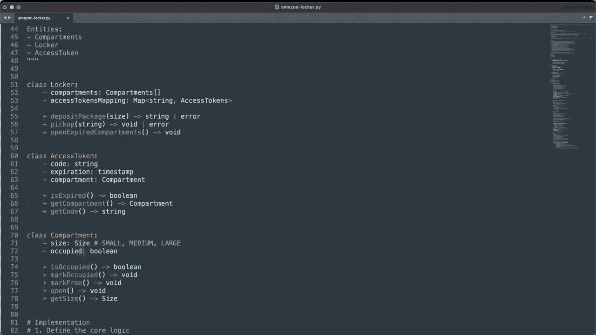

实现openExpiredCompartments：遍历accessTokenMapping的键值对，如果accessToken.isExpired()，获取compartment = accessToken.getCompartment，调用compartment.open()，假设员工取走包裹，30秒后自动关闭，调用compartment.markFree()。不从映射中移除，保留过期码。以后可以加一个额外的循环，清理三个月以上的旧码，具体和面试商量。

边界情况：如果映射为空或没有过期码，循环不会执行，返回空。如果所有码都过期，会打开所有格子，也没问题。这个方法是幂等的，多次调用只会打开同样的格子，没什么大不了的。可以说没有其他需要显式处理的边界情况。

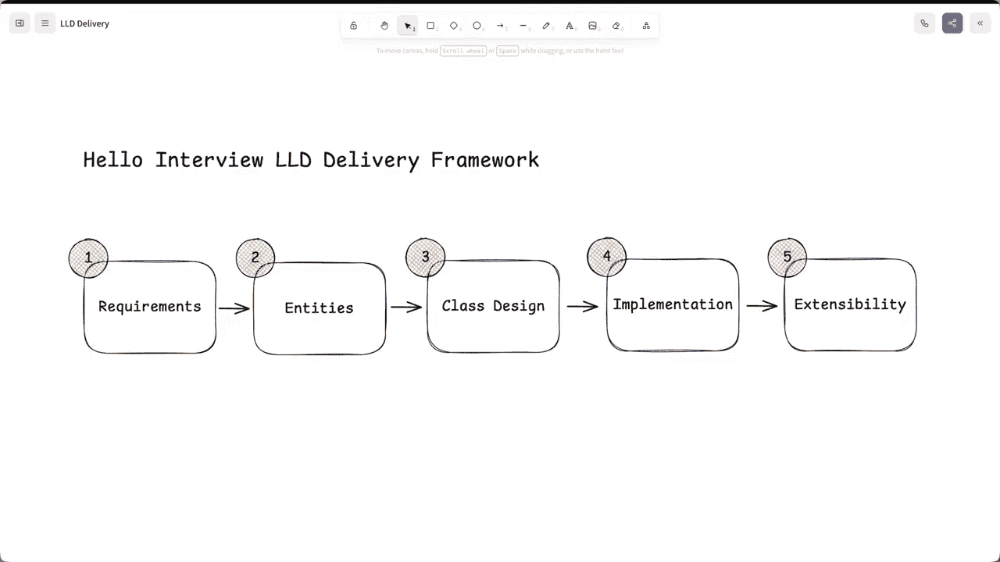

在面试中，我建议你这样做，有助于理清思路，但这不是强制要求，面试官主要看你的实现。不需要逐字照搬我的写法，不过这个方法挺不错的。

## 扩展性讨论 🔄

接下来进入最后一步，扩展性讨论。面试官可能会问一些后续问题，测试你的设计是否具备扩展性。如果你是实习生、初级或中级候选人，面试官可能在这时候就结束面试了，不用担心。如果是高级职位，大概率会问几个扩展性问题。

以下是Amazon Locker面试中最常见的扩展性问题，这些问题是候选人报告在面试中被问到的。

第一，如果所有相同尺寸的格子都满了，是否允许小包裹退回使用更大的格子作为备选？比如小包裹，小格全满，能不能放中格或大格？

第二，如何处理损坏或维护中的格子？

第三，如何确保在生成访问码之前，包裹确实已经放入格子？

我们逐个来看，先看第一个问题。

如果面试官问这个，回答应该很简单。只需要修改getAvailableCompartment函数。增加一个外层循环，按尺寸顺序遍历，从请求尺寸开始，再往大的尺寸找。伪代码大致如下：

```
for i from indexOf(requestedSize) to sizesInOrder.length:
    size = sizesInOrder[i]
    for compartment in compartments:
        if compartment.getSize() == size and not compartment.isOccupied():
            return compartment
```

这样，如果请求小格，就先找小格，再找中格，最后找大格。在实际面试中，通常只需要描述这个思路，不一定非要写完代码，但写出来能让面试官更清楚你的意思。

接下来看第二个问题，如何处理损坏或维护中的格子。这实际上是在考察Compartment类是否遵循了信息专家原则，即格子自己知道自己的一切。目前Compartment只有布尔状态isOccupied，现在增加第三种状态，比如维护中。当状态超过两个值时，通常要引入枚举。可以定义CompartmentStatus枚举，取值为可用、已占用、维护中，也可以有更具体的值，比如损坏。Compartment类更新后，状态变成compartmentStatus，而不是isOccupied。原来的isOccupied检查变成isAvailable，即检查状态是否为可用且未占用或非维护中。markOccupied时设置状态为已占用，markFree时设置为可用，markOutOfService时设置为维护中。这就是用三个可能值的枚举替换布尔值。

最后看第三个问题，也是最有趣的，如何确保包裹实际放入后再生成访问码？当前设计里，我们假设司机放了包裹，打开门、标记已占用、生成码，一气呵成。但实际不知道司机是否真的放了包裹。最坏情况是司机分心，格子被标记为已占用，但实际上是空的，访问码映射到一个空格子。

现实和面试中都需要引入两阶段提交模式。不再一次性完成的depositPackage，拆分为两个步骤：reserveCompartment和confirmDeposit。

ReserveCompartment会获取可用格子，标记为预留，打开门，生成一个预留ID，存储在某个预留映射里，不直接放入访问码映射。司机放好包裹后，回来确认存放，此时我们才标记格子为已占用，可能关上门，生成访问码，加入访问码映射，然后由外部系统发送给用户。

具体流程：先调用reserveCompartment(size)，获取可用格子，状态设为reserved，打开门，生成reservationId，存入reservationMapping。司机拿到reservationId后，放好包裹，回来输入这个ID。系统获取关联格子，标记为已占用，这时候才生成访问码，加入accessTokenMapping，外部系统发给用户，并移除预留记录。

关键点在于，你在面试中大概率不需要完整实现这个，但要向面试官解释两阶段提交的概念：先打开格子，再验证放入了东西，只有验证通过后才触发后续流程，比如标记已占用、生成访问码并发送给用户。

## 本节课总结 📝

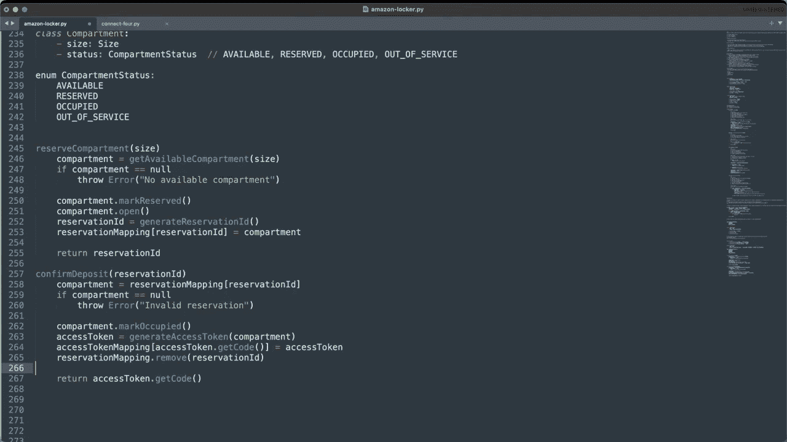


本节课中我们一起学习了Amazon Locker的低级设计。我们从模糊的提示开始，通过提问澄清需求，最终确定了一组清晰需求。识别出三个核心实体，Locker、AccessToken和Compartment，并为它们设计了清晰的接口，职责分离。接着用伪代码实现了关键流程，处理了常见边界情况。最后讨论了几种扩展性场景，比如尺寸回退、格子维护和两阶段提交。

整个设计遵循面向对象原则，信息专家原则体现在Compartment类自己管理物理状态，职责分离体现在Locker负责编排，AccessToken负责访问控制，Compartment负责物理状态跟踪。我们刻意保持简单，用线性扫描而不过度优化，因为储物柜的规模很小，只有五十到一百个格子左右。

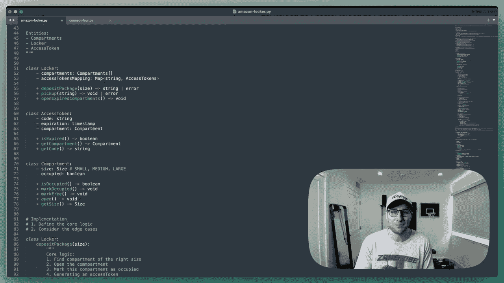

如果你觉得有帮助，可以去看看文末链接的文字拆解，里面有更多低级设计内容，包括并发的完整拆解。好了，谢谢观看，祝面试顺利，下次见。

