# 低级别设计速成：第04章：电梯系统低级别设计 🏗️

在本节教程中，我们将一起学习如何设计电梯控制系统。这是一个在微软等大公司面试中非常常见的低级别设计问题。相比于之前我们拆解过的连四棋问题，这个问题在移动逻辑上更加复杂，具有一定的深度。我将演示作为面试官我会如何来回答这个问题，也会告诉你在每一个步骤中，面试官会关注哪些要点。无论你是初学者还是有一定经验的候选人，通过本节教程你都能掌握从需求分析到代码实现的完整思路。

在低级别设计面试中，保持专注并覆盖所有重要内容，同时避免在短时间内用完时间，是非常重要的。为此，我们将遵循一个固定的框架，这个框架也适用于你即将面临的所有低级别设计面试。框架的目标是让你在有限的时间内不遗漏关键环节，并最终交付一个面试官期待的设计方案。

以下是框架的五个步骤：

1. 需求分析：与面试官反复沟通，明确构建的内容，达成一致的需求集合。
2. 实体建模：找出系统中的名词，确定哪些需要建模为类或枚举。
3. 类设计：根据需求，为每个实体推导状态和行为。状态是需要记住的内容，行为是类需要具备的功能，也就是函数接口。
4. 实现：根据不同公司和地区，可能使用伪代码或实际代码。本教程将使用伪代码，保持与语言无关。
5. 扩展性：如果时间允许，探讨设计如何演进。

下一节，我们将进入具体的需求分析环节。

想象你坐在低级别设计面试中，共享编辑器上出现了这样的题目：为一栋大楼设计电梯控制系统。系统需要处理多部电梯、完整的请求，并高效地移动电梯来服务这些请求。很多候选人可能会想，我乘过电梯，我知道电梯是怎么工作的，这很容易，我可以直接开始写代码了。但面试官希望你先提出澄清问题，在前期就把事情说清楚。这个问题描述故意模糊，问题分析是面试官明确评估和评分的能力。他们想确保你能花一点时间理解问题，并确定核心需求。因此，我们将先提问，以更好地理解问题。候选人经常会问我，我怎么知道该问什么问题。我将问题分为三类：主要功能、错误处理、范围边界。

以下是每个类别的示例问题：

- 主要功能：系统的主要功能是什么？
- 错误处理：我们需要考虑哪些错误处理？
- 范围边界：这个系统的范围内和范围外分别是什么？

具体来说，我可能会问面试官：电梯数量和楼层数量是固定的还是可配置的？作为面试官，他可能会回答，暂且简单起见，假设有三部电梯，十层楼，目前固定不变。

接下来，我可能会问：厅厅呼叫只是上下方向，还是可以选择楼层？为了统一术语，如果你不在电梯里，而是在某一层等待，通常可以按上或下，请求电梯来接你。在一些高级电梯中，你甚至可以指定要去的楼层。这就是所谓的厅厅呼叫。面试官可能会说，只支持上下方向，你只能选择方向。

接着，我可能会问：乘客在电梯内部可以选择多个目标楼层吗？任何人都会说，是的，这是正常电梯的功能。当你进入电梯轿厢内部，可以点击任意数量的楼层，这些就是目标呼叫，指明电梯要去哪里。

然后，我可能会问：题目中提到希望电梯轿厢高效移动，这具体是什么意思？作为面试官，我可能会保持模糊，说由你来定义，你可以指定哪台电梯采取什么方向来服务请求，但要以合理的方式做到高效。

关于错误处理，我可能会问：无效楼层请求怎么办？虽然这是硬件，有固定按钮，但我们是在构建软件，所以这是个不错的问题。作为面试官，我会说，是的，任何超出零到九范围的请求都抛出合理的错误。如果有人请求当前所在的楼层，那也没什么大不了的。

关于范围边界，包括载重限制、门机械、紧急停止等硬件内容，面试官会说，这些暂时不在范围内，也许我们会在扩展性部分讨论。

最后一个问题是很重要的。对于这种机械系统，你可能想问：这是带步进和时钟的模拟系统，还是实际的硬件控制软件？作为面试官，我会告诉你，不，让我们专注于模拟，步进和时钟。这在这类面试中很常见。实际系统当然没有你调用来推进时间的步进函数，它有电机控制、楼层传感器、中断，由硬件事件驱动的异步控制流程。但在低级别设计面试中，我们几乎总是需要构建模拟系统。无论问题是电梯、停车场、自动售货机还是交通灯，模式通常都是一样的：你要抽象掉硬件，通过步进或时钟自己控制时间。这样问题就变得容易处理，能在三十五分钟内完成。

当你进入实现部分，你会看到，这基本上意味着我们会有一个循环，叫步进。步进会让每部电梯移动一步，可能是一层楼，可能是开门，不管是什么，这就是我们管理时间处理的方式。

问完所有问题后，你对问题就有了相当好的理解。你可能一直在做笔记，但我在这里直接粘贴最终达成一致的具体需求集。这是你需要和面试官在开始设计之前达成一致的重要内容。

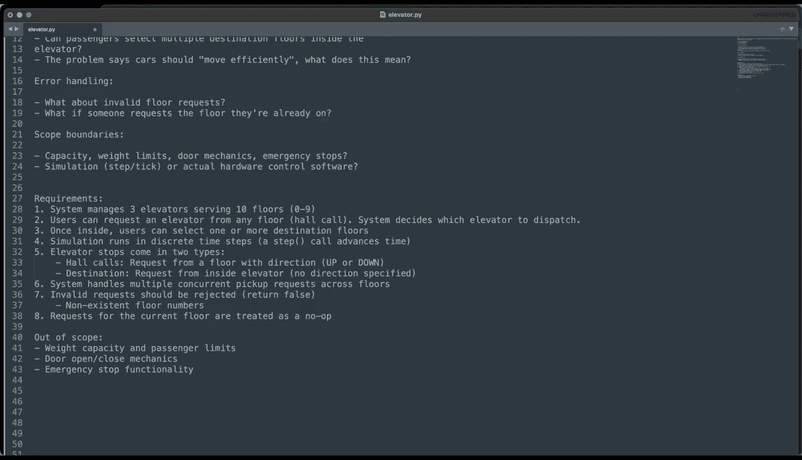

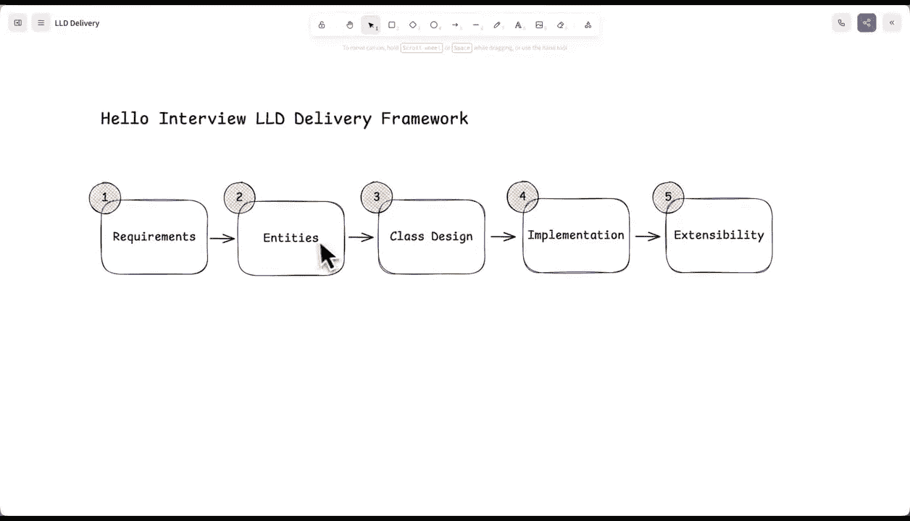

对我们的系统，我们达成一致的需求如下：系统管理三部电梯，服务十层楼，编号零到九。用户可以从任何楼层请求电梯，我们称之为厅厅呼叫，系统会决定派遣哪部电梯。我们需要考虑如何高效地完成这一点。一旦进入电梯，用户可以选择一个或多个目标楼层。模拟运行在离散时间步进中，步进调用会推进时间。电梯停止有两种类型：厅厅呼叫是从楼层发出的请求，方向是上或下；目标请求是从电梯内部发出的请求，没有方向。系统可以处理多个楼层上的并发取票请求。任何无效请求都应该返回 false 或抛出错误。对当前楼层的请求或无意义的方向请求也会被处理。

这就是我们关于需求的全部讨论总结。我会看向面试官，问你觉得怎么样？有什么要修改的吗？我们达成一致了吗？得到确认后，我知道自己将设计一个面试官期望的系统，而不会浪费时间去设计与期望不符的内容。

下一节，我们将进入实体建模环节。

既然需求已经确定，按照我们的交付框架，下一步是进行实体建模。

实体是我们系统中的名词，这些是我们可能会考虑作为类的对象，它们相当于在进入类设计之前设定了我们需要关注的重点。这个过程其实很简单，并且是基于我们刚才完成的需求逐步构建的。你扫描需求，寻找名词，并考虑每个名词是否适合成为类，或者只是一个字符串、数字、值对象，或者是你最终设计中的其他东西。

如果我们浏览一下刚才的需求，首先出现的是电梯。毫无疑问，电梯几乎肯定是我们系统中的一个类。它需要维护状态，比如当前楼层、方向、要停靠的楼层以及需要服务的请求，还需要强制执行规则，比如移动方向、何时停止等。所以电梯几乎肯定会成为一个类。

继续往下看，我们会遇到楼层和请求，这些名词出现频率很高。我们可以把楼层放进来。乍一看，楼层类似乎很重要，但如果我们构建楼层类，它到底会做什么？它会维护什么状态？会强制执行什么规则？其实它不维护任何内容，也不强制执行任何规则。它只是一个数字，只是一个属性，告诉我们电梯需要去哪一层，或者目前在哪一层。所以这里不需要类，这只是一个数字，可能会作为字段出现在请求和电梯等对象中。

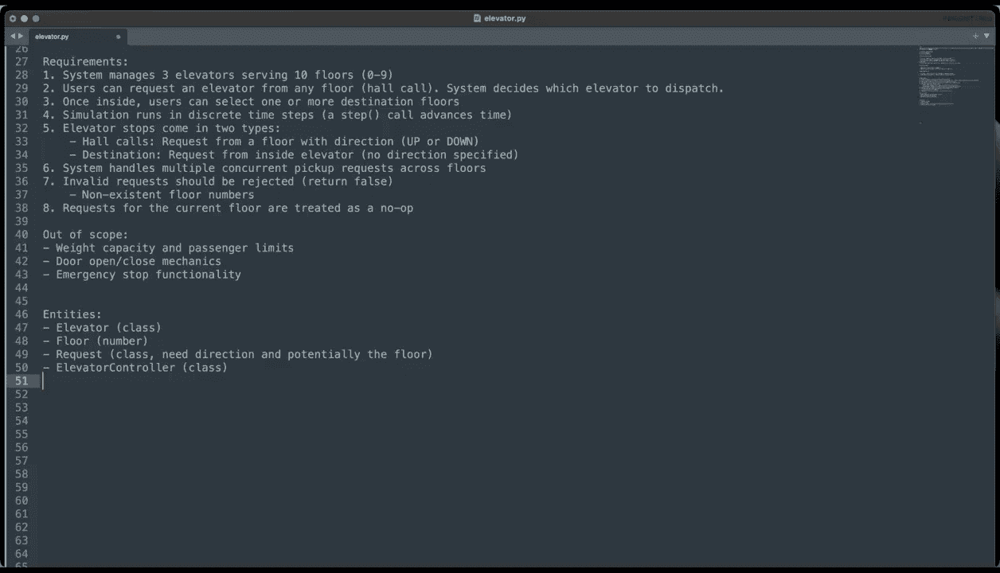

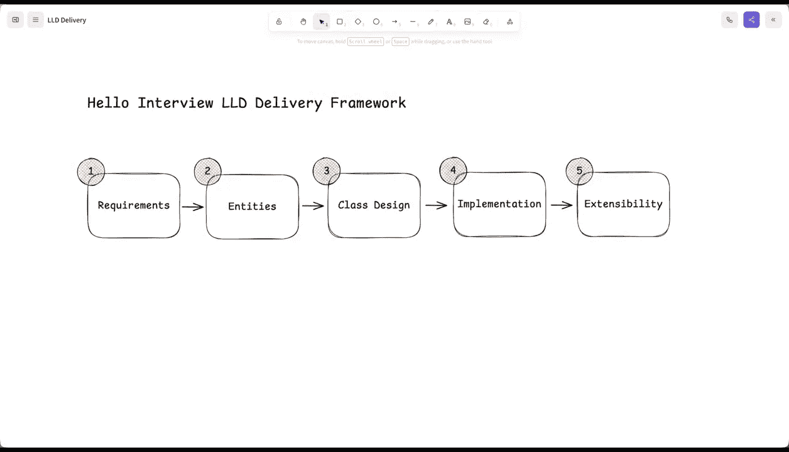

接下来是请求。什么是请求？请求可以是两种类型之一：厅厅呼叫，或者是来自电梯内部的目标请求。它需要知道如果是来自电梯内部，请求要去的楼层；如果是来自电梯外部，则需要知道方向，是上还是下。本质上，它可以是一个值对象，也可以是一个元组，取决于你使用的语言，也许你希望它成为一个类。但为了简单起见，我们暂时把它当作类，同时心里要清楚，我们需要方向和可能的楼层，这些才是有趣的地方。

还有一个可能在需求中没有明确提及的名词，但当我们考虑离散步进模拟运行，并且有人需要分派厅厅呼叫，所有这些都由电梯系统维护时，你可以称之为电梯系统，或者通常在这类设计中被称为控制器。所以我们会有一个电梯控制器。这肯定是一个类。电梯控制器将是我们的主要入口点，用于调用步进，在模拟中推进时间。它将接收厅厅呼叫，并决定派遣哪部电梯。它是我们的协调者，拥有系统级视图，并做出所有协调决策。这显然是系统中一个明确的实体。

现在我们完善了实体，可以进入第三步，即类设计。在类设计中，我们将指定每个类持有的状态以及它支持的操作。

下一节，我们将开始类设计。

既然我们已经完善了实体，现在可以进入第三步，即类设计。类设计是指定每个类持有的状态以及它支持的操作的过程。我们将采用自顶向下的方式，从电梯控制器开始，因为它是入口点。外部代码与控制器交互，而不是与单个电梯交互。我们会先设计接口，然后再深入到电梯类，这样可以让我们专注于公共契约，而不会过早陷入实现细节，实现细节将在下一步处理。

让我们开始设计电梯控制器。确定类设计的方法其实非常简单，它直接源自我们的需求，我们只需要回答两个问题：这个类需要维护什么状态？它需要具备哪些方法、函数或行为？

如果我们查看需求，系统管理三部电梯，服务十层楼，这表明我们需要一个电梯列表，这很直接。至于控制器的状态，就这样了。请求本身将由电梯来管理。当请求进来时，我们会立即将其分派给一台电梯。当然，也可以认为请求应该放在控制器上，然后控制器基于请求队列决定何时将请求发送给每台电梯。两种方法都有优缺点。我倾向于让电梯维护自己的状态，我认为这样更清晰，也能让电梯做出更好的调度决策，稍后你会看到。

那么对于电梯控制器来说，它只有一部分状态，就是电梯列表。那方法方面呢？它需要具备哪些函数？回到我们的需求：用户可以从任何楼层请求电梯，这些是我们的厅厅呼叫，所以我们应该有一个请求电梯函数。它接收当前所在的楼层，以及想要去的方向，也许返回布尔值表示成功或失败，或者返回空值。

还有，模拟运行在离散时间步进中，我们已经知道电梯控制器是入口点，它运行这些步进，所以我们会有一个步进函数。步进函数只是遍历每台电梯，并让每台电梯的步进加一。为了完整性，我们还会添加一个构造函数，这个构造函数会用我们案例中的三部电梯初始化列表。这就是电梯控制器的完整类设计：状态是电梯列表，它有几个核心函数。

下面我们可以进入实际的电梯类。电梯需要知道什么呢？电梯服务那十层楼，所以我们需要知道电梯当前所在的楼层，也就是当前楼层。我们还需要知道电梯正在向哪个方向移动，也就是方向。我将创建一个方向枚举。方向枚举将包含上、下。这里有一点棘手，我会加入空闲状态。很多候选人会忘记这一点，但电梯并非总是向上或向下移动。有时候，如果没有请求，电梯就会处于空闲状态。这一点很重要，它会对我们的实际实现产生一些影响。所以在添加枚举时，请确保考虑所有可能的状态。我会包含上、下、空闲。

如前所述，电梯还需要拥有一组请求。用户可以选择一个或多个目标楼层，我们之前定义过，电梯将拥有请求。所以电梯将拥有一组请求。之所以将其设为请求的集合而不是列表，是因为这样可以自动处理去重。你可能在类设计阶段不需要知道这一点，也许会在实际实现中想到，但这很棒，因为现在如果多人点击同一层楼，我们不会试图多次前往那一层，这不太合理。这就是电梯的完整状态。

现在我们要问自己，电梯实际上需要具备哪些能力？我们可以从简单的构造函数开始。然后我们需要能够添加请求，这肯定会接受一个请求对象，它接受请求对象，然后可以返回成功或失败的布尔值，或者空值。重要的是，我们需要那个步进函数，它将调用所有电梯的步进，并决定是否向上移动、向下移动、开门等等。

当然，我们也需要能够获取当前楼层，这很简单，这些只是简单的获取器，会返回一个数字或整数，正如我们在伪代码中定义的那样。我们还需要能够获取当前方向，获取当前方向，这将是那个方向枚举。

如果我们回来检查一下是否有遗漏：一旦进入电梯，用户可以选择一个或多个目标楼层，这样做会将其添加到我们的请求集合中，没问题。模拟运行，这将有步进函数。用户可以从楼层请求电梯，我们刚才讨论过，那就是厅厅呼叫，将从这里分派到电梯的添加请求调用中。多个并发取票是可以的，我们的集合有助于去重。一切良好。好的，我觉得差不多了。也许在进入实现时我们会发现缺少什么，但我觉得电梯类的设计看起来不错。

这意味着我们应该进入下一个，即请求类。请求类是一个有趣的类，我们应该花点时间讨论。正如我们之前讨论过的，请求有两种类型，我们来明确一下：厅厅呼叫。在厅厅呼叫中，你指定电梯需要前往的楼层，并且还要指定方向，即楼层加方向。目标呼叫，我们称之为目标请求，这些来自电梯内部，只有一个楼层，没有方向，不像厅厅呼叫那样，一旦到达某一层就必须继续朝某个方向行驶。

你可能会想到一种建模方式：你只需要一个必需的楼层，将是整数，还有一个方向，我们已经有方向枚举了，为什么不直接使用它，并且也许使其可为空，因为我们并不总是有方向？很多候选人会跳到这一步。这并不糟糕，我想说明这并不糟糕。但这里有一些问题。第一是，我们重复使用电梯方向枚举，其中包含空闲状态，对于请求来说，不存在空闲请求，这说不通。通过使用完全相同的枚举，我们已经引入了请求不可能拥有的状态，这已经是一个问题。我们可以在这里添加一个不同的枚举，称为请求方向，只包含上和下，但你仍然会有这个可为空的东西，它是可空的。每当你添加一个可空值，你就会留下问题：这里的空意味着什么？空状态是什么？第一次读代码的人不一定知道这意味着什么。因此，可能有一种更清晰的方式来实际建模这一点。

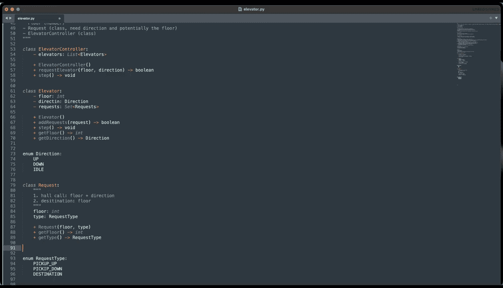

我建议我们采取以下方法：我们明确地对状态进行编码。我们说我们有一个楼层，然后还有一个请求类型。请求类型是一个新的枚举。请求类型是枚举，要么是取票上，基本上取票且方向是上，要么是取票下，这两个都是厅厅呼叫，或者是目标。这样你就有两个厅厅呼叫，编码了方向是上或下，然后有一个目标，也就是轿厢呼叫。现在我们没有任何可空值，对任何读取代码的人来说，请求类型都非常清晰。基本上有三种请求类型：两个厅厅呼叫，取票上和取票下，以及轿厢呼叫，目标。为了完整性，我们可以有构造函数，接受楼层和类型。我们可以有获取楼层，返回楼层。还有获取类型，返回请求类型。

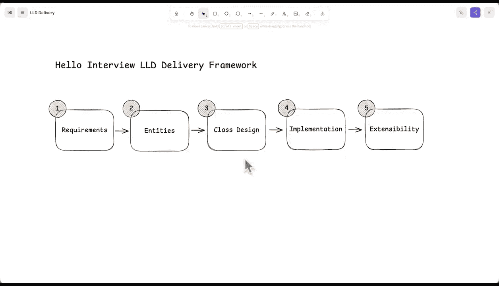

并且，对于我们上面的设置，相等性将基于楼层和类型。所以请求七，楼层七且类型取票上，与请求七，取票下是不同的。不同的电梯会以不同方式服务这些请求，因为期望是，当你从厅厅选择上方向时，你不会得到一台正在下行的电梯来接你，希望这很清楚。

如果我们缩小一点，这就是我们完整的类设计。我们有电梯控制器，它控制电梯。电梯拥有一组需要服务的请求。电梯的移动方向是上、下或空闲，请求可以是三种类型之一：取票上、取票下或目标。

下一节，我们将进入实际实现。

既然类设计已经就位，现在我们可以开始一些有趣的工作，进入实际实现。这是我们将实现实际方法体的地方。在本例中，我们将使用伪代码，正如大多数低级别设计面试中所做的那样。在你的面试中，面试官通常会指出他们实际希望你实现的核心方法，通常没有时间写完所有代码，所以他们会指出一些有趣的方法，你将专注于这些方法。如果我来进行这个面试，我会说，电梯控制器的请求电梯很有趣，电梯类也很有趣，还有电梯步进函数。我们会处理这些，我们也会为了完整性处理一些其他方法，这样你们就能看到所有核心函数。请注意，这意味着这个视频可能比实际面试要长得多。你们往往喜欢更多信息而不是更少，如果不再是这种情况，请在评论中让我们知道，我们可以做出调整，但我会尽量在这里提供你们需要的所有信息。

我们进行实现的方式，就像所有其他步骤一样，都有一个有条不紊的过程。我们将用英语概述这个函数需要支持的核心逻辑，以及需要处理的边缘情况。我们通常已经根据需求和类设计的组合了解了核心逻辑，边缘情况也是如此。我们将把它们明确化。让我放大一些，这样你们都能看清楚。我将从电梯控制器开始，从我们刚才讨论的那个有趣函数开始，即请求电梯。你有请求电梯的楼层，然后还有请求类型，也就是我们之前定义的那个枚举。

我将这样做，正如我所说，我将先概述核心逻辑，然后概述边缘情况，即错误条件。那么当你请求电梯时会发生什么呢？首先，你需要找出最适合发送这个请求的电梯是哪一台。一般来说，我们要找到一台电梯，然后将这个请求添加到该电梯的请求集合中。你可以通过几种不同的方式找到电梯，你可以找到当前最近的电梯，也可以采用轮询方式，找到距离上次设置请求已过去最长时间的那台电梯，或者你可以做一些更聪明的事情，我们称之为方向感知，这会处理这一点，但总体概念是，我们需要找到最佳电梯来处理这个请求。

第二件事是将请求发送到电梯，这很简单。至于边缘情况，我想我们真正能想到的只有，如果楼层超出范围。虽然你有物理按钮，这有点牵强，但如果请求去的楼层不在零到九范围内，那就不太好了。我会在这里抛出一个错误。

这里我要补充一点，我们的请求电梯、电梯控制器和电梯类，都是信息专家设计原则的例子。你不需要记住这个名字，但概念很重要，即电梯拥有请求，所以它将决定是否停止、是否反转或是否移动。这部分将在电梯步进函数中处理，而控制器拥有电梯列表，所以它决定将请求分派给哪台电梯。每个类对其拥有的数据做出决策，这就是这里的要点，这就是信息专家，我们在实现时遵循这一点。

好的，那么让我们开始吧。第一件事是，我将根据刚才传入的内容创建一个新的请求对象。你可以说，这应该直接接受请求吗？也许这是我们的外部公共函数调用，所以我主张请求是一个内部类型，我们将接受它并构建这个内部类型。

然后我们需要确定最佳电梯，所以我们将选择最佳电梯，它将接受该请求。然后我们将只返回该最佳电梯，将其请求添加到请求集合中。很简单。你会看到，我在这里把所有难的部分都卸载了。你会看到我选择最佳电梯，这是有趣的部分，然后你完全跳过了它。但在低级别设计面试中，这非常有效。我将复杂的部分抽象为一个私有辅助方法，然后现在我将实现它。你们会看到我实现它。但这有助于我的逻辑非常清晰，直接映射到我的核心逻辑和边缘情况。我们还没有处理边缘情况，稍后会处理。然后我可以转向私有辅助方法，而不会过早地陷入细节。希望这能引起共鸣。

不过，在我实现那个辅助方法之前，让我们先处理边缘情况。我们会说，如果楼层小于零或大于九，就返回 false。当然，在现实中，这些可能是最大楼层和最小楼层枚举，但在我们构造的需求中，它们是固定数字，所以我们就使用它们。还有一点我想指出来，现在我再看一眼，类型是请求类型，我们说过请求类型可以是取票上、取票下和目标。但是，显然，你不能使用目标类型来请求电梯，目标类型是留给在电梯内部按按钮时使用的，对吧。所以这是不对的。我们向这个函数暴露了一个接口，暴露了参数，其中一个枚举状态是不允许的。

在面试中，我会意识到这一点并指出来，我会对面试官说，有几种方法可以解决这个问题。我们可以在这里缩小类型定义，我可以说这只是取票上或取票下，我正在使用某种类型记法，由于这是伪代码，我正在混合记法。或者我们可以在运行时进行验证，如果类型等于目标，就抛出错误。我不喜欢那样。我宁愿缩小类型，以便静态地完成而不是在运行时完成。既然我们说要抛出错误，我就在这里抛出。不管边界。也许我要找个更好的。无效的楼层。不管怎样。所以我不会在这里处理类型。如果你在面试中注意到这样的问题，没关系，你可以回去修改类型设计，使其更清晰，就是这样。

现在让我们处理选择最佳电梯。选择最佳电梯将接受一个请求，并确定我们实际应该使用哪台电梯来服务该请求。如前所述，有不同的方法来做这一点，我甚至可能会向面试官提到，这可能是策略模式的合适位置，你实际上会有一个选择最佳电梯的接口，并可以以不同方式实现该策略，你可以做最近、负载平衡、方向感知，然后调用者或工程师可以定义他们希望当前电梯系统使用哪种策略。

现在我们要定义，我们有一个单电梯系统，所以我将实现我认为的最佳电梯，但在面试中时间有限，我会向面试官指出这一点，让他们知道我了解模式，但不过度设计。好的，那么我们可以再次处理核心逻辑和边缘情况。选择最佳电梯的核心逻辑是什么呢？我们首先能做的，是尝试找到一台正朝我们移动的电梯。有没有哪台电梯正朝我们方向来，并且朝着正确的方向移动？如果没有，也许我们就尝试空闲电梯，找到最近的空闲电梯。然后，如果有什么 fallback 条件，那就选择最近的，随便选什么，就这样，有一个 fallback 条件。边缘情况，在实现时再看，现在没有立即想到什么。

那么这看起来是什么样子呢？最佳电梯等于，是否有朝我移动的电梯？找到朝我移动的电梯。如果确实有人朝我移动，基本上不是空值，那么我将返回那台。否则，我将找到我楼层最近的空闲电梯，并传入楼层。呃。如果那台不是空值，我将返回它。否则，也许我们就返回最近的，找到最近的。采用上面相同的策略，我们卸载了一些可能更有趣的部分，但这使我们的逻辑非常清晰，并允许我们现在实现那个有趣的部分，即找到朝我移动的电梯，因为这是可能最困难的部分，我不想永远卸载它，所以我会把它交给面试官，或者我不会再把它交给面试官了，我会说，我来实现这个。

核心逻辑是，找到朝我移动的电梯，这意味着什么呢？这意味着，如果电梯正在向下移动，而我比它低，或者电梯正在向上移动，而我比它高，对吗？扫描电梯，查看朝那个方向移动的电梯，然后跟踪最近的，返回最近的，大概就是这样。让我们来做这件事。请求所在的楼层，很好。请求的方向，因为我们有不同的类型，我们有获取类型。如果等于取票上，那么我们正在上行，否则我们正在下行。这只是将请求转换为电梯的术语，电梯的语言，因为我们有充分的理由将枚举分开，但这意味着，如果请求是取票上，我们需要一台正在上行的电梯，我们需要一台正在上行的电梯，因为再次非常清楚，即使有一台靠近我五楼的电梯，但它正在向下移动，而我在厅厅按了上行按钮，我就不希望它来接我，我不要得到一台正在下行的电梯，这就是这个意思，在电梯术语中，这个请求的方向意味着电梯必须正在上行，或者电梯必须正在下行，这取决于那个三元运算符。然后我们来设置循环的一些状态，当前最近的设为 null，然后我们迭代的当前最小距离可以是你语言中的某个最大值。

对于电梯在电梯列表中，我们将遍历所有电梯。我们将说，如果电梯的获取方向不等于我们需要的方向，那么你正在朝错误的方向移动，当我们请求上行时电梯正在下行，或者反之，那么继续循环，我们不要这台。第二个条件是，如果方向等于上行，且电梯的当前楼层大于我们当前的楼层，或者反过来，正在下行且电梯的楼层小于我们的楼层。想想这意味着什么，这意味着是的，这台电梯正朝着正确的方向移动，但它已经低于或高于我们了，所以它已经越过我们了。例如，它正在朝我们想要的方向移动，但我在五楼，它在四楼正朝着三楼行驶，那它对我来说就不是一个好候选了。所以我们不要这台。如果所有这些都不是情况，那么我们可以看看它离我们想要的楼层有多远。现在我们确认它正朝我们而来，就看看它离我们有多远。如果该距离小于当前最小距离，我们默认将其设为最大值，那么第一个肯定会满足这个条件。然后我们可以更新当前最小距离为那个新距离，并将最近的设为那台电梯。最后返回最近的。

我不知道看着我写这些代码对你们有多大价值，也许在评论中让我知道。但让我们放大一点，快速检查一下。我们所做的就是遍历所有电梯。如果电梯没有朝我们想要的方向移动，那对我们来说不有趣。如果它朝我们想要的方向移动，但已经越过了我们，那也不有趣。否则，看看它离我们有多远，找到离我们最近的，这就是对我们来说最好的电梯，也是我们要选择的那台。如果不是这种情况，那么我们将筛选所有空闲电梯，并做同样的绝对距离检查，看看哪个最近。我不打算写那段代码，因为它非常相似，而且非常简单。否则，一个兜底的找最近的方案是最直接的。这只是获取所有电梯，获取它们的当前楼层，计算请求楼层与当前楼层之间的绝对距离，然后选择最近的。

好了，也许为了完整性，在电梯控制器中，我也添加一个步进函数。嗯。这很简单，但我觉得值得看看。就这个。在模拟的每次迭代中，电梯控制器调用步进，它只是遍历所有电梯并调用步进。控制器不知道电梯如何移动，它只是调用电梯点步进。电梯不知道其他电梯。每个类都隐藏其内部。这就是面向对象编程中的封装。

下一节，我们将进入电梯步进函数的实现。

现在我们要进入那个电梯步进函数，这是最重要的，也是最有趣的部分。我们将拥有电梯类，然后是步进函数。这本质上就是，电梯如何移动，它们如何知道要服务哪个请求，以什么顺序服务哪个请求。所有这些都包含在这个步进函数中。

在实际讨论实现之前，我想向你们展示几种选项。这将对比第一种选项，即先进先出，就是按请求到来的顺序来服务每一个请求，算法非常简单。

第二种是扫描算法，这是电梯实际工作的方式，只是有一些细微差别，也是我们将在这里实现的算法。我描述一下先进先出，那个很简单。扫描算法的工作原理是，你基本上继续朝同一方向移动，朝同一方向扫描，服务所有遇到的请求，直到没有更多请求，或者你到达顶端或底部，然后你掉头，朝另一个方向继续扫描，再服务所有请求，直到满足同样的条件。让我向你们展示这会是什么样子。

假设请求按以下顺序到来：楼层八的下行厅厅呼叫，楼层三的上行厅厅呼叫，然后是来自电梯内部的目标请求，即楼层七。一开始，你看到它们都朝同一个方向移动，所以扫描算法继续向上扫描，而先进先出算法则试图去第一个请求，也就是楼层八。它们继续移动。

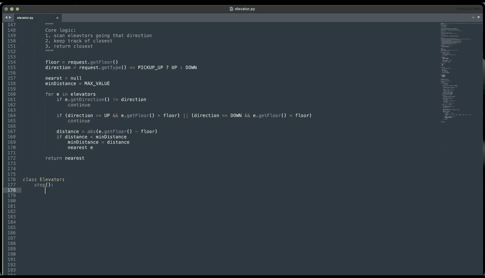

接下来一步，扫描算法在楼层七停下，因为我们碰到了那个七，那就是我们的目标。尽管那是最后到来的请求，我们打开了门，让那个人出去。而在先进先出算法中，我们没有这样做，因为我们继续前往第一个请求，即楼层八的下行呼叫。

继续往下看，此时对于扫描算法，我们到达了楼层八的下行呼叫，我们服务它，然后掉头，朝相反方向前进。我们继续扫描，一直到达底部，那里有楼层三。我们服务它，之后进入空闲状态，因为没有请求需要服务了。

你可以看出，扫描算法效率更高。在我们的问题定义中，我们说过要做一些半高效的事情，所以扫描算法是合适的选择。你可能会想，埃文，我怎么知道电梯算法？我怎么知道扫描这个名字？这面试太不合理了。别担心。你不需要知道扫描这个名字，当然不需要知道。你只需要能够围绕基本逻辑进行推理，即你应该继续朝同一方向移动，而不是不断改变方向。你坐过电梯，对吧？你知道那是什么感觉。所以我们不需要把它弄得比这更复杂。

问题是，我们如何实现它？我们采用与电梯控制器相同的方法，先讨论核心逻辑，然后讨论边缘情况。

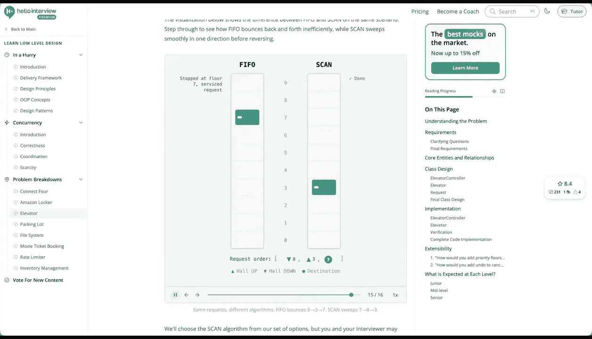

那么先从核心逻辑开始，让我们讨论这里可能发生的每种情况。第一种情况是，电梯可能已经处于空闲状态。如果你空闲但有请求，那么你应该选择朝最近请求的方向前进。好的，你的电梯是空闲的，但你有请求，那么你最好朝最近的那个前进。这就够了，没什么争议。

你还应该检查是否应该在当前楼层停下。这要么匹配厅厅呼叫，要么匹配电梯内部的目标请求。对吧？然后，如果前方没有请求，我们应该掉头。所以如果我们正在下行且下方没有请求，好吧，如果我们还有其他请求，那么我们应该掉头，朝那些请求所在的方向前进。最后一件事是，我们应该朝当前方向移动一层楼。所以我们应该继续朝同一方向扫描，如果我们没有做上面的任何事情，我们就应该继续朝同一方向扫描。

至于边缘情况，如果没有任何请求，那么我们应该将自己设为空闲，然后直接返回。还要考虑这一点，停止和移动不能在同一个时钟周期发生。也就是说，你不可能在同一段时间内移动到楼层并停止、开门，那相当于在曲折时间。所以这是两个不同的时钟周期：先移动到楼层，再服务该楼层，然后继续移动。在考虑实现时这是必要的。反转和移动也是一样，它们不会在同一个时钟周期发生。我不知道这是否算作边缘情况，这不是错误条件，但这是值得考虑的一个边缘情况。

不管怎样，让我们来实现这个。情况一，基本上没什么可做的，也就是请求为空，没有请求。那么我们将方向设为空闲，并返回。这一点非常简单，希望到目前为止大家都能跟上，这一点不具争议。

情况二，也许如果我们已经空闲，那么我们选择一个方向。如果我们的方向当前是空闲，那么我们要做的是，找到离我们最近的请求。我们开始看到这些辅助函数是什么样子了，就像之前那个一样。然后我们将设置电梯的方向，即那个最近请求的方向。所以如果我们得到的最近请求，我们将获取它的楼层。假设我们刚刚得到的请求是楼层九，好吗。如果九在我们楼层之上，那么我们希望上行，否则我们希望下行。好的，找到离我们最近的请求，看看那个请求在哪一层，如果在我们上面，就将方向设为上行，如果在我们下面，就将方向设为下行。这就够了。

那情况三呢，情况三是，我们可以停在当前楼层吗？我们应该怎么定义呢？我们可以通过查看我们的请求集合，看看是否有针对该楼层的请求来定义。但不仅仅是这个楼层，这一点很重要，候选人经常在这里搞错。想象一下你正在向上扫描，这里有一个下行请求。你不会停下来，即使你在那一层，你也不会停下来，因为这个人想下行，而你目前正在上行。对吧？所以我们不想仅仅因为楼层匹配就停下，我们希望在厅厅呼叫的情况下，如果是楼层匹配且方向正确时才停下；在目标请求的情况下，无论方向如何都要停下，因为目标请求不关心方向。

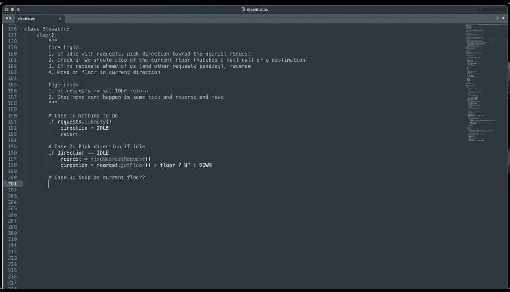

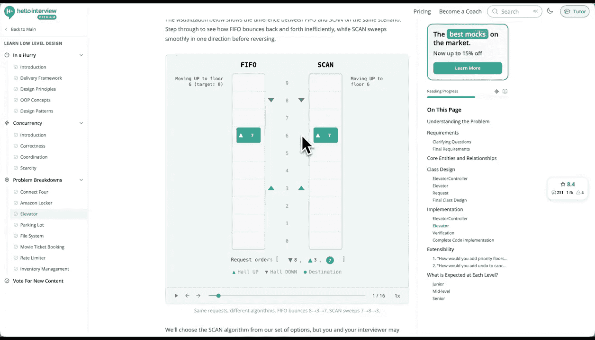

那我们如何做呢？我们有厅厅呼叫请求，我们将创建一个我们当前楼层和我们的类型的请求对象，也就是我们的取票类型，我们需要定义它。基本上就是检查它们是否在请求集合中。我将创建一个我们当前楼层和我们类型的请求对象，也就是我们的取票类型，我们需要定义它。基本上就是检查它们是否在请求集合中。如果方向当前正在上行，那么我们可以服务的取票类型就是取票上，取票上，天哪。我真恨我这样命名，取票下，取票上说起来很难。目标请求则更简单，这就是当前楼层，我想我们把楼层叫做这个吧，希望是这样。然后类型就是目标。好的，所以如果请求集合中包含这两种请求类型，我们就会为它们停下来。所以让我们检查它们是否在请求集合中。

如果请求包含厅厅呼叫请求，或者它包含目标呼叫请求，那么我们就会停下来。让我们一次做一个，我想这样可能更清楚。如果是这种情况，那么我们就停下来。我们将执行请求点移除，移除它，然后对这个也做同样的操作。请求点移除。移除就像是说我们正在服务这个请求。也许这有点令人困惑，也许我们本应该有一个停止动作，电梯本身应该暴露一个停止动作。在现实中，我认为这不太重要，随你便，和你的面试官谈谈吧。我会在这里做，当然，我们会停下来。停止意味着开门。也许我们应该叫得更清楚些，比如开门，但你明白我的意思。

那么还有什么呢？我想，在这一点上我们移除了它。如果请求集合为空，那么我们的方向现在应该是空闲，对吧？这是在这一步发生还是下一步发生？我认为应该在下一步发生。因为我们只是在这里停下来。所以在这两种情况下，我们都只是停下来。我认为这是正确的。但我想在这里返回。我要做的是回到这里，我会这样做。如果这两种情况中的任何一种为真，就移除它们。如果我们在移动某个不存在的东西，那只是一个空操作。我想我们想在这里返回。对吧，这个时钟周期结束了。我们停下来了。我们说了，不能在同一个时钟周期内做多件事。所以此时这个时钟周期结束了。我想这是对的。我确信我敏锐的观众们会注意到这里的某些错误，请让我知道。但我想当场这样做，这检查出来没问题。那么情况四呢？

情况四是，如果前面没有东西，我们就应该掉头。这就是我们到达楼层八的情况。我们到达了楼层八，我们还可以继续上升到楼层九，但我们在顶部，所以我们可能直接掉头。我们需要定义什么是有东西在前面，我们可以使用我们方便的私有辅助方法。所以如果前面没有东西，那么我们的方向将翻转。如果方向当前是上行，它现在变成下行，否则变成上行。然后我们返回。

最后一种情况，最简单的情况，就是你正在移动。基本上，你就在这里。你正朝这个方向移动。没有理由现在就停下。什么都没发生。你的这个时钟周期只是朝另一个方向移动，或者你知道，再移动一层楼。所以如果方向当前是上行。它当前是上行。那么你的楼层加一。否则如果方向等于下行。楼层减一。好的，这就是我们的扫描算法，让我们再检查一遍。

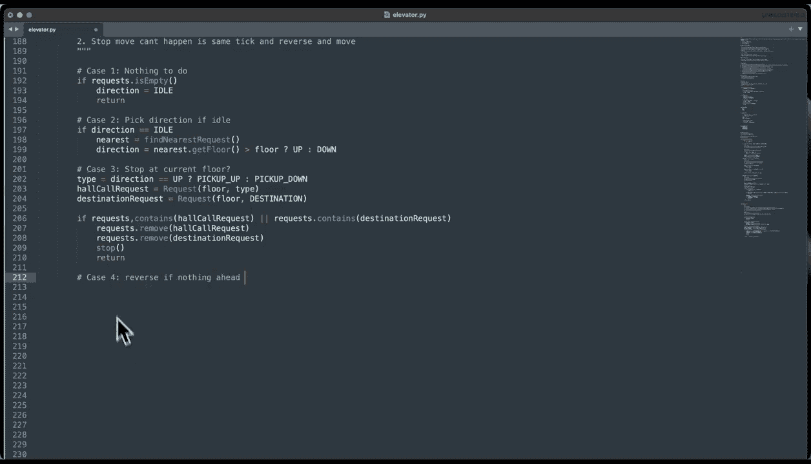

如果你处于空闲状态或没有请求，那么你变成空闲状态并返回。这就是你的这一步，没有更多可做的了，我结束了，这就是我的步进。第二种情况，选择方向。如果空闲，我们可以选择一个方向。但是仅仅选择一个方向本身不是一个时钟周期。所以这就是为什么我在这里不返回。我们可以选择一个方向，然后继续执行实际朝那个方向移动一次。移动是一步，仅仅选择一个方向不是一步。所以找到最近的请求，然后朝那个方向移动那一步。看看我们是否需要停下。停止就是检查这里是否有需要服务的呼叫或目标请求。如果是厅厅呼叫，我们要确保我们朝正确的方向移动。如果我们停下，那么我们返回。这就是一个时钟周期，我们做完了，或者说这是一个步进，抱歉我一直在说时钟周期。

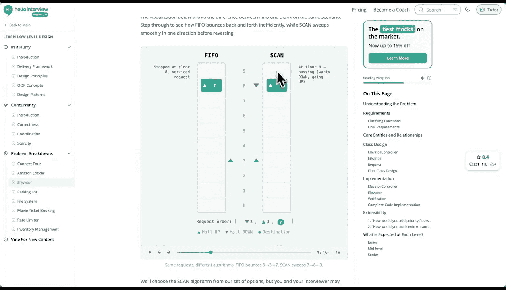

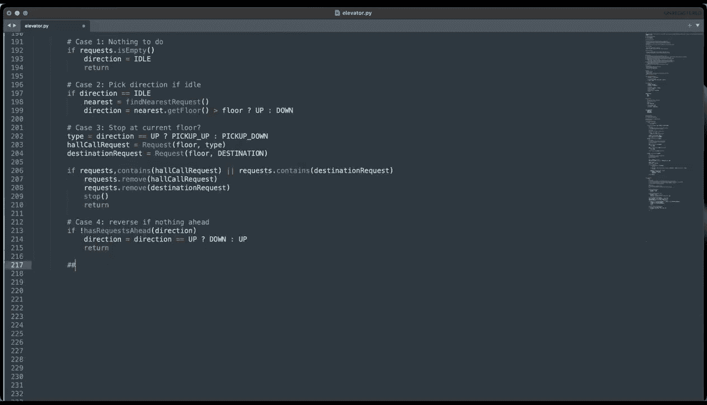

第四种情况，如果前面没有东西，就掉头。如果我们掉头，我认为我们也不应该返回，因为我们只是掉头，还没实际移动。我们会掉头，然后让第五种情况来处理实际的移动。

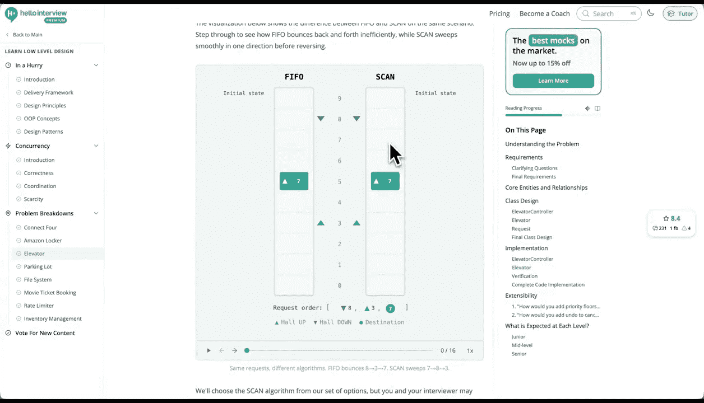

好的，我觉得关于这个我挺满意的。至于这些辅助方法，哪个我们应该做呢？我就把两个都贴进来吧。我不想让这个视频太长，而且它们在面试中通常不是最有趣的部分，面试官通常也接受你不实现这些，或者只是谈论它们，这完全取决于你的面试官。

我刚才在哪里。哦，在这儿。好的，那么找到最近的请求。这是针对空闲状态的，我们找到最近的请求很容易，扫描所有请求，找到最近的那个。对所有请求，计算你的楼层（我们称之为楼层，而不是当前楼层）和请求楼层之间的绝对距离，然后跟踪那个最小值。这与我们之前的辅助方法非常相似。

前方是否有请求？这个辅助方法很简单。对每个请求检查：如果你正在向上移动且楼层高于你，或者你正在向下移动且楼层低于你。这就是我们检查的内容。我们前面是否有任何未来请求？如果没有，就像这里那样，我们最终就会改变方向。好了，缩小一点，这就是完整的实现。不，我不应该说是完整的。但从面试角度来看，这就是电梯和电梯控制器的完整实现。请求那部分没什么可实现的，只是一些获取器和设置器。我们实现了基本的扫描算法。如果你想允许用户交换电梯移动的策略，这里也可以使用策略模式。

下一节，我们将讨论并发问题与扩展性。

我们交付框架的最后一步是关于扩展性的。如果你是初级候选人，甚至是中级候选人，能做到这里，恭喜你。这可能很棒。如果你做到了我们到这里为止的内容，你很可能通过面试了。如果还有时间，你的面试官可能会问你一些扩展性问题。如果你是高级职位，团队和首席工程师肯定会期待扩展性问题。这些是后续问题，用来检查你的设计是否可扩展，以及你是否能在这些核心领域深入探讨。

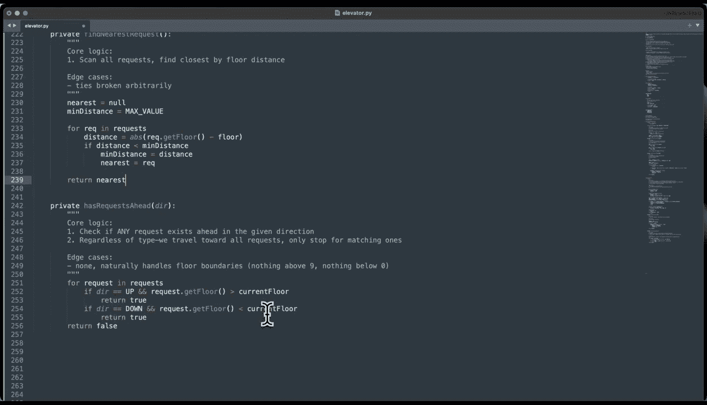

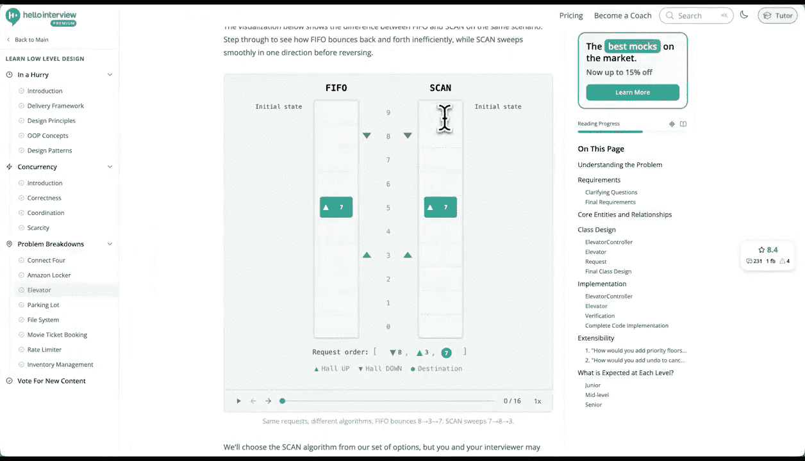

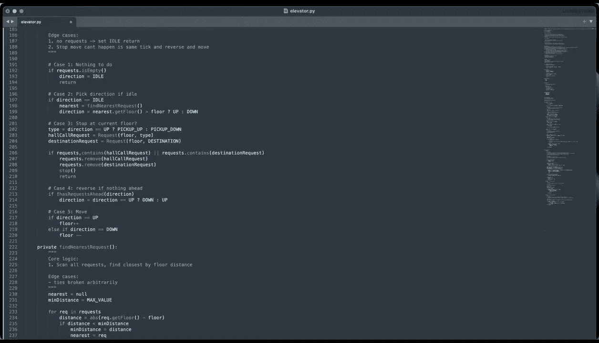

对于设计电梯这类问题，常见的扩展性问题首先是关于并发。如果多个厅厅呼叫同时到来会怎样？如果步进函数正在运行时来了一个厅厅呼叫，那会怎样？这是一个很有趣的问题，我们花了大部分时间来讨论。然后还有两个相对容易的问题。如何增加优先楼层或特快电梯？如何增加取消楼层请求的功能？在面试中，我们会讨论这三个问题。也许你只讨论一个，也许讨论两个。我在这里会更完整一些，比实际面试要多，这就是为什么这个视频可能会长一点。让我们先讨论第一个，这是远远最有趣的。

发生的情况是，两个用户同时按下请求电梯按钮。他们从两个不同的楼层，也许是四、九和四，或者五，同时按下了按钮。这里可能会出现两种失败状态。第一种失败状态是，想象有一台空闲电梯。两个人同时进去，他们都选择最佳电梯，都得到了那台空闲电梯。然后我们将那台空闲电梯添加到两人的请求中。这显然不是最有效的做法。第一个请求本应该发给那台空闲电梯，第二个请求应该考虑到那台电梯不再空闲，并分别找出它的最佳电梯。

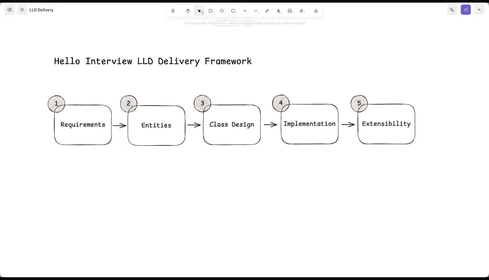

第二个问题是，我们可能会在同一台电梯上调用添加请求，这会导致并发修改。也就是说，我们从两个独立的线程更新请求集合，如果数据结构不是线程安全的，它们可能会互相覆盖。我们以为我们写了两次，但实际上只写了一次。这是多线程系统中常见的并发问题。你想要避免对给定数据结构进行并发修改。

除此之外，步进函数中也可能发生同样的事情。在步进函数中，我们也会从请求集合中移除请求。所以如果请求在添加的同时被移除，就会发生并发修改，它们可能会互相覆盖，并让我们处于意想不到的状态，我们不想要这样的情况。

考虑到这一点，有两种主要解决方案。第一种最容易理解，但有一些缺点。第二种稍微复杂一些，但我认为是更好的解决方案。让我向你们展示它们是什么。

第一种解决方案是，我们可以锁定这两个函数。我们可以锁定请求电梯和步进函数，给它们都加上同一个锁。这简单且正确。请求集合根本不会有并发访问。但代价是它们会互相阻塞。也就是说，厅厅呼叫必须等待步进函数运行完，反之亦然。当你获取锁时，就意味着你可以想象函数体就在这里，省略号代表整个函数体，一次只能由单个线程执行。它们基本上会排队等待对方。它会起作用，但会减慢我们的系统，这就是为什么它有一些缺点，但这是一个不错的选择。

另一种方案稍微高级一些。我们可以让添加请求直接将请求写入一个线程安全的队列，而不是直接写入集合。然后在每个时钟周期开始时，步进函数会将队列中的请求排空到工作集合中。这样，写入者只操作队列，步进函数只操作集合。我们在这里实现了完全的分离。不需要锁了。这个待处理请求需要是一个线程安全的数据结构。每种语言都有可以使用的线程安全队列。然后我们添加请求，当我们到达步进函数时，我们将遍历所有请求并将它们添加到该集合中。但这样，当新请求到来时，它操作的是线程安全的队列，而移除操作是在集合上进行的，它们不是同一个数据结构。所以不会对同一个数据结构进行并发修改。这很清楚。正如我说的，第一种更简单，在面试中可能更容易解释，但会减慢速度。第二种更优雅一点。两种都是很好的答案。

下一个问题是，如何增加优先楼层？这个其实很简单。在这个视频的这一步，也许你可以暂停，问问自己，想一想。我本应该对上一个问题也这么说。对此有几种方法。我看到很多候选人会想，哦，让我在请求对象中添加一个优先级字段，然后我可以使用优先级队列，这样我就可以始终去优先级最高的请求。但这会破坏我们在扫描算法中投入的所有努力，即电梯单向扫描的行为。电梯会开始四处跳转，基本上会搞乱其他所有人。这里有一个缺点。

更好的方法是，我们保持普通电梯的标准移动逻辑，但也许我们指定其中一部电梯作为特快电梯。比如我们有三部电梯，指定其中一部为特快。我们可以在电梯类中添加一个私有布尔变量，叫 isExpress，可以只设置其中一部电梯。然后它只服务优先楼层。它可能有一个楼层列表，比如二、五和九。我们可以说这些是优先楼层。现在，任何分派到二、五和九楼的请求都应该发给特快电梯。它只在这三层之间运行，所以一切都很快。其他所有请求都发给其他电梯，仍然使用扫描算法。这通常是最好的方法。

最后一个问题是，如何处理取消请求？这非常简单，特别是考虑到我们目前的设计，我们让这变得非常容易。做起来就像这样。你只需要添加一个移除请求函数，它接受请求并从集合中移除。当然，如果我们仍然担心并发问题，你想要加上锁。那么也许我应该这样做。释放锁。但对于初级候选人来说，这可能是最后一个扩展性问题。这个问题没什么大不了的。你可以像添加一样从集合中移除，幸运的是，因为我们的代码已经相当整洁了，从集合中移除请求意味着在下一步，该请求不会再被考虑。所以如果突然请求集合为空，我们就进入空闲状态。如果方向改变了，我们就会改变方向。有些候选人的实现会非常混乱。而像这样的问题，面试官可能是在暗示，等等，这里可能有点乱。但在我们的情况中，这相当直接。

这就是全部了，各位。希望这次演练对你有所价值。如果你想自己尝试这个问题，请去 hellary.com，点击该问题的指导练习。你将通过我们在这里做的五个阶段，逐步获得对你方法的反馈。留下一些评论。让我知道我做错了什么。像往常一样，我会在评论区互动。很高兴听到你们的声音。最重要的是，祝你们即将到来的面试好运。我相信你们能做得很出色。保重。

下一节，我们将进行课程总结。

本节教程中，我们一起学习了如何设计电梯控制系统。我们首先进行了需求分析，通过澄清问题确定了系统管理三部电梯、服务零到九层楼，并支持厅厅呼叫和目标请求的需求。接着我们进行了实体建模，确定了电梯控制器、电梯和请求三个核心实体，并设计了相应的类结构，包括状态和行为。

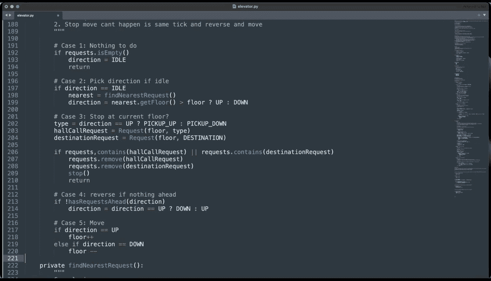

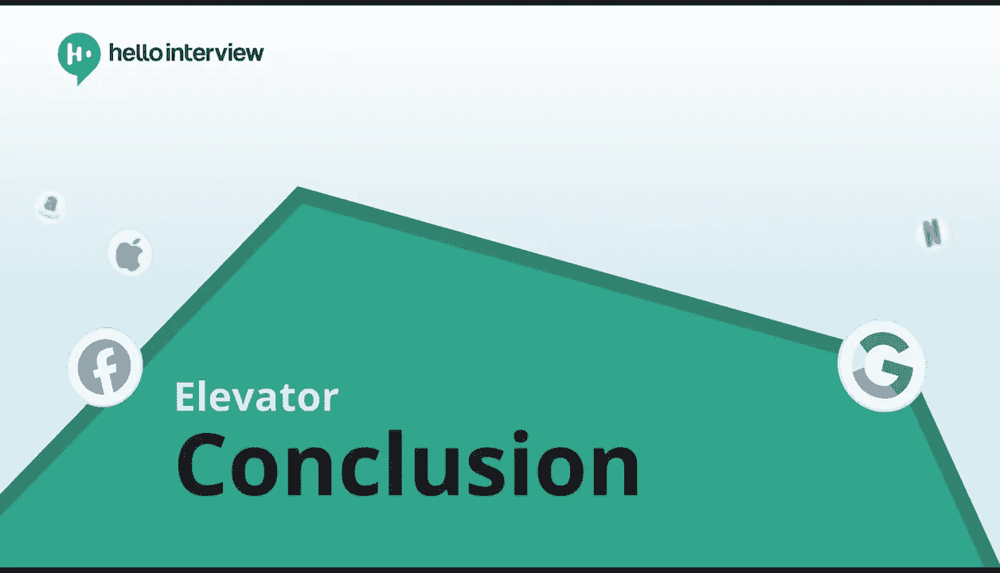

随后，我们使用伪代码实现了电梯控制器的请求电梯和步进函数，以及电梯类的步进函数，重点讲解了扫描算法及其核心逻辑与边缘情况。最后，我们讨论了并发问题的两种解决方案，并探讨了增加优先楼层、特快电梯和取消请求等扩展性功能的方法。

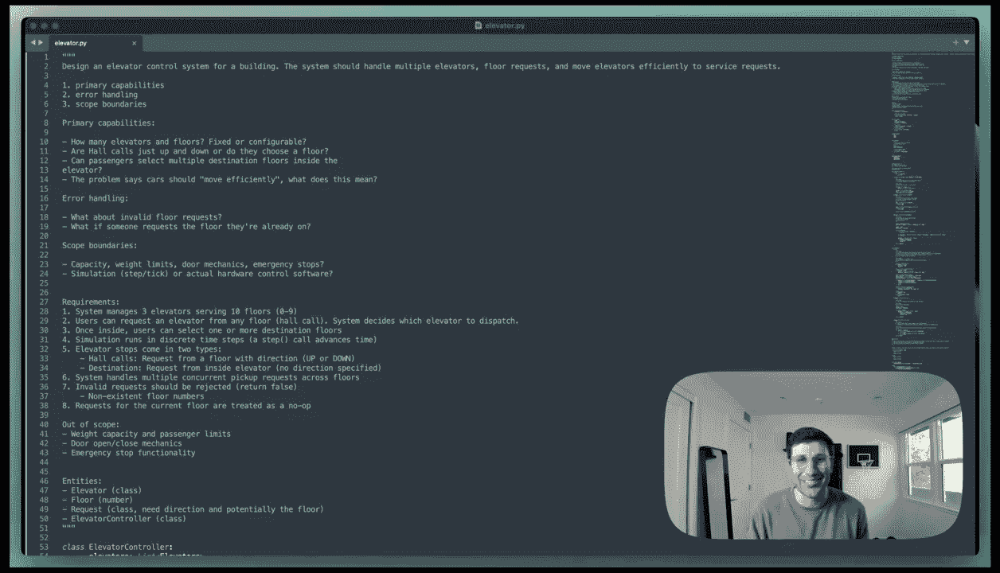

希望这篇教程能帮助你更好地理解低级别设计面试中的电梯系统问题，并在实际面试中运用所学知识。祝学习顺利。

