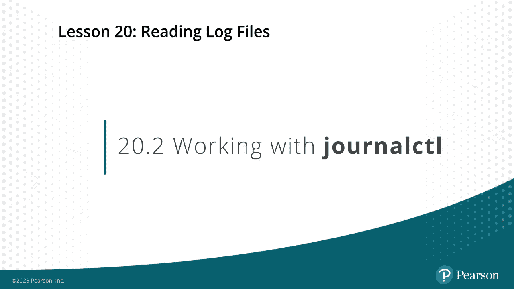
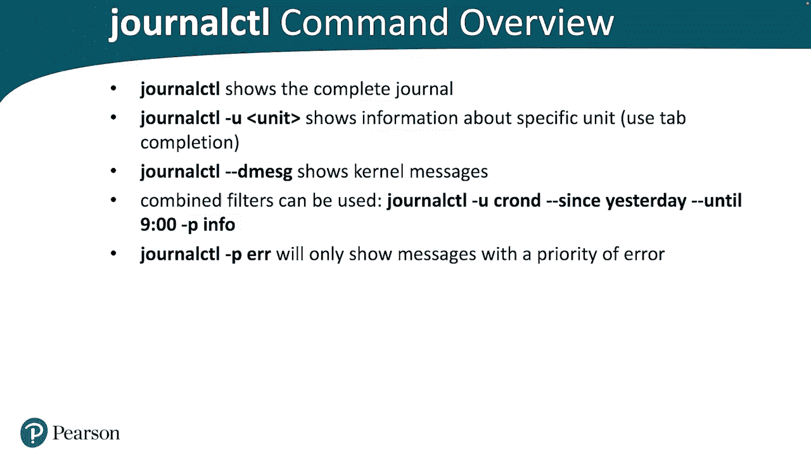
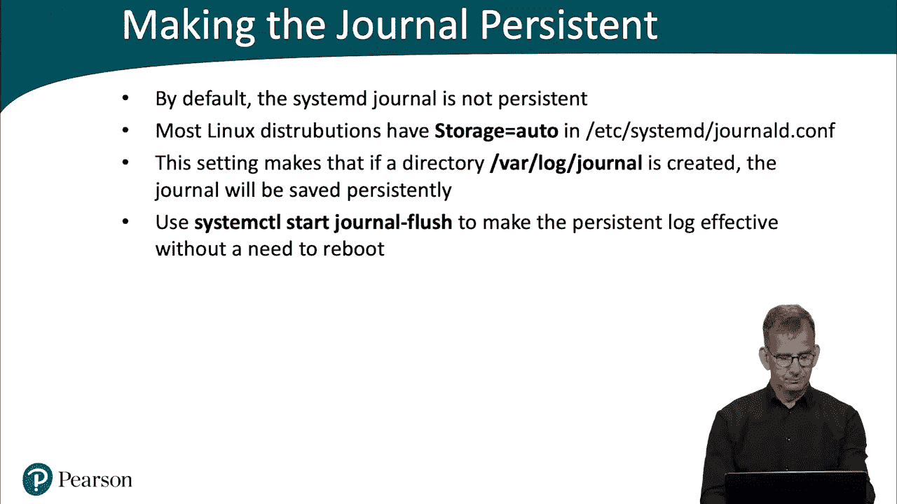

# CompTIA Linux+ V8：01：使用 journalctl 管理系统日志 📋

## 课程概述 📚

在本节课中我们将要学习 journalctl 命令的基础用法。journalctl 是 Linux 系统中用来查看 systemd 日志的工具，几乎所有服务和内核的运行信息都会记录在这里。我们会先看怎么打开完整日志，再学习如何按服务名过滤，如何查看内核消息，以及怎么组合多个条件来精确定位问题。最后还会讲解怎么让日志在重启后依然保留，不至于丢失。这些内容对排查系统故障非常有帮助，建议你跟着视频一起动手操作。

## journalctl 的基本用法 🔍

当你在终端里只输入 journalctl 并回车时，系统会把完整的日志全部显示出来。这是一个非常长的列表，所以程序会使用 less 分页器来分页展示。如果你之前用过 less 命令，那么这里的操作方式你会觉得很熟悉，比如可以用空格键向下翻页，也可以用其他 less 支持的按键来移动光标。简单来说，会用 less 就等于已经掌握了 journalctl 输出的基本阅读方法。

以下是查看完整日志时常用的操作：

- 输入 `journalctl` 打开完整 systemd 日志。
- 使用空格键在 less 分页器中向下翻页。
- 按大写字母 `G` 快速跳转到日志的最后一行。
- 按 `q` 退出日志查看界面。

## 按服务单元过滤日志 ⚙️

上一节我们介绍了如何查看完整日志，但日志通常有成千上万行，直接看很难找到想要的内容。本节中我们来看看怎么只查看某个特定服务的日志。在 systemd 中，每个服务都有一个单元名，比如 sshd.service 或 chronyd.service。使用 journalctl 的 `-u` 参数后面跟上单元名，就可以把日志范围缩小到该服务。如果你记不住具体的单元名，也可以按 Tab 键进行补全，系统会列出当前可用的所有单元供你选择。

以下是按服务单元过滤的常见写法：

- `journalctl -u sshd.service`：只显示 SSH 服务的日志。
- `journalctl -u chronyd.service`：只显示时间同步服务的日志。
- 输入 `journalctl -u` 后按 Tab 键，查看所有可用的服务单元列表。

## 查看内核相关消息 🖥️

刚才我们学习了按服务名过滤，有时候问题出在服务层面，有时候则可能出在内核层面。本节中我们来看看怎么只看内核消息。journalctl 提供了一个 `--dmesg` 参数，它可以替代老旧的 dmesg 命令，专门显示内核打印的消息。当你需要排查与内核驱动、硬件检测或系统底层错误相关的问题，而不是某个具体服务的问题时，这个命令非常有用。

以下是查看内核消息的命令：

- `journalctl --dmesg`：显示内核 ring buffer 中的消息。
- 这个命令的输出更加集中，适合用于内核相关的故障排查。

## 使用组合过滤器精确定位问题 🎯

在实际工作中，光知道某个服务出了问题还不够，我们通常还需要限定时间范围和日志的重要程度。本节中我们来看看怎么把多个过滤条件组合在一起使用。你可以指定服务单元，加上 `--since` 和 `--until` 来限定时间范围，再用 `-p` 参数来指定优先级。比如你想查看昨天到现在，chronyd 服务的 info 级别日志，就可以把这些条件写在一条命令里。不过要注意，如果指定的时间段内没有日志，命令可能不会显示任何内容，这并不代表命令出错了。

以下是组合过滤器的示例命令：

- `journalctl -u chronyd --since yesterday --until now -p info`：查看昨天到现在，chronyd 服务的 info 级别日志。
- `-p info` 会显示所有已记录的信息，但这未必是最有用的过滤方式。
- 如果时间过滤太严格，可能会看到“没有条目”的提示，这时可以尝试放宽时间范围。

## 排查故障时优先查看错误日志 ⚠️

上一节我们介绍了组合过滤器，其中提到了 `-p info` 这种信息级别的过滤。不过在实际的生产环境中，info 级别的日志往往太多，容易让人找不到重点。本节中我们来看看什么样的优先级更有助于故障排查。更推荐的做法是使用 `-p error`，这样只会显示错误级别的日志。错误日志通常直接指向系统出了什么问题，排查起来效率最高，也不容易被大量无关信息干扰。

以下是查看错误日志的推荐命令：

- `journalctl -b -p error`：只显示当前启动以来的错误级别日志。
- `-b` 参数表示只看本次启动的日志，避免翻阅旧启动记录。
- `-p error` 表示只显示优先级为 error 的消息，这是真正需要关注的内容。

## 开启日志持久化存储 💾

前面我们讲了很多查看日志的方法，但这里有一个重要的挑战需要注意。systemd 日志默认并不是持久化的，这意味着如果系统重启，之前的日志可能就会丢失。幸运的是，大多数 Linux 发行版都提供了一个配置选项，可以让日志持久保存到硬盘上。你需要修改 `/etc/systemd/journald.conf` 文件，将 `Storage` 设置为 `auto`，并且确保 `/var/log/journal` 目录存在。修改完成后，还需要重启 systemd-journald 服务，让设置生效，不过这不需要重启整个计算机。

以下是开启持久化存储的关键步骤：

- 编辑配置文件 `/etc/systemd/journald.conf`。
- 将 `Storage=auto` 写入配置文件。
- 确保目录 `/var/log/journal` 已经创建。
- 执行 `systemctl restart systemd-journald` 使持久化日志生效，无需重启系统。

## 实际演示：在终端中操作 journalctl 🖥️

讲完了理论，接下来我们来看看怎么在真实的终端里把这些命令跑一遍。因为 journalctl 涉及读取系统日志，通常需要超级用户权限，所以演示会使用 `su -i` 切换到 root 用户。直接输入 `journalctl` 时，日志会从第一行开始显示，你可以用空格键向后翻页，也可以按大写字母 `G` 直接跳到最后。按照演示中的统计，完整日志大约有七万行左右，这时候如果不加过滤，查找特定信息会非常困难。

以下是演示中展示的操作步骤：

- 使用 `su -i` 切换到 root 用户，获取超级用户权限。
- 输入 `journalctl` 查看完整日志，总行数大约在七万行左右。
- 输入 `journalctl -u` 并按 Tab 键，系统会显示大约七百九十个可用服务单元。
- 直接指定 `journalctl -u sshd.service` 查看 SSH 服务日志。
- 输入 `journalctl --dmesg` 查看内核相关消息，输出更加集中。
- 尝试组合命令 `journalctl -u chronyd --since yesterday --until now -p info`，如果没有输出，可能是因为该时间段内没有日志记录。
- 改用 `journalctl -b -p info`，可以看到大量已记录的消息。
- 在实际排查时，更建议使用 `journalctl -b -p error` 只看错误信息。
- 最后输入 `journalctl -xb`，其中 `-b` 表示本次启动，`-x` 表示添加解释，输出中可能会出现绿色行，告诉你具体哪里出错了。

## 本节小结 ✅

在本节课中我们一起学习了 journalctl 的常用命令和使用方法。我们先了解了怎么打开完整日志并用 less 分页器浏览，然后学习了怎么用 `-u` 按服务单元过滤，怎么用 `--dmesg` 查看内核消息，以及怎么组合时间范围和优先级进行精确过滤。接着我们讨论了为什么在排查故障时应该优先看 `-p error` 的错误日志，并且介绍了如何通过修改 `/etc/systemd/journald.conf` 开启日志持久化存储。最后还看到了 `journalctl -xb` 如何通过绿色提示行帮助快速定位问题。这些就是日常运维中最常用的 journalctl 操作，掌握它们后你就能更高效地分析系统日志了。

