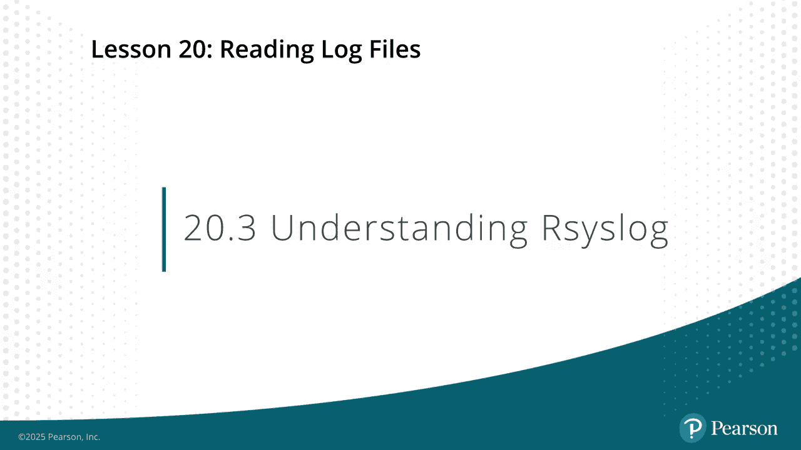
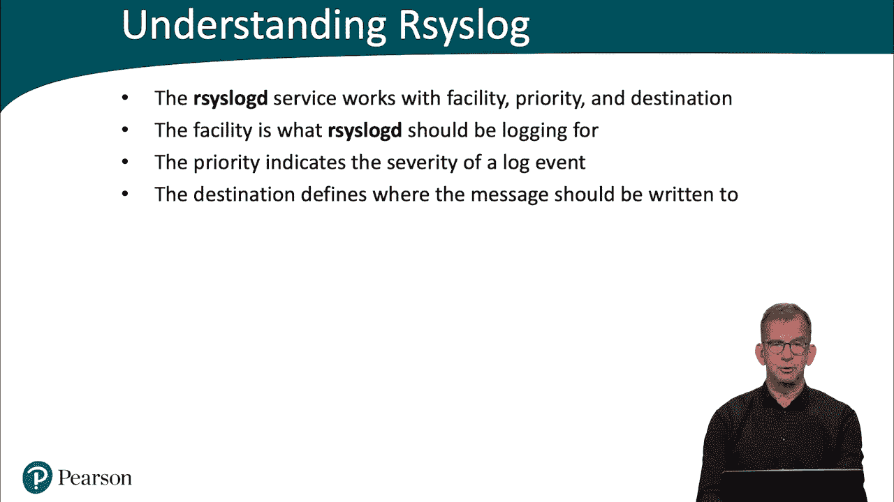
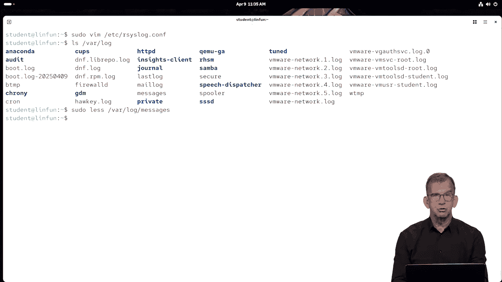

# 📋 CompTIA Linux+ V8：02：理解 Rsyslog


在本节课中，我们将一起学习 Rsyslog 的相关知识。如果你已经接触过 systemd journal，那么这节内容会是很好的补充，因为今天的许多 Linux 发行版中，仍然会默认安装并使用 Rsyslog 来处理系统日志。我们会用最直白的方式把它讲清楚，包括 Rsyslog 是怎么工作的，它的主配置文件在哪里，以及日志信息最终会被写进哪个文件。不管你是刚开始学 Linux 的新手，还是正在为 CompTIA Linux+ 考试做准备，看完这一节都能对系统日志管理有一个更完整的认识，也能在实际操作中更快地定位到系统日志文件。


上一节我们介绍了 systemd journal，本节中我们来看看 Rsyslog。虽然 systemd journal 在现代系统里很常见，但实际上在很多发行版上，你依然会发现 Rsyslog 的身影，所以了解它的工作方式是很有必要的。不管系统是否默认启用它，作为一名 Linux 学习者，掌握 Rsyslog 的基础概念都不会吃亏，毕竟很多老旧服务器和企业环境里还在广泛使用它。


Rsyslog 的运行逻辑可以用下面这个简单的公式来描述：

```
Rsyslog 工作逻辑 = Facility（来源） + Priority（严重性） + Destination（目的地）
```

这里的 facility 是 Rsyslog 需要关注的日志来源项目，比如内核、邮件系统或认证服务等；priority 表示日志事件的严重程度，比如普通信息、警告或错误等；destination 则决定了消息应该被写到哪里，在大多数情况下，这个目的地就是一个日志文件。看完这个公式，你应该就能明白 Rsyslog 是怎么决定“记什么、记到哪里”的了，这三个要素缺一不可，配置文件里的每一条规则其实都是在组合这三者。


了解了 Rsyslog 的基本工作方式之后，接下来自然就是确认这个服务是否真的在运行了，因为服务没起来，日志配置再好也没有任何意义。在实际操作前，先检查服务状态是一个好习惯，可以避免后面排查日志问题时走弯路。



可以使用下面这条命令来查看 Rsyslog 的当前状态：

```
systemctl status rsyslog
```

执行后如果输出显示服务是 active 并且 running，就说明 Rsyslog 已经正常工作，系统日志记录功能处于正常状态，你就可以放心地继续查看它的配置文件了。


服务确认正常之后，下一步就是去查看它的配置文件，因为日志到底该记录什么、保存在哪里，全部都是在这个文件里定义的。配置文件是 Rsyslog 的“大脑”，所有的日志分发规则都写在这里，理解了它，你就能掌控系统日志的去向。

Rsyslog 的主配置文件路径如下：

```
/etc/rsyslog.conf
```


打开配置文件后，你会看到里面有一部分是关于模块的内容，这部分在初学阶段可以直接跳过，重点要看的是下面的规则部分。规则决定了具体的日志会被发送到哪里，下面列出的就是配置文件中比较典型的一些规则示例：

- `*.* /dev/console`
  这条规则表示，所有设施、所有优先级的日志都会发送到系统控制台。

- `*.info;mail.none;auth.none;cron.none /var/log/messages`
  这条规则的大白话意思是：所有以 info 级别记录的日志，除了邮件、认证和计划任务相关的日志之外，都会写入 `/var/log/messages` 文件。

- 与认证相关的日志会被发送到 `/var/log/secure` 文件中。


看完这些规则示例，你可能会发现自己发行版的配置文件里内容不太一样，这是很正常的，因为不同发行版的默认设置确实会有差异。不过不管具体规则如何，日志信息最终都会被写入 `/var/log` 目录，在那里你可以看到已经创建了很多日志文件。这个目录就像是系统日志的“仓库”，各种不同类型的日志都被分门别类地放在这里。

以下是你在 `/var/log` 目录下可能会遇到的一些常见日志文件：

- `/var/log/messages`
  这是大多数系统的主日志文件，记录了各种普通的系统信息。

- `/var/log/secure`
  这个文件专门用来记录与用户认证相关的日志，比如登录尝试等。


知道日志文件放在哪里之后，接下来就可以实际打开它看看里面记录了什么内容了。光知道路径是不够的，真正打开文件看一眼，才能对系统日志的格式和内容有直观的认识。

要查看 `/var/log/messages` 文件，可以使用下面这条命令：

```
less /var/log/messages
```

因为这是系统日志文件，你需要管理员权限才能打开并读取其中的内容。在 less 界面中，按大写字母 `G` 可以直接跳转到文件底部，从而看到最新的所有日志消息。需要注意的是，`/var/log/messages` 其实就是一个普通的文本文件，所以你可以使用平常处理文本文件的工具来在其中查找你需要的信息，比如 grep 之类的命令都可以派上用场。


用 less 查看日志虽然方便，但如果你只想筛选出严重程度为 error 的日志，事情就没有那么简单了。在默认配置下，没有一个简便的方法能直接只显示 error 优先级的日志，less 工具本身并不具备按优先级过滤的功能。如果你确实希望在某个特定的日志文件中只查看 error 级别的信息，就需要对 rsyslog 的配置进行相应的调整，才能实现这种筛选效果，这也是后续学习中可以进一步探索的方向。




本节课中我们一起学习了 Rsyslog 的基本工作原理，包括它如何根据设施、优先级和目的地来分发日志，如何用 `systemctl status rsyslog` 检查服务状态，主配置文件 `/etc/rsyslog.conf` 中规则的含义，日志文件默认保存在 `/var/log` 目录，以及如何用 `less /var/log/messages` 查看主日志文件，并且了解到只筛选特定优先级日志需要修改配置。希望这些大白话的解释能帮助你更好地理解 Linux 系统日志，为后续的学习和 CompTIA Linux+ 考试打下基础。

