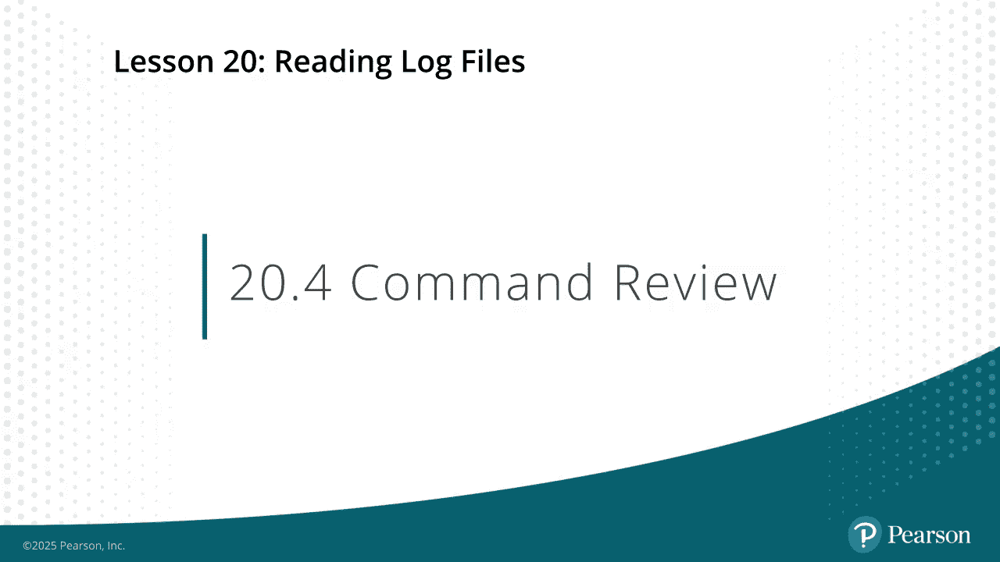
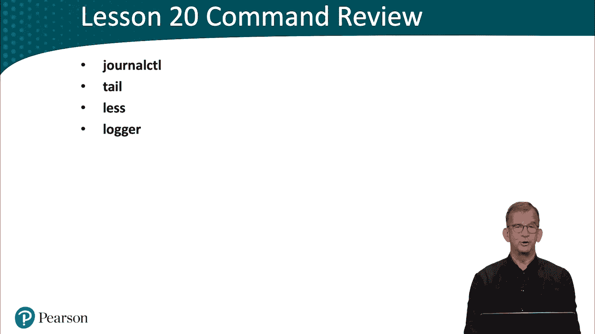

# 🐧 CompTIA Linux+ 教程：03：203.204 命令复习

在本节课中，我们将一起学习 Linux 系统中用于查看和管理日志的几个常用命令。具体来说，我们会认识 journalctl、dmesg 和 logger 这三个工具，并了解它们在日常运维中的基本用法。不管你是刚接触 Linux 的新手，还是想要复习一下基础知识的学习者，这节课都会用大白话把这些命令讲清楚，让你知道在什么情况下该用哪个命令，从而更方便地排查系统问题。


上一节我们可能已经初步接触过系统日志的概念，本节中我们先来看看 journalctl 这个命令。以下是 journalctl 的核心说明。



journalctl 是 systemd 日志系统的主要管理命令，它帮助你直接操作 systemd 产生的 journald 日志。简单说，systemd 是现代 Linux 发行版中常用的系统和服务管理器，而 journalctl 就是用来读取和查询它产生的日志的工具。你可以把它理解成一个专门的“日志阅读器”，帮助你查看系统运行过程中记录下来的各种信息。

核心命令格式如下：

```bash
journalctl
```

运行这条命令后，系统会把 journald 记录的日志内容直接显示在终端里。这里的 journald 是 systemd 自带的日志守护进程，负责把内核和服务产生的消息收集起来，存放到二进制日志文件中。相比传统的文本日志，systemd 日志的结构更加规整，也更容易通过 journalctl 进行过滤和搜索，这使得它成为日常故障排查中非常实用的工具。

介绍完 journalctl 之后，本节中我们来看看另一个和日志查看密切相关的命令，也就是 dmesg。以下是 dmesg 的作用说明。

dmesg 命令用于显示内核环形缓冲区中的最近几行消息。当你需要排查硬件驱动、系统启动或底层设备相关的问题时，这个命令非常实用。它能让你快速了解系统在启动过程中或者运行期间，内核到底打印了哪些提示信息，从而帮助你定位可能的故障原因。

该命令的基本用法可以表示为：

```bash
dmesg
```

执行后，你会看到类似于系统启动日志的输出内容，这些信息通常包括 CPU 检测、内存配置、磁盘设备识别等底层细节。在日常维护中，很多运维人员会用 dmesg 来监控 /var/log/messages 中记录的内核相关事件，因为它能直观地反映出当前系统底层运行的状态。当然，这也和过去直接在 /var/log 目录下打开日志文件阅读的习惯类似，只是 dmesg 更专注于内核层面的消息，适合用来快速查看最近的系统事件。

学习完如何读取日志之后，本节中我们再来看看如何向日志系统写入消息，这时 logger 命令就派上用场了。以下是 logger 的功能介绍。

logger 是一个方便的小工具，允许你把自定义消息直接写入当前的日志系统。比如当你在编写脚本或者进行系统调试时，可能需要把某些关键事件记录下来，以便日后排查问题，这时候就可以用 logger 来完成这项工作，而不需要手动去操作日志文件。

它的使用方式可以概括为：

```bash
logger "你的消息内容"
```

logger 命令不仅可以配合传统的 syslog 日志机制使用，也能与 systemd journal 协同工作。这意味着无论你的系统使用哪种日志后端，logger 都能帮你把消息发送到正确的位置，而不需要你手动去操作日志文件，从而简化了日志记录的过程。



在本节课中，我们一起学习了 journalctl、dmesg 和 logger 三个命令。journalctl 用于操作 systemd journal 日志，dmesg 用于查看内核最近的消息，而 logger 则用于向日志系统写入自定义消息。掌握这几个命令后，你就能更方便地查阅系统日志，并在需要时记录关键信息，为后续的系统故障排查打下坚实基础。
