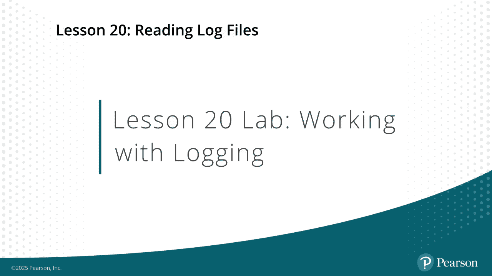
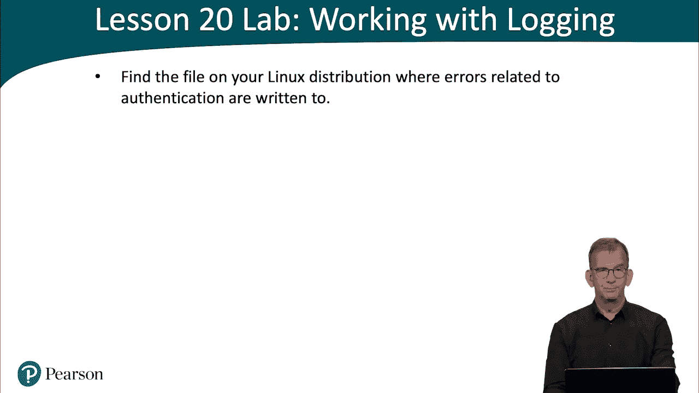

# CompTIA Linux+ V8：204：使用日志实验课 🪵

在本节课中我们将要学习如何处理系统日志，特别是如何在你的Linux发行版中找到记录身份验证错误的日志文件。日志是Linux系统运行的重要记录，记录了系统各种事件和操作信息。了解日志文件的位置和作用，能帮助你快速定位系统问题，排查登录失败等安全相关事件，提高系统运维效率。


既然我们已经学完了本节课的理论知识，现在是时候进入实验环节了。实践是掌握Linux系统管理技能的最好方式，只有动手操作才能真正理解系统的工作原理。通过动手查找日志文件，你可以更深刻地理解系统是如何记录安全事件的，为后续的故障排查打下基础。

以下是本节课的实验任务：



- 在你的Linux发行版中，找到记录身份验证相关错误的日志文件。

在大多数Linux系统中，身份验证相关的日志通常被写入特定的系统日志文件。这些文件记录了用户登录、权限提升、认证失败等关键安全信息。你可以使用以下命令来查看这些日志文件的位置和内容：

```bash
cat /var/log/auth.log
```

或者在某些发行版中，相关日志可能记录在：

```bash
cat /var/log/secure
```

这两个文件通常记录了SSH登录、sudo使用、用户认证失败等安全事件的详细信息。你可以根据自己使用的Linux发行版选择对应的文件进行查看，并熟悉日志的记录格式。



实验任务已经给出，你可以开始动手操作了。祝你好运。

本节课中我们一起学习了如何查找记录身份验证错误的日志文件，掌握了在Linux系统中定位安全日志的基本方法，了解了常见日志文件的存储位置和查看方式。

