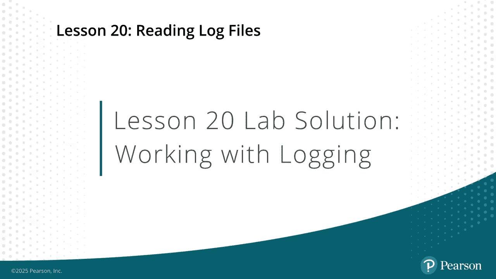
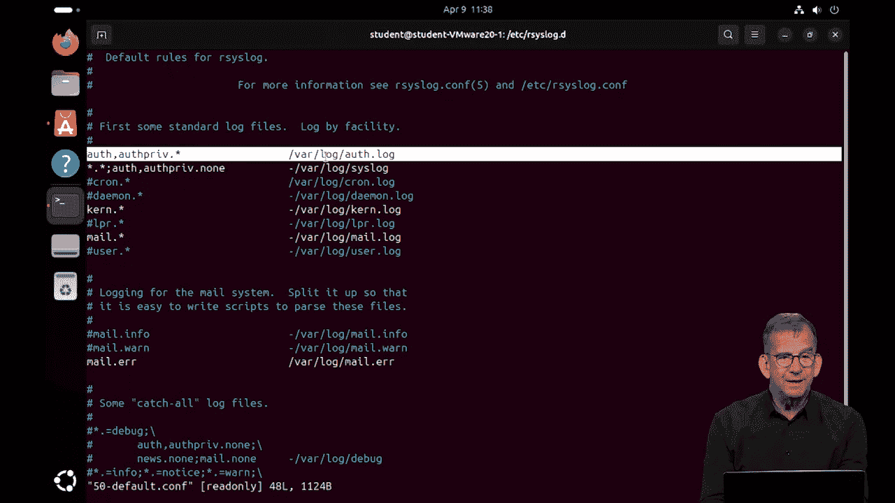

# CompTIA Linux+ 教程：第 20 课：使用日志实验解答 📜

在本节课中，我们将一起学习如何在 Ubuntu 系统上查看和定位系统日志。讲师之前已经在另一台机器上演示过日志的工作方式，现在我们将切换到 Ubuntu，看看它是如何处理认证相关日志的。通过本节课，你将掌握检查日志服务状态、查找配置文件以及读取日志内容的完整流程。




## 第一步：检查系统日志服务是否运行

在开始查找日志之前，我们需要先确认系统上的日志服务是否正常运行。如果这个服务没有启动，后续的操作就无法获取任何有用信息，所以第一件事就是检查状态。

我们可以使用以下命令来查看 rsyslog 服务的当前状态：

```bash
systemctl status rsyslog
```

执行这条命令后，终端会输出服务是否处于 active 状态。如果显示 active，说明日志服务已经在后台运行，我们可以继续下一步的操作。


## 第二步：查看主配置文件

有了服务状态的确认，接下来我们需要找到日志系统的主配置文件。在大多数 Linux 发行版中，rsyslog 的主配置文件位于 /etc/rsyslog.conf。我们可以用 vim 编辑器打开它，查看里面的规则设置。

使用以下命令打开主配置文件：

```bash
sudo vim /etc/rsyslog.conf
```

在文件中，我们通常会搜索与认证相关的关键字，比如 auth 或 authpriv，以确认认证日志被发送到了哪里。不过在 Ubuntu 上，直接搜索可能找不到我们想要的具体规则，这并不意味着配置出错了，而是 Ubuntu 的配置方式比较特殊。


## 第三步：查看 Ubuntu 的分散配置文件

不同于把所有设置都写在一个大文件里，Ubuntu 把 rsyslog 的配置拆分到了多个小文件中。这些小文件通常存放在 /etc/rsyslog.d/ 目录下，每个文件负责不同类型的日志处理。

我们可以先列出该目录下的所有文件，看看有哪些配置可用：

```bash
ls /etc/rsyslog.d/
```

在目录列表中，我们会看到一个名为 50-default.conf 的文件。这就是我们需要重点查看的配置文件。它决定了绝大多数系统日志该写到哪个位置。


## 第四步：查看认证日志文件

打开 50-default.conf 之后，我们会发现其中有一行规则明确指出，所有与认证相关的消息都会发送到 /var/log/auth.log 文件中。这就是 Ubuntu 存放登录、权限提升等认证事件的地方。

为了查看这个日志文件里的具体内容，我们可以使用 less 命令来分页阅读：

```bash
less /var/log/auth.log
```

执行后，你会看到一系列带有时间戳的认证记录。每一行代表一次登录尝试、用户切换或其他安全相关事件。通过这种方式，你就能清楚地知道认证消息被发送到了哪里，以及如何查找它们。


## 小结



本节课中，我们一起学习了在 Ubuntu 系统上使用日志的完整方法。首先通过 systemctl status rsyslog 确认日志服务正常运行；接着用 sudo vim 打开主配置文件，但发现主要规则并不全部集中在那里；随后转到 /etc/rsyslog.d/ 目录，找到了 50-default.conf 这个关键配置文件；最后使用 less /var/log/auth.log 查看了所有认证相关的日志记录。希望这些步骤能帮助你在实际工作中快速定位系统日志。
