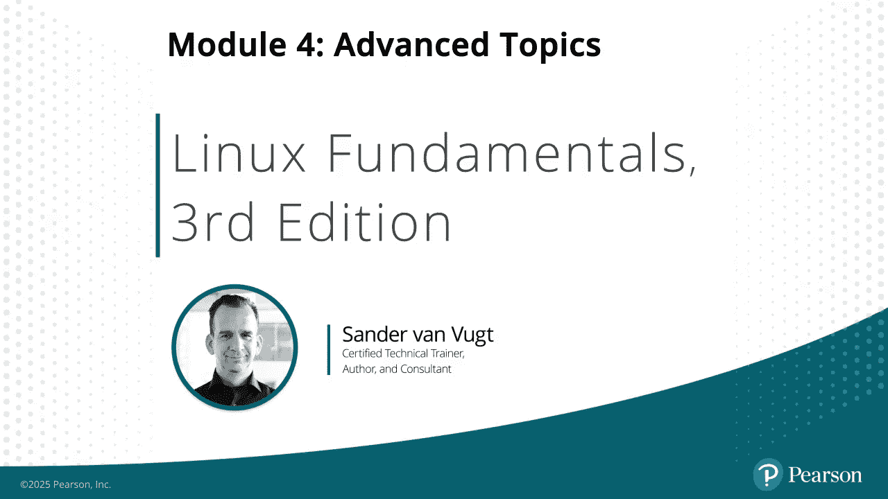
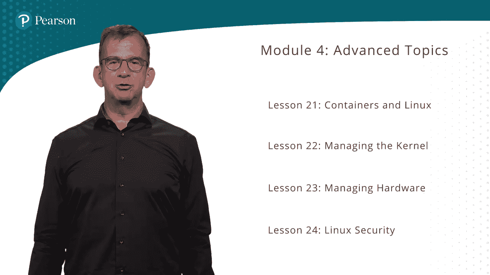

# CompTIA Linux+ V8：模块4：模块介绍📚

在本节课中，我们将要学习CompTIA Linux+ V8课程里的模块4，也就是模块介绍这一部分。这个模块的主要目的是让你初步接触一些比较高级的Linux主题，虽然这些内容看起来可能不太容易，但我们只需要掌握基础知识就可以了。

Welcome to Mod4 in this module， some advanced topics are introduced。这个模块就是模块4，里面会引入一些高级话题。这些高级话题并不是为了让你立刻成为专家，而是希望你能先知道这些东西的存在。

The topics in this module are rather complex and knowing all about these topics requires a lot of expertise。这些主题本身比较复杂，如果你想完全搞明白每一个细节，需要具备很多专业知识和实际经验。所以在学习的时候，不需要追求一下子全部吃透，先有个大致印象就足够了。

but you should at least know about the basics which are covered in this module。但是，你至少应该了解模块中讲到的基础知识。这些基础内容是后续深入学习Linux系统的重要起点，建议你在学习过程中多花些时间去理解。

This model has four lessons， the first lesson explains how containers can be used as an alternative for starting applications in the next lesson you'll learn more about a kernel and how to configure it。整个模块一共有四个课程。第一节课会讲容器怎么用来替代传统的启动应用程序的方式，第二节课会讲解什么是内核，以及如何对内核进行配置。

And after that， you'll find lessons about hardware management and Linux security。在这之后，接下来还有两节课，分别是关于硬件管理的内容，以及Linux系统安全的相关知识。

以下是模块4中包含的四个课程主题：

- 容器作为启动应用程序的替代方案：容器可以看作是一种轻量级的运行环境，我们可以用它来启动应用，而不需要像传统方式那样直接在系统上安装很多依赖。用代码形式表示大概是这样的：`应用程序 -> 容器 -> 操作系统`，而不是`应用程序 -> 操作系统`。

- Linux内核及其配置：内核是操作系统的核心部分，负责管理硬件和软件之间的通信。配置内核就是告诉系统在启动时该开启哪些功能、加载哪些驱动程序。可以用公式表示为：`内核配置 = 硬件驱动 + 系统参数 + 功能开关`。

- 硬件管理：这一部分会教你怎么在Linux里查看和管理硬件设备，比如磁盘、网卡、显卡等，确保系统能正确识别和使用这些硬件资源。

- Linux安全：最后一节课会介绍Linux的安全基础知识，包括用户权限、防火墙、系统加固等内容，帮助你保护系统不被未授权访问。

以上就是模块4中会涉及的四个主要课程，每个课程都有自己独立的知识点，你可以按照顺序逐一学习。

在学习这四个课程的时候，建议你先不要被复杂的概念吓到，因为高级话题通常都需要长时间的积累才能完全掌握。我们在这一模块只要求你了解基础知识，为后续的深入学习打下基础。如果你在学习过程中遇到不懂的地方，可以多查阅文档，或者动手实践一下相关命令。

本节课中我们一起学习了CompTIA Linux+ V8模块4的模块介绍内容。我们了解了模块4包含四个课程，分别是容器作为应用启动的替代方案、内核及其配置、硬件管理、以及Linux安全。虽然这些主题比较复杂，但只要掌握基础知识，就足以应对接下来的学习。希望这节课对你有所帮助。
