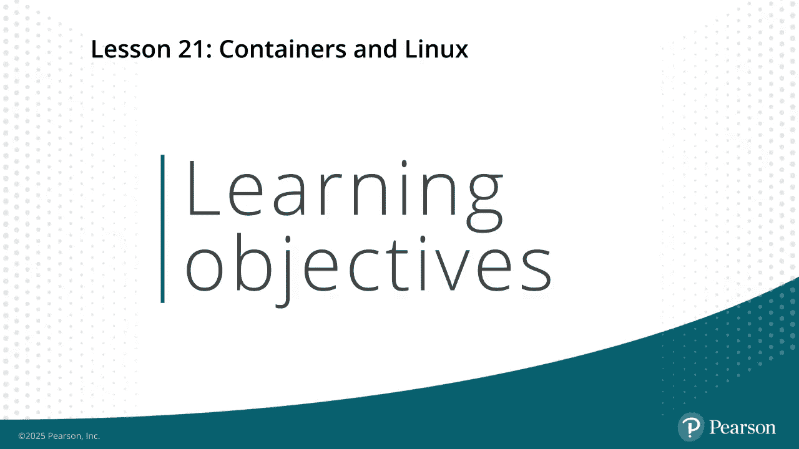
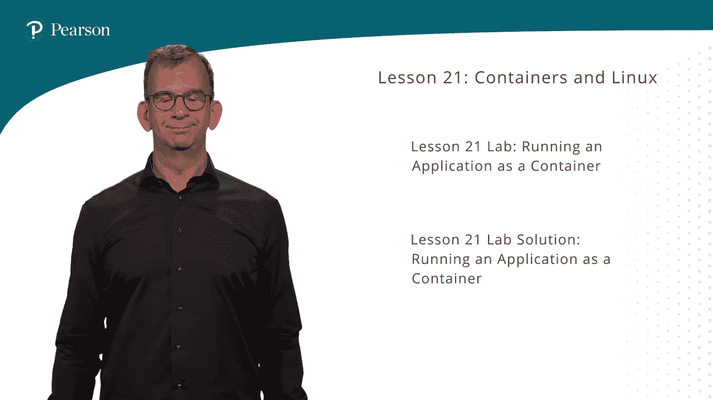

# 🐧 CompTIA Linux+ V8：第 07 节：容器学习目标

在本节课中，我们将一起学习容器在 Linux 系统中的基本使用方法，了解如何把容器作为传统虚拟机的替代方案来运行应用程序，并掌握使用 Docker 或 Podman 管理容器的核心技能。

容器是一种轻量级的应用程序打包方式，它把程序本身以及运行所需的所有依赖项一起封装起来。你可以把它理解为下面这样：

容器 = 应用程序 + 运行依赖 + 配置文件

这种方式比完整的虚拟机更省系统资源，启动速度也更快，非常适合在 Linux 环境中学习和部署各种应用程序。



本节课我们将先认识容器的基本概念，然后学习如何使用两款主流工具来操作容器，最后进入实验环境进行动手练习。

## 使用 Docker 或 Podman 操作容器

在 Linux 系统中，管理容器通常依赖于专门的容器引擎。目前最常见的两款工具是 Docker 和 Podman，它们都可以让你创建、启动、停止和删除容器。

你可以使用以下命令来启动一个容器：

```bash
docker run 镜像名称
```

或者如果你使用 Podman，命令几乎完全一样：

```bash
podman run 镜像名称
```

这两款工具在日常操作上非常相近，学习其中一款后，切换到另一款也只需要很短的适应时间。我们将在后续内容中分别演示它们的基本用法，让你能够根据实际情况选择合适的工具。

## 管理容器的基本操作

除了启动容器之外，日常管理工作还包括查看正在运行的容器、停止不再需要的容器、删除占用空间的容器镜像，以及查看容器的运行日志等。

以下是常见的容器管理命令：

- 查看正在运行的容器：`docker ps` 或 `podman ps`
- 停止指定容器：`docker stop 容器 ID` 或 `podman stop 容器 ID`
- 删除指定容器：`docker rm 容器 ID` 或 `podman rm 容器 ID`
- 查看容器日志：`docker logs 容器 ID` 或 `podman logs 容器 ID`

这些命令是你每天操作容器时最常会用到的部分，掌握它们后就可以在 Linux 系统中自如地控制容器的生命周期了。

## 进入实验环境进行练习

理论学习之后，最重要的一步就是动手实践。本节课的最后部分将带你进入专门的实验环境，你可以在那里自由地创建和管理容器，而不用担心影响到主机系统。

在实验中，你可以尝试以下操作：

- 拉取一个常用的镜像
- 启动一个基于该镜像的容器
- 查看容器运行状态
- 停止并删除容器



通过这些实际操作，你会更直观地理解容器是如何工作的，也能更快地熟悉 Docker 和 Podman 的命令行界面。

## 本节小结

在本节课中，我们一起学习了容器作为应用程序运行环境的基本概念，了解了如何使用 Docker 或 Podman 来操作容器，掌握了启动、停止、删除和查看容器等常用管理命令，并进入实验环境进行了动手练习。希望这些内容能帮助你在 Linux 学习之路上打下坚实的容器基础。
