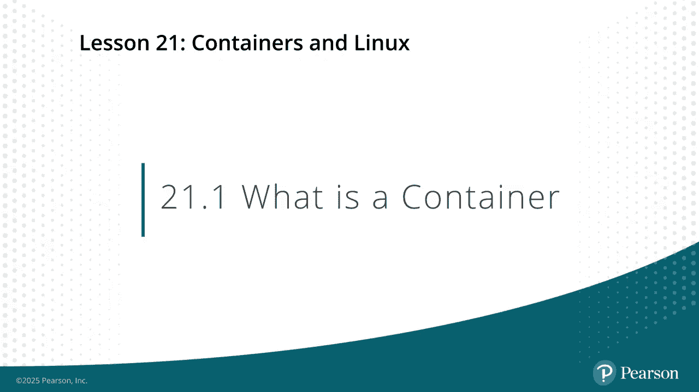
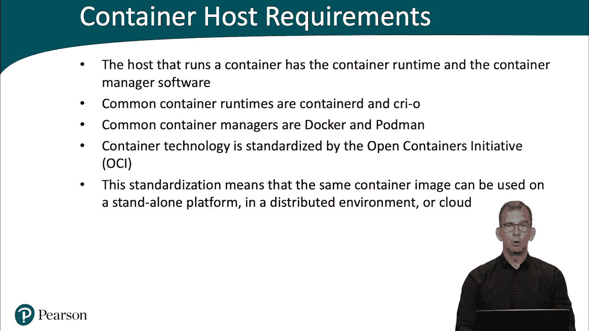

# CompTIA Linux+ V8：第8节：什么是容器 📦




在本节课中，我们将一起学习什么是 Linux 容器，容器是如何工作的，以及为什么在当今的软件开发和运维中，容器技术变得如此重要。无论你是刚接触 Linux 的初学者，还是想要了解应用程序部署新方式的学习者，本节内容都会用大白话为你讲解清楚，让你从零开始建立对容器的直观认识。

---

## 为什么需要了解容器

上一节我们简单提到了容器的存在，本节中我们先来看看为什么有必要了解它。

在 Linux 系统中，启动应用程序的方式不止一种。传统上，我们直接在操作系统上安装和运行应用，但容器提供了另一种启动应用的方法。简单来说，容器是 Linux 中启动应用程序的一种新方式。了解容器可以帮助你更好地理解现代应用是如何被打包、分发和运行的，这对于后续学习云原生技术和微服务架构非常有帮助。

---

## 什么是容器

在了解了为什么需要容器之后，我们来看看容器到底是什么。

我把容器定义为：在 Linux 内核通过命名空间实现隔离的环境中，从容器镜像启动的应用程序。

用代码块表示这个定义：

```
容器 = 容器镜像 + Linux 内核命名空间隔离 + 应用程序
```

这个定义看起来比较简洁，但里面包含几个关键部件，下面我们将逐一解释，以便你彻底搞清楚每个部分的作用。

---

## 容器的核心组件

容器的定义中还有几个部分需要进一步说明。以下是容器的核心组件：

1. **命名空间（Namespace）**
   命名空间是 Linux 内核实现的一种隔离级别。它确保容器内部只能访问与该容器相关的文件、用户和进程。也就是说，容器化的应用无法越界进入宿主操作系统，这大大提升了系统安全性，防止容器内的程序随意访问宿主机资源。

2. **容器镜像（Container Image）**
   容器镜像包含了运行应用所需的所有依赖项。有了镜像，依赖问题就不再是麻烦，因为所有需要的库、配置和运行环境都已经打包在里面了，开发者不需要再手动去安装各种依赖包。

3. **容器仓库（Container Registry）**
   容器镜像通过容器仓库获取。容器仓库是一个在线资源，有点像代码仓库，任何人都可以把自己的容器镜像发布到这里，供其他人下载和使用。

4. **宿主机提供的内核**
   容器主要专注于运行应用，容器内部不需要自带内核。容器使用的是宿主机操作系统提供的内核，这使得容器比传统虚拟机更轻量，启动速度也更快。

---

## 容器运行环境的要求

了解了容器的组件之后，我们来看看运行容器需要满足什么条件。以下是容器宿主机的要求：

- 宿主机上必须安装容器运行时。
- 容器运行时是一个小型程序，负责启动容器并管理容器中的软件。
- 常见的容器运行时包括 containerd 和 CRI-O。
- 常见的容器管理工具包括 Docker 和 Podman。

这里有一个有趣的现象：大多数人使用容器时，根本不会去关心具体使用的容器运行时是什么。你只需要安装 Docker 或 Podman，就能开始使用容器了，运行时会随之自动安装，无需额外操作，这也降低了使用容器的门槛。

---

## 容器技术的标准化与优势

接下来我们来看看容器技术是如何标准化的，以及它带来了什么好处。

容器技术本身由 OCI（开放容器倡议，Open Container Initiative）进行标准化。这种标准化带来的好处是：同一个容器镜像可以在独立平台、分布式环境或云平台上使用。这也解释了为什么容器会迅速变得非常流行，因为它打破了不同环境之间的兼容性障碍。

作为开发者，你可以在本地笔记本电脑上开发应用程序，也可以在本地笔记本电脑上进行测试。一旦证明应用运行正常，你就可以在分布式平台（比如云平台）上运行完全相同的应用程序，而不需要修改任何代码或配置。这种“开发一次，到处运行”的特性，让容器在现代软件交付中变得不可或缺。

正因如此，容器如今已成为运行应用程序的事实上标准。

---

## 本节总结



本节课中，我们一起学习了什么是 Linux 容器，容器的定义及其核心组件，包括命名空间、容器镜像、容器仓库和宿主机内核。我们还了解了容器运行时、常见的容器管理工具，以及容器技术的标准化和优势。希望通过本节内容，你能对容器有一个清晰的认识，并为后续深入学习容器技术打下基础。

