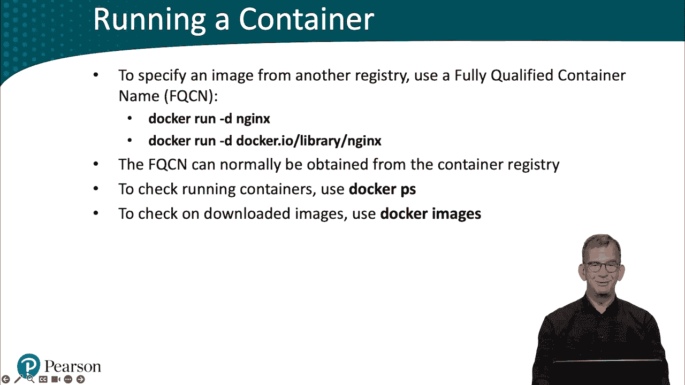
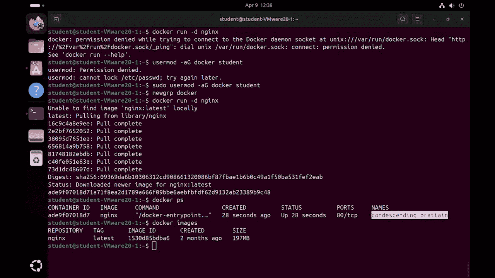
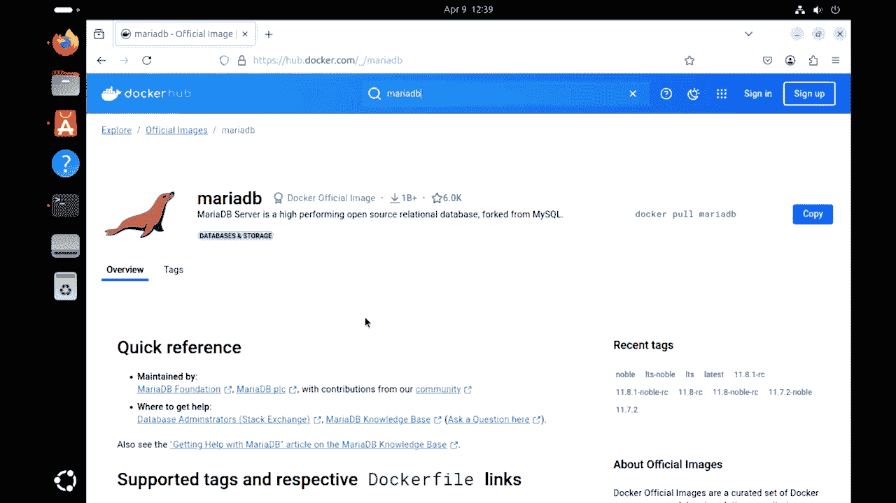

CompTIA Linux+ V8：09：🐳 使用 Docker 或 Podman 在 Linux 上运行容器

在本节课中我们将要学习在 Linux 系统中使用 Docker 或 Podman 来运行容器。我们会先认识这两个工具，接着了解如何安装它们，然后学习如何从镜像仓库获取镜像，最后通过实际命令启动容器并查看运行状态。

### 🛠️ Docker 与 Podman 的基本介绍

为了运行容器，你需要先了解可用的工具。本节我们来看看 Docker 和 Podman 是什么，以及它们之间有什么关系。

Docker 是一个比较老牌的容器平台，它在 2014 年开始引发容器技术的变革，直到今天仍然被广泛使用。Podman 是一个较新的解决方案，最早是在 Red Hat Enterprise Linux 中于 2018 年引入的。在 Red Hat 系列 Linux 发行版中，Podman 是默认的容器管理工具，不过它也可以在其他 Linux 发行版上使用。

Podman 的命令行接口被设计为与 Docker 的命令行接口完全兼容。因此，本节课中出现的所有 Docker 命令，你都可以把命令中的 Docker 替换成 Podman 来使用。如果你了解 shell 别名，也可以直接创建一个别名，让 Docker 和 Podman 互相替换。

核心概念如下：
```text
容器管理工具 = Docker 或 Podman
```

以下是两个工具的主要特点：
- Docker：2014 年兴起，应用广泛，社区资源丰富。
- Podman：2018 年由 Red Hat 推出，Red Hat 系发行版默认内置，与 Docker 命令兼容。

### 📦 安装 Docker 或 Podman

上一节我们介绍了 Docker 和 Podman 的基本概念，本节中我们来看看在不同系统上如何安装它们。

如果你使用的是 Red Hat 系列发行版，Podman 默认已经可用，你不需要做任何事情就可以开始使用。但是 Docker 在 Red Hat 系列发行版中不再受支持，如果你尝试安装 Docker，系统更新后很可能会出问题，所以不建议这样做。

如果你使用的是非 Red Hat 系列发行版，比如 Ubuntu 或 Debian，可以使用包管理器进行安装。安装 Docker 的命令是 sudo apt install docker.io，安装 Podman 的命令是 sudo apt install podman。

以下是安装命令示例：
```bash
sudo apt install docker.io
sudo apt install podman
```

### 🌐 访问容器镜像仓库

安装好容器工具之后，下一步是获取容器镜像。本节我们来看看镜像仓库是怎么回事。

运行容器之前，你需要访问镜像仓库。Docker Hub 是最大的镜像仓库，地址是 hub.docker.com，Docker 和 Podman 都可以使用它。即使可以匿名访问仓库，你也可能需要创建账号并登录，才能获取仓库提供的所有镜像。

登录镜像仓库可以使用 docker login 命令。比如 docker login docker.io 可以登录 Docker Hub，你也可以把 docker.io 替换成你想要登录的任何其他仓库名称。

核心概念如下：
```text
登录命令 = docker login <仓库名称>
```

以下是登录仓库的常见做法：
- 使用 docker login docker.io 登录 Docker Hub。
- 将 docker.io 替换成其他仓库名，登录私有或第三方仓库。

### ▶️ 运行容器的核心命令

知道了如何获取镜像，接下来就是启动容器了。本节我们来看看运行容器的主要命令。

启动容器的主命令是 docker run。执行这个命令时，容器镜像会首先被获取，也就是我们常说的拉取，即 pull。如果你使用短镜像名，镜像通常会从 Docker 仓库中拉取。你可以使用 docker search 命令，或者通过仓库的网页界面来搜索特定的镜像。

使用 docker run 时，如果不希望容器占据当前终端，记得加上 -d 选项，这样容器会在后台运行。如果容器镜像提供交互式终端，比如 Shell，你可以使用 docker run -i 来打开这个交互式终端。

核心概念如下：
```text
后台运行 = docker run -d <镜像名>
交互式终端 = docker run -i <镜像名>
```

以下是运行容器的常用选项：
- -d：让容器在后台运行，不占用当前终端。
- -i：打开交互式终端，适用于提供 Shell 的镜像。

### 🔗 使用完全限定容器名称



掌握了基本的运行命令之后，我们还需要知道如何指定特定仓库的镜像。本节我们来看看完全限定容器名称。

如果你想要指定来自其他仓库的镜像，可以使用完全限定容器名称，也就是 FQCN。而不是直接使用 docker run -d nginx，在 Podman 等环境中更推荐使用 docker run -d docker.io/library/nginx，这样拉取的是同一个镜像，但明确指定了仓库来源。

FQCN 通常可以直接从容器仓库中获取。在 Docker 仓库不是硬编码的环境中，使用 FQCN 是更好的选择。

核心概念如下：
```text
FQCN = 仓库地址 / 命名空间 / 镜像名
示例 = docker.io/library/nginx
```

以下是使用 FQCN 的示例：
- docker run -d docker.io/library/nginx

### 🔍 查看容器和镜像

启动容器之后，你需要知道容器是否真的在运行，以及本地有哪些镜像。本节我们来看看查看命令。

检查运行中的容器可以使用 docker ps，检查已下载的镜像可以使用 docker images。

核心概念如下：
```text
查看运行容器 = docker ps
查看本地镜像 = docker images
```

以下是查看命令的用途：
- docker ps：显示当前正在运行的容器，包括容器 ID、镜像名称、端口和容器名。
- docker images：显示已拉取到本地的镜像列表。

### 💻 Ubuntu 上的实操演示

理论部分介绍完了，接下来我们通过一个实际的演示来巩固知识。本节我们在 Ubuntu 系统上安装 Docker 并运行容器。

演示中选择 Ubuntu 的原因很简单，因为 Ubuntu 可以安装 Docker，而且安装 Docker 比在 Red Hat 系上开始使用 Podman 要复杂一些。如果你在 Red Hat 系系统上，可以直接把 docker 命令替换成 podman 命令，效果是一样的。

首先使用 sudo apt install docker.io 安装 Docker。安装过程会列出要安装的所有内容，确认继续即可。

安装完成后，如果普通用户想要运行 Docker 容器，该用户必须是 docker 组的成员，否则会出现权限不足的错误。你可以使用 usermod -aG docker student 命令，把用户 student 添加到 docker 组，需要使用 sudo 权限。

添加完成后，需要退出并重新登录，或者使用 newgrp docker 命令立即启用该组。之后再次运行 docker run -d nginx，就可以正常启动容器了。

核心概念如下：
```bash
sudo apt install docker.io
sudo usermod -aG docker student
newgrp docker
docker run -d nginx
```

以下是演示中的关键步骤：
- 安装 Docker：sudo apt install docker.io
- 将用户加入 docker 组：sudo usermod -aG docker student
- 立即生效组权限：newgrp docker
- 启动 Nginx 容器：docker run -d nginx

### 🔎 在 Docker Hub 查找镜像

容器已经启动了，接下来我们看看如何找到更多可用的镜像。本节我们来看看 Docker Hub 的使用。



在 Docker Hub 网站中有一个搜索框，你可以搜索想要运行的应用，比如 MariaDB，搜索结果会显示对应的镜像。即使你是 Podman 用户，Docker Hub 依然是寻找容器镜像的重要资源。

当你在 Docker Hub 上找到某个镜像并向下滚动时，会看到大量使用说明，这些说明会告诉你如何使用这个容器镜像。因此 Docker Hub 是开始寻找容器镜像的非常有价值的地方。

核心概念如下：
```text
搜索镜像 = Docker Hub 搜索框 + 应用名称
示例 = MariaDB
```

以下是使用 Docker Hub 的方法：
- 打开 hub.docker.com。
- 在搜索框输入要运行的应用名称，如 MariaDB。
- 查看搜索结果中的镜像及其使用说明。

### 📋 课程总结



本节课中我们一起学习了 Docker 和 Podman 的基本概念、在不同系统上的安装方法、如何访问镜像仓库、运行容器的核心命令、使用完全限定容器名称、查看容器和镜像的方法，以及在 Ubuntu 上的实际演示和 Docker Hub 的使用。
