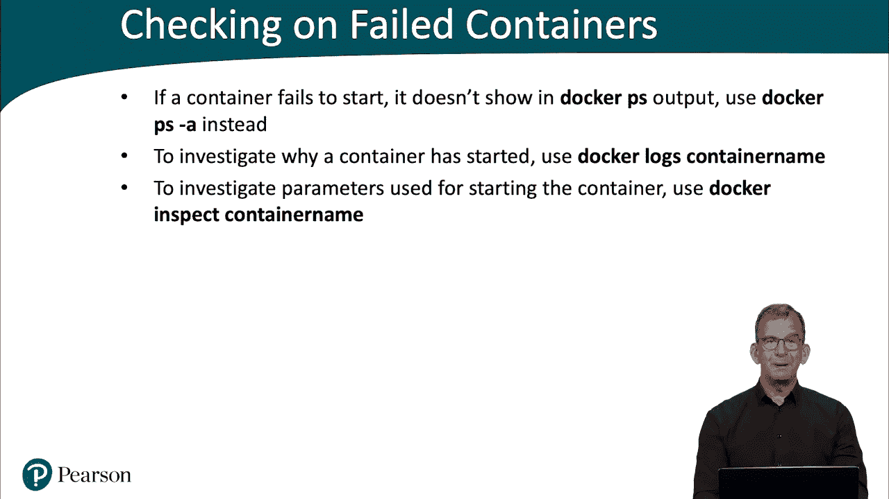
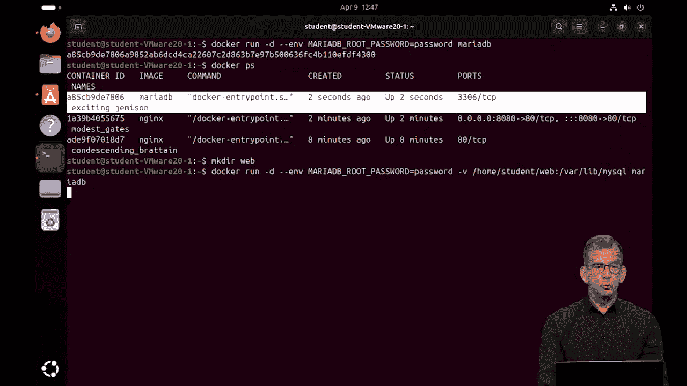

CompTIA Linux+ V8：第 10 章：管理容器 🐳


在本节课中，我们将要学习如何管理已经在运行中的 Docker 容器。我们会一起看看如何给容器传递启动参数，如何让外部通过端口访问容器内部的服务，如何让容器里的数据在容器删除后依然保留，以及当容器启动失败时该如何排查问题。所有内容都会用大白话讲解，即使你是第一次接触容器，也能看懂。这节课的目标是让你掌握容器管理的基础操作，为后续学习打下坚实基础。


## 1. 容器启动参数的位置规则

上一节我们简单了解了运行中的容器，本节中我们先来看看启动参数应该怎么写。

使用 Docker 启动容器时，参数的位置非常重要。你必须把参数放在 `docker run` 之后、镜像名称之前。也就是说，所有的启动参数必须紧跟在 `docker run` 后面，不能写在镜像名称的后面，否则 Docker 可能无法正确识别你的意图。这一点是后面所有操作的基础，所以请务必记住，不要把参数漏掉或放错位置。


```bash
docker run [参数] [镜像名称]
```


## 2. 配置端口转发

知道了参数的写法，接下来我们来看看如何让容器里的服务对外部可见。

默认情况下，容器内部监听的端口（比如 80 端口）只在容器内部有效，宿主机无法直接访问。如果你希望从宿主机访问容器里的 Nginx，就需要配置端口转发。具体做法是在启动时加上 `-d` 参数让容器在后台运行，再用 `-p 8080:80` 把宿主机的 8080 端口映射到容器的 80 端口。前面的数字代表宿主机端口，后面的数字代表容器内部端口，这样外部流量才能正确进入容器。


以下是端口转发的核心写法：

- `-d`：后台运行容器
- `-p 8080:80`：宿主机 8080 端口映射到容器 80 端口


## 3. 使用挂载提供持久化存储

端口通了之后，我们还需要考虑容器里的数据怎么保存。

容器默认是不持久化的，也就是说，容器一旦被删除，里面写入的所有数据都会跟着消失。为了解决这个问题，我们可以使用“挂载”技术，把宿主机上的一个目录直接关联到容器内部的某个目录。这样容器往里写数据时，实际上就是往宿主机目录写，即使容器删除了，数据依然在宿主机上保留，不会丢失。


```bash
docker run -d -p 8080:80 -v /宿主机/目录:/容器/内部/目录 [镜像名称]
```


## 4. SELinux 系统的额外配置

如果你使用的是 Red Hat 系列的系统，还需要注意一个特殊情况。

在带有 SELinux 的系统上（比如所有 Red Hat 系发行版），直接挂载目录可能会遇到权限限制。不过解决方法并不复杂，只需要在挂载参数后面加上 `:z` 标记即可。这样 Docker 就会给该目录打上正确的安全标签，容器就能正常读写了，不会报权限错误。




以下是 SELinux 环境下的挂载写法：

- `-v /宿主机/目录:/容器/内部/目录:z`：添加安全标签以满足 SELinux 要求


## 5. 为容器应用设置环境变量

除了端口和存储，很多应用还需要通过环境变量来初始化配置。

如果你要启动的容器应用需要环境变量，可以使用专门的参数来传递。比如启动 MariaDB 数据库时，你需要指定 root 用户的密码，否则数据库无法正常初始化。这时候就要在启动命令中加入环境变量设置，让容器应用在启动时就能读取到所需的配置信息。


以下是设置环境变量的示例：

- `--n`：用于传递环境变量（原文中用于设置数据库密码等配置）
- 示例：`docker run -d --n MARIADB_ROOT_PASSWORD=password mariadb`


## 6. 排查容器启动失败

启动容器时不一定总是顺利，有时候容器启动不起来，我们需要有排查手段。

当容器启动失败时，它不会出现在普通的 `docker ps` 输出中，因为 `docker ps` 默认只显示正在运行的容器。这时你应该用 `docker ps -a` 查看所有容器，包括启动失败的容器。想知道具体报错，可以用 `docker logs 容器名称` 查看启动日志；如果想查看启动时使用的详细参数，可以用 `docker inspect` 检查容器或镜像。这些命令能帮你快速定位问题所在。


以下是常用的排查命令：

- `docker ps -a`：查看所有容器，包括已停止和失败的容器
- `docker logs 容器名称`：查看容器启动时的错误输出
- `docker inspect 容器名称或镜像`：查看启动参数和详细配置


## 7. 实战演示：运行 Nginx 容器

理论介绍完了，我们开始动手操作，先启动一个 Nginx 容器。

执行 `docker run -d -p 8080:80 nginx` 之后，Docker 会在后台启动 Nginx 容器。然后用 `docker ps` 确认容器是否在运行，你会看到一个自动生成的容器名称，比如 `modest gates`，并且它正在监听本地主机的 8080 端口。接下来可以用 `curl localhost:8080` 验证流量是否被正确转发到容器内部。如果系统里没有 `curl` 命令，可以用 `apt install curl` 安装，我个人更倾向于使用 `apt` 包，因为速度更快，且适合纯命令行环境。执行成功后，你应该能看到 Nginx 的欢迎页面，这说明端口转发已经配置正确。


## 8. 实战演示：运行 MariaDB 容器并排查问题

接下来我们尝试启动 MariaDB 数据库容器，看看会遇到什么情况。

执行 `docker run -d mariadb` 时，Docker 先会在本地查找 MariaDB 镜像，如果找不到，就会自动从远程仓库拉取。镜像下载完成后再启动容器。不过启动后用 `docker ps` 查看，可能会发现 MariaDB 并没有出现在运行列表中。这时就需要用 `docker ps -a` 查看所有容器，你会看到一个状态异常的容器，比如名字是 `affectionate beni`。为了找出问题，使用 `docker logs 容器名称` 查看日志，你会看到提示数据库未初始化，并且没有指定密码选项。


## 9. 修正 MariaDB 启动命令

根据日志提示，我们需要重新启动 MariaDB 并指定 root 密码。

修正后的命令大致是 `docker run -d --n MARIADB_ROOT_PASSWORD=password mariadb`，再次执行后，用 `docker ps` 查看，就可以看到 MariaDB 已经正常运行了。这次启动成功是因为我们提供了必要的环境变量，让数据库知道该如何初始化。


## 10. 为 MariaDB 配置持久化存储

数据库容器跑起来之后，数据持久化也是必须考虑的问题。



默认情况下，容器内写入的数据不会保留，容器删除后数据就会丢失。为了避免这种情况，我们在宿主机家目录下创建一个名为 `web` 的目录，然后启动另一个 MariaDB 容器，使用挂载参数 `-v /home/student/web:/var/lib/mysql`。容器内部的 `/var/lib/mysql` 是 MariaDB 默认存放数据库文件的位置，这样容器向该目录写入数据时，实际上都会保存到宿主机的 `/home/student/web` 目录中，实现数据持久化。


## 11. 验证持久化存储与总结

最后我们验证一下数据是否真的持久化了。

使用 `docker ps` 确认容器正在运行，然后检查宿主机上的 `/home/student/web` 目录，你应该能看到 MariaDB 的数据文件已经出现在里面。这样即使容器被删除，数据依然安全保存在宿主机上。至此，我们对容器管理的简短介绍就结束了。如果你想深入了解，可以查看《容器入门》相关的录像课程。


本节课中，我们一起学习了如何管理 Docker 容器，包括启动参数的位置规则、端口转发配置、持久化存储挂载、SELinux 额外设置、环境变量传递，以及容器启动失败时的排查方法。通过 Nginx 和 MariaDB 的实战演示，我们也掌握了如何启动容器、验证服务可用性、排查启动错误，并确保数据不会随容器删除而丢失。希望这些内容能帮助你更好地掌握容器管理的基础技能。
