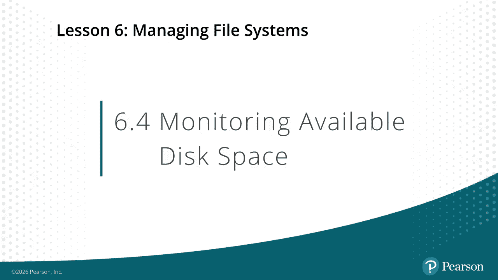
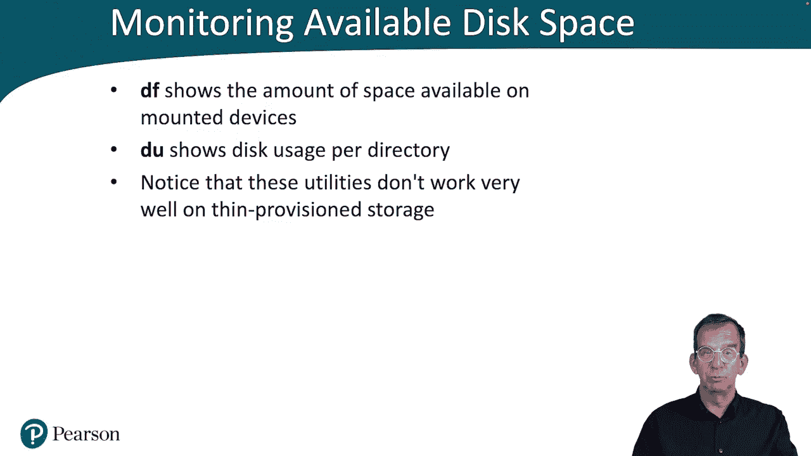
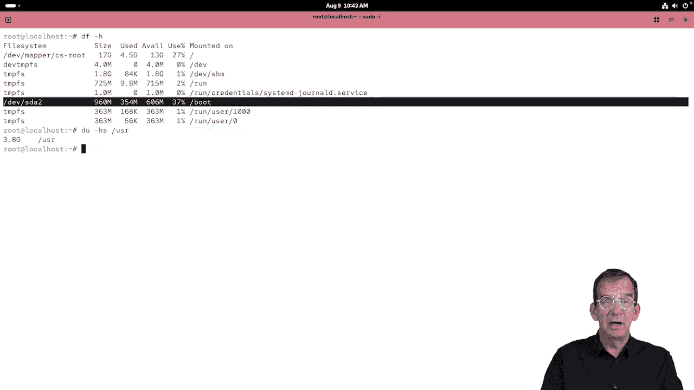

# CompTIA Linux+ V8：300.64：监控可用磁盘空间 💾

在本节课中，我们将要学习如何在 Linux 系统中监控可用磁盘空间。作为系统管理员，你还需要跟踪磁盘上的可用空间，这是保证系统正常运行的重要工作。本节课将重点介绍 DF 和 DU 这两个常用命令，并解释它们在不同存储环境下的表现。那么让我们来看看涉及的命令。最后，我们会通过具体示例演示如何查看实际的磁盘使用情况，帮助你快速上手。

## 磁盘空间监控的基本命令

上一节我们简单概述了本课的学习目标，本节中我们来看看系统管理员需要用到的核心命令。Linux 提供了一组专门的工具，用于帮助管理员完成磁盘空间监控工作。以下是与磁盘空间监控相关的主要命令：

- DF：显示已挂载设备上的可用空间量。
- DU：显示磁盘使用情况的汇总信息，可以查看特定目录下的文件占用空间。

## DF 命令详解

了解完基本命令之后，本节中我们先深入了解 DF 命令的具体作用和使用方式。DF 命令用于显示已挂载设备上的可用空间。它支持不同的选项，可以让你按照自己喜欢的方式查看显示结果。常见的核心用法如下：

`df`

如果你希望以更易读的格式查看，可以使用带选项的命令：

`df -h`

## DU 命令详解

介绍完 DF 命令之后，本节中我们来看看另一个实用工具 DU。DU 是 Disk Usage 的缩写，用于显示磁盘使用情况的汇总信息。它的一个好处是，你可以查看某个特定目录下包含多少文件以及占用多少空间。这对于排查哪个目录占用了大量磁盘空间非常有帮助。核心用法如下：

`du -hs /usr`

## 精简配置存储的注意事项

在使用上述工具之前，本节中我们需要了解一个重要的存储概念。你应该注意，这些工具在精简配置存储上工作得不太好。这是因为精简配置存储声称提供的存储比实际可用的更多。在这种存储环境下，显示值与实际值之间的关系可以用下面的公式表示：

`可用空间显示值 != 实际可用空间`

你可能会看到显示 20 GiB 可用，但实际上在写入 5 GiB 后，你的精简配置存储可能已经满了。因此在使用这些工具时，需要结合存储类型来判断结果是否准确，避免产生误解。

## 命令演示实例

理论介绍完毕，本节中我们来看看如何在实际系统中使用这些命令。首先，我们先使用 Df 减 H，即带 -H 选项的 DF 命令。我喜欢使用 -H 选项，因为减 H 提供人类可读的格式，单位更容易理解。在输出结果中，我们可以看到最重要的存储设备，它是卷组 CS 上的 LVM 逻辑卷 root，有 13 GiB 的可用空间。此外，我们还可以看到引导设备有 606 MiB 可用。这里需要说明，我刚才说的是千兆字节，其实是 GiB，因为 GiB 之类的是存储相关内容的默认显示单位。

接下来，如果你想看一个目录里有多少文件，可以在 USR 上使用 DU 减 Hs，例如针对 /usr 目录进行查看。命令需要计算一小段时间，然后在这里我们可以看到 USR 总共是 3.8 GiB 的可用存储。这就是你监控可用磁盘空间的方法。

## 总结

本节课中我们一起学习了如何监控 Linux 系统的可用磁盘空间。我们介绍了 DF 命令用于查看挂载设备的可用空间，介绍了 DU 命令用于查看特定目录的磁盘使用情况，并了解了精简配置存储可能导致显示结果与实际不符的问题。最后，我们通过 df -h 和 du -hs /usr 的演示，掌握了这两个命令的基本用法。

