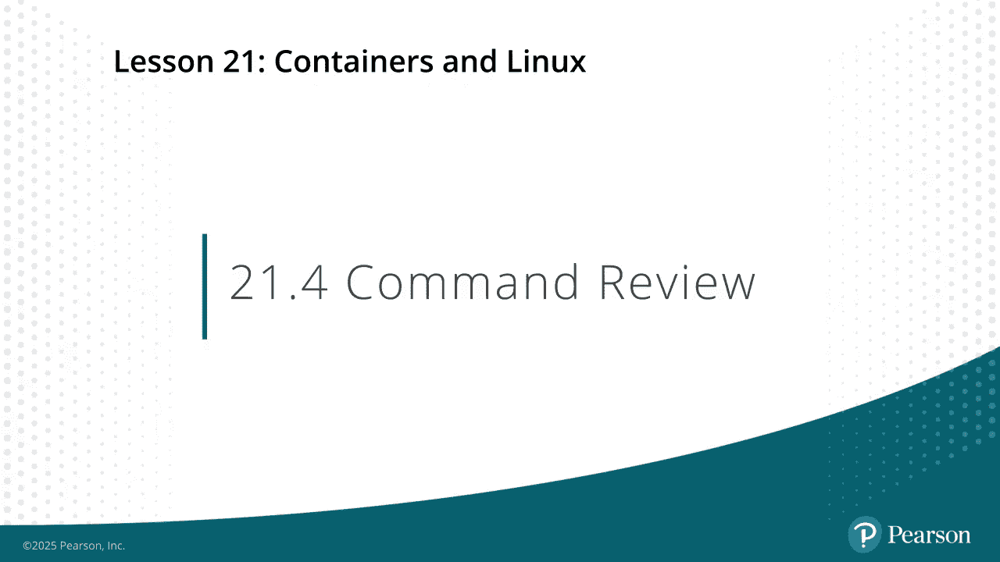
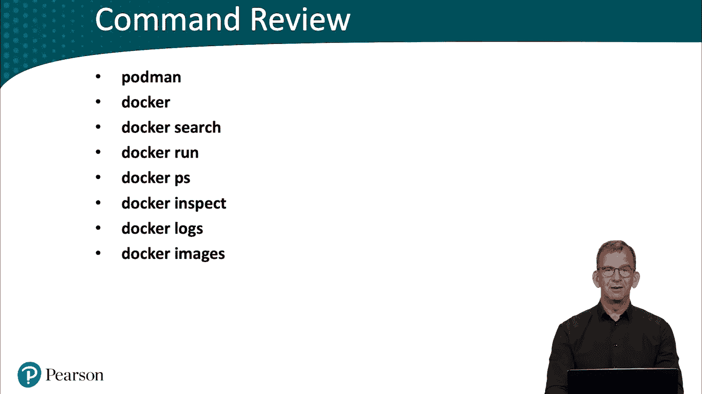

# 🐧 Linux命令教程：第11章：Docker容器管理命令复习

在本节课中，我们将一起学习本课里讲过的 Docker 相关命令，帮助你回顾在 Red Hat 及其系列系统上如何运行和管理容器。不管你是刚开始接触容器，还是已经有一点基础，这部分内容都能让你把之前零散的命令串联起来，形成一个完整的操作思路。

## 命令概述

这节课的核心内容就是把之前学到的 Docker 命令梳理一遍，让你对容器操作有个整体印象。我们不需要深入到非常复杂的底层原理，只需要知道每个命令大概是用来干什么的，以及在什么情况下应该使用哪个命令即可。

Podman 是用来在 Red Hat 及其系列系统上运行容器的工具，而 Docker 是一个通用的容器运行接口。如果你想查找可用的 Docker 镜像，可以使用 Docker search；如果你想启动一个容器，可以使用 Docker Run。Docker ps 能让你查看当前正在运行的容器概览，Docker inspect 则允许你查看容器内部的运行情况。Docker logs 可以获取容器的输出内容，在容器运行失败时非常有帮助。最后，Docker images 会列出所有已经下载的镜像，方便你确认本地有哪些镜像可用。

## 常用命令整理

下面是本节课涉及的主要命令，每个命令后面都说明了具体作用，你可以把它们当作速查表来使用：

- 查找镜像：`docker search <镜像名称>`
- 运行容器：`docker run <镜像名称>`
- 查看运行中的容器：`docker ps`
- 检查容器内部情况：`docker inspect <容器ID或名称>`
- 查看容器输出日志：`docker logs <容器ID或名称>`
- 列出已下载镜像：`docker images`

## 总结

本节课中，我们一起学习了 Docker search、Docker Run、Docker ps、Docker inspect、Docker logs 以及 Docker images 这些命令，掌握了在 Red Hat 系列系统上使用 Podman 和 Docker 进行容器管理的基础操作。希望你能把这些命令多敲几遍，熟能生巧后日常使用会更加得心应手。

