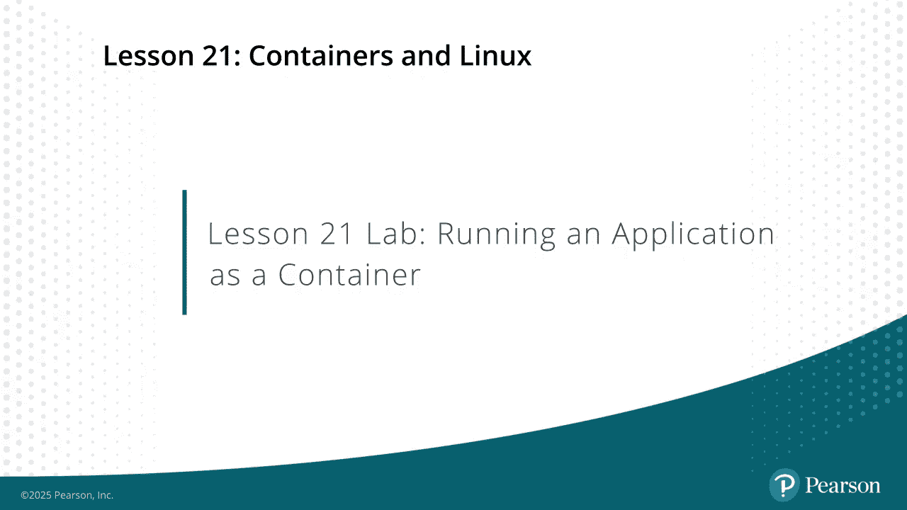
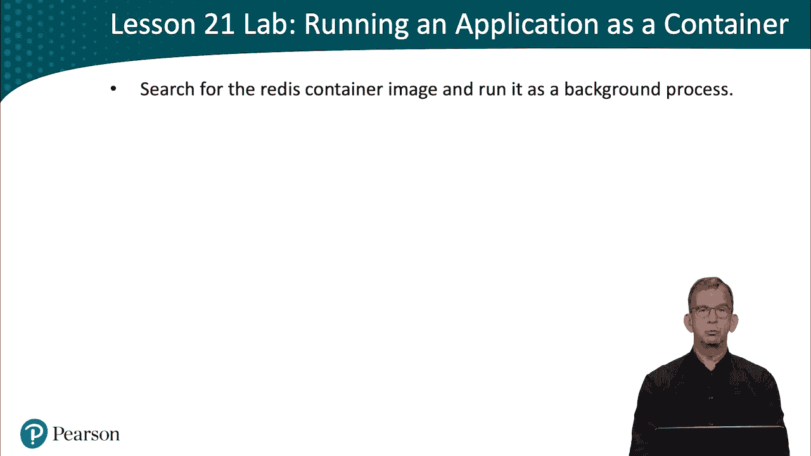

# 🐧 O'Reilly CompTIA Linux+ V8：212：在容器中运行应用程序


在本节课中，我们将要学习如何在 Linux 系统中使用容器技术来运行应用程序。具体来说，我们会聚焦于一个实际操作实验，也就是本节课的核心实践环节。在本节课的开始部分，我们会先回顾一下整个课程的进度，确保大家对之前学到的知识点有基本的印象。然后，我们将进入正题，针对本节课的实验任务展开详细说明。整个教程会用大白话来讲解，让没有任何容器基础的初学者也能听懂，并且能够顺利完成实验操作。


好了，既然我们已经来到本节课的结尾，让我们快速回顾一下刚才学习过的内容。这也是课程结束时的一个惯例，帮助大家把关键知识点在脑子里过一遍。所以在这个实验中，我们需要完成一个非常具体的任务。以下是本节课实验的主要任务说明：




- 搜索 Redis 容器镜像
- 将 Redis 容器作为后台进程运行


首先，我们来看看如何搜索 Redis 容器镜像。容器镜像可以理解为运行容器的模板，里面包含了应用程序运行所需的所有文件和配置。Redis 是一种常用的内存数据结构存储系统，经常被用作缓存或消息代理。在 Linux 系统中，我们通常使用容器引擎（比如 Docker 或 Podman）来查找和下载镜像。其核心命令格式大致如下：

```bash
# 伪代码示例，用于说明查找镜像的操作逻辑
查找镜像 redis
```

接下来，我们需要把这个 Redis 镜像作为后台进程来运行。所谓的后台进程，就是指容器启动后不占据当前终端界面，而是在系统后台静默运行，这样你就可以继续在同一个终端窗口里执行其他命令了。这在实际生产环境中非常常见，因为大多数服务都需要长期运行而不应该阻塞终端。运行容器的命令模式可以用下面这个伪代码来表示：

```text
运行容器命令 = 容器引擎命令 + 后台运行标志 + 镜像名称
```




在本节课中，我们一起学习了如何在容器中运行应用程序。我们回顾了本节课的结尾部分，并明确了实验任务，即搜索 Redis 容器镜像并将其作为后台进程运行。希望大家能够按照说明完成实验操作，掌握容器的基本使用方法。


