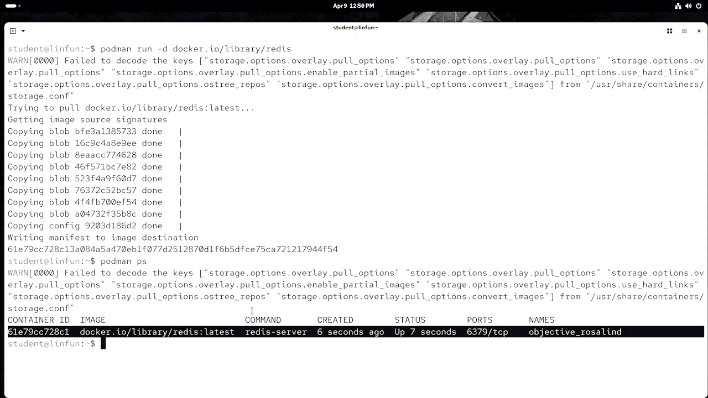

# 📦 CompTIA Linux+ V8：Lesson 21 实验解答：在容器中运行 Redis 应用程序

## 本节课概述

在本节课中，我们将一起完成第 21 课的实验解答，学习如何在 Linux 系统里使用 Podman 运行容器化应用程序。具体的任务是启动一个 Redis 容器，并且要确认这个容器已经在后台正常运行。这对于初学者来说是一个非常基础但又非常实用的容器操作场景，掌握之后可以帮助你更好地理解 Linux 上的容器管理工作。

## 使用 Podman 搜索 Redis 镜像

接下来我们先来看看搜索镜像的过程。以下是具体的操作步骤。

在这个实验里，我们需要使用 Podman 工具来搜索 Redis 镜像。当你执行搜索命令的时候，屏幕上可能会显示一些错误提示信息，这些信息看起来可能让人感到困惑，但实际上并不影响后续操作。通过查看这些输出内容，我们可以找到 Redis 镜像对应的完全限定容器名称，也就是 FQCN。拿到这个名称之后，建议把它复制下来，这样在下一步启动容器时就可以直接使用，不需要手动输入。

核心命令如下：

```
podman search redis
```

其中 FQCN 的含义是完全限定容器名称，用于唯一标识容器镜像的完整地址。

## 在后台启动 Redis 容器

拿到镜像名称之后，下一步就是启动容器了。以下是启动操作的说明。

启动容器的操作其实并不复杂，只需要使用 `podman run` 命令加上 `-d` 参数即可。这里的 `-d` 参数表示 detached，也就是让容器在后台运行，不会占据当前终端窗口。然后把刚才复制的完全限定容器名称粘贴进命令里，这里对应的镜像地址是 `docker.io/library/redis`。执行完这个命令之后，容器就会自动在后台启动并开始运行。

核心命令如下：

```
podman run -d docker.io/library/redis
```

## 忽略无关错误并确认容器运行

容器启动之后，我们需要确认运行状态。以下是检查时需要注意的要点。

在命令执行过程中，你可能会看到屏幕上显示一些错误信息，这些错误可以安全忽略，不需要进行特殊处理，也不会影响容器的正常启动。真正需要关注的是，Podman 工具显示 Redis 容器已经打开并且正在运行，这就是本实验要求我们完成的最终目标。只要能看到容器处于运行状态，就说明任务已经完成。



## 本节课总结


在本节课中，我们一起学习了如何使用 Podman 搜索 Redis 镜像，获取并复制完全限定容器名称，使用 `podman run -d` 在后台启动容器，以及如何忽略无关错误并确认容器正在运行。希望这些内容能帮助你更好地掌握 Linux 上的容器操作方法。

