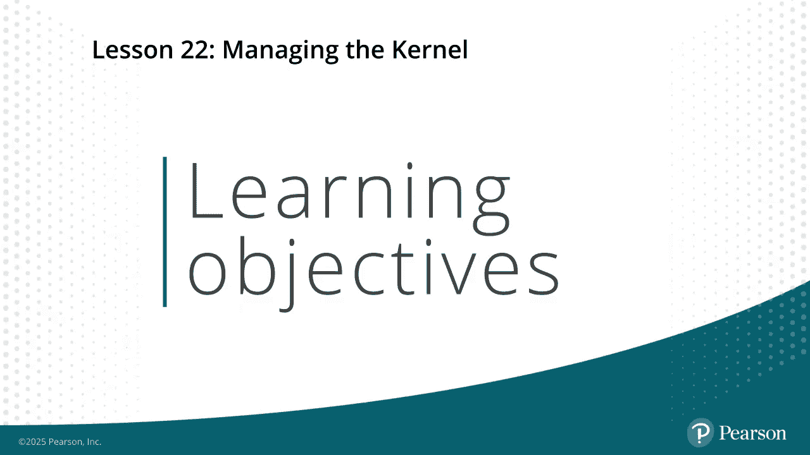
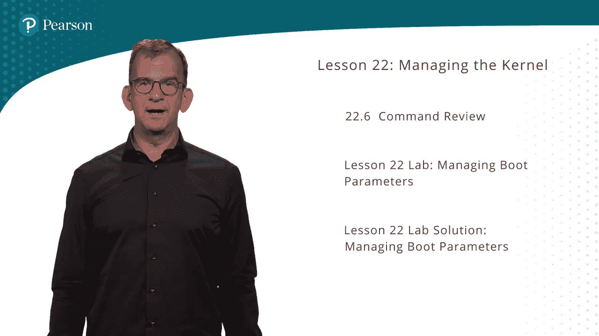

# CompTIA Linux+ V8：part3 p14 214：学习目标 🐧

## 课程概述

在本节课中，我们将一起学习 Linux 内核的基础知识，了解系统启动的整个流程，以及如何通过启动参数来改变启动方式，还会看到驱动程序是如何被加载的，最后还会通过 proc 文件系统来查看和修改内核属性。这节课的内容比较基础，非常适合刚接触 Linux 的同学，即使你之前从来没有碰过内核相关的概念，也能跟上节奏。



## 本节课的主要内容

下面我们先来看看这节课会具体讲些什么，这样你对整体的学习路线会更清楚。

以下是本节课的主要知识点：

- 这节课会先讲解 Linux 内核到底在做些什么，帮你建立对内核工作方式的初步认识。
- 接下来你会学习 Linux 系统是如何启动的，以及如何通过输入启动参数来改变 Linux 的启动行为。
- 后面的视频会介绍设备驱动程序是如何被加载的，并演示如何使用 Proc 文件系统来查看和修改内核属性。
- 在本节课的最后，你会有机会动手操作内核相关的内容，随后可以通过实验室解答来核对自己的练习结果。

## Linux 内核的工作原理

上一节我们简单提到了操作系统的组成，本节中我们来看看内核到底在做什么。内核就像是电脑里的一个管家，它负责管理硬件资源，比如 CPU、内存和各种外设，同时还要为应用程序提供运行环境。简单来说，没有内核，你的软件就无法和硬件正常通信，整台计算机也就无法正常工作。

核心概念可以用下面这个伪代码来描述：

```text
内核 = 硬件管理 + 系统调用接口 + 进程与内存调度
```

## Linux 系统启动与引导参数

刚才我们介绍了内核的基本职责，本节中我们来看看 Linux 是如何启动的。当你按下电源按钮后，计算机会经历一系列加载步骤，最终把内核放入内存并开始运行。在这个过程中，你还可以通过输入启动参数来改变系统的启动方式，比如指定不同的启动模式或者关闭某些服务，这在排查系统故障时非常有用。

以下是常见的启动参数示例：

```bash
# 进入单用户模式
single

# 禁用图形界面，直接进入命令行
text

# 设置根文件系统位置
root=/dev/sda1
```

## 设备驱动程序与 Proc 文件系统

学完启动流程之后，本节中我们来看看驱动程序是如何被加载的。驱动程序是内核和硬件设备之间的桥梁，没有合适的驱动，硬件设备就无法正常工作。除了驱动加载，你还可以通过 Proc 文件系统来查看内核的当前状态，甚至在系统运行期间修改某些内核属性，而不需要重新启动计算机。

常用的 Proc 文件系统路径示例如下：

```bash
# 查看内核版本信息
cat /proc/version

# 查看 CPU 详细信息
cat /proc/cpuinfo

# 查看内存使用情况
cat /proc/meminfo
```

## 实践练习与验证

前面几节我们讲了很多理论知识，本节中我们来看看如何动手实践。在本节课的最后部分，你会得到一个操作机会，尝试在系统中操作内核相关的内容。完成练习之后，建议你对照实验室提供的标准答案来核对自己的工作，确保每一步都做正确，如果有地方做不对，可以回头再看一遍视频。



## 本节总结

本节课中我们一起学习了 Linux 内核的基本功能、系统启动流程以及如何通过引导参数修改启动行为，还了解了设备驱动程序的加载方式，并掌握了使用 Proc 文件系统查看和修改内核属性的方法。希望这些内容能帮你打好 Linux 内核管理的基础，为后续的学习做好准备。

