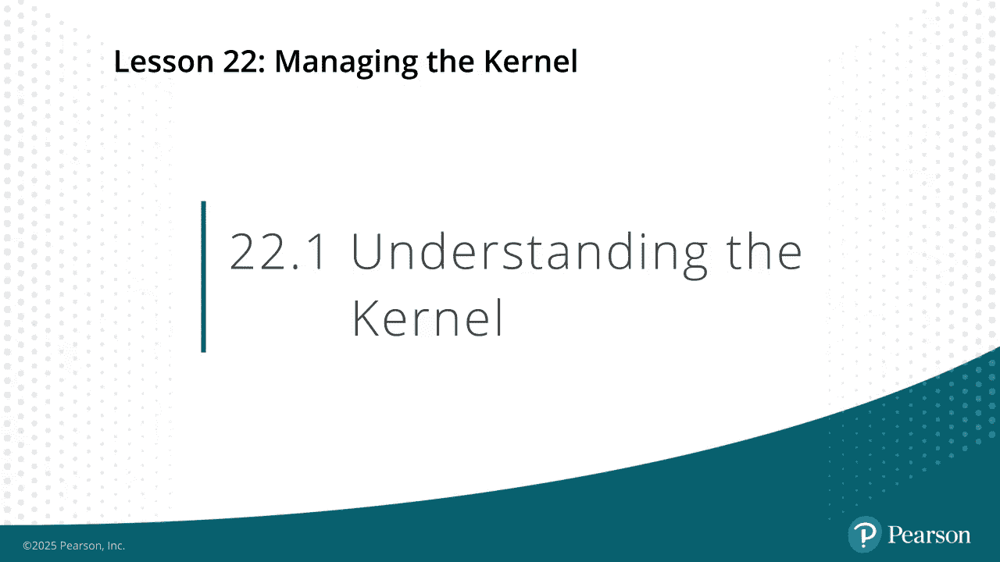
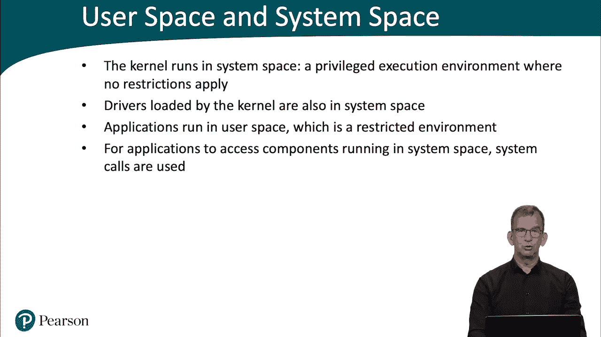

# 🐧 CompTIA Linux+ V8：15：理解内核


在本节课中，我们将一起学习操作系统中最核心的部分——内核。你将了解内核到底是什么，它负责哪些具体工作，以及用户空间和系统空间之间有什么区别。除此之外，我们还会聊聊系统调用，看看应用程序是如何请求内核帮忙的。通过这节课，你会对 Linux 内核的作用有一个直观的认识，即使是完全没有相关基础的初学者也能听懂。




## 一、什么是内核

让我们先来谈谈内核。要使用计算机硬件，必须有内核。内核包含操作系统的核心组件，并且可以动态加载驱动程序。它不仅负责确保系统的安全性，还要保证系统运行稳定，同时让性能保持在较好的水平。如果没有内核，普通的应用程序根本没法直接去操作硬件。

内核实际上是操作系统中最基本的部分，它承担着多项重要职责。下面是内核主要负责的几个方面：

- 进程管理，决定哪个程序什么时候运行。
- 内存管理，分配和回收内存空间。
- 文件系统管理，处理文件的读写和存储。
- 设备管理，控制键盘、鼠标、硬盘等硬件设备。
- 网络管理，处理网络数据的发送和接收。
- 中断处理，响应硬件发出的紧急信号。
- 硬件通信，让系统能和硬件正常对话。

可以用下面这个简单的公式来表示内核的职责范围：

内核职责 = { 进程管理, 内存管理, 文件系统管理, 设备管理, 网络管理, 中断处理, 硬件通信 }


## 二、用户空间与系统空间

上一节我们介绍了内核的基本职责，本节中我们来看看内核是如何和外部世界打交道的。为了更好地理解，我们需要把系统分成两个区域：用户空间和系统空间。

系统空间是一个特权执行环境。在这个环境中，没有限制，因为内核需要完全访问硬件。驱动程序也被称为内核模块，它们同样属于系统空间的一部分。内核通过驱动程序来控制硬件设备。

而应用程序通常运行在用户空间。用户空间是一个受限环境，应用程序不能直接去碰触硬件，也不能随意修改系统的核心数据。这种限制是为了保护系统安全，防止一个有问题的应用程序把整个系统搞崩溃。

如果应用程序需要访问系统空间中的组件，就像刚才提到的那样，就会使用系统调用。继续之前，我想画个图，让用户空间和系统空间到底在做什么变得更清晰。

用户空间和系统空间的关系可以用下面这段简单的代码结构来描述：

```
[ 用户空间：受限环境，运行应用程序 ]
        ↓ 系统调用
[ 系统空间：特权环境，内核和驱动程序 ]
        ↓ 硬件访问
[ 物理硬件：CPU、内存、磁盘、网卡等 ]
```


## 三、系统调用

刚才我们提到了用户空间和系统空间，本节中我们来详细说说系统调用。系统调用是用户空间程序和内核之间沟通的桥梁。

如果你在用户空间中的某个应用程序需要与内核通信，它会使用所谓的系统调用。系统调用是一条底层指令，除非你主动搜索或使用审计子系统，否则平时几乎接触不到。也就是说，普通用户在写应用程序时，通常不会直接去写系统调用，而是通过操作系统提供的库函数来间接使用。

系统调用的工作流程可以简化为：

用户空间应用程序 → 发起系统调用 → 进入系统空间 → 内核处理请求 → 返回结果给应用程序


## 四、驱动程序与内核模块

在了解了系统调用之后，本节中我们来看看驱动程序和内核模块。驱动程序是内核用来控制硬件的工具。

内核通过驱动程序来访问硬件，而驱动程序又被称为内核模块。这些模块属于系统空间，可以动态加载，也可以在不需要时卸载。这种设计让 Linux 系统非常灵活，不需要重启电脑就可以加载新的硬件驱动。


## 五、总结



本节课中，我们一起学习了内核的基本概念，了解了它是操作系统中最基本的部分，并且负责进程、内存、文件系统、设备、网络、中断和硬件通信等多项工作。我们还区分了用户空间和系统空间，知道了系统空间是特权环境，用户空间是受限环境。最后，我们学习了系统调用，明白了应用程序是如何通过系统调用请求内核服务的，也了解了驱动程序也就是内核模块在其中的作用。希望这节课能帮你建立起对 Linux 内核的初步认识。

