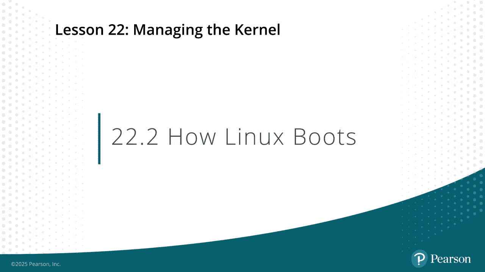
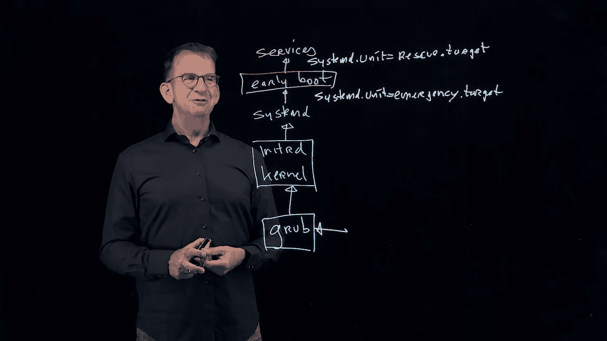

# CompTIA Linux+ V8：16：Linux 系统启动流程 🐧

## 课程概述

在本节课中，我们将一起学习 Linux 系统启动时到底发生了什么。我们会从计算机通电开始，一直聊到你最终进入可用的命令行界面。内容包括引导程序 GRUB 的作用、内核加载过程、initrd 辅助组件的功能，以及 systemd 如何分阶段启动系统。最后，我们还会讲解当系统无法正常启动时，如何通过 GRUB 菜单进入紧急模式和救援模式进行故障排查。所有内容都会用大白话讲解，确保完全没有 Linux 基础的学习者也能看懂。系统启动的大致顺序可以用简单的流程表示：`GRUB → 内核 → initrd → systemd`。

## 第一部分：GRUB 引导加载程序 🖥️

上一节我们简单提到了 Linux 启动的大致流程，本节中我们来看看启动的第一步是什么。当你的 Linux 系统启动时，最先发生的事情是 GRUB 启动。GRUB 的全称是 Grand Unified Bootloader，中文可以理解为统一引导加载程序。这个 Grand Unified Bootloader 自带一个 GRUB shell，也就是一个命令行界面。这个 GRUB shell 非常方便，可以让你在系统正式启动之前，干预并改变 Linux 的启动方式，比如临时修改启动参数或选择不同的内核版本，而不需要重新安装系统。

当 GRUB 把控制权交出去之后，接下来由 Linux 内核接管。内核加载的时候会随带一个辅助组件，这个辅助组件的名字就是 initrd。在你使用的 Linux 发行版中，它也可能被称为 initramfs，不管发行版怎么称呼，这两个名字对应的功能是完全一样的。无论你把它叫做 initrd 还是 initramfs，它里面都包含系统启动所必需的必要驱动程序，没有这些驱动，内核可能无法识别硬盘或文件系统，系统也就无法继续启动下去。

以下是启动早期涉及的主要组件：
- GRUB 统一引导加载程序
- Linux 内核
- initrd 或 initramfs 初始磁盘镜像

## 第二部分：systemd 的启动阶段 ⚙️

接下来我们继续看内核和 initrd 完成工作后会发生什么。下一个被加载的核心组件是 systemd，systemd 是现代 Linux 发行版中广泛使用的系统和服务管理器。systemd 不会一次性把所有东西全部启动完毕，而是按照不同的阶段逐步推进启动流程。为了方便你理解，这里我们需要用不同方式来标记不同阶段，因为系统此时已经进入了启动流程的另一部分区域。

我喜欢把其中一个阶段叫做 early boot，也就是早期启动。在 early boot 阶段，系统会加载所有最基本的必要系统组件，这些组件是让计算机能够运转的最低限度条件。early boot 结束之后，系统会进入下一个阶段，开始加载各种系统服务。等到所有服务都准备就绪，启动过程就算完成了，此时你会进入一个可用的命令行 shell 界面，就可以正常登录和使用系统了。

以下是 systemd 启动阶段的划分说明：
- early boot：加载最基础的必要系统组件
- 服务启动阶段：加载常规系统服务
- 启动完成：进入可用的命令行 shell

## 第三部分：启动故障排查与模式选择 🔧

如果系统启动过程中出现问题，你需要知道如何通过 GRUB 引导菜单来进行干预。你可以进入 GRUB 引导菜单，在 GRUB 引导菜单里输入不同的启动参数，来改变系统的启动行为。这里有两个最关键的参数需要重点记住。第一个关键参数是 `systemd.unit=emergency.target`，使用这个参数会把系统引导进入 emergency target，也就是紧急目标模式。这个模式会在 early boot 之前就介入，所以系统只加载极少量的服务。服务越少，出错的可能性就越低，故障排查也就更容易一些。

不过，如果你已经确定问题不出在 early boot 阶段，那么直接进入紧急模式可能未必是最佳选择，因为此时可用的系统功能太少了。更明智的做法是让系统启动得再远一点，然后使用 GRUB 启动参数 `systemd.unit=rescue.target`。这会让系统进入另一种救援模式，但在该救援模式中，系统已经完整通过了 early boot 阶段，因此更多正常运行的系统部分都可用。这样你在保留更多功能的同时，也能更方便地修复系统问题。

以下是两种故障模式的参数对比：
- `systemd.unit=emergency.target`：紧急模式，加载最少服务，适合早期启动故障
- `systemd.unit=rescue.target`：救援模式，更多服务可用，适合后期启动故障

## 课程总结

本节课中，我们一起学习了 Linux 系统启动的完整流程。首先介绍了作为第一步的 GRUB 引导加载程序及其 GRUB shell，接着解释了内核加载后随带的 initrd 辅助组件及其包含的必要驱动。随后详细说明了 systemd 如何分阶段推进启动，从早期启动到常规服务加载，最后进入命令行界面。最后，我们掌握了在 GRUB 菜单中使用 `systemd.unit=emergency.target` 和 `systemd.unit=rescue.target` 两个参数，分别进入紧急模式和救援模式进行故障排查的方法。希望这些内容能帮助你更好地理解 Linux 启动过程，并解决实际的启动故障。

