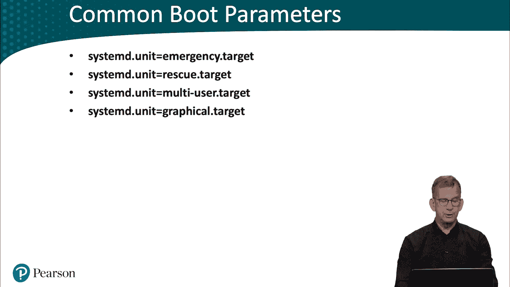

# CompTIA Linux+ V8：17：进入引导参数 🐧

在本节课中，我们将要学习如何在 Linux 系统启动时输入引导参数，从而改变系统的启动方式。我们会先了解什么是引导参数，以及如何进入 GRUB 引导菜单，然后重点介绍 systemd.unit 参数和几种常见的启动目标，最后通过红帽系系统和 Ubuntu 两个发行版的实际演示，让你明白在不同系统上使用 emergency.target 时需要注意什么。

引导参数是在系统启动过程中传递给内核的特殊指令，用于临时改变启动行为。所有在启动时输入的引导参数都是非持久化的，也就是说重启后就会失效，主要用于故障排除场景。你可以在 GRUB 提示符下输入这些参数，而要访问 GRUB 引导菜单，通常需要在启动的正确时机按下 Esc 键。找准这个时机并不总是容易，所以建议多尝试几次，我相信你一定能成功。另外，如果某次系统启动没有完成，下次启动时 GRUB 引导菜单会自动出现，这样即使你第一次没能进入，也可以通过重置机器并在重启时再次尝试，自动看到引导提示符。

有了这些基础认知后，我们来看看最常用的引导参数具体有哪些。最常用的引导参数是 systemd.unit，后面需要跟上你想要使用的 systemd 单元名称，核心关系可以简单表示为：

启动行为 = systemd.unit + 目标单元名称

以下是几种常见的启动目标及其作用：

- emergency.target：紧急故障排除模式，只加载最基本的系统组件。
- rescue.target：救援模式，比紧急模式稍微进一步，提供更多可用服务。
- multi-user.target：完整的多用户操作环境，不带图形界面。
- graphical.target：图形化目标，这是大多数图形化 Linux 操作系统正常启动时默认进入的目标。

接下来我们开始实际操作，看看如何与 GRUB 引导菜单交互。上一部分内容我们介绍了引导参数的基本概念和常见目标，本节中我们来看看在红帽系系统上具体怎么操作。

首先需要重启系统，并且要在正确的时机按下 Esc 键。我的小技巧是：当你看到光标出现时，就在那一刻按下 Esc，通常就能成功。不过这可能取决于你使用的发行版，这里不能做绝对保证。如果你无法进入 GRUB 引导菜单，可以重置虚拟机，并在它重启的时候再次尝试。进入菜单后，选择一个引导条目并按下 e 键，就可以编辑不同的启动选项了。在这里最重要的是找到以 Linux 开头的那一行，这一行负责启动 Linux 内核，也就是你能看到的 vmlinuz 文件。目前这些参数已经足够，但我不喜欢 rhgb 和 quiet，所以先把它们去掉，这是一个不错的开始。接下来我要使用 systemd.unit 参数，指定为 emergency.target。

在基于红帽的系统上，如果你想启动 emergency.target，必须先设置好 root 密码，否则这个目标无法正常工作。这里我使用 Ctrl+X 组合键来启动，然后就可以观察系统的反应。问题是，emergency.target 会加载一个名为 /sbin/login 的程序，这是登录程序，属于额外的保护层。如果你没有设置 root 密码，这个命令就不会起作用。从这个界面进入之后，你可以进行任何你想要的故障排除操作。不过我本人对故障排除不感兴趣，所以我打算重启系统，并展示在 Ubuntu 上会是什么样子，回到 Ubuntu 之后我也会使用 sudo reboot 命令重启。

当你看到光标重复出现时，按下 Esc 键，现在我已经进入了引导菜单，接下来我再次按下 e 键来编辑 GRUB 引导菜单。在这里同样有一行以 Linux 开头，看起来没问题，但有个地方看起来不太对劲，就是 quiet 和 splash 这两个参数。我真的不喜欢 quiet 和 splash，因为它们会隐藏启动过程中的信息，而我希望在启动时能看到系统在做什么，这样如果需要进行故障排除，会更容易发现问题。现在我想向你展示 systemd.unit=emergency.target，因为你需要理解它在 Ubuntu 上的工作原理。在 Ubuntu 中，root 用户默认是没有密码的，那么这里会不会失效呢？看看这个结果，Ubuntu 提示你按回车进入维护模式。这与红帽系系统的紧急目标有所不同，在 Ubuntu 的 emergency.target 结束时，并没有 /sbin/login 程序。所以我按下回车，然后就进入了 root shell，即使 root 用户没有设置密码，这个操作也能完美运行。

实操演示结束后，我们回顾一下本节学到的重点内容。在本节课中，我们一起学习了如何进入 GRUB 引导菜单，如何编辑启动参数，以及如何使用 systemd.unit 参数切换不同的启动目标。我们还分别在红帽系系统和 Ubuntu 上演示了进入 emergency.target 的过程，并了解了两者在 root 密码要求上的区别。希望这些内容能帮助你更好地掌握 Linux 引导故障排除的基础知识。
