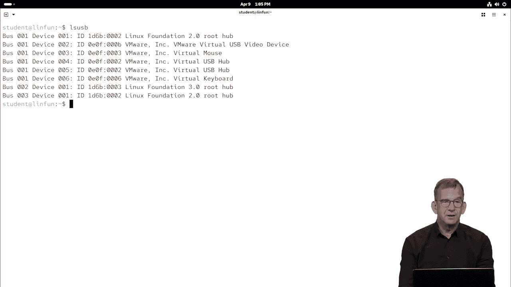
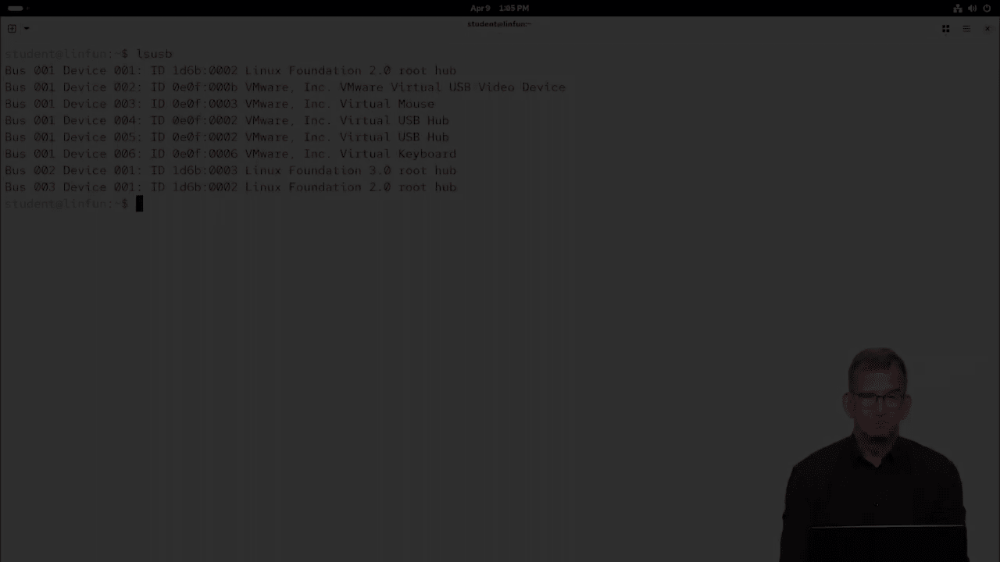

# CompTIA Linux+ V8：18：Linux中驱动程序是如何加载的 🚀

在本节课中，我们将一起学习Linux系统是如何加载硬件驱动程序的，以及日常排查硬件问题时常用的命令有哪些。驱动程序是操作系统与硬件之间沟通的桥梁，没有合适的驱动，即使是最好的硬件也无法正常工作，所以理解驱动加载机制对学习Linux非常重要。

当你安装Linux系统的时候，系统会生成一个特殊的镜像文件，这个文件叫做初始化RAM文件系统，通常简写为`initramfs`，老一点的系统里也叫`initrd`。这个镜像是在Linux内核启动的时候被加载进去的，里面包含了安装过程中检测到的关键硬件驱动，目的就是让你能够正常使用电脑上最重要的硬件，比如磁盘控制器和键盘之类的东西，否则系统根本没法启动。

不过这个`initramfs`只负责最基本的硬件。对于其他的硬件设备，Linux在启动过程中或者当你插入新设备的时候，会由一个名为`systemd-udev`的进程来处理，它充当即插即用管理器，可以根据需要动态加载驱动，让硬件在插上就能用。

当然，除了系统自动加载，你也可以手动干预。这时就要用到`modprobe`命令了，它可以让你手动加载内核模块，这些内核模块本质上就是设备驱动程序。

如果你想知道当前系统里到底加载了哪些驱动，可以使用`lsmod`命令，它会列出当前所有已经加载的内核模块。另外还有`lspci`命令，它用来显示PCI设备，加上`-k`参数还能显示每个设备具体用了哪个内核模块。对于USB设备，可以用`lsusb`命令来查看USB总线以及挂在上面的所有设备。

以下是常用的驱动查看与管理命令：
- `lsmod`：显示当前已加载的内核模块列表。
- `lspci -k`：显示PCI总线上的设备，以及每个设备当前使用的内核模块。
- `lsusb`：显示USB总线及所有已连接的USB设备信息。
- `modprobe <模块名>`：手动将指定的内核模块加载到内存中。
- `modprobe -r <模块名>`：从内存中移除指定的内核模块。

在实际演示中，管理员先用`sudo lsmod`查看当前系统里有哪些可用模块，但单看这个列表意义不大，所以更常用的是`sudo lspci -k`。这条命令会展示PCI总线上的每一个设备，并且旁边会标注对应的内核模块，比如以太网控制器对应的模块可能是`e1000e`。

再来看显卡设备的例子。在虚拟机环境下，你可能会看到VGA兼容控制器，对应的驱动是`vmwgfx`，也就是VMware图形驱动，这个驱动是由虚拟化工具提供的，通常不需要你手动去修改或更换。

手动加载或移除模块的操作比较少见，日常使用中大部分情况下系统会自动处理。不过如果你插入了USB设备，`lsusb`命令就会派上用场，它能告诉你USB总线上发现了哪些设备，帮助你确认硬件是否被系统识别。

内核模块本身很有趣，Linux内核是开源的，为大多数设备都提供了模块，但有些情况下你可能更想使用专有的内核模块，比如你装了一块昂贵的NVIDIA显卡用来做AI计算，这时候就需要厂家提供的专有驱动，而不仅仅是开源模块，这部分内容稍微超出了本节课的范围，但你可以自己去探索。

本节课中我们一起学习了Linux中驱动程序的加载机制，包括`initramfs`/`initrd`镜像在启动时的作用，`systemd-udev`作为即插即用管理器的职责，以及`modprobe`、`lsmod`、`lspci`和`lsusb`等常用命令的使用方法，同时也了解了开源内核模块与专有驱动之间的区别。

