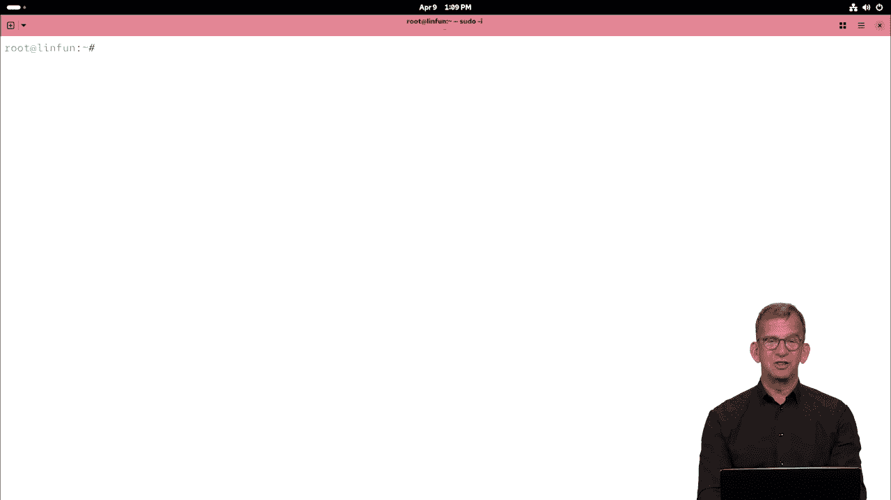
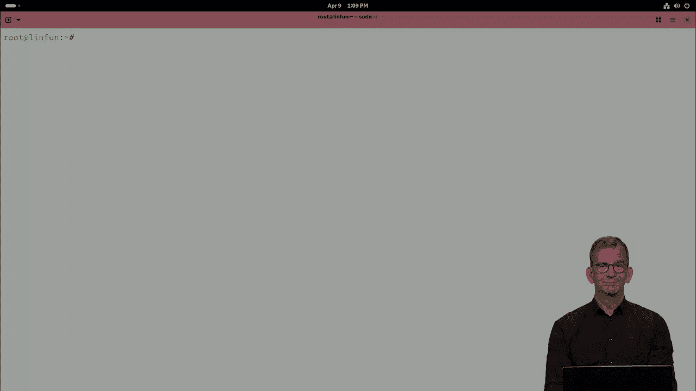

# 🐧 Linux 基础教程：19：proc 伪文件系统详解

在本节课中，我们将一起学习 Linux 内核中一个非常重要的部分，也就是 proc 文件系统。你会了解到它是什么，里面保存了哪些信息，以及如何通过它查看系统运行状态和调整内核参数。这篇教程会用大白话把每一个概念讲清楚，即使你是初学者也能轻松跟上。


proc 文件系统是 Linux 内核的重要组成部分。它被称作一种伪文件系统，用于提供对内核设置和参数的访问。拥有这个文件系统非常好，因为它提供了一个简单的界面，让你能够查看系统内部运行情况，并对参数进行微调。


在 proc 文件系统中，你会发现三种主要类型的文件。


以下是 proc 文件系统中包含的三种主要文件类型：

- 状态文件，例如 `/proc/meminfo`，用于对内核的各个部分提供详细的洞察。
- `/proc/sys`，其中包含内核可调参数。
- `/proc/PID`，这是一个直接的结构，包含关于 Linux 系统上运行中的进程的详细信息。


我们来实际看看 proc 文件系统是如何工作的。比如，如果我想查看系统内存的真实运行情况，可以查询这里的文件。我可以使用 `less` 命令查看 `/proc/meminfo` 文件，从而深入了解 Linux 中内存的使用方式。这本身可能需要一门专门的课程才能讲完，但了解这些细节是非常容易获取的，这也是件好事。


我也很喜欢 `/proc/sys` 目录。在进入那里之前，我先打开一个 root 权限的 Shell，这样在 `/proc/sys` 中操作会方便一些。在这个目录下，你会看到不同的子目录，它们对应内核提供的所有接口。


以下是 `/proc/sys` 下常见的子目录及其含义：

- 各个子目录对应内核提供的不同接口。
- 其中一个子目录是 `vm`，`vm` 与虚拟内存相关。
- 在 Linux 术语中，虚拟内存是指 Linux 系统正在使用的全部内存。


接下来，我想在这里向你展示它是如何工作的，并聊聊一个具体的参数。我使用 `cat` 命令查看 `swappiness` 参数，可以看到它的值是 30。

```bash
cat /proc/sys/vm/swappiness
```

`swappiness` 参数的取值范围在 0 到 100 之间，可以用公式表示为：

`0 ≤ swappiness ≤ 100`

数值表示内核在内存不足时开始交换（swapping）的积极程度。数值越接近 100，内核开始交换的速度就越快。如果我不喜欢当前的 30，希望内核更快地开始交换，我可以把新值 `echo` 进 `swappiness` 参数中。

```bash
echo 新值 > /proc/sys/vm/swappiness
```

更改内核参数的唯一方法就是通过 `echo` 命令将新值写入 proc 文件系统中的对应文件。之所以这样，是因为 proc 文件系统本质上是一个假的文件系统，它并不是真正存在于磁盘上的东西，而是一个面向内核的接口，因此适用不同的规则。


最后一部分是 PID 目录。每个进程都有自己的 PID 目录。如果我想了解进程 606 的运行情况，可以查看它的 PID 目录。最关键的文件是 `cmdline`，通过它我可以发现这个进程没有命令行，这意味着它是一个内核进程，不是我想要关注的内容。于是我换了一个进程，查看进程 949，`cat` 它的 `cmdline` 显示这是 `udevd` 程序。


如果我想了解 `udevd` 程序的具体运行情况，我能找到的最重要文件是 `status` 文件。这个 `status` 文件会提供关于该进程正在做的一切的详细信息。


proc 文件系统不是你每天都会用到的东西，但我想向你介绍它，因为它是一个非常丰富的接口，能让你深入了解内核在做什么。






本节课中，我们一起学习了 proc 伪文件系统的基本概念、三种主要文件类型、如何查看内存信息、如何通过 `/proc/sys` 调整内核参数（例如 `swappiness`），以及如何通过 PID 目录中的 `cmdline` 和 `status` 文件查看进程详情。
