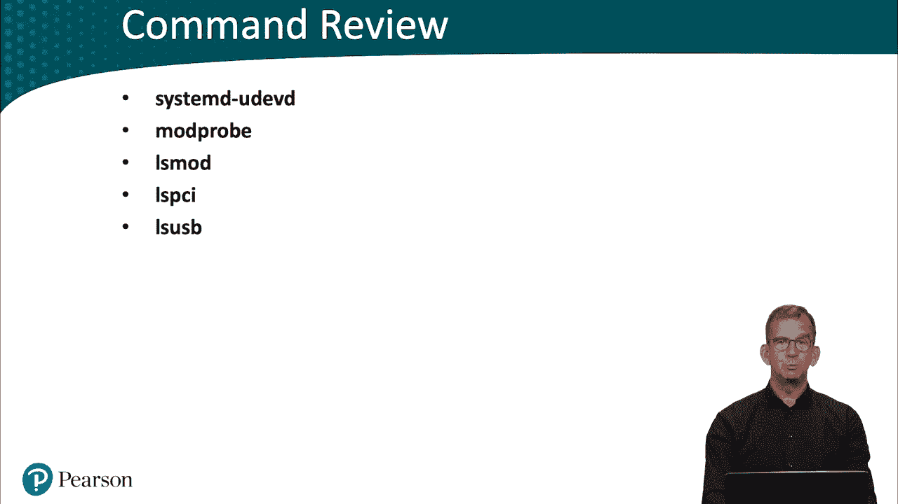

# 🐧 CompTIA Linux+ V8 命令复习：第20章：220-226 命令回顾

## 课程概述


在本节课中，我们将会一起学习 Linux 系统中几个非常实用的命令。这些命令可以帮助你查看和管理内核模块，也可以让你了解计算机硬件设备的当前运行状态。如果你刚开始接触 Linux 操作系统，那么这篇教程会用最直白的方式把这些概念讲清楚，让你即使没有经验也能快速上手。

## systemd-udevd 即插即用管理器


本节我们先来看看 systemd-udevd 是什么，以及它在系统中的具体作用。

systemd-udevd 是 Linux 系统里的即插即用管理器。当你把 U 盘、键盘或者鼠标这种设备插进电脑的时候，系统需要知道新设备的存在，并且要为它分配合适的设备文件。systemd-udevd 就是负责监听这些硬件变化，并在设备插入或拔出时自动完成配置的程序。你可以把它理解为系统里的“硬件迎宾员”，只要有新硬件到来，它就会立刻去处理，而不需要你手动去配置。

## modprobe 手动插入内核模块

上一节我们介绍了 systemd-udevd 作为即插即用管理器的职责，本节中我们来看看 modprobe 如何手动加载内核模块。

modprobe 是用来向 Linux 内核中手动插入模块的命令。内核模块就像是内核的插件，可以在不重启系统的情况下扩展内核功能，比如加载网卡驱动或者文件系统支持。使用 modprobe 你可以指定要加载的模块名称，系统就会自动去查找对应的模块文件并将其插入正在运行的内核中。

使用方式如下：

```bash
sudo modprobe 模块名称
```

## 查看内核模块和硬件设备

上一节我们学习了如何用 modprobe 手动插入内核模块，本节中我们来看看几个用于查看内核模块和硬件设备的命令。

以下是几个常用的查看命令：

- `lsmod`：列出当前系统中已经加载的所有内核模块，你可以用它来确认某个模块是否已经运行。
- `lspci`：显示计算机上所有 PCI 设备的信息，例如显卡、声卡和网卡等挂在 PCI 总线上的硬件。
- `lsusb`：显示 USB 总线上挂载的设备情况，让你知道哪些 USB 设备已经被系统识别。



## 本节总结

本节课中，我们一起学习了 systemd-udevd 即插即用管理器，学习了使用 modprobe 手动插入内核模块的方法，也学习了 lsmod、lspci 和 lsusb 这几个查看系统设备和模块的命令。希望这些内容能帮助你更好地理解 Linux 系统的底层硬件管理机制。

