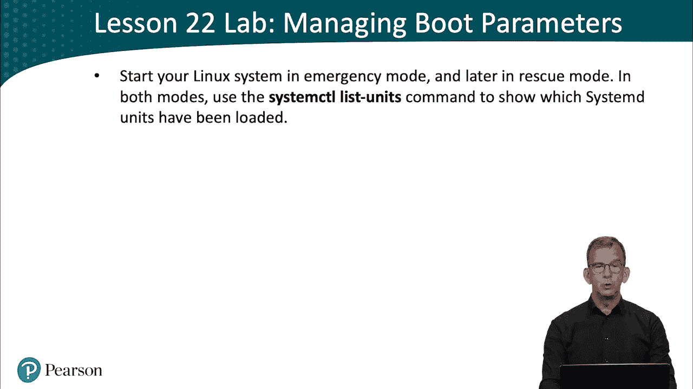

# CompTIA Linux+ V8：Lesson 22：管理引导参数 🛠️

在本节课中我们将要学习Linux系统引导参数的管理方法，重点是通过GRUB引导菜单来控制系统的启动方式，并且在两种特殊的启动模式下查看系统服务的加载情况。这节课不需要你有很深的Linux基础，我们会用最直白的语言把每一步都讲清楚，适合完全的初学者跟着操作。


本节课我们先整体了解一下这个实验的目标，然后再进入具体的操作步骤。整个实验的核心就是让你在两种不同的启动模式下检查系统，对比它们之间的差异，从而理解Linux系统启动的时候到底加载了哪些服务单元。


以下是本节课需要学习的主要内容：

- 在GRUB引导菜单中编辑启动参数并进入紧急模式
- 在紧急模式下使用 `systemctl list-units` 查看已加载的系统单元
- 重新启动系统并进入救援模式
- 在救援模式下同样查看已加载的系统单元
- 对比两种模式下系统单元加载情况的不同之处


接下来我们开始第一个步骤，也就是如何启动紧急模式。紧急模式是一种最小化的系统环境，通常用于系统出现严重故障时的紧急修复，在这种模式下只有最基本的系统服务会被启动，大部分服务都不会运行。


上一节我们介绍了GRUB引导菜单的基本概念，本节中我们来看看如何实际操作紧急模式。

以下是启动紧急模式的具体步骤：

1. 重启你的Linux计算机
2. 在启动过程中出现GRUB引导菜单时，选择你要启动的内核条目
3. 按下e键进入编辑模式
4. 在内核参数行的末尾添加 `systemd.unit=emergency.target`
5. 按下Ctrl+X或F10使用修改后的参数启动系统

其中核心启动参数可以用这个公式表示：

`内核启动参数 = 原始参数 + systemd.unit=emergency.target`


进入紧急模式之后，系统会给你一个根shell提示符，这时候你就可以查看系统当前加载了哪些服务单元。我们常用的命令是 `systemctl list-units`，它会列出当前系统中已经加载的所有unit文件，包括服务、挂载点、套接字等等。


上一节我们介绍了紧急模式的启动方法，本节中我们来看看如何在紧急模式下检查系统单元。

以下是在紧急模式下需要执行的命令：

```bash
systemctl list-units
```

这条命令运行后，你会看到一个列表，显示系统当前运行的各种单元。在紧急模式下，这个列表通常比较短，因为大部分服务都没有启动。


紧急模式操作完毕之后，我们需要重启系统，然后进入另一种模式，也就是救援模式。救援模式和紧急模式很像，但它会加载更多的系统服务，比紧急模式更适合做系统修复工作。


上一节我们介绍了紧急模式下的单元检查，本节中我们来看看如何进入救援模式并进行同样的操作。

以下是进入救援模式的步骤：

1. 重启计算机
2. 在GRUB菜单处按下e键编辑启动参数
3. 在内核参数行末尾添加 `systemd.unit=rescue.target`
4. 使用修改后的参数启动系统

救援模式的启动参数公式如下：

`内核启动参数 = 原始参数 + systemd.unit=rescue.target`


进入救援模式后，同样需要检查系统当前加载了哪些单元，我们还是使用 `systemctl list-units` 命令。


上一节我们介绍了救援模式的启动方法，本节中我们来看看在救援模式下查看系统单元。

以下命令在救援模式下执行：



```bash
systemctl list-units
```

执行这条命令后，你会得到一个单元列表。对比紧急模式的输出，你会发现救援模式下加载的单元更多一些，这反映了两种模式在系统服务加载上的不同。


现在我们有了紧急模式和救援模式下的两个单元列表，接下来就要对比它们之间的差异了。这个对比过程能帮助你理解systemd在不同启动目标下会加载哪些服务，也能让你更清楚Linux系统启动的整体流程。


以下是对比时需要关注的几点：

- 紧急模式下加载的单元数量通常较少
- 救援模式下会加载更多的基础系统服务
- 两种模式下都能使用 `systemctl list-units` 进行查看
- 通过对比可以发现systemd.target对系统服务加载的影响


本节课中我们一起学习了如何管理Linux引导参数，具体包括如何通过GRUB菜单进入紧急模式和救援模式，以及如何在这两种模式下使用 `systemctl list-units` 查看已加载的系统单元。希望这些内容能帮助你初步理解Linux系统启动时服务加载的差异，为后续的系统故障排查打下基础。

