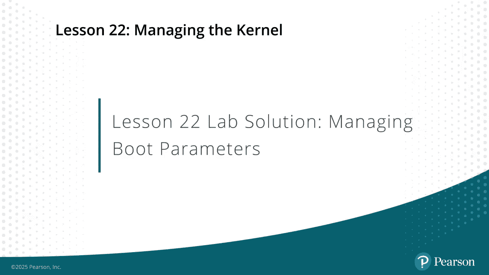

# CompTIA Linux+ V8：第22课：管理引导参数 🖥️

## 课程概述

在本节课中，我们将学习当Linux系统无法正常启动时该怎么处理。有时候电脑开机后卡在黑屏，或者根本进不了桌面，这时候就需要通过修改引导参数来进入紧急模式或救援模式，对系统进行排查和修复。我们将一起重启电脑，进入GRUB引导菜单，编辑内核启动行，进入最小化的紧急环境，再切换到功能稍微丰富一点的救援环境，最后学会如何重启回到正常使用状态。这整个过程就像给生病的系统做急救，掌握它对每个Linux学习者都非常重要，尤其是准备参加CompTIA Linux+认证的朋友。

## 第一步：重启并打开GRUB引导菜单

上一节我们介绍了系统启动的基本流程，本节中我们来看看如果系统无法正常启动该如何处理。

首先，我们需要重启计算机。重启的目的是为了激活GRUB引导菜单，这样我们才有机会在系统完全加载之前介入启动过程。当你重启电脑并看到启动画面时，请按下E键进入引导选项的编辑界面。在这个界面里，你可以修改系统启动时使用的参数，为接下来进入紧急模式做准备。

## 第二步：编辑引导参数进入紧急模式

以下是进入紧急模式的具体操作步骤：

- 在出现的编辑界面中，找到那行加载Linux内核的内容，通常以linux或vmlinuz开头。
- 将行末尾的rhgb和quiet这两个参数删除，它们原本用于隐藏启动信息，删除后可以看到更多详细输出。
- 在行末添加systemd.unit=emergency.target，这是启动最小化系统的方式，只保留最必要的硬件支持。
- 编辑完成后不要按回车键，而是使用Ctrl + X组合键直接以当前参数启动系统。

系统启动后，因为此时运行的是紧急模式，所以需要你输入root用户的密码才能登录。输入正确后，你就会进入一个只有最基础命令可用的命令行环境，这里就是紧急模式。

## 第三步：在紧急模式下查看系统单元

刚才我们进入了紧急模式，本节中我们来看看此时系统里到底加载了哪些服务。

在命令行中使用以下命令：

systemctl list-units

这条命令会把当前所有可用的systemd单元一个一个列出来。输出内容非常多，会分多个屏幕显示，你可以使用空格键向前翻页。按照演示，系统总共加载了98个单元。其中大部分都和硬件设备有关，而能够真正运行的服务非常少，只保留了最核心的必要服务，这就是紧急模式的特点，它只提供最基本的硬件访问能力。

## 第四步：从紧急模式切换到救援模式

刚才我们查看了紧急模式下的系统单元，本节中我们来看看如何切换到功能稍微丰富一点的救援模式。

使用以下命令启动救援目标：

systemctl start rescue.target

这条命令会把系统从emergency.target切换到rescue.target。切换过程中你会看到更多服务开始运行，屏幕上会出现更多输出信息。系统可能会再次要求你输入密码，输入完成后再次执行：

systemctl list-units

这一次你会发现可用的单元数量变多了，挂载点也已经可用，系统提供了一些基础的网络和文件系统支持，算得上是一个比较完整的最小操作系统环境。

这里有个有趣的现象，救援模式下的单元数量反而比紧急模式少。这是因为紧急模式处理硬件设备的方式比较特殊，它会尽量把所有硬件都映射出来，从而增加访问硬件的成功率。这就是紧急模式和救援模式之间的区别，紧急模式更倾向于让你拿到所有硬件的控制权。

## 第五步：重启回到正常模式

刚才我们完成了紧急模式和救援模式的操作，本节中我们来看看如何结束实验并回到日常使用。

当你完成排查或修复工作后，不要忘记输入以下命令：

reboot

执行reboot命令后，计算机会重新启动，并按照正常的引导流程加载系统，这样你就可以回到平时使用的图形界面或正常命令行环境了。千万不要跳过这一步，否则系统会一直停留在救援状态，无法正常使用。

## 课程总结

本节课中我们一起学习了如何通过修改引导参数来管理Linux系统的启动状态。我们重启系统并进入GRUB菜单，删除rhgb和quiet参数，添加systemd.unit=emergency.target进入紧急模式，使用systemctl list-units查看已加载单元，再用systemctl start rescue.target切换到救援模式，最后用reboot重启回到正常模式。希望这些步骤能帮助你在系统出问题时顺利进行排查和修复，掌握这个流程对日常运维和考试都非常有帮助。
