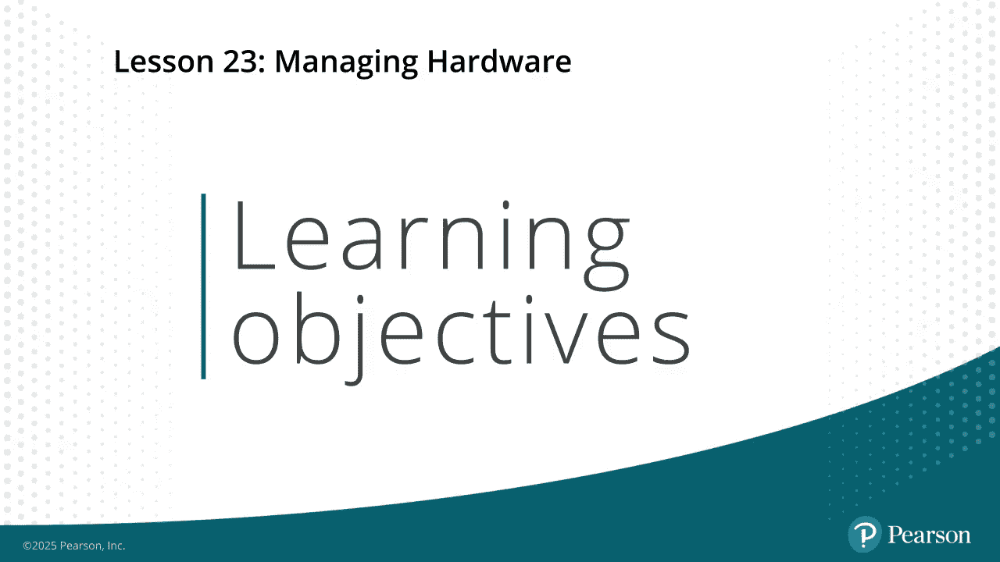
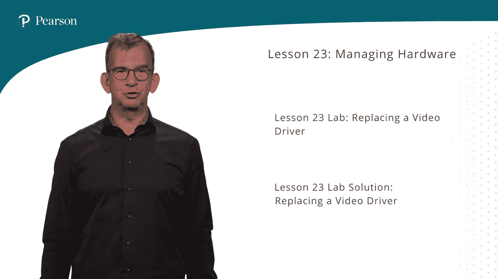

# 🖥️ CompTIA Linux+ V8：p23：硬件管理学习目标

在本节课中，我们将一起学习关于 Linux 硬件管理的基础内容。本节课的主要目标是让你了解系统是如何识别和管理硬件设备的，并掌握相关工具的使用方法，为后续的实验操作打下坚实的基础。无论你是刚接触 Linux 的新手，还是希望复习硬件管理知识的学习者，这节课都会用最直白的方式把关键点讲清楚。

在课程开始部分，我们会先观看一段关于 System D UFD PnP 管理器的视频。这段视频会介绍系统如何自动识别新插入的硬件设备，并为它们分配合适的资源，从而实现即插即用的功能。理解这一机制有助于你以后排查设备无法被识别的问题。



以下是本节课需要重点掌握的几个核心概念：

- System D UFD PnP 管理器：负责处理设备即插即用机制，实现硬件的自动识别与配置。
- 硬件设备列表工具：用于查看系统中当前连接的硬盘及其他设备信息。
- 属性查看方法：用于查询并显示特定硬件设备的详细参数和当前状态。

硬件管理能力可以用一个简单的公式来描述：

`硬件管理能力 = 设备列表工具 + 属性查看命令 + CPU 架构知识`

接下来，我们将学习如何列出连接到系统的硬盘设备，并查看它们的属性信息。这部分内容非常实用，因为在日常运维中，你经常需要确认硬盘是否被系统正确识别，以及查看它们的型号、容量等基本属性。掌握这些方法后，你就能快速定位存储设备相关的故障。

以下是常用的硬件设备列表与属性查看操作示例：

```
lsblk          # 列出块设备信息
lspci          # 列出 PCI 总线设备信息
lsusb          # 列出 USB 设备信息
cat /proc/cpuinfo  # 查看 CPU 详细属性
```

在进入实验环节之前，还有一段视频会讲解 CPU 架构之间的差异。这一部分内容非常重要，因为不同的 CPU 架构决定了系统能运行哪些软件，以及硬件驱动程序是否兼容。理解这些差异，有助于你在实际工作中选择合适的系统版本和软件包，避免安装错误的镜像。

以下是 CPU 架构差异的核心比较点：

- 指令集架构：决定 CPU 可以执行哪些机器指令，常见的有 x86_64 与 ARM 架构。
- 字节序：影响多字节数据在内存中的存储顺序，分为大端序与小端序。
- 寄存器宽度：决定 CPU 一次能处理多少位的数据，例如 32 位与 64 位架构的区别。

最后，我们将进入动手实验环节，让你有机会亲自练习硬件管理技能。在实验中，你可以尝试列出系统中的硬件设备，查看它们的属性信息，并尝试解决一些常见的硬件识别问题。动手操作是巩固知识最好的方式，建议你不要跳过这一步。

以下是实验环节建议练习的操作步骤：



1. 使用系统工具列出所有已连接的硬盘设备。
2. 查看选定硬盘设备的详细属性信息。
3. 记录 CPU 架构类型，并确认当前系统是否匹配该架构。
4. 尝试查找系统中未识别的设备，并分析可能的原因。

在本节课中，我们一起学习了硬件管理的学习目标，包括 System D UFD PnP 管理器的作用、硬件设备列表与属性查看工具的使用、CPU 架构差异的比较，以及实验环节的技能练习。希望这些内容能帮助你建立起对 Linux 硬件管理的初步认识。

