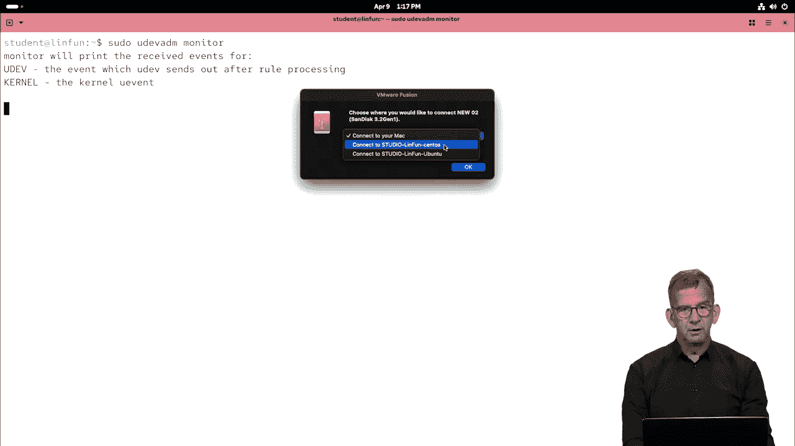

CompTIA Linux+ V8：224.231：systemd-udevd即插即用管理器 🔧

在本节课中，我们将要学习Linux系统里的systemd-udevd服务，这是一个专门负责即插即用硬件管理的组件。我们会先了解它的基本作用，然后看看udev规则文件应该放在哪里，接着学习如何使用udevadm monitor命令来追踪设备插拔时的系统事件，最后还会聊聊/sys文件系统与硬件管理之间的关系。整节课用大白话讲解，适合刚开始接触Linux设备管理的初学者，大家不用担心内容太难，跟着思路走就能明白。

什么是systemd-udevd以及它的工作原理

systemd-udevd是各大Linux发行版中的标准组件，它的核心职责就是处理系统中新插入的硬件设备。当你把U盘、鼠标或者键盘插到电脑上时，这个服务就会开始工作，确保这些设备能够被正确识别，并且按照合适的属性进行配置。它的运作方式并不神秘，主要是靠一套规则来决定，当某个具体的硬件设备被插入时，系统到底该采取什么样的动作。对普通用户来说，这个过程通常在后台自动完成，不需要手动干预，但搞清楚它的原理对排查硬件问题非常有帮助。

核心概念可以用下面的简单关系式来表示：

硬件设备插入 → systemd-udevd读取对应规则 → 设备被初始化并分配相应属性

这个流程展示了从物理插入到系统可用的完整路径，也是后面我们要讨论的排查思路的基础。

udev规则文件的存放位置

为了让systemd-udevd知道遇到不同硬件时该怎么做，系统会使用一组规则文件。这些规则定义了当某个硬件设备被插入时具体要发生什么，比如要加载哪个驱动模块、设置什么权限、创建什么设备节点等等。你可以把这些规则看成一本说明书，告诉系统遇到设备A就执行操作B，遇到设备C就执行操作D。

以下是常见的规则文件目录：

- /lib/udev/rules.d：存放系统安装包自带的标准规则
- /etc/udev/rules.d：存放用户自定义的规则

需要注意，/lib/udev/rules.d目录下的规则是由软件包安装的，不建议直接修改。如果你真的想添加自己的规则，请把文件放到/etc/udev/rules.d目录下。不过在这门课程中，自定义规则属于比较进阶的内容，我们暂时不深入展开，先掌握基础知识即可。

使用udevadm monitor观察设备事件

如果你想亲眼看看当插入硬件设备时系统内部发生了什么，udevadm monitor是一个非常方便的命令。它可以实时追踪内核和udev之间的事件交互，让你清楚地看到设备从被检测到被初始化的整个过程。对于排查“插入U盘却没有反应”这类问题来说，这个工具非常实用，能帮你快速定位到底是哪个环节出了问题。

下面是使用这个命令的方法：

```bash
udevadm monitor
```

运行这个命令后，终端会进入等待状态，直到有硬件事件发生才会输出信息。如果你什么都不做，它可能会一直等着，看起来好像没有任何反应，这属于正常现象，不必担心。

在虚拟机中插入U盘的实际演示

现在我们来看一个实际的例子。假设你正在使用虚拟机运行CentOS系统，并且想要把一个USB拇指驱动器，也就是U盘，连接进去。因为是在虚拟化环境下，你需要先在虚拟机软件里设置，把U盘连接到虚拟机，而不是只连接到宿主机。

以下是操作时可能看到的现象：

- 运行udevadm monitor后，终端处于等待状态
- 在虚拟机软件中将U盘连接到CentOS虚拟机
- 终端中出现一系列事件信息，显示USB设备正在被初始化
- 可以看到exFAT模块被加载
- 向上滚动查看，可以发现U盘被识别为类似sda1这样的设备节点

如果你插入USB设备后什么都没发生，这时候查看udevadm monitor的输出就能帮你找出问题所在，你可以看到具体发生了什么事件，或者根本没有事件，从而进行故障排查。

值得注意的是，udevadm monitor不仅在插入设备时有效，在拔出设备时也同样适用。当你拔掉U盘，终端里也会显示对应的硬件移除事件，这能帮助你确认系统是否正确识别了设备的拔除操作。

理解设备路径与/sys文件系统



有时候你会看到类似/devices/pci0000:00这样的设备路径，这可能看起来比较晦涩。实际上，这就是系统中用来表示硬件接口的路径。如果你想深入研究硬件是如何被Linux管理的，所有这些最终都关联到/sys文件系统中的文件。

简单来说，这几者之间的关系可以用下面的公式来表示：

/sys文件系统 → 硬件设备的抽象表示 → 系统用于硬件管理的接口

sysfs，也就是/sys目录，是Linux内核向用户空间导出硬件信息的一种方式。systemd-udevd背后的很多逻辑，最终都是通过读写/sys下的文件来实现硬件管理的。所以如果你想在Linux硬件管理方面深入钻研，熟悉/sys文件系统会是一个很好的切入点。


本节课中我们一起学习了systemd-udevd即插即用管理器的基本原理，了解了udev规则文件的存放位置，学习了如何使用udevadm monitor命令追踪设备插拔事件，还看了在虚拟机中插入U盘的实际演示，最后简单介绍了/sys文件系统与硬件管理的关系。希望这些内容能帮助你更好地理解Linux是如何处理硬件设备的，祝学习顺利。
