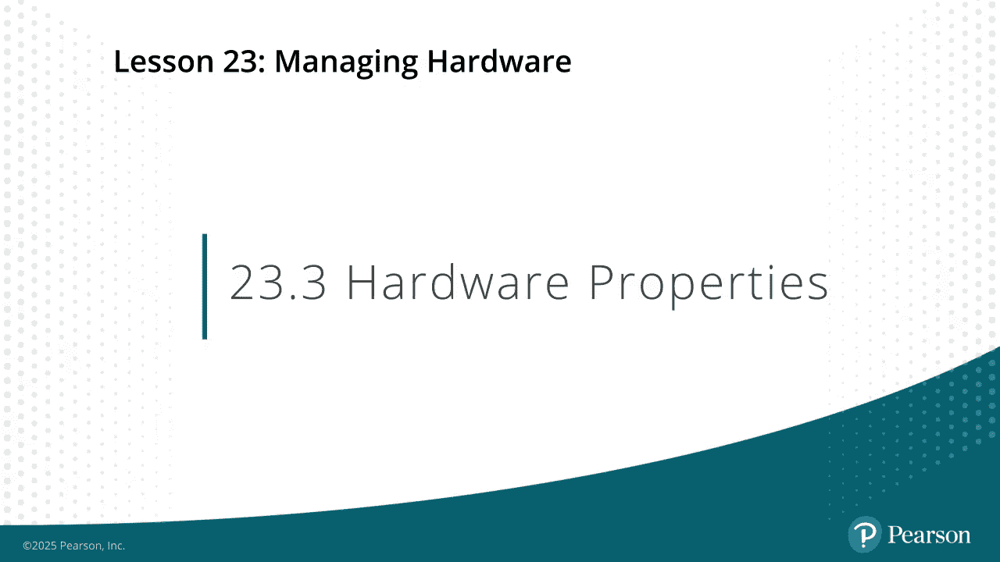
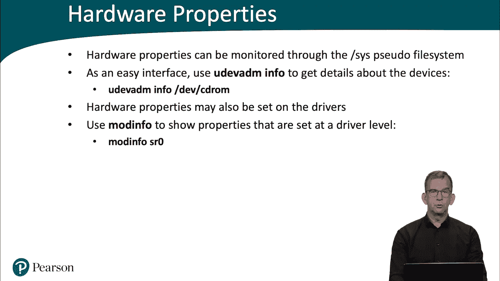
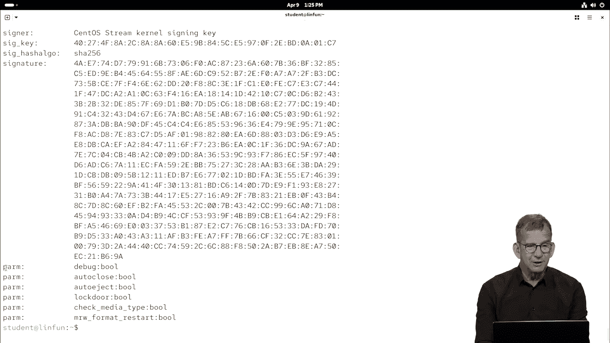
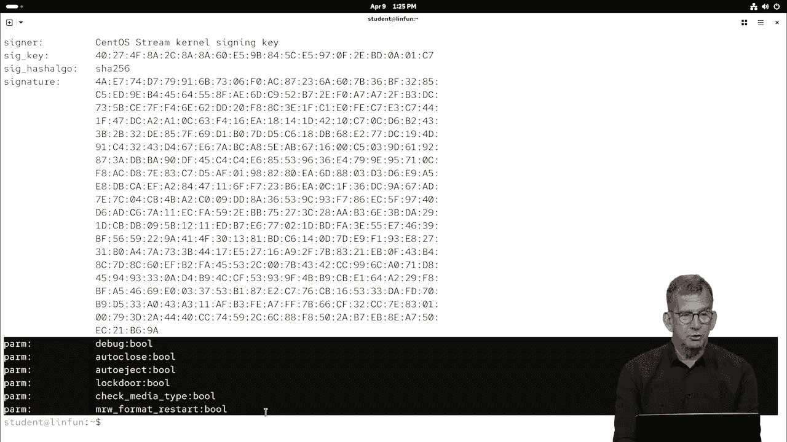
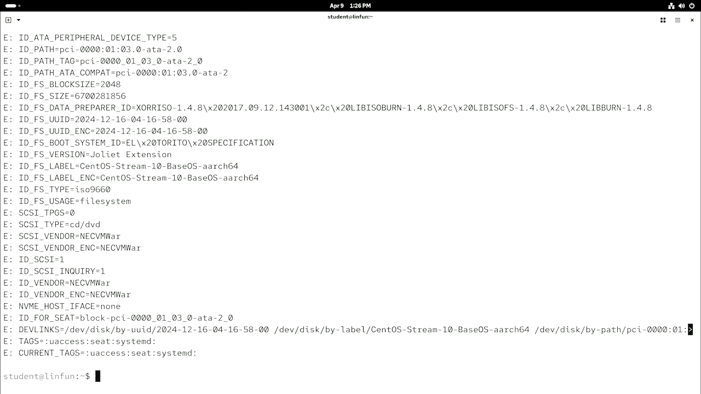

# CompTIA Linux+ V8：226-233：硬件属性🔧



## 课程概述

在本节课中，我们将要学习如何在 Linux 系统中查询和查看硬件属性。我们会先了解系统是怎么记录硬件信息的，接着看看驱动程序层面的参数，再学习怎么用简单的命令获取设备详情。最后我们会对比不同设备，比如光驱和网卡，看看它们的配置有什么区别。这些内容对初学者来说非常实用，因为日常排查硬件问题时，往往就需要用到这些命令。


### 一、查询硬件属性的基本方法

上一节我们可能介绍过一些基础的设备管理知识，本节中我们来看看怎么获取硬件属性。

在 Linux 里，硬件属性是通过 sysfs 这个伪文件系统来监控的。sysfs 就像是一个大仓库，把所有硬件的状态信息都放在里面。它作为一个简单的接口，让我们能够了解设备的当前状态。你可以使用 udevadm info 命令，因为它会替你读取这些信息，并把相关数据拿过来，省得你自己去折腾。不过，你会发现 sysfs 这个文件系统可能相当复杂，里面的目录层级很深，文件名也很奇怪，直接去翻找并不友好，很容易迷路。所以更好的做法是使用 udevadm info 这类命令，直接针对 /dev/ 下的设备节点来查询，这样更快也更准。

以下是查询硬件属性的常用命令示例：

```bash
udevadm info --query=all --name=/dev/sr0
```

这条命令会告诉你关于光驱设备的各种属性，省得你手动在系统目录里找半天。


### 二、从驱动程序层面查看信息



刚才我们介绍了怎么用 udevadm info 查询设备属性，本节中我们来看看驱动程序本身的参数。

其实硬件属性有时候也会设置在驱动程序上，也就是说，设备怎么工作，不只看设备本身，还要看控制它的驱动程序。如果属性是在驱动里设置的，你可以使用 modinfo 命令，它会显示驱动程序正在使用的相关信息，帮你搞清楚底层发生了什么。比如，如果你想看看光驱设备发生了什么，modinfo 在 sr0 上应该就能派上用场。让我来演示一下。

我们先从较低的层级开始，也就是驱动程序层面，我会使用 sudo lsmod | grep sr 来查看。这里的 sr 通常就是你的光驱设备，我能看到 cdrom 这个模块，正好是我需要的。于是我使用 modinfo 针对 cdrom 模块，我们就能看到这个驱动程序存在的不同参数。

以下是相关操作命令：

```bash
sudo lsmod | grep sr
modinfo cdrom
```



这些参数决定了驱动程序的使用方式。对于光驱来说，这些参数并不怎么引人注目，没什么特别的，因为光驱现在用得比较少了，配置也比较简单。


### 三、网卡设备的参数示例



刚才我们看了光驱的驱动参数，本节中我们来看看网卡的情况会有什么不同。

网卡和光驱不一样，它一直在工作，跟网络连接息息相关，所以配置会多一些。如果你对网卡做同样的操作，比如我的 E1000 网卡，就会看到更有意思的设置。在那里，我们可以看到决定网卡工作方式的选项，比如双工设置，这个东西有点老旧了，早期的网卡经常用到，当然还有其他可能可用的设置。所以，有时候如果网络出了问题，连不上网或者速度很慢，可能跟这些驱动程序的参数有关，值得检查一下。

以下是查看网卡驱动信息的示例：

```bash
modinfo e1000
```


### 四、使用 udevadm info 查看详细设备属性

前面我们分别看了驱动程序参数和基本设备属性，本节中我们来看看怎么获取更详细的信息。

如果你想更详细地了解发生了什么，udevadm info 很有用，它能把设备的方方面面都列出来。我可以在光驱上使用 sudo udevadm info，这样我们就能看到为这个光驱设备设置的所有不同属性，而且信息非常全面。我正在使用设备接口文件来获取这些信息，就像是打开一扇窗户，直接看到设备内部的状态。如你所见，第一行实际上使用了一个深藏在 /sys/devices/ 目录中的文件，这个目录藏得很深，普通用户很难自己找到，而设备的所有属性都直接显示在这里，一目了然。

以下是查看详细属性的命令：

```bash
sudo udevadm info --query=all --name=/dev/sr0
```


### 五、建议与总结

刚才我们介绍了怎么用 udevadm info 查看设备属性，本节中我们来看看最后的建议。

我肯定会建议，如果你需要知道更多关于设备的信息，就用 udevadm info 来查看。它比你自己去探索 /sys/ 目录要容易得多，也更直接，不用在成千上万的文件里面瞎找，一条命令就搞定。

## 本节总结



本节课中，我们一起学习了如何在 Linux 中查询硬件属性。我们了解了 sysfs 伪文件系统的作用，学会了使用 udevadm info 和 modinfo 命令，查看了光驱和网卡的驱动程序参数，还掌握了怎么用设备接口文件获取详细属性。希望这些内容能帮助你更好地理解和管理 Linux 下的硬件设备。

