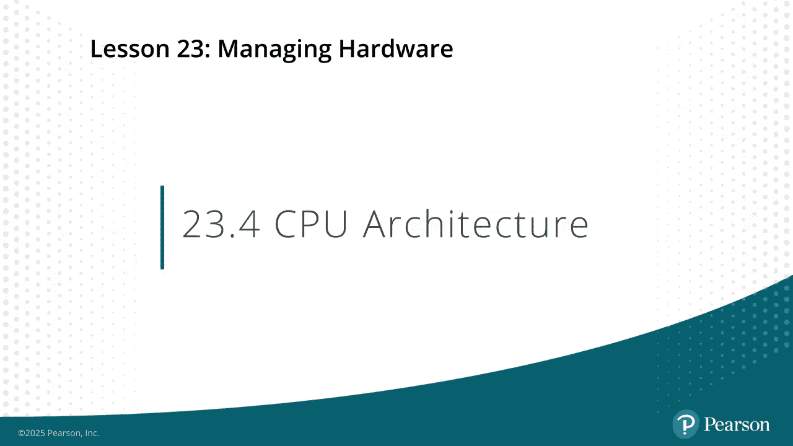
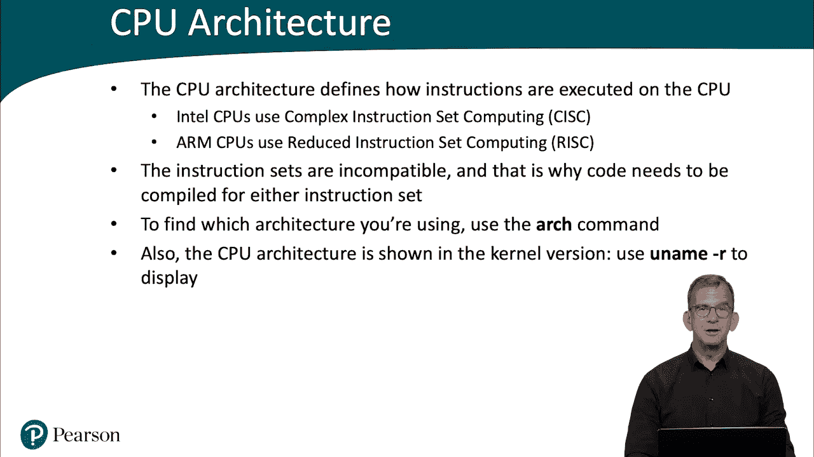
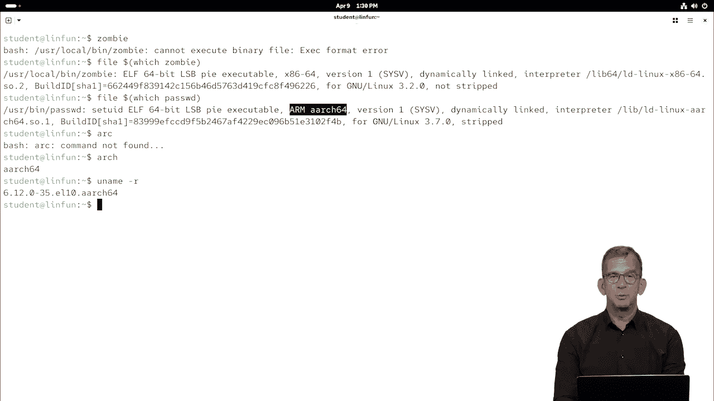

# CompTIA Linux+：227：CPU 架构基础 🖥️

在本节课中，我们将一起学习 CPU 架构的基础知识，弄清楚为什么有些程序跑在 Intel 处理器上没问题，却在 ARM 处理器上直接报错，还会学习如何在 Linux 系统里查看当前的架构信息。为了让初学者也能轻松看懂，我会用尽可能大白话的方式来解释这些概念，并且多举一些实际中的例子，让你在读完之后知道遇到架构不匹配的问题时该怎么排查。


## CPU 架构到底是指什么

上一节我们可能介绍过一些 Linux 基础命令，本节中我们来看看 CPU 架构这个核心概念。简单来说，CPU 架构决定了处理器是如何执行指令的。你可以把它理解为 CPU 能听懂的“语言”，不同的 CPU 厂商设计了不同的指令集，也就是 CPU 能够理解和执行的命令集合。

如果一段程序是针对某一种架构编译的，它通常无法在另一种架构的处理器上直接运行。这个问题在实际使用中非常常见，特别是当我们使用不同种类的服务器、虚拟机或开发板时。很多时候，明明下载了软件却无法启动，报出莫名其妙的错误，背后往往就是架构不匹配在起作用。


## 指令集为什么不兼容

在了解了 CPU 架构的基本意思之后，本节中我们来看看为什么不同架构之间无法互通。目前主流的 CPU 架构主要分为两大阵营，它们的设计理念截然不同，以下是主要的区别：

- Intel 系列 CPU 使用复杂指令集计算，即 `CISC`（Complex Instruction Set Computing）。
- ARM 系列 CPU 使用精简指令集计算，即 `RISC`（Reduced Instruction Set Computing）。

这两种指令集彼此不兼容，也就是说，为 Intel 架构编译的二进制程序无法在 ARM 架构的 CPU 上运行，反过来也一样。因此，开发者必须针对目标架构分别编译代码，才能保证程序能够正常工作。这就是为什么同一个软件，往往需要提供多个不同的安装包或镜像文件。


## 如何查看当前系统的架构



知道了指令集不兼容的原因之后，本节中我们来看看在实际操作中如何确认自己所用的架构。在 Linux 系统中，我们有几种简单的方法可以查看当前运行的 CPU 架构，以下是常用的几种方式：

- 使用 `arch` 命令，它会直接输出当前系统的架构名称。
- 使用 `uname -r` 命令，查看当前内核版本，其中通常也包含架构信息。
- 使用 `file` 命令检查具体的可执行文件，它会告诉你该文件是为哪种架构编译的。


## 实战：遇到 Exec format error 该怎么办

在了解了查看架构的命令之后，本节中我们通过一个实际的例子来看看架构不匹配会导致什么后果。假设我们在一台 ARM 架构的机器上尝试运行一个名为 `zombie` 的程序，结果会出现这样的错误提示：

```bash
cannot execute binary file: Exec format error
```

这个“Exec format error”错误明确告诉我们，我们正在尝试在错误的架构上运行该程序。为了进一步确认问题所在，我们可以使用 `file` 命令来检查这个二进制文件：

```bash
file zombie
```

命令输出会显示该二进制文件是为 `x86_64` 架构编译的，而这正是问题的根源。因为我们当前的系统运行在 ARM 架构上，无法直接执行 x86_64 的二进制文件。

为了对比，我们可以检查系统中自带的其他程序，比如 `pwd`：

```bash
file /usr/bin/pwd
```

这时你会看到 `pwd` 是为 `arm64` 架构编译的，这说明它与当前系统的架构是匹配的，因此可以正常运行。通过 `file` 命令，我们可以清楚地知道任意一个二进制文件是在哪种架构上创建的，从而快速定位兼容性问题。

除了 `file` 命令，我们也可以直接使用 `arch` 来查看自己当前所在的架构，或者使用 `uname -r` 查看内核版本中的架构标识。这些工具都能提供足够的信息，让我们知道自己只能使用针对对应架构编译的程序。


## 实际使用中的注意事项

在学习完如何查看架构之后，本节中我们来聊聊实际使用中需要注意的事情。在日常工作中，绝大多数 Linux 程序默认都能在 Intel 架构上完美运行。但是，如果你正在使用基于 ARM 架构的虚拟机或设备，偶尔也会遇到一些从外部获取的程序无法正常运行，并且报出“Exec format error”错误。

这种情况虽然不常见，但一旦发生，通常就是因为该程序是为 Intel 架构编译的，而你的系统运行在 ARM 架构上。遇到这种问题时，不要慌张，先用 `file`、`arch` 或 `uname -r` 检查一下架构信息，然后尝试寻找针对 ARM 架构编译的版本，或者在兼容的环境中重新编译该程序即可。


## 总结



本节课中，我们一起学习了 CPU 架构的基本概念，了解了 Intel 使用 CISC 而 ARM 使用 RISC 导致指令集不兼容的原因，也掌握了如何使用 `arch`、`uname -r` 和 `file` 命令来查看系统架构以及二进制文件的编译目标。希望这些内容能帮助你在实际使用 Linux 时更好地处理架构兼容性问题。

