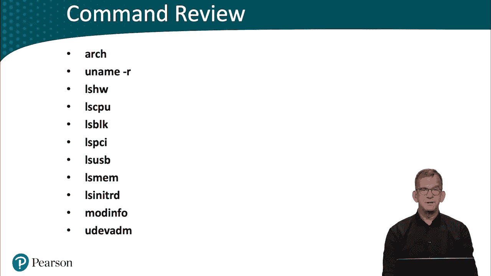

# CompTIA Linux+ V8：228-235：命令复习 🖥️

## 本节课概述

在本节课中我们将要学习一组用于查看 Linux 系统信息的命令。这些命令可以帮助你查询计算机的架构、内核版本、硬件设备、CPU、内存、PCI 设备、USB 设备、初始化文件系统以及内核模块参数等内容。无论你是刚开始学习 Linux 的新手，还是正在准备 CompTIA Linux+ 考试的考生，掌握这些基础命令都是非常必要的，因为它们能让你快速了解系统运行在什么样的硬件环境之上。

## 系统架构与内核信息命令

上一节我们介绍了基本的文件和目录操作命令，本节中我们来看看如何查询系统的底层信息。首先，我们需要知道如何获取计算机的架构和内核版本，这是理解系统运行环境的第一步。

以下是查询系统架构和内核信息的命令：

- `arch`：用于显示系统的架构信息，比如你的处理器是 64 位还是 32 位。
- `uname -R`：用于显示内核相关的版本信息，让你知道当前运行的是哪个内核发行版。

使用这两个命令非常简单，直接在终端中输入命令名称并回车，就可以立即看到输出结果，不需要复杂的参数配置。

## 硬件设备信息命令

在了解了系统架构和内核之后，我们接下来要看的是如何查看计算机的硬件设备。硬件信息包括主板、内存、CPU、磁盘、PCI 设备、USB 设备等等。初学者可以把这些命令当成是给电脑做“体检”的工具，帮助你搞清楚机器里到底装了什么。

以下是常用的硬件信息查询命令：

- `lshw`：列出大量关于你硬件的详细信息，涵盖从主板到外设的几乎所有部分。
- `lscpu`：专门用于显示 CPU 的相关信息，比如核心数、频率、架构等。
- `lsblk`：用于查看块设备信息，比如硬盘、分区等存储设备。
- `lspci`：用于显示 PCI 总线上的设备信息，比如显卡、网卡等插在主板上的硬件。
- `lsusb`：用于显示 USB 设备信息，比如鼠标、键盘、U 盘等外接设备。
- `lsmem`：用于显示系统内存的使用情况和相关信息。
- `lsinitrd`：用于查看 initramfs 系统中包含的内容，了解启动时加载的内核镜像。

每个命令都有自己的侧重点，你可以根据实际需求选择使用。比如想知道内存多大就用 `lsmem`，想看 USB 接口连接了什么就用 `lsusb`，想看启动镜像里有什么就用 `lsinitrd`。

## 内核模块与设备管理命令

除了查看硬件信息，有时我们还需要知道内核模块使用了哪些参数，或者想要通过更友好的方式查看设备。这时候就需要用到模块信息命令和设备管理器了。

以下是两个比较实用的命令：

- `modinfo`：可以用来获取内核模块所使用的参数信息，帮助你理解某个驱动模块是如何配置的。
- `udevadm`：这是一个访问系统 udevd 即插即用管理器的良好界面，用于获取关于硬件设备的详细信息。

这两个命令稍微偏向进阶一些，但也非常实用，特别是在排查硬件驱动问题时经常会用到，建议多花些时间熟悉。

## 本节课总结

本节课中我们一起学习了 `arch`、`uname -R`、`lshw`、`lscpu`、`lsblk`、`lspci`、`lsusb`、`lsmem`、`lsinitrd`、`modinfo` 和 `udevadm` 这些命令。它们分别用于查看系统架构、内核信息、硬件设备、CPU、内存、PCI/USB 设备、初始化镜像、内核模块参数以及设备管理信息。掌握这些命令后，你就可以快速了解 Linux 系统运行在什么样的硬件环境之上，为后续的系统管理和故障排查打下坚实基础。
