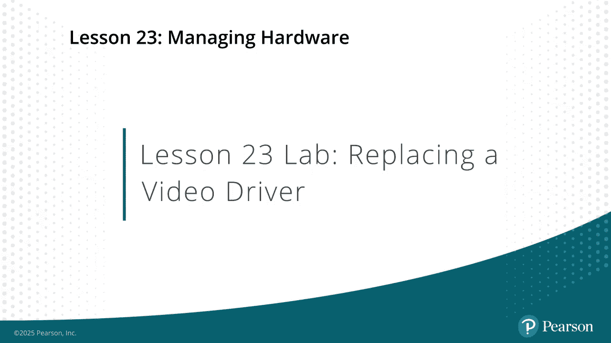
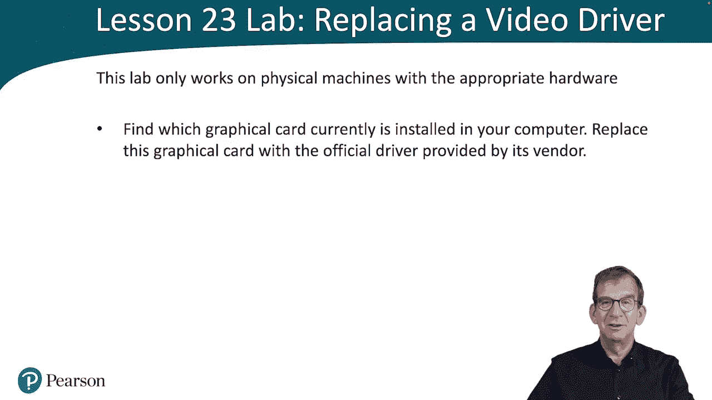

# CompTIA Linux+ V8：第23课：替换显卡驱动 🖥️

## 课程概述


在本节课中，我们将要学习如何在 Linux 系统里替换显卡驱动程序。显卡是电脑中负责处理图像显示的硬件设备，而驱动程序则是操作系统跟显卡沟通时用的“翻译软件”。如果驱动程序不合适，可能会出现屏幕分辨率不对、图形界面启动失败，甚至整个系统画面花屏的情况。本节课我们会一起动手，先找出电脑里目前安装的是哪块显卡，再把它换成显卡厂商官方提供的驱动，让系统能更稳定地运行。这对学习 Linux 系统维护来说是一个非常实用的技能，建议大家认真跟随讲解。


## 准备工作与实验环境



在开始动手之前，我们需要先聊聊这次实验的特殊情况。这次的实验不像平时那样可以在任何电脑上做，它只能在真实的物理机器上运行，而且你的机器必须装有合适的显卡硬件。如果你现在只是用虚拟机练习，或者电脑里没有对应的硬件设备，那么直接看视频讲解也完全没问题，因为整个操作流程本身就很有意思，值得我们花时间去理解。

以下是适合做这个实验的前提条件：
- 物理计算机，而不是虚拟机
- 合适的显卡硬件设备
- 显卡厂商提供的官方驱动程序

通过上面列出的条件，你可以自己判断是否具备动手实践的环境。如果暂时还不具备，先观摩学习也是完全可以接受的，不需要勉强自己去操作。


## 核心操作步骤

接下来，我们来看看本节课具体要完成哪些任务。整个实验的主要内容分为两个部分：首先是找出电脑里当前安装的是什么显卡，然后是把它替换成显卡厂商官方提供的驱动程序。

以下是具体的操作流程：
1. 检测系统中当前安装的显卡硬件信息
2. 下载对应厂商提供的官方驱动程序
3. 卸载旧驱动并安装新驱动
4. 验证新驱动是否正常工作

在 Linux 系统中，我们可以把显卡驱动替换的核心思路用下面这个公式来描述：

系统稳定性 = 当前硬件型号 ∩ 厂商官方驱动版本

这里的符号 ∩ 表示我们需要让硬件型号和驱动版本完全匹配，才能达到最好的运行效果。如果两者不匹配，系统可能无法正确识别显卡，导致图形界面出现异常。

用代码形式表示这个替换逻辑，就像下面这样：

```text
当前驱动 = 检测系统显卡
新驱动 = 厂商官方驱动
替换(当前驱动, 新驱动)
```

上面的代码虽然很简单，但它把我们要做的事情说得很清楚：先找到旧驱动，再用新的官方驱动把它换掉。


## 实践开始

好了，理论部分就讲到这里，下面我们就开始动手操作。请按照刚才介绍的步骤，在你的物理机器上逐一完成。如果你遇到任何问题，可以先暂停下来，仔细检查每一步是否都做对了。

让我们开始吧。




## 课程总结

本节课中，我们一起学习了如何替换电脑中的显卡驱动程序。我们了解了这个实验需要在物理机器和合适硬件上进行，也明确了操作的核心步骤：先查找当前安装的显卡，再用厂商官方驱动进行替换。希望大家通过本节课的学习，能够掌握 Linux 显卡驱动更换的基本方法，为后续的系统维护打下基础。

