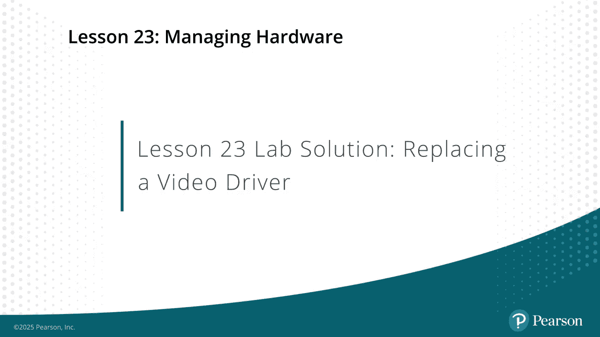
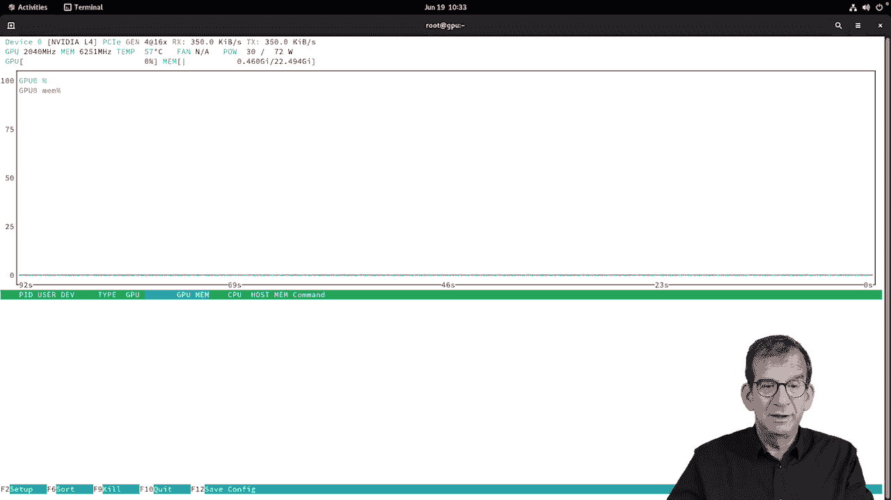

# CompTIA Linux+ V8:23:替换视频驱动程序🖥️




## 概述

在本节课中我们将要学习如何在 Fedora 系统上替换视频驱动程序。具体目标是把开源的 nouveau 驱动替换成 NVIDIA 的专有驱动，这样才能在 NVIDIA L4 GPU 上使用 CUDA 进行人工智能计算。我们会先通过远程连接查看当前显卡使用的是什么驱动，然后添加需要的软件仓库，安装新驱动，重启系统，最后验证驱动是否已经生效。整个过程适合初学者，不需要深厚的 Linux 基础，跟着步骤操作即可完成。


## 第一步：连接远程主机并查看当前显卡信息

首先，我们需要通过安全外壳协议打开一个会话，连接到远程机器。这台远程机器的名字叫做 GPU。连接成功之后，我们先要看看系统当前正在使用哪个显卡驱动。

以下是查看 PCI 总线和内核模块的命令：

```bash
lspci -k
```

这条命令会列出系统中的 PCI 设备，并且显示每个设备当前正在使用的内核模块。执行之后，你会看到一个 3D 控制器，它是一块 NVIDIA L4 GPU。这块显卡专门用于小规模的人工智能计算，属于比较昂贵的硬件。不过这里有个问题，系统现在正在使用 nouveau 驱动。对于想要在 NVIDIA 显卡上跑 AI 任务的用户来说，这个开源驱动不够用，因为 CUDA 这个关键功能只在 NVIDIA 的专有驱动里提供，nouveau 是不支持的。


## 第二步：添加 RPM Fusion 软件仓库

既然 nouveau 驱动无法满足需求，我们就需要安装 NVIDIA 的官方专有驱动。在 Fedora 系统上，安装这类闭源驱动通常需要借助 RPM Fusion 软件仓库。

以下是需要添加的仓库类型：

- RPM Fusion 免费仓库，用于提供额外的 RPM 软件包。
- RPM Fusion 非免费仓库，专门提供闭源软件包，其中就包含了 NVIDIA 显卡驱动。

添加完这些仓库之后，系统就能从正确的来源下载和安装驱动程序。这是一个必要的前置步骤，如果没有这些仓库，后面的安装命令就无法找到对应的软件包。


## 第三步：安装 NVIDIA 驱动和 CUDA

软件仓库准备好之后，接下来就可以安装驱动程序了。根据你要安装的驱动类型以及所使用的 Linux 发行版，具体的软件包名称可能会有所不同，所以在实际操作前做一些调研是很重要的。

以下是本次操作中使用的安装命令：

```bash
dnf install -y akmod-nvidia xorg-x11-drv-nvidia cuda
```

这条命令会同时安装好几个组件。akmod-nvidia 负责自动编译内核模块，xorg-x11-drv-nvidia 是 X 窗口系统所需的 NVIDIA 驱动部分，cuda 则是 NVIDIA 的并行计算平台。安装过程大约会下载几个 GB 的数据，完成之后，系统里除了显卡驱动之外，还会包含 CUDA 框架的相关代码。

由于我们添加的是新仓库，系统会提示你导入该仓库的 GPG 密钥，确认是即可，之后只需要等待下载和安装完成。过程中你可能会看到一些弃用警告消息，这表示某些功能不再推荐使用，但依然可以正常工作，不用太担心。


## 第四步：更新 initramfs 并重启系统

驱动安装完成之后，还需要让新驱动在系统启动时就能被加载。为此，我们需要更新 initramfs 镜像。

以下是执行命令：

```bash
dracut -f
```

在较旧的 Fedora 版本中，你可能还需要使用 `akmods --force` 强制重建模块，但在现代 Fedora 上通常不再需要。这条命令会重新生成 initramfs，检测所有硬件，并确保新安装的 NVIDIA 驱动被正确反映在启动镜像中。这个过程可能需要花一点时间，请耐心等待。

更新完成之后，重启是不可避免的步骤。只有重启之后，系统才会使用新的显卡驱动。


## 第五步：验证驱动安装结果

系统重启之后，我们需要确认 NVIDIA 驱动是否已经成功加载。为了方便操作，这里建议打开一个 root 权限的 shell。

以下是验证命令：

```bash
lspci -k
```

执行之后，查看内核模块部分，如果你看到 `nvidia_drm` 和 `nvidia` 相关条目，就说明驱动已经安装成功了。

要进一步测试显卡是否被正确识别，可以使用 NVIDIA 提供的管理工具：

```bash
nvidia-smi
```

`nvidia-smi` 会显示系统当前检测到的所有 NVIDIA 硬件信息。在这里，你应该能看到 NVIDIA L4 GPU 已经被完美识别，这意味着整个驱动替换过程已经圆满完成。


## 附加内容：安装 nvtop 监控工具

作为一个额外的小奖励，安装过程中 DNF 也顺便把 `nvtop` 装上了。这是一个非常实用的工具，如果你经常需要关注 NVIDIA 硬件的运行状态，它会很有帮助。

以下是安装命令：

```bash
dnf install -y nvtop
```

运行 `nvtop` 之后，你可以实时查看 GPU 的活动情况。现在 GPU 可能还什么都不在做，但如果你之后要跑 AI 训练或其他图形密集型任务，这个工具就是监控性能的首选。


## 总结



本节课中我们一起学习了如何在 Fedora 上替换视频驱动程序。我们首先通过 SSH 连接到远程主机，用 `lspci -k` 查看了当前使用的 nouveau 驱动，接着添加了 RPM Fusion 的免费和非免费仓库，安装了 `akmod-nvidia`、`xorg-x11-drv-nvidia` 和 `cuda` 包，更新了 initramfs 并重启了系统，最后用 `lspci -k` 和 `nvidia-smi` 验证了 NVIDIA 驱动安装成功，还顺便介绍了 `nvtop` 监控工具。希望通过这节课，你已经掌握了在 Linux 上更换专有显卡驱动的基本流程。

